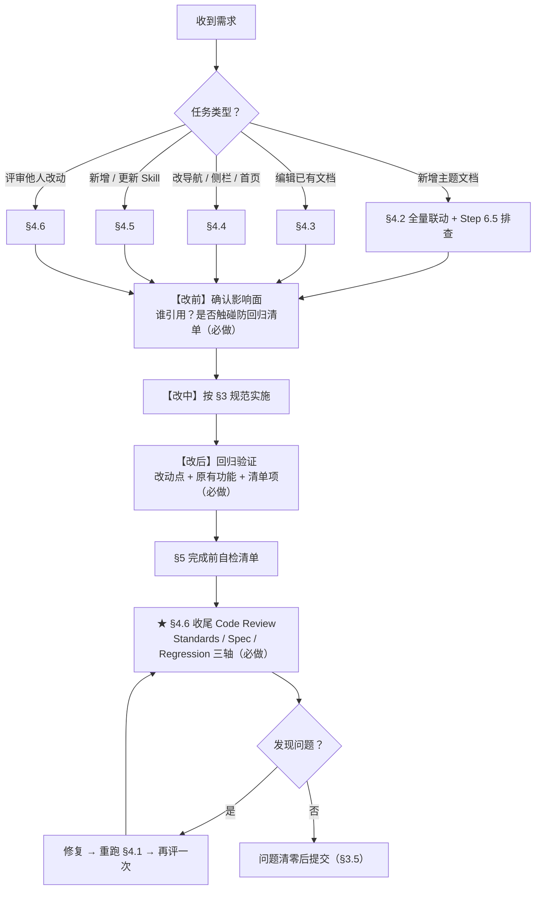

# AGENTS.md

> 本仓库的**代理工作规范**：能改什么（边界）、怎么写（规范）、按什么顺序做（流程）。站点介绍与首页区块清单见 `README.md`。
>
> **铁律一**：改样式、补内容、加需求，都不得影响既有正常功能；已修复过的 bug 不得被覆盖或回退（§2.4 / §2.5）。
> **铁律二**：每次任务 / 对话收尾必须执行一次收尾 Code Review（§4.6），发现问题就修复并复验，不得带问题收尾。

> **配套细节（示例 / 排查命令 / 三轴详程 / 首页实现细则）**统一放在 `.agent-reference/` 下：详见 `agent-guide-details.md`（文档骨架、Skill 样例、新增文档排查与清单、Code Review 三轴详程）与 `homepage-implementation-notes.md`（首页网格 / 技术栈面板 / 动效的实现原理与自查口径）。本文件只保留关键规则。

## 0. 项目概览

`solution` 是 **VitePress 文档站**：内容全部来自本仓库已有的 Markdown，站点工程只负责「渲染 + 导航 + 主题」。`srcDir` 即仓库根目录，`README.md` 由 `srcExclude` 排除、不生成页面。

**技术栈**：VitePress `2.0.0-alpha` + Vue 3 + `@voidzero-dev/vitepress-theme`（`viteplus` 变体）+ Tailwind 4 + GSAP 3（首页动效）+ reka-ui；包管理器锁定 **pnpm 10**（禁 npm / yarn）。部署：推送 `main` → `.github/workflows/deploy-docs.yml` → GitHub Pages 子路径 `/solution/`。

**常用命令**：

```bash
pnpm install     # 安装依赖
pnpm run dev     # 本地开发，http://localhost:5173
pnpm run build   # 构建校验：md 语法、花括号插值、死链等在此暴露 —— 任何改动结束前必须能通过
pnpm run preview # 预览构建产物
```

> **执行约定**：以上命令以及一切脚本，都**一律后台运行**（启动即返回，不阻塞后续任务），需要结果时再读日志 / 输出；禁止前台阻塞等待（细则见 §4.1）。

## 1. 目录地图与真相源

| 路径                                                   | 职责                                                                                      | 可改性             |
| ------------------------------------------------------ | ----------------------------------------------------------------------------------------- | ------------------ |
| `fundamentals/` `frameworks/` `engineering/` `career/` | 正文分类：Web 基础 / 框架与端 / 工程化与适配 / 职业成长                                   | ✅ 正文            |
| `roadmaps/`                                            | 学习路线索引页（PDF 原件在 `public/roadmaps/`）                                           | ✅ 索引，PDF 不改  |
| `public/`                                              | 静态资源，构建时**原样**复制到站点根（含 SEO 用的 `robots.txt`）                          | ✅ 新增图片 / PDF  |
| `.vitepress/config.mts`                                | **导航 / 侧边栏 / 页脚 / head / SEO / markdown 扩展的唯一真相源**                         | ✅ 维护级          |
| `.vitepress/theme/`                                    | 自定义主题：`index.ts`、`Layout.vue`、`styles.css`、`components/`、`data/`、`animations/` | ✅ 维护级          |
| `.vitepress/theme/data/topics.ts`                      | **首页索引数据唯一真相源**（`topicGroups` / `categories` / 统计常量）                     | ✅ 维护级          |
| `.agents/skills/<name>/`                               | **Skill 真相源**（`SKILL.md` + `references/` + `agents/`）                                | ✅                 |
| `.codebuddy/skills/<name>`                             | 指向上者的 **Junction**（供 CodeBuddy 发现）                                              | ⚠️ 只改链接        |
| `skills-lock.json`                                     | 第三方 Skill 的来源与哈希                                                                 | ✅ 新增时同步      |
| `.github/workflows/`                                   | Pages 发布流水线                                                                          | ✅ 维护级          |
| `README.md` / `index.md`                               | 仓库说明 / 首页入口                                                                       | ✅                 |
| `.vitepress/dist`、`.vitepress/cache`、`node_modules`  | 构建产物与依赖，已 gitignore                                                              | ❌ 禁止手改 / 提交 |

> 一句话：**内容在分类目录，导航在 `config.mts`，首页在 `data/*.ts`，Skill 在 `.agents/skills/`**——四者交叉引用的部分必须同步改。

## 2. 边界（Boundaries）

### 2.1 可以直接做

- 新增 / 编辑 `<分类>/<主题>/index.md` 正文。
- 在 `config.mts` 的 `sidebar` / `nav` / `footer` 登记页面。
- 在 `.vitepress/theme/data/` 同步首页索引与统计数字。
- 向 `public/` 增加图片、PDF 等静态资源。
- 在 `.agents/skills/` 下新增本地 Skill。

### 2.2 禁止 / 不要做（除非用户明确要求）

- ❌ 手改或提交 `.vitepress/dist`、`.vitepress/cache`、`node_modules`。
- ❌ 改 `public/roadmaps/*.pdf` 等二进制原件（只加不改）。
- ❌ 在 `.codebuddy/skills/` 另写一份内容（它是 Junction，改内容要改 `.agents/skills/` 的源）。
- ❌ 改第三方 Skill（`code-review` / `vitepress` / `vue-best-practices`）的 `SKILL.md` 与 `references/`——改动会与 `skills-lock.json` 哈希失配；需定制请**新建**自己的 Skill。
- ❌ 升级 `vitepress`、`@voidzero-dev/vitepress-theme`、`vue` 等核心依赖。
- ❌ 改 `srcDir`、删除 `srcExclude: ['README.md']`、改动首页布局骨架（`Layout.vue` / `Home.vue` 的区块顺序）。
- ❌ 手动把正文 `{{PLACEHOLDER}}` 改写成 HTML 实体或 `<code>`——渲染期由 `config.mts` 统一转义，源文件必须保持原样。
- ❌ 使用 `npm` / `yarn`；提交密钥、令牌等敏感信息（CI 凭据一律走 GitHub Secrets）。

### 2.3 需先与用户确认

- 新增**内容分类**（新开顶层目录，如 `ai/`）——涉及 nav、sidebar、footer、首页、README 五处联动。
- 删除或重命名**已存在的路由**——会破坏站内外链接与锚点。
- 大规模重排导航顺序，或改动 `styles.css` 的布局宽度变量。
- 改动首页组件结构与 Tailwind 网格边框写法（易触发「缺边框」回归，细则见 §2.6）。

### 2.4 不可回退原则（回归红线）

1. **不得影响既有正常功能**：改动前先明确「要动的东西被谁依赖」；改完后导航、侧边栏、首页区块、搜索、深色模式、右侧目录、《本页目录》锚点、PDF 链接必须**与改动前一致地正常工作**。
2. **不得覆盖已修复的 bug**：§2.5 清单中的坑在后续改动中不得被推翻或「顺手整理掉」；确需改动须先说明理由并取得确认，且改后重新验证原问题不再复现。
3. **只做加法，谨慎做减法**：新增需求允许新增文件 / 配置项；删除、重命名、重排既有内容属高风险动作，必须先确认影响面（`config.mts`、`data/topics.ts`、`README.md`、正文交叉链接）。

### 2.5 已修复问题防回归清单（改动相关文件前先读）

| 位置                       | 勿动的要点                                                            | 禁回退为                                 |
| -------------------------- | --------------------------------------------------------------------- | ---------------------------------------- |
| `config.mts` markdown 转义 | `escape-double-braces` + `code_inline` v-pre                          | 移除 / 简化（`{{}}` 报插值错）           |
| `config.mts` 站点配置      | `srcExclude` / `cleanUrls`+尾斜杠 / `ignoreDeadLinks`                 | 删除项 / 去尾斜杠 404 / 关闭构建失败     |
| `theme/styles.css`         | 「布局宽度统一配置」段 4 变量                                         | 别处零散写死                             |
| `theme/index.ts`           | `themeContextKey` 品牌资源覆盖                                        | 删除覆盖                                 |
| `theme/Layout.vue`         | 首页 `data-theme="light"` 同步                                        | 移除同步                                 |
| 首页网格                   | 格子数**整除列数** + divide 规则（§2.6 A）                            | 直接套 `divide-x/y`，缺边框              |
| 技术栈面板 `StackIsometric.vue` | 数据驱动（`categories`/`growthBlocks` 来自 `topics.ts`）；6 列 Bento 首行 3×2、次行 2×3（每行整除）；深色固定 `bg-[#12131d]` 不用 `data-theme="dark"` | 写死 `data-theme="dark"`（border-t 与相邻浅色区块横线变色）/ 手算间距失整除 / 把芯片写死进组件 |
| 首页动效                   | `set`+`to`（禁 `from`）/ 零动画 / 动态 `import` / `data-motion-scope` | CSS 隐藏 / `from()` / 去 scope           |
| `base` + 资源引用          | CI 切换 + 一律 `withBase()`                                           | 写死 `/` 或裸 `/xxx`，404                |
| 页头 Logo 根链接           | `transformHtml` + `fixThemeLogoLink()`                                | 删除（子路径跳域名根）                   |
| SEO 三件套                 | `head` / `transformHead` / `lastUpdated` / sitemap / robots.txt       | 删减（TDK / canonical / 结构化数据丢失） |

> 各条目的完整「现状」说明见 `.agent-reference/agent-guide-details.md` 六。遇到「新需求要求推翻清单中某项」时：**先停下来说明冲突并征询用户**，不要自行判断「这次可以例外」。

### 2.6 首页改动细则（网格 / 技术栈面板 / 动效，改动前必读）

**A. 网格边框（Tailwind）**

| 规则        | 内容                                                                                                        |
| ----------- | ----------------------------------------------------------------------------------------------------------- |
| divide 边框 | `divide-x/y` 只给「非首个子元素」加边框；换行网格必须**单元格数整除列数**（3 / 4 / 2 列）                   |
| 列表 / 横向 | 多条目列表放格内做单列 `divide-y`；横向网格补 `divide-x-0 <bp>:divide-x`                                    |
| 外框连续    | 骨架 `<section class="wrapper border-t">`；禁空白 `Spacer.vue`、禁中间区块 `md:border-none`（全宽通栏除外） |
| 自查        | 无头浏览器统计「空的带边框块」（无内容、任一边有框、宽 ≥200 高 ≥24）= **0**                                 |

**B. 技术栈面板 `StackIsometric.vue`**（2026-10 由 SVG 等距图重构为深色 Bento 面板）

| 模块         | 规则（勿动）                                                                                                                                                 |
| ------------ | ------------------------------------------------------------------------------------------------------------------------------------------------------------ |
| 数据         | 卡片 = 仓库已有文档，取 `topics.ts` 的 `categories`（内容分类）/ `growthBlocks`（学习路线 + 职业成长）；芯片 flex-wrap 自动换行，新增文档只需在 `topics.ts` 加一条 chip，组件零改动 |
| 版式         | 深色面板铺满 `wrapper`（无内边距、无圆角），与收尾内容地图同一设计语言；外框由 section 的 `border-t` 延续                                                        |
| 配色         | 面板恒深色、文字用固定色（`bg-[#12131d]` + `text-white`/`white/60`），**不用 `data-theme="dark"`**——避免改变本区块 `border-t` 主题变量，与相邻浅色区块横线不一致      |
| Bento 网格   | `lg:grid-cols-6`；第一行 3 卡各 `lg:col-span-2`、第二行 2 卡各 `lg:col-span-3`（**每行都整除 6 列**）；卡内芯片是 flex-wrap 链接组，**不使用共享 divide 边框**    |
| 动效分层     | 入场由组件内一条 GSAP 时间线编排（背景淡入 → 扫描线扫过 → 标题 → 卡片上浮 + 边框通电闪光 → 芯片弹性 pop → 计数滚动，ScrollTrigger 一次性触发）；零 JS / GSAP / 减少动态时内容完整静态可见（起点一律 `gsap.set()` 生成，结束 `clearProps` 释放 transform） |
| 常驻循环     | 仅顶部「数据流」光带，走 CSS 且包在 `prefers-reduced-motion: no-preference` 内                                                                              |
| 悬停         | 只改 `color`/`border`/`background`（paint 属性），不碰 `transform`，不与 GSAP 抢                                                                           |

> ★ **硬约束**：① 悬停只动 paint 属性（`color`/`border-color`/`background-color`），**禁止 `transform`**，否则与 `revealOnScroll` 入场 tween 抢同一批 transform / opacity（症状：滚到底后部分文案仍 `opacity: 0`）；② 卡 / 芯片全部由 `topics.ts` 数据驱动，**禁止把文档列表写死进模板**——新增文档应在数据侧加 chip。

**C. 首页动效（GSAP）**

| 约束     | 内容                                                                                                                                                           |
| -------- | -------------------------------------------------------------------------------------------------------------------------------------------------------------- |
| 唯一入口 | `animations/motion.ts`（组件禁各自 `import gsap`）；GSAP / ScrollTrigger 仅浏览器端动态 `import()`，组件一律 `useMotion()`，卸载自动 revert                    |
| ★ 三禁   | 禁 CSS 先隐藏再等 JS 显形（起点 `gsap.set()` 生成）；禁 `gsap.from()`（用 `set()` + `to()` 写死终值）；`prefers-reduced-motion` 时零动画                       |
| 标记     | `data-reveal`（`up`/`scale`/`left`/`right`）、`data-count`、`data-hero-step`、`data-hero-cta`（磁吸）                                                          |
| ★ scope  | `useMotion()` 根节点必须带 `data-motion-scope`，否则同元素被建两份 tween 互抢 opacity                                                                          |
| SVG      | CSS `transform` 覆盖 SVG `transform` 属性：带 `translate` 的元素（**内容地图卡片组** `ClosingIllustration.vue` 的内层 `<g transform>`）只能动画其**无 transform 属性的外层 `<g data-map-card>`**，或改用 opacity |
| Hero CTA | `styles.css` 第 7 段两条让路（**都不可删**）：① `.button` 的 `transition-property` 摘掉 `transform`（**保留 `scale`**）；② `:hover { scale: 105% !important }` |

> 以上规则的**完整实现原理、失败复盘与逐项自查口径**（含 Bento 网格与边框口径、数据驱动收益、动效与悬停分层、SVG transform 覆盖、GSAP 三禁复盘、无头 Edge 验证步骤）见 **`.agent-reference/homepage-implementation-notes.md`**（关键规则见本表，详程见附件）。

## 3. 规范（Standards）

### 3.1 内容组织规范

- 每个主题是 `<分类>/<主题>/index.md`，对应路由 `/<分类>/<主题>/`。
- **目录名用小写 kebab-case**（`responsive-vs-adaptive`、`data-screen-adaptation`），不用中文或驼峰。
- 开启 `cleanUrls: true`，站内链接一律写成**带尾斜杠的绝对路径**：`/fundamentals/http/`。
- 新增主题的原文链接（参考资料）保留在文首引用块，不做改写。
- ★ **新增文档「全量联动」原则**：新增任何一篇 `xx.md`（不论分类、不论是否首次出现）都不是「只加一个文件」，而是「加文件 + 把全项目中所有需登记 / 引用它的地方一次改齐」。**漏改任何一处都视为任务未完成**（典型后果：页面能构建但侧栏找不到、首页索引没有、统计数字是旧值）。清单见 §4.2 Step 6。

### 3.2 文档书写规范（新增 / 编辑 `xx.md` 必须遵守）

**骨架示例、目录锚点规则详解**见 `.agent-reference/agent-guide-details.md` 一。

硬性要求：

- **标题层级不跳级**：`#` → `##` → `###`，正文从 `##` 开始；文首必须有 **H1 + 引用块**（参考资料 + 面向角色 / 文档定位）。
- **「参考资料」必须用引用块内的无序列表**（`> - [名称](链接)` 每行一条），**禁止**用 `、` 把多个链接连成一行；列表与「面向角色」之间用一行 `>` 空行分隔。
- 章节编号用「`## 一、` / `### 1.1`」体例，`## 目录` 与正文标题一一对应；**目录锚点不要手写猜**，复制标题左侧 `#` 的真实链接（规则见附件。
- 代码块**必须标注语言**（`js` / `bash` / `ts` / `text`）。
- 中文正文用中文标点；中英文 / 数字之间保留一个空格；不滥用 emoji。
- 表格列对齐（`| --- |`），行内术语首次出现给中英对照（如 `跨域（CORS）`）。
- 图片、PDF 等资源放 `public/`，正文用绝对路径引用（如 `/roadmaps/beginner/frontend-beginner.pdf`）。
- **不留空章节、不留 TODO**；占位符 `{{PLACEHOLDER}}` 原样保留（渲染期统一转义）。

### 3.3 VitePress 工程规范

- 导航 / 侧边栏 / 页脚 / head / 搜索**只在 `config.mts` 维护**；侧边栏与内容目录一一对应，`nav.activeMatch` 保持 `^/<分类>/`。
- 主题入口 `theme/index.ts`；布局覆写 `Layout.vue`；样式集中 `styles.css`——全局宽度只改「布局宽度统一配置」段（4 变量）。
- 首页数据只改 `data/topics.ts`（索引 / 统计）与 `terminal.ts`；统计常量不留旧值。
- 首页带边框网格规则见 §2.6 A。
- **SEO 只在 `config.mts`**：TDK 取 `siteTitle` / `siteDescription` / `siteLang`；`canonical` / `sitemap` / `og:url` 基准 `siteUrl`；每页 TDK 与 JSON-LD 由 `buildSeoHead` 生成。
- 组件与 `config.mts` 引用站内链接 / 根路径资源**必须经 `withBase()`**（CI 下 `base` = `/solution/`）。

> SEO 解耦细节、`withBase` 说明等见 `.agent-reference/agent-guide-details.md` 七。

### 3.4 Skill 规范（`.agents/skills/` → `.codebuddy/skills/`）

**目录结构、front-matter 与 `openai.yaml` 样例**见 `.agent-reference/agent-guide-details.md` 二。

正文约定（参考 `.agents/skills/code-review/SKILL.md`）：

- 先一段「这个 Skill 做什么」，再进入 `## Process` 的**编号步骤**，全程祈使句。
- 细节拆到 `references/<topic>.md`，在 `SKILL.md` 用**表格**给出「主题 / 说明 / 参考文件」索引。
- `agents/openai.yaml` 只写展示信息：`interface.display_name` / `interface.short_description`。
- `.codebuddy/skills/<name>` 必须是指向 `.agents/skills/<name>` 的 **Junction**（Windows：`cmd /c mklink /J "路径\.codebuddy\skills\<name>" "路径\.agents\skills\<name>"`），**不要复制两份内容**。
- 新增**第三方** Skill 后，在 `skills-lock.json` 登记 `source` / `sourceType` / `skillPath` / `computedHash`。

### 3.5 提交信息规范

Conventional Commits，描述用中文：

```text
feat(<主题>): 新增 <主题> 文档
fix(<主题>): 修复 <问题>
chore(<主题>): 优化和补充 <内容>
```

一次提交只做一件事；新增文档的提交不夹带主题 / 配置无关的改动。

## 4. 流程（Workflows）

### 4.0 总流程总览



### 4.1 本地验证与回归验证

任何改动都必须走完「改前确认影响面 → 改 → 改后回归验证」，**不得只验证新功能**：

- **改前**：列出要改的文件被谁引用（`config.mts` / `data/topics.ts` / `README.md` / 正文交叉链接 / 主题组件）；对照 §2.5 确认是否触碰清单模块，若触碰按 §2.4 先说明并取得确认。
- **改后**：① 本次改动生效；② 改动点周边的原有功能未被影响（同页其他区块、同分组其他页面、首页、搜索、深色模式）；③ 清单项未被回退（`{{}}` 占位符仍正常显示、`README.md` 仍未生成页面、页内目录锚点仍可跳转、首页网格仍无缺边框、品牌 Logo / 页脚背景仍正常）；④ `pnpm run build` 通过（构建期错误即视为回归，必须修完再提交）。
- **只用 pnpm**；命令见 §0。
- ★ **脚本一律后台运行**：任何可能耗时或长时间驻留的命令 / 脚本（`pnpm run dev`、`pnpm run build`、`pnpm run preview`、无头浏览器 / CDP 探测脚本、轮询健康检查、日志巡检等）都必须**以后台方式启动**——发起后立即返回，不阻塞后续的编辑、分析与任务推进；**禁止前台阻塞等待**（典型反例：`Start-Sleep -Seconds N; Get-Content xxx.out` 前台占住执行通道等人）。需要结果时改为后台运行 + 轮询读取输出文件 / 日志，或在收尾统一核对，绝不为了拿一次输出而卡住主流程。

### 4.2 ★ 新增 `xx.md`（新增主题文档）标准流程

**Step 1 定位置**：确认分类（`fundamentals/` `frameworks/` `engineering/` `career/` 或新分类）与主题目录名（小写 kebab-case）。新分类先按 §2.3 与用户确认。
**Step 2 建文件**：`<分类>/<主题>/index.md`。
**Step 3 写头部**：H1 标题 + 引用块（参考资料、面向角色 / 文档定位）。
**Step 4 写目录**：`## 目录` 编号索引，条目与正文章节标题严格一致。
**Step 5 写正文**：按 `## 一、…` → `### 1.1 …` 展开；代码块标语言；表格对齐；遵守 §3.2 全部硬性要求。

**Step 6 挂到站点（★ 全量联动，逐项核对，一处都不能漏）**

| #   | 位置                             | 何时必改              | 要改什么                                                            |
| --- | -------------------------------- | --------------------- | ------------------------------------------------------------------- |
| a   | `config.mts` → `sidebar`         | **每次新增都必改**    | 对应分组 `items` 追加 `{ text: '<标题>', link: '/<分类>/<主题>/' }` |
| b   | `config.mts` → `nav`             | 新增**分类**时        | 加 `{ text, link: '/<分类>/<主题>/', activeMatch: '^/<分类>/' }`    |
| c   | `config.mts` → `footer.nav`      | 新增分类 / 需页脚曝光 | 把链接加入合适分组                                                  |
| d   | `data/topics.ts` → `topicGroups` | **每次新增都必改**    | 对应分组追加 `{ title, details, link }`                             |
| e   | `data/topics.ts` → `categories`  | 需进首页分类 chips    | 追加 `{ text, link }`                                               |
| f   | `data/topics.ts` → 统计常量      | 数量变化时            | `docCount` +1；路线图另加 `roadmapCount`；新分类加 `categoryCount`  |
| g   | `README.md`                      | 新增分类 / 首个主题   | 「内容目录分类」表 + 受影响的「首页组成」「目录结构」等描述         |
| h   | `roadmaps/index.md`              | 新增学习路线图时      | 追加 PDF 链接                                                       |
| i   | `public/`                        | 有图片 / PDF 时       | 放入对应子目录，正文用绝对路径（如 `/roadmaps/beginner/x.pdf`）引用 |
| j   | 其他文档正文的交叉链接           | 该主题被别处提及      | 补充 / 修正指向新页面的链接                                         |

**Step 6.5 全量排查（防漏改，必做）**：用现有任一文档的路由片段在整个项目搜索，得到「引用点全集」，再对照 Step 6 确认新文档覆盖全部同类位置。**判定**：搜索命中的每一类位置（sidebar / nav / footer / topics.ts / README / 其他正文），新文档都必须同样出现；有一类「旧在、新不在」即漏改，补齐后再验证。

**Step 7 验证 → Step 8 提交**：`pnpm run dev` 逐页点开（左侧分组 / 顶部导航 / 首页索引 / 右侧本页目录全部正确）→ 按 §4.1 回归验证既有页面未受影响 → `pnpm run build` 通过 → `feat(<主题>): 新增 <主题> 文档`。

> 全量排查命令（`rg`）、a~j 逐项检查清单，见 `.agent-reference/agent-guide-details.md` 三。

### 4.3 编辑已有文档

1. 只改正文内容，**不随意重排章节顺序**（锚点会变，破坏外部链接）。
2. 必须改标题时，同步 `## 目录` 对应条目及站内引用该锚点的链接。
3. 篇幅变化导致 `topics.ts` 的 `details` 描述不再准确时，一并更新。
4. 改完确认同文档其他章节、其他页面的交叉链接与锚点仍可跳转。
5. `pnpm run build` 通过后提交（`fix` / `chore`）。

### 4.4 新增 / 更新导航、侧边栏、首页

1. 先确认改 `config.mts` 还是 `data/topics.ts`，不要两处各写一份。
2. 侧边栏与内容目录保持一致顺序；`nav.activeMatch` 保持 `^/<分类>/`。
3. 首页增删格子必须回到 §2.6 A / §3.3 的网格边框规则。
4. 同步 `docCount` / `roadmapCount` / `categoryCount`。
5. **不得改变既有导航项的顺序与链接文本**（除非用户要求）；新增项追加在分组末尾。
6. `pnpm run dev` 逐屏核对**且确认其余分类的导航 / 侧栏 / 首页区块无变化**，`pnpm run build` 通过后提交。

### 4.5 新增 / 更新 Skill

1. 在 `.agents/skills/<name>/` 建 `SKILL.md`（front-matter 见 §3.4），细节拆到 `references/`。
2. 需要界面展示信息时加 `agents/openai.yaml`；生成类附 `GENERATION.md`。
3. 建 Junction：`.codebuddy/skills/<name>` → `.agents/skills/<name>`。
4. 第三方来源的 Skill 在 `skills-lock.json` 登记来源与哈希。
5. 不改动上游第三方 Skill 的既有内容。

### 4.6 ★ 收尾 Code Review（任务 / 对话完成后必做，复用 `code-review` Skill）

> **强制**：收尾时必须对本次改动做一次自查 Review，判定「是否存在问题」；凡「规范违背 / 需求未落实 / 影响既有功能 / 覆盖已修 bug」一律就地修复并重跑 §4.1、再评一次，直到问题清零，**不得带问题宣布完成**。

三轴（基点 → 评审 → 汇总 → 修复 → 输出，详程见 `.agent-reference/agent-guide-details.md` 四）：

- **Standards**：是否符合 §3？重点 `config.mts` 与 `topics.ts` 同步、`docCount` 更新；新增文档须加跑 §4.2 Step 6.5。
- **Spec**：无需求缺失 / 无范围蔓延 / 实现无误；结论引用需求原文。
- **Regression（权重最高）**：逐条对照 §2.5，无一项被回退。

## 5. 完成前自检清单

- [ ] 改动文件都在 §2.1 允许范围内，未触碰 §2.2 红线。
- [ ] **已确认「谁引用了本次要改的东西」，且改后回归验证既有功能未受影响（§2.4 / §4.1）。**
- [ ] **逐条对照 §2.5 防回归清单，无一项被回退。**
- [ ] 内容按 `<分类>/<主题>/index.md` 组织，链接为带尾斜杠的绝对路径。
- [ ] 文档结构符合 §3.2（H1 + 引用块 + 目录 + 编号章节 + 代码块标语言）。
- [ ] `config.mts`（sidebar / nav / footer）与 `data/topics.ts`（索引 / 统计）已同步。
- [ ] **若为新增文档：§4.2 Step 6 的 a~j 已改齐，且已用 Step 6.5 全量排查确认无遗漏。**
- [ ] 首页网格仍满足「格子数整除列数」，未引入缺边框。
- [ ] `{{PLACEHOLDER}}` 仍正常渲染，`README.md` 仍未生成页面，页内目录锚点仍可跳转。
- [ ] `pnpm run build` 通过。
- [ ] **所有命令 / 脚本均以后台方式运行，未阻塞后续任务的继续执行（§4.1）。**
- [ ] **已按 §4.6 完成收尾 Code Review（三轴），发现的问题均已修复并复验。**
- [ ] 提交信息符合 §3.5，且一次提交只做一件事。
- [ ] 每次完成任务或者结束对话，必须关闭或者停止后台测试启动的 dev 或者 build。
