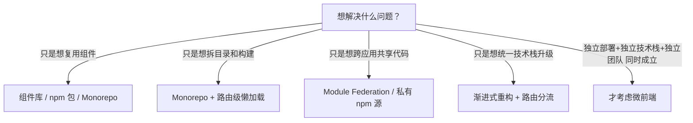
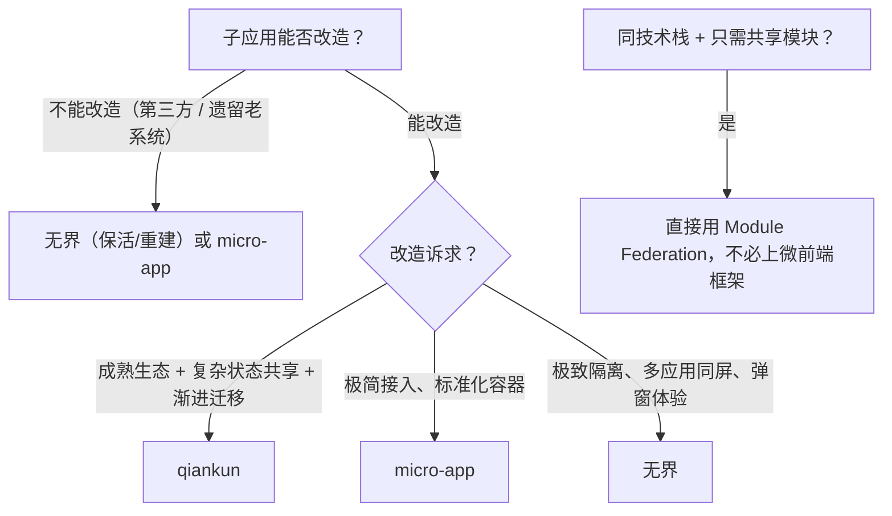

# 微前端从入门到精通 · 架构认知、方案选型与落地指南

> 参考资料：
>
> - [无界 wujie 官方文档 · 快速上手](https://wujie-micro.github.io/doc/guide/start.html)
> - [无界 wujie 官方文档 · 首页](https://wujie-micro.github.io/doc/)
> - [前端码农手册 · 微前端](https://fe-hl.github.io/handbook/pages/micro.html)
> - [TED 知识体系 · 微前端](https://books.tedshen.cn/docs/解决方案/前端解决方案/微前端/)
> - [博客园 · 什么是微前端？有什么好处？有哪一些方案？](https://www.cnblogs.com/zxlh1529/p/18815555)
> - [博客园 · qiankun、micro-app、wujie 深度对决与选型指南](https://www.cnblogs.com/yangykaifa/p/19391240)
> - [ExplainThis · 什么是微前端架构？为什么要用微前端架构？](https://www.explainthis.io/zh-hans/swe/micro-frontend)
>
> 面向角色：**需要拆分大型前端应用的中高级前端工程师**、**负责遗留系统渐进式改造的技术负责人**，以及**准备微前端相关面试的同学**。
> 本文按「认知 → 选型 → 框架原理 → 落地工程 → 优化与排错」五段组织：先讲清微前端解决什么问题、代价是什么，再横向对比 `iframe` / Web Components / `single-spa` / Module Federation 四类底层方案与 `qiankun` / `micro-app` / 无界三个主流框架，随后给出可直接抄的接入代码、沙箱与样式隔离原理、通信与部署要点，最后附踩坑速查表与面试高频问答。

---

## 目录

- [一、微前端是什么](#一、微前端是什么)
- [二、为什么需要微前端](#二、为什么需要微前端)
- [三、微前端的三大核心问题](#三、微前端的三大核心问题)
- [四、实现方案全景对比](#四、实现方案全景对比)
- [五、主流框架选型](#五、主流框架选型)
- [六、qiankun 从入门到精通](#六、qiankun-从入门到精通)
- [七、无界（wujie）从入门到精通](#七、无界-wujie-从入门到精通)
- [八、Module Federation 实战](#八、module-federation-实战)
- [九、样式隔离与依赖共享](#九、样式隔离与依赖共享)
- [十、应用间通信](#十、应用间通信)
- [十一、路由、部署与工程化](#十一、路由、部署与工程化)
- [十二、性能优化与白屏治理](#十二、性能优化与白屏治理)
- [十三、常见问题与踩坑速查](#十三、常见问题与踩坑速查)
- [十四、面试高频问答](#十四、面试高频问答)
- [十五、落地检查清单](#十五、落地检查清单)

---

## 一、微前端是什么

### 1.1 定义

**微前端（Micro Frontends）** 是一种架构模式：把一个大型前端应用按业务维度拆分成多个**可独立开发、独立部署、独立运行**的子应用，再由主应用（基座）在运行时动态加载并整合，对用户呈现为一个完整的产品。

> Techniques, strategies and recipes for building a modern web app with multiple teams that can ship features independently. —— [Micro Frontends](https://micro-frontends.org/)

通俗地说：**在一个 Web 应用里可以独立地运行另一个 Web 应用**。

### 1.2 与微服务的类比

微前端借用了后端**微服务（Micro Services）**「分而治之」的思想，但二者的拆分对象不同：

| 维度         | 微服务                       | 微前端                                   |
| ------------ | ---------------------------- | ---------------------------------------- |
| 拆分对象     | 后端业务能力                 | 前端页面 / 业务模块                      |
| 独立部署单元 | 服务进程                     | 静态资源包（HTML / JS / CSS）            |
| 集成方式     | 网关路由、RPC                | 基座加载、路由分发、模块远程引用         |
| 隔离手段     | 进程 / 容器                  | JS 沙箱、样式隔离、iframe、Shadow DOM    |
| 共同目标     | 团队自治、独立发布、增量升级 | 团队自治、独立发布、增量升级             |

一个典型对照（AWS 的做法）：改造前是「单体前端 + 多个微服务」，改造后是「主应用 + 个人信息前端 + 账单前端 + ……」，每个子前端直接对应自己的后端服务。

### 1.3 整体结构

典型结构：**一个基座承载多个异构子应用，每个子应用独立仓库、独立部署**。

| 层级   | 角色           | 示例技术栈 / 职责         | 部署形态          |
| ------ | -------------- | ------------------------- | ----------------- |
| 基座   | 主应用 / Host  | 路由分发、全局状态、公共布局 | 统一入口          |
| 子应用 | 子应用 A       | Vue 3                     | 独立仓库 / 独立 CI/CD |
| 子应用 | 子应用 B       | React                     | 独立仓库 / 独立 CI/CD |
| 子应用 | 子应用 C       | Angular                   | 独立仓库 / 独立 CI/CD |

### 1.4 名词对照表

| 名词                            | 含义                                                                 |
| ------------------------------- | -------------------------------------------------------------------- |
| **主应用 / 基座（Host）**       | 负责布局、路由分发、公共依赖、登录态与通信总线的外壳应用             |
| **子应用 / 微应用（Micro App）** | 按业务域拆分出来的独立产物，可被基座加载，也可独立访问               |
| **JS Entry**                    | 以 JS 文件作为子应用入口（`single-spa` 早期做法），资源清单需手写维护 |
| **HTML Entry**                  | 以子应用 `index.html` 作为入口，框架自动解析其中的 JS / CSS          |
| **沙箱（Sandbox）**             | 隔离子应用对 `window` / DOM / 样式副作用的运行环境                   |
| **保活（keep-alive）**          | 切换子应用时不销毁实例，保留内部状态与路由                           |
| **预加载 / 预执行**             | 空闲时提前拉取（甚至提前执行）子应用资源，消除切换白屏               |
| **降级（degrade）**             | 浏览器不支持关键特性时退化为 `iframe` 等兼容方案                     |

---

## 二、为什么需要微前端

### 2.1 单体应用的六个痛点

| 痛点             | 具体表现                                                       |
| ---------------- | -------------------------------------------------------------- |
| 代码库臃肿       | 几十万行代码堆在一个仓库，编译几分钟，改一行也要全量构建       |
| 技术栈锁死       | 起步用 Vue 2，想升 Vue 3 或换 React 几乎只能推倒重来           |
| 团队协作冲突     | 多团队共用一个仓库，合并冲突频繁、发布互相阻塞                 |
| 牵一发动全身     | 任意模块出错可能拖垮整个应用，发布风险高                       |
| 老系统难维护     | 遗留系统技术过时，但一次性重写成本极高                         |
| 交付节奏被绑死   | 所有模块必须同版本发布，无法按业务线灰度                       |

### 2.2 五项收益

1. **技术栈无关**：主应用不限制子应用技术栈，Vue / React / Angular 甚至 jQuery 老项目都能共存。
2. **独立开发、独立部署**：子应用独立仓库与流水线，发布互不影响，主应用自动同步。
3. **增量升级**：老系统可以被「包」进基座，一个模块一个模块地重写，是渐进式重构的有效手段。
4. **团队自治**：边界清晰，各团队按自己的节奏迭代，减少沟通与协调成本。
5. **故障隔离**：单个子应用崩溃不至于拖垮整个站点。

### 2.3 代价：先算清楚复杂度账单

微前端不是银弹，它把「代码复杂度」换成了「工程复杂度」：

- **运行时开销**：沙箱代理、样式改写、资源解析都会带来额外 CPU 与内存成本。
- **调试链路变长**：一个页面横跨主应用 + 多个子应用，报错栈、Source Map、断点都要跨产物定位。
- **重复依赖**：多个子应用各自打包 React / Vue，包体膨胀（需要 `shared` 或 `externals` 治理）。
- **隐式耦合风险**：滥用全局状态会让子应用互相依赖，退化成「分布式单体」。
- **部署编排成本**：版本兼容、灰度、回滚、跨域、缓存失效都要额外设计。

### 2.4 适合与不适合

| 适合                             | 不适合                             |
| -------------------------------- | ---------------------------------- |
| 大型中后台 / SaaS 平台，多业务模块 | 小型单页应用                       |
| 多团队协作、技术栈不统一         | 单人 / 小团队、技术栈统一          |
| 老系统渐进式改造、遗留系统整合   | 对首屏性能极致敏感的 C 端页面      |
| 需要按模块独立发布、独立灰度     | 模块间交互极其频繁、耦合极深       |
| 需要嵌入第三方或不可信页面       | 上线时间极紧、无人维护基建         |

### 2.5 选型前的自检

在决定上微前端之前，先依次排除更廉价的方案：



> 结论：**微前端的本质是用工程复杂度换取组织协作效率与技术演进自由**。团队只有一两个人、技术栈统一时，Monorepo 往往更划算。

---

## 三、微前端的三大核心问题

无论用哪个框架，本质上都在回答三个问题——**加载、隔离、通信**。理解这三条主线，再看任何框架的取舍都一目了然。

### 3.1 应用加载

如何把子应用的 HTML / JS / CSS 在运行时拉下来，并渲染到主应用指定的容器里？

| 关键技术                                | 说明                                                    |
| --------------------------------------- | ------------------------------------------------------- |
| JS Entry                                | 子应用导出一份入口 JS，主应用手动维护资源清单           |
| HTML Entry                              | 直接请求子应用 `index.html`，自动解析脚本与样式（主流） |
| 动态 `script` / `import()`              | 运行时插入脚本标签或动态导入，配合沙箱执行              |
| `import-html-entry`（qiankun）          | 解析 HTML、内联 / 外联脚本提取与执行顺序处理            |
| `remoteEntry.js`（Module Federation）   | 构建期产物清单，运行时按模块名拉取                      |

### 3.2 应用隔离

如何保证子应用之间、子应用与主应用之间的全局变量与样式互不污染？

| 类别        | 关键技术                                                             |
| ----------- | -------------------------------------------------------------------- |
| JS 隔离     | 快照沙箱、单例 Proxy 沙箱、多例 Proxy 沙箱、iframe 原生沙箱          |
| CSS 隔离    | Shadow DOM、运行时选择器作用域改写、CSS Modules、动态样式表增删      |
| DOM 隔离    | Web Components 容器、iframe 文档树、document 代理                    |
| 副作用清理  | `unmount` 时移除定时器、事件监听、全局订阅与残留 `<style>`           |

### 3.3 应用通信

拆分之后如何共享登录态、用户信息、主题与业务事件？

| 方式                | 方向       | 耦合度 | 典型场景                     |
| ------------------- | ---------- | ------ | ---------------------------- |
| `props` 下发        | 主 → 子    | 低     | 初始化数据、token            |
| 全局状态            | 双向       | 中     | 登录态、主题（qiankun）      |
| EventBus / 发布订阅 | 任意       | 低     | 跨应用事件、框架无关         |
| URL / 路由参数      | 任意       | 最低   | 可分享、可刷新的状态         |
| `postMessage`       | 任意       | 低     | iframe 场景、跨源            |
| 本地存储            | 任意       | 低     | 持久化、跨标签页（注意隔离） |

### 3.4 三个派生问题

落地时真正的坑往往不在三大问题本身，而在它们的副产品：

1. **路由协调**：主子应用各有路由系统，刷新、前进后退、分享链接时谁说了算？
2. **依赖共享**：公共依赖重复加载会导致包体膨胀，React 多实例还会直接触发 Hooks 报错。
3. **部署编排**：子应用发版后主应用如何感知？灰度、回滚、跨域、缓存失效怎么设计？

---

## 四、实现方案全景对比

### 4.1 iframe 方案

用 `<iframe>` 加载子应用，靠浏览器原生机制实现 JS / CSS / DOM 的**完全隔离**。

```html
<iframe src="//sub-app.example.com/app1" id="sub"></iframe>
<script>
  // 主应用 → 子应用
  document.getElementById('sub').contentWindow.postMessage({ type: 'login', token: 'xxx' }, '*')
  // 子应用监听
  window.addEventListener('message', (e) => {
    if (e.data.type === 'login') console.log(e.data.token)
  })
</script>
```

| 优势                     | 局限                                                 |
| ------------------------ | ---------------------------------------------------- |
| 实现极简，无任何心智负担 | 弹窗 / 遮罩被限制在 iframe 内，无法覆盖全屏          |
| JS / CSS / DOM 完美隔离  | URL 不同步，刷新后退状态丢失                         |
| 安全边界清晰             | 每次切换重建上下文，白屏明显                         |
| 子应用完全零改造         | DOM 割裂，共享弹窗、全局 Loading 困难，通信靠 postMessage |

一句话：**隔离满分，体验不及格**。iframe 的思路并没有被抛弃——无界正是用它来做 JS 沙箱，再用 Web Components 补回体验。

### 4.2 Web Components 方案

基于原生**自定义元素（Custom Elements）**把子应用封装成标签，用 **Shadow DOM** 提供样式与 DOM 作用域隔离。

```js
class MicroApp extends HTMLElement {
  connectedCallback() {
    const shadow = this.attachShadow({ mode: 'open' })
    shadow.innerHTML = `<style>h1{color:red}</style><h1>子应用</h1>`
  }
}
customElements.define('micro-app', MicroApp)
```

```html
<micro-app url="//localhost:3000"></micro-app>
```

| 优势                    | 局限                                        |
| ----------------------- | ------------------------------------------- |
| 浏览器原生，无框架依赖  | 老浏览器兼容性差                            |
| Shadow DOM 天然样式隔离 | 挂 `document.body` 的第三方 UI 库容易失效   |
| 封装性好、可组件化使用  | 学习曲线较陡，调试相对困难                  |

`micro-app` 正是以它为核心，把子应用包装成 `<micro-app>` 标签，做到「像用组件一样用微前端」。

### 4.3 single-spa（JS Entry）方案

微前端的「鼻祖」框架，核心是**劫持路由**：监听 `hashchange` / `popstate`，按 `activeWhen` 匹配决定加载哪个子应用。

```js
import { registerApplication, start } from 'single-spa'

registerApplication({
  name: 'app1',
  app: () => System.import('app1'),
  activeWhen: (location) => location.pathname.startsWith('/app1'),
  customProps: { token: 'xxx' },
})

start()
```

| 优势                       | 局限                                       |
| -------------------------- | ------------------------------------------ |
| 框架无关，技术栈灵活       | **不提供 JS / CSS 沙箱**，隔离要自己实现   |
| 生命周期模型成为事实标准   | 子应用改造较多（导出钩子 + 改打包配置）    |
| 支持渐进式迁移             | 依赖 SystemJS，学习成本高                  |

### 4.4 HTML Entry 方案

`qiankun` 在 `single-spa` 之上做的第一个关键改进：**把注册入口从「JS 列表」改成一个 URL**，用 `import-html-entry` 请求子应用 `index.html`，解析出脚本与样式，再把 HTML 模板注入容器、把 JS 放进沙箱执行。

好处：子应用改动小、资源信息完整（含 `<style>` 与外链顺序）、便于做样式隔离与预加载。

### 4.5 Module Federation 方案

**模块联邦（Module Federation，MF）**是 Webpack 5 的构建期特性：`remote` 在运行时暴露自己的模块，`host` 直接远程加载并运行，还能协商共享依赖。

```js
// 子应用（remote）webpack.config.js
new ModuleFederationPlugin({
  name: 'app1',
  filename: 'remoteEntry.js',
  exposes: { './Button': './src/Button' },
  shared: ['react', 'react-dom'],
})

// 主应用（host）
new ModuleFederationPlugin({
  name: 'host',
  remotes: { app1: 'app1@//localhost:3001/remoteEntry.js' },
  shared: ['react', 'react-dom'],
})
```

| 优势                       | 局限                                   |
| -------------------------- | -------------------------------------- |
| 依赖共享、避免重复下载     | 强依赖 Webpack 5（或 Vite 插件）       |
| 模块级复用，不止应用级     | **无沙箱隔离**，全局与样式冲突要自理   |
| 开发体验接近普通 npm 包    | 版本协商配置较复杂                     |

### 4.6 路由分发与服务端组合

最「朴素」的一类方案：由网关 / Nginx / BFF 按路径把请求分发到不同的独立前端产物。

```nginx
location ^~ /product/ { alias /srv/product/dist/;  try_files $uri /product/index.html; }
location ^~ /order/   { alias /srv/order/dist/;    try_files $uri /order/index.html; }
location ^~ /user/    { alias /srv/user/dist/;     try_files $uri /user/index.html; }
```

优点是真正的「零框架成本」与完全独立的部署；缺点是跨应用跳转等于整页刷新，共享布局、共享登录态与共享组件都要靠约定补齐。

### 4.7 总览对比

| 方案              | 隔离能力 | 体验 | 接入成本 | 依赖共享 | 适用场景                     |
| ----------------- | -------- | ---- | -------- | -------- | ---------------------------- |
| iframe            | ★★★★★    | ★    | 极低     | 差       | 第三方页面嵌入、简单聚合     |
| Web Components    | ★★★★     | ★★★★ | 低       | 一般     | 组件级嵌入、标准化接入       |
| single-spa        | ★        | ★★★  | 中       | 一般     | 自定义底层、渐进迁移         |
| HTML Entry（qiankun） | ★★★★ | ★★★★ | 中       | 好       | 企业级中后台                 |
| Module Federation | ★        | ★★★★★ | 中      | ★★★★★    | 同栈项目的模块级复用         |
| 路由分发 / 服务端 | ★★★★★    | ★★   | 低       | 差       | 页面边界清晰的多站点聚合     |

---

## 五、主流框架选型

### 5.1 三个框架的定位

| 框架              | 出品方   | 底层方案                                        | 一句话定位                         |
| ----------------- | -------- | ----------------------------------------------- | ---------------------------------- |
| **qiankun**       | 蚂蚁集团 | single-spa + import-html-entry + Proxy 沙箱     | 应用级微前端，生态最成熟、落地最广 |
| **micro-app**     | 京东零售 | Web Components + 自研沙箱                      | 组件式微前端，接入极简、几乎零改造 |
| **无界（wujie）** | 腾讯     | iframe + Web Components                        | iframe 级隔离 + WC 级体验，主打稳定 |

### 5.2 核心能力横向对比

| 维度         | qiankun                        | micro-app              | 无界                      |
| ------------ | ------------------------------ | ---------------------- | ------------------------- |
| 技术原理     | 路由劫持 + HTML Entry          | Web Components + 沙箱  | iframe + Web Components   |
| JS 沙箱      | Proxy 沙箱（多例）             | 基于 Proxy 的沙箱      | iframe 原生沙箱           |
| CSS 隔离     | Shadow DOM / 运行时作用域      | Web Components 天然隔离 | iframe 完整隔离           |
| 路由同步     | 手动配置 `activeRule`          | 自动同步               | 自动同步（`sync` 开关）   |
| 子应用改造   | 需导出生命周期 + 改打包        | 几乎零改造             | 完全零改造（保活 / 重建模式） |
| 多实例并存   | 支持                           | 支持                   | 支持，且互不影响          |
| 子应用保活   | 不支持（路由切换即卸载）       | 支持                   | 支持（`alive`）           |
| 通信方式     | `props` + `initGlobalState`    | `setData` / `dispatch` | `props` / `bus` / `window.parent` |
| 加载性能     | 中等（框架 + 沙箱初始化）      | 较好（轻量 + WC）      | 略慢（多一次 iframe 实例化，可预执行抵消） |
| 生态与案例   | ★★★★★                          | ★★★★                   | ★★★                       |

### 5.3 决策链



一句话结论：**求稳定、功能全 → qiankun；求快速、轻量 → micro-app；求安全、零改造、隔离彻底 → 无界**。大型项目里也常见「qiankun 做主框架 + MF 做依赖共享」的混合架构。

### 5.4 选型时必须提前规划的四件事

1. 子应用静态资源的跨域（CORS）策略。
2. `publicPath` 的动态设置方式。
3. 子应用路由 `base` 前缀与主子路由的边界。
4. 样式隔离策略与挂 `body` 的弹窗组件处理方案。

> 这四件事是接入阶段绝大多数报错的来源，务必在写代码之前定好。

---

## 六、qiankun 从入门到精通

`qiankun` = `single-spa`（调度）+ `import-html-entry`（HTML Entry 加载）+ Proxy 沙箱（隔离）。

### 6.1 主应用接入

```js
// main/src/micro.js
import { registerMicroApps, start } from 'qiankun'

registerMicroApps(
  [
    {
      name: 'vue-app',                 // 唯一名称，需与子应用 package.json name 一致
      entry: '//localhost:7100',       // 子应用 HTML 入口
      container: '#subapp-container',  // 挂载点
      activeRule: '/vue',              // 路由命中规则
      props: { token: 'xxx' },         // 下发给子应用的数据
    },
    {
      name: 'react-app',
      entry: '//localhost:7200',
      container: '#subapp-container',
      activeRule: '/react',
    },
  ],
  {
    beforeLoad: [(app) => console.log('before load', app.name)],
    afterMount: [(app) => console.log('mounted', app.name)],
  },
)

start({ prefetch: true, sandbox: { strictStyleIsolation: false } })
```

需要手动控制加载（不依赖路由）时用 `loadMicroApp`：

```js
import { loadMicroApp } from 'qiankun'

const app = loadMicroApp({ name: 'vue-app', entry: '//localhost:7100', container: '#c' })
// 卸载：await app.unmount()
```

### 6.2 子应用改造三件套

**① 导出生命周期钩子**

```js
// sub/src/main.js
import { createApp } from 'vue'
import App from './App.vue'

let app = null
function render(props = {}) {
  const { container } = props
  app = createApp(App)
  app.mount(container ? container.querySelector('#app') : '#app')
}

if (!window.__POWERED_BY_QIANKUN__) render()   // 独立运行时直接渲染

export async function bootstrap() {}
export async function mount(props) { render(props) }
export async function unmount() { app.unmount(); app = null }
export async function update(props) { /* 可选：响应 props 变化 */ }
```

**② 打包格式改为 UMD**

```js
// vue.config.js / webpack.config.js
module.exports = {
  devServer: { headers: { 'Access-Control-Allow-Origin': '*' } },
  configureWebpack: {
    output: {
      library: 'vue-app',          // 与注册时的 name 一致
      libraryTarget: 'umd',
    },
  },
}
```

**③ 运行时修正 publicPath**

```js
// sub/src/public-path.js（在入口第一行引入）
if (window.__POWERED_BY_QIANKUN__) {
  __webpack_public_path__ = window.__INJECTED_PUBLIC_PATH_BY_QIANKUN__
}
```

### 6.3 HTML Entry 加载流程

<MicroFrontendHtmlEntryFlow />

### 6.4 生命周期与内存泄漏

| 钩子          | 触发时机                 | 典型工作                             |
| ------------- | ------------------------ | ------------------------------------ |
| `bootstrap`   | 子应用**首次**加载，仅一次 | 初始化全局资源、缓存                 |
| `mount`       | 每次进入子应用路由       | 创建实例、挂载 DOM、订阅通信         |
| `unmount`     | 每次离开子应用路由       | 卸载实例、清理副作用、解绑事件       |
| `update`（可选） | 主应用主动更新 props  | 响应 props 变化                      |

> **内存泄漏高发区**：`mount` 里注册的定时器、事件监听、全局订阅，必须在 `unmount` 里逐一清理。反复切换子应用导致的泄漏是 qiankun 项目最常见的隐患。

### 6.5 JS 沙箱三种实现

沙箱的作用是**隔离子应用对 `window` 的污染**：子应用对全局变量的增删改都应限制在自己的作用域内，卸载后能干净还原。

**① 快照沙箱（SnapshotSandbox）**

适用于不支持 `Proxy` 的低版本浏览器：激活时给 `window` 拍快照，失活时对比差异并还原。

```js
class SnapshotSandbox {
  constructor() {
    this.modifyPropsMap = {}    // 子应用修改过的变量
    this.windowSnapshot = {}    // window 快照
  }
  active() {
    this.windowSnapshot = {}
    for (const key in window) this.windowSnapshot[key] = window[key]
    for (const key in this.modifyPropsMap) window[key] = this.modifyPropsMap[key]
  }
  inactive() {
    for (const key in window) {
      if (window[key] !== this.windowSnapshot[key]) {
        this.modifyPropsMap[key] = window[key]       // 记录
        window[key] = this.windowSnapshot[key]       // 还原
      }
    }
  }
}
```

**② 单例 Proxy 沙箱（LegacySandbox）**

用 `Proxy` 记录新增 / 修改，失活时精准还原，无需遍历整个 `window`。

```js
class ProxySandbox {
  constructor() {
    this.addedPropsMap = new Map()
    this.modifyPropsMap = new Map()
    this.allPropsMap = new Map()
    const fakeWindow = Object.create(null)
    this.proxy = new Proxy(fakeWindow, {
      get: (target, key) => window[key],
      set: (target, key, value) => {
        if (!window.hasOwnProperty(key)) this.addedPropsMap.set(key, value)
        else if (!this.modifyPropsMap.has(key)) this.modifyPropsMap.set(key, window[key])
        window[key] = value                 // 仍然写真实 window
        this.allPropsMap.set(key, value)
        return true
      },
    })
  }
  active() { this.allPropsMap.forEach((v, k) => (window[k] = v)) }
  inactive() {
    this.modifyPropsMap.forEach((v, k) => (window[k] = v))
    this.addedPropsMap.forEach((_, k) => delete window[k])
  }
}
```

**③ 多例 Proxy 沙箱（现役主力）**

单例沙箱直接改真实 `window`，两个子应用同时运行会冲突。多例沙箱为每个子应用创建**独立的 `fakeWindow`**：读优先取自己的、找不到回退真实 `window`；写只落在自己的 `fakeWindow`。

```js
class ProxySandbox {
  constructor() {
    this.running = false
    const fakeWindow = Object.create(null)
    this.proxy = new Proxy(fakeWindow, {
      get: (target, key) => (!this.running ? window[key] : key in target ? target[key] : window[key]),
      set: (target, key, value) => { if (this.running) target[key] = value; return true },
    })
  }
  active() { this.running = true }
  inactive() { this.running = false }
}

const s1 = new ProxySandbox()
const s2 = new ProxySandbox()
s1.active(); s2.active()
s1.proxy.a = 1
s2.proxy.a = 2
console.log(s1.proxy.a, s2.proxy.a)   // 1 2（互不影响）
console.log(window.a)                 // undefined（真实 window 未被污染）
```

| 沙箱类型   | 隔离方式                    | 多实例 | 性能             | 兼容性     |
| ---------- | --------------------------- | ------ | ---------------- | ---------- |
| 快照沙箱   | 拍照 → 改 → 对比还原        | 否     | 差（遍历 window） | 好（无需 Proxy） |
| 单例 Proxy | 记录增改，操作真实 window   | 否     | 较好             | 需 Proxy   |
| 多例 Proxy | 独立 fakeWindow，读回退写隔离 | 是   | 好               | 需 Proxy   |

### 6.6 CSS 样式隔离

**① 严格隔离（Shadow DOM）**

```js
start({ sandbox: { strictStyleIsolation: true } })
```

最彻底，但挂 `document.body` 的元素（Ant Design 的 Modal / Message / Tooltip）会脱离 Shadow 边界而丢失样式，需要配置 `getPopupContainer` 把弹层挂回容器内。

**② 运行时作用域（推荐默认）**

```js
start({ sandbox: { experimentalStyleIsolation: true } })
```

给子应用每条 CSS 规则动态添加属性选择器前缀：

```css
/* 原始 */
.title { color: red; }
/* 改写后 */
div[data-qiankun="react-app"] .title { color: red; }
```

兼容性好、不影响弹窗，但对 `@keyframes`、`@font-face`、内联样式覆盖不全，属折中方案。

**③ 动态样式表（框架默认行为）**

`mount` 时插入子应用 `<style>`，`unmount` 时移除，保证离开后样式不残留。

### 6.7 通信

```js
// 主应用：初始化全局状态
import { initGlobalState } from 'qiankun'
const actions = initGlobalState({ user: null, theme: 'light' })
actions.onGlobalStateChange((state, prev) => console.log(state, prev))
actions.setGlobalState({ user: { name: '张三' } })

// 子应用：在 mount 里拿到通信方法
export async function mount(props) {
  props.onGlobalStateChange((state) => console.log('状态更新', state))
  props.setGlobalState({ theme: 'dark' })
}
```

---

## 七、无界（wujie）从入门到精通

### 7.1 原理：iframe 做沙箱，Web Components 做容器

无界把子应用的 **JS 注入主应用同域的 iframe** 中运行——iframe 是原生 `window` 沙箱，内部有完整的 `history` 与 `location`；同时把**子应用的 DOM 渲染在主应用的 `wujie` 自定义元素（Web Components）里**，通过代理 iframe 的 `document`（`getElementById`、`querySelector`、`head`、`body` 等查询接口）把两者精准连起来。

由此获得四项能力：

| 能力           | 实现                                                                 |
| -------------- | -------------------------------------------------------------------- |
| 天然 JS 沙箱   | 子应用只改 iframe 内的 `window`，不污染主应用，切换无需清理           |
| 天然 CSS 沙箱  | DOM 在 Web Components 内，样式物理隔离，子应用不用改                 |
| 天然适配弹窗   | `document.body.appendChild` 被代理到 webcomponent 内，弹窗不逃出边界 |
| 路由同步       | iframe 的 `history.pushState` 会自动进入 joint session history        |

### 7.2 快速上手

```bash
pnpm add wujie                 # React 主应用可用 wujie-react，Vue 可用 wujie-vue2 / wujie-vue3
```

```js
import { bus, setupApp, preloadApp, startApp, destroyApp } from 'wujie'

setupApp({ name: '唯一id', url: '子应用地址', exec: true, el: '容器', sync: true })  // 设置默认参数（可选）
preloadApp({ name: '唯一id' })                                                      // 预加载（可选）
startApp({ name: '唯一id' })                                                        // 启动
```

Vue 主应用也可以用组件式写法：

```vue
<template>
  <WujieVue name="vue-app" url="//localhost:7100" :sync="true" :alive="true" :props="{ token }" />
</template>
```

### 7.3 三种运行模式

| 模式     | 行为                                                        | 子应用改造             |
| -------- | ----------------------------------------------------------- | ---------------------- |
| 单例     | 保 iframe、换 `url` 即切子路由，适合多菜单跳同一应用不同页面 | 需做生命周期改造       |
| 保活     | `alive: true`，实例与 webcomponent 都不销毁，切换只是热插拔 | 零改造                 |
| 重建     | 每次销毁重建，最朴素、最省心                                | 零改造                 |

> 主应用多个菜单要跳子应用**不同页面**时，不建议用保活模式（保活下无法用 `url` 改路由），应选单例 + 生命周期改造。

### 7.4 startApp 关键参数

| 参数       | 默认值 | 说明                                                                 |
| ---------- | ------ | -------------------------------------------------------------------- |
| `name`     | —      | 子应用唯一 id；多个菜单共享同一子应用时用同一个 name 可复用实例      |
| `url`      | —      | 子应用地址；单例模式下改 `url` 即可跳子路由                          |
| `el`       | —      | 渲染容器，建议设置好宽高                                             |
| `html`     | —      | 已有 HTML 时直接传入，不再请求 `url`                                 |
| `sync`     | false  | 路由同步：把子应用路径实时写到主应用 URL 查询参数上，刷新 / 分享不丢 |
| `prefix`   | —      | 短路径替换，缩短同步到主应用 URL 上的参数                            |
| `alive`    | false  | 保活模式，state 与路由都不丢失                                       |
| `props`    | —      | 注入子应用的数据，子应用通过 `$wujie.props` 读取                     |
| `fiber`    | true   | JS 按文件粒度在 `requestIdleCallback` 中间断执行，避免阻塞主应用渲染 |
| `degrade`  | false  | 主动降级为普通 iframe（弹窗将无法覆盖全局）                          |
| `attrs`    | —      | 自定义运行 iframe 的属性                                             |
| `replace`  | —      | 代码替换钩子，子应用不便改代码时在此改写 HTML / JS / CSS             |
| `fetch`    | —      | 自定义 fetch，可统一携带 `credentials: 'include'`                    |
| `plugins`  | —      | 运行时改写子应用资源的插件（htmlLoader / jsLoader / cssLoader 等）   |

生命周期钩子：`beforeLoad`、`beforeMount`、`afterMount`、`beforeUnmount`、`afterUnmount`、`activated`、`deactivated`、`loadError`。

> 注意：未做生命周期改造的子应用不会触发 `beforeMount` / `afterMount` / `beforeUnmount` / `afterUnmount`；非保活应用不会触发 `activated` / `deactivated`。另外 `name`、`replace`、`fetch`、`alive`、`degrade` 五个参数在 `preloadApp` 与 `startApp` 中必须严格一致。

### 7.5 子应用生命周期改造

把「创建并挂载实例」挂到 `window.__WUJIE_MOUNT`，把「销毁实例」挂到 `window.__WUJIE_UNMOUNT`：

```js
// 子应用入口（Vue 3）
if (window.__POWERED_BY_WUJIE__) {
  let instance
  window.__WUJIE_MOUNT = () => {
    const router = createRouter({ history: createWebHistory(), routes })
    instance = createApp(App)
    instance.use(router)
    instance.mount('#app')
  }
  window.__WUJIE_UNMOUNT = () => { instance.unmount() }
  // Vite 等异步加载场景：定义完钩子后主动调用一次（内置去重标记）
  window.__WUJIE.mount()
} else {
  createApp(App).use(createRouter({ history: createWebHistory(), routes })).mount('#app')
}
```

React 版本：

```js
if (window.__POWERED_BY_WUJIE__) {
  window.__WUJIE_MOUNT = () => {
    ReactDOM.render(<React.StrictMode><App /></React.StrictMode>, document.getElementById('root'))
  }
  window.__WUJIE_UNMOUNT = () => {
    ReactDOM.unmountComponentAtNode(document.getElementById('root'))
  }
} else {
  ReactDOM.render(<App />, document.getElementById('root'))
}
```

### 7.6 三种通信方式

```js
// ① props 注入：子应用读取
const token = window.$wujie?.props.token

// ② EventBus（去中心化，主子应用共享）
import { bus } from 'wujie'
bus.$emit('user-login', userInfo)
bus.$on('user-login', (data) => console.log(data))

// ③ 同源直连：子应用可直接 window.parent 访问主应用
window.parent.document.title = '来自子应用'
```

### 7.7 保活、预执行与降级

- **保活（`alive: true`）**：切换只是 webcomponent 的热插拔，内部 state 不丢。
- **预执行（`preloadApp({ exec: true })`）**：提前把子应用跑起来（含页面请求与渲染），配合保活可实现接近 SSR 的「秒开」。
- **降级（`degrade: true`）**：浏览器不支持 `Proxy` / Web Components 时自动或主动退化为普通 iframe，理论上可兼容到 IE 9；代价是弹窗只能在 iframe 内部展示。

---

## 八、Module Federation 实战

### 8.1 主应用（host）

```js
// webpack.config.js
const { ModuleFederationPlugin } = require('webpack').container

module.exports = {
  plugins: [
    new ModuleFederationPlugin({
      name: 'host',
      remotes: { app1: 'app1@http://localhost:3001/remoteEntry.js' },
      shared: {
        react: { singleton: true, requiredVersion: '^18.0.0' },
        'react-dom': { singleton: true },
      },
    }),
  ],
}
```

### 8.2 远程应用（remote）

```js
new ModuleFederationPlugin({
  name: 'app1',
  filename: 'remoteEntry.js',
  exposes: { './Button': './src/Button', './App': './src/App' },
  shared: { react: { singleton: true }, 'react-dom': { singleton: true } },
})
```

### 8.3 消费远程模块

```jsx
import React, { Suspense } from 'react'
const RemoteButton = React.lazy(() => import('app1/Button'))

export default function App() {
  return (
    <Suspense fallback={<div>加载中...</div>}>
      <RemoteButton />
    </Suspense>
  )
}
```

### 8.4 shared 的意义与 Vite 生态

`singleton: true` 保证共享库全局只有一个实例——对 React 尤其重要，多份 React 会直接导致 Hooks 报错。MF 会在运行时协商版本，优先复用已加载的兼容版本。

Vite 项目可用 `vite-plugin-federation` 获得同等能力；若既要模块共享又要运行时隔离，可采用「qiankun 做容器 + MF 做依赖共享」的组合。

> 再次强调：**MF 本身不提供 JS / CSS 沙箱**，它解决的是「共享与复用」，不是「隔离」。

---

## 九、样式隔离与依赖共享

### 9.1 CSS 隔离手段一览

| 手段                | 原理                             | 特点                           |
| ------------------- | -------------------------------- | ------------------------------ |
| Shadow DOM          | 原生影子边界                     | 最彻底，但挂 body 的弹窗易失效 |
| 运行时 CSS 前缀     | 运行时给选择器加属性作用域       | 兼容好，覆盖不全               |
| Web Components 容器 | 子应用 DOM 整体放进自定义元素内  | 物理隔离，子应用零改造         |
| CSS Modules         | 编译期生成 hash 类名             | 构建期隔离，需子应用配合       |
| CSS-in-JS           | 运行时生成唯一类名               | 隔离好，有运行时开销           |
| BEM / 命名空间约定  | 人为加前缀                       | 零成本，靠自觉，易失效         |
| 动态样式表增删      | mount 插入 `<style>`、unmount 移除 | 框架默认行为，防残留         |

### 9.2 弹窗类组件的处理

只要用了「DOM 边界」型隔离（Shadow DOM / Web Components），挂到 `document.body` 的浮层就会脱离边界：

- Ant Design：配置 `getPopupContainer={() => 容器 DOM}`；
- Element Plus：配置 `popper-append-to-body` / `teleported`；
- 无界：无需处理，因为它把 `document.body.appendChild` 代理回了 webcomponent 内部。

### 9.3 依赖共享三条路

```js
// ① externals + CDN：构建期排除，主应用注入全局变量
externals: { vue: 'Vue', react: 'React', 'react-dom': 'ReactDOM' }

// ② Module Federation shared：运行时版本协商
shared: { react: { singleton: true, requiredVersion: '^18.0.0' } }

// ③ 主应用下发：把公共库挂到 window / props 上，子应用直接取用
props: { React, ReactDOM }
```

---

## 十、应用间通信

### 10.1 方式对比

| 方式            | 方向    | 耦合度 | 适用                     |
| --------------- | ------- | ------ | ------------------------ |
| `props`         | 主 → 子 | 低     | 初始化数据、token 下发   |
| 全局状态        | 双向    | 中     | 登录态、主题             |
| EventBus        | 任意    | 低     | 跨应用事件、框架无关     |
| URL / 路由参数  | 任意    | 最低   | 可分享、可刷新的状态     |
| `postMessage`   | 任意    | 低     | iframe / 跨源            |
| 本地存储        | 任意    | 低     | 持久化、跨标签页         |

### 10.2 极简 EventBus 实现

```js
class EventBus {
  constructor(namespace = 'global') {
    this.namespace = namespace
    this.events = {}
  }
  on(event, cb) {
    const key = `${this.namespace}:${event}`
    ;(this.events[key] ||= []).push(cb)
    return () => this.off(event, cb)      // 返回取消订阅函数
  }
  emit(event, data) {
    const key = `${this.namespace}:${event}`
    ;(this.events[key] || []).forEach((cb) => {
      try { cb(data) } catch (e) { console.error(`Error in listener for ${key}`, e) }
    })
  }
  off(event, cb) {
    const key = `${this.namespace}:${event}`
    this.events[key] = (this.events[key] || []).filter((fn) => fn !== cb)
  }
}
window.__BUS__ = new EventBus()
```

### 10.3 通信原则

1. 优先用**低耦合**方式（`props` / URL），全局状态留给真正跨应用共享的数据（登录态、主题、权限）。
2. 约定**数据契约**（事件名、载荷结构、版本），写进文档，避免口头约定。
3. 子应用之间不直接读写彼此内部状态，统一经由主应用或事件总线。
4. 事件订阅必须在 `unmount` / `__WUJIE_UNMOUNT` 里解绑，否则反复切换会累积监听。

---

## 十一、路由、部署与工程化

### 11.1 路由分发与边界

- 主应用负责**一级路由**（哪个子应用），子应用负责**自己的子路由**（页面内导航）。
- 子应用路由 `base` 必须与主应用分配的激活前缀一致（如 `activeRule: '/order'` → 子应用 `base: '/order'`）。
- `history` 模式下服务端（Nginx / CDN）必须配置 `try_files ... /index.html`，否则刷新 404。
- 微前端框架一般要求主应用用 `history` 路由；`hash` 模式也可工作，但 URL 观感较差。

### 11.2 刷新、前进后退与分享

| 场景           | qiankun                        | 无界                                     |
| -------------- | ------------------------------ | ---------------------------------------- |
| 浏览器前进后退 | 由 activeRule 重新匹配         | iframe 的 joint session history 天然生效 |
| 浏览器刷新     | 按 URL 重新加载对应子应用      | 需 `sync: true` 才能从 URL 读回子路由    |
| 分享链接       | 主子路径都在 URL 上，天然支持  | 开启 `sync` 后子路由写进查询参数         |

### 11.3 跨域与 publicPath

子应用资源是在主域名下发起请求的，因此**必须开启 CORS**：

```js
// 子应用 Node 服务示例
app.use((req, res, next) => {
  res.set({
    'Access-Control-Allow-Credentials': true,
    'Access-Control-Allow-Origin': req.headers.origin || '*',
    'Access-Control-Allow-Headers': 'X-Requested-With,Content-Type',
    'Access-Control-Allow-Methods': 'PUT,POST,GET,DELETE,OPTIONS',
    'Content-Type': 'application/json; charset=utf-8',
  })
  next()
})
```

同时记得：Webpack 子应用设置 `__webpack_public_path__`，Vite 子应用设置 `base` 为绝对路径，否则资源 404。

### 11.4 缓存与版本

| 资源                     | 策略                                             |
| ------------------------ | ------------------------------------------------ |
| 子应用 `index.html`      | `no-cache` / 短 TTL，保证发版后主应用立刻拉到新版本 |
| 带 hash 的 JS / CSS      | `max-age` 长期强缓存                             |
| `remoteEntry.js`（MF）   | 与 `index.html` 同等对待，避免拿到旧清单          |
| 子应用版本清单           | 由主应用从配置中心拉取，支持灰度与回滚            |

### 11.5 部署、灰度与 CI/CD

- 每个子应用独立流水线：`test → build → deploy`，产物发到各自的路径前缀或 CDN 目录。
- 主应用只维护「子应用注册表」（name / entry / 版本），子应用发版后更新注册表即可生效。
- 灰度：按用户分组下发不同版本的注册表；异常时改回上一个版本即完成回滚。
- 监控：主应用统一初始化 Sentry，子应用上报时带 `microApp` 与 `version` 标签，便于按子应用归因。

---

## 十二、性能优化与白屏治理

### 12.1 白屏成因

切换子应用时的白屏来自四段耗时：**拉取 HTML → 解析资源 → 下载 JS/CSS → 执行并渲染**。框架能优化的主要是前两段与最后一段的调度。

### 12.2 优化清单

| 手段             | 做法                                                                 |
| ---------------- | -------------------------------------------------------------------- |
| 预加载           | qiankun：`start({ prefetch: true })` 或 `prefetchApps([...])`；无界：`preloadApp` |
| 预执行           | 无界：`preloadApp({ exec: true })`，提前跑完请求与渲染               |
| 子应用保活       | 无界 `alive: true`，切换只做热插拔，避免重复渲染                     |
| 共享依赖         | `externals` + CDN，或 MF `shared: { singleton: true }`               |
| 路由级懒加载     | 子应用内部按路由 `import()` 拆包，减小首屏体积                       |
| JS 分片执行      | 无界 `fiber: true`（默认），把大文件拆包后效益最大                   |
| CDN + 强缓存     | 静态资源上 CDN，hash 文件长缓存                                      |
| 骨架屏 / loading | 切换期展示占位，优化体感（无界可传 `loading` 元素）                  |

```js
// qiankun 精细化预加载：只预取指定子应用
import { prefetchApps } from 'qiankun'
prefetchApps([{ name: 'app1', entry: '//localhost:7100' }])
```

### 12.3 监控指标

- 子应用加载耗时（从触发加载到 `afterMount`）；
- 主应用 FCP / LCP 与切换期的 CLS；
- 每个子应用的 JS 错误率、接口错误率、内存增长；
- 同一子应用反复进入的内存曲线（泄漏体检）。

---

## 十三、常见问题与踩坑速查

| 现象                          | 原因                                 | 解决                                                     |
| ----------------------------- | ------------------------------------ | -------------------------------------------------------- |
| 子应用资源 404                | `publicPath` 用了相对路径            | 运行时设置 `__webpack_public_path__` 为框架注入的地址     |
| 子应用 HTML 拉取失败          | 未开启 CORS                          | dev-server 与生产资源加 `Access-Control-Allow-Origin`     |
| qiankun 找不到生命周期钩子    | 打包格式不对                         | `libraryTarget: 'umd'` 且 `library` 与 name 一致          |
| 样式互相污染                  | 未开启样式隔离                       | 开 `experimentalStyleIsolation`，或用 Shadow DOM / WC     |
| Ant Design 弹窗样式丢失       | Shadow DOM 隔离了挂 body 的元素      | 配置 `getPopupContainer` 把弹层挂回容器内                 |
| 路由冲突 / 刷新 404           | 子应用 base 未设置                   | 子应用路由 base 设为激活前缀；服务端配 `try_files`        |
| 切换子应用内存持续上涨        | `unmount` 未清理副作用               | 定时器 / 监听 / 订阅在 `unmount` 中逐一清理               |
| 多个子应用全局变量冲突        | 用了单例沙箱                         | 使用多例 Proxy 沙箱（qiankun 默认）                       |
| React 多实例 Hooks 报错       | 加载了多份 React                     | MF `shared` 设 `singleton: true`，或 externals + CDN      |
| 刷新后子应用回到首页          | 未开启路由同步                       | qiankun 保证 activeRule 可回读；无界设 `sync: true`       |
| 子应用接口不带 cookie         | fetch 默认不携带凭据                 | 无界自定义 `fetch`：`credentials: 'include'`              |
| Vite 子应用在无界中不渲染     | 异步加载导致 mount 时机不确定        | 定义完钩子后主动调用 `window.__WUJIE.mount()`             |
| 老项目切换白屏明显            | 非 Webpack 产物无法做生命周期改造    | 尽量使用保活模式 + 预执行                                 |

---

## 十四、面试高频问答

| 问题                             | 一句话回答                                                                             |
| -------------------------------- | -------------------------------------------------------------------------------------- |
| 什么是微前端？                   | 把大型前端应用按业务拆成多个可独立开发部署的子应用，由基座运行时加载整合的架构模式     |
| 微前端解决哪三个问题？           | 应用加载（HTML/JS Entry）、应用隔离（JS 沙箱 + 样式隔离）、应用通信（props / 状态 / 总线） |
| iframe 做微前端有什么问题？      | 隔离完美但体验差：URL 不同步、弹窗受限、切换白屏、通信困难                             |
| qiankun 和 single-spa 的关系？   | qiankun = single-spa 调度 + import-html-entry 加载 + Proxy 沙箱隔离                     |
| 三种 JS 沙箱的区别？             | 快照：拍照对比还原，兼容好但慢且单例；单例 Proxy：记增改但写真实 window；多例 Proxy：独立 fakeWindow，读回退写隔离，支持多实例 |
| CSS 隔离怎么做？                 | Shadow DOM（最彻底，弹窗易失效）、运行时选择器前缀（兼容好，覆盖不全）、动态样式表增删 |
| 无界的原理？                     | iframe 承载 JS（原生沙箱 + 完整 history），Web Components 承载 DOM，代理 iframe 的 document 把两者连接 |
| Module Federation 能替代微前端吗 | 不能：MF 擅长依赖共享与模块复用，但**不提供隔离**；常与 qiankun 组合使用               |
| 为什么 shared 要 singleton？     | 保证共享库只有一个实例，避免多份 React 导致 Hooks 报错                                 |
| 微前端的代价是什么？             | 运行时开销、调试链路变长、重复依赖、隐式耦合风险、部署编排成本                         |
| 什么时候不该用微前端？           | 小应用、单人团队、技术栈统一、对首屏极致敏感——用 Monorepo / 路由懒加载更划算           |

---

## 十五、落地检查清单

- [ ] 已确认「真的需要微前端」：独立部署 + 独立技术栈 + 独立团队至少两项成立。
- [ ] 已选定框架并写成选型说明（含为什么不用 Monorepo / MF）。
- [ ] 子应用边界按业务域划分，单个子应用规模可控，避免过度拆分。
- [ ] 主应用只负责布局、路由分发、登录态与通信总线，不承载业务逻辑。
- [ ] 子应用已开启 CORS，且 `publicPath` / `base` 支持运行时注入。
- [ ] 子应用路由 `base` 与激活前缀一致，刷新 / 前进后退 / 分享链接均已验证。
- [ ] 样式隔离方案已定，挂 `body` 的弹窗组件已验证可用。
- [ ] 公共依赖已共享（externals 或 MF shared），无重复加载的 React / Vue。
- [ ] 通信契约（事件名 / 载荷 / 版本）已文档化，订阅在卸载时解绑。
- [ ] 预加载 / 保活策略已开启，切换白屏时间在可接受范围。
- [ ] 每个子应用独立流水线，支持单独发版、灰度与回滚。
- [ ] 监控已按子应用维度归因（错误率、加载耗时、内存曲线）。
- [ ] 反复切换子应用 20 次的内存与监听器数量无明显增长（泄漏体检通过）。
