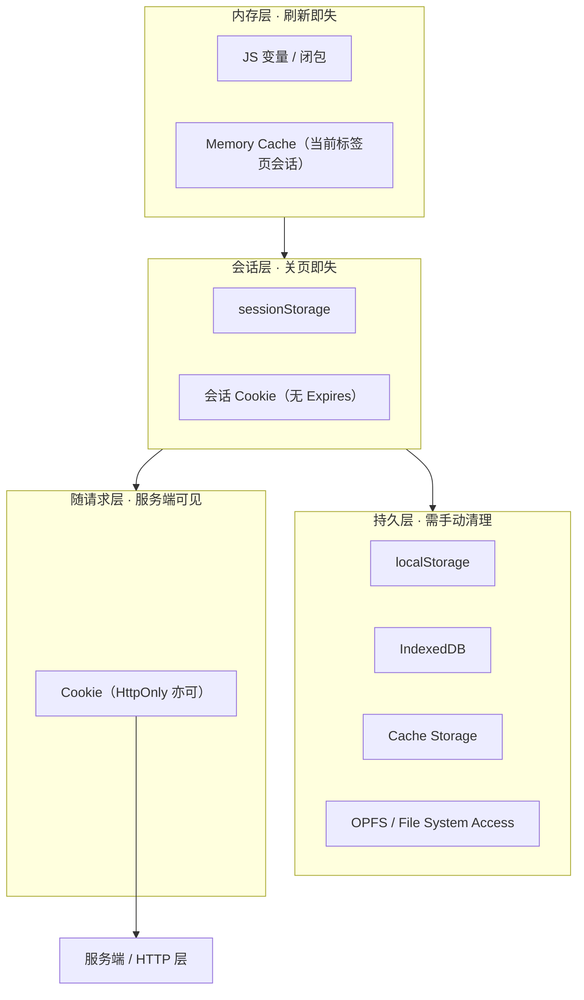
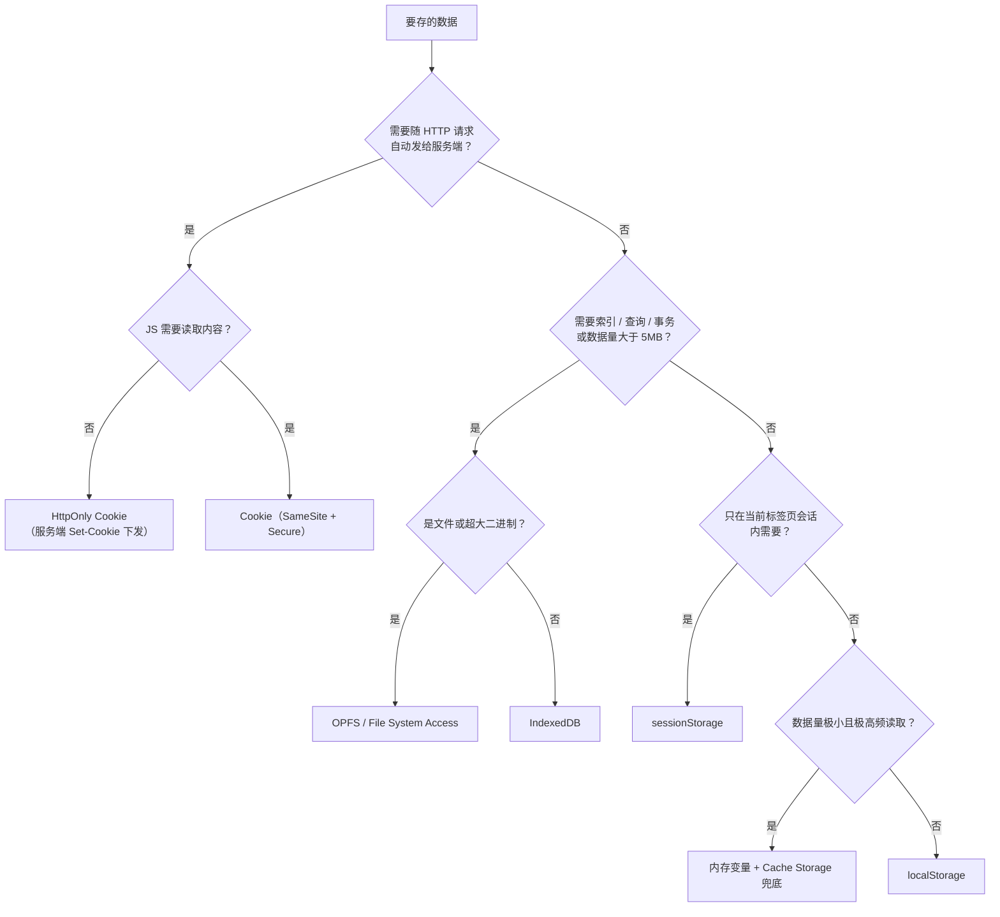

# Browser Storage Guide

> 参考资料：
>
> - [前端知识体系 — 解决方案 / 前端解决方案 / 浏览器存储（本文结构蓝本）](https://books.tedshen.cn/docs/%E8%A7%A3%E5%86%B3%E6%96%B9%E6%A1%88/%E5%89%8D%E7%AB%AF%E8%A7%A3%E5%86%B3%E6%96%B9%E6%A1%88/%E6%B5%8F%E8%A7%88%E5%99%A8%E5%AD%98%E5%82%A8/)
> - [MDN — Web Storage API（localStorage / sessionStorage）](https://developer.mozilla.org/zh-CN/docs/Web/API/Web_Storage_API)
> - [MDN — Storage quotas and eviction criteria（配额与淘汰）](https://developer.mozilla.org/en-US/docs/Web/API/Storage_API/Storage_quotas_and_eviction_criteria)
> - [MDN — IndexedDB API](https://developer.mozilla.org/zh-CN/docs/Web/API/IndexedDB_API)
> - [MDN — Cache API](https://developer.mozilla.org/zh-CN/docs/Web/API/Cache_API)
> - [MDN — StorageManager（navigator.storage：配额 / 持久化 / 分桶）](https://developer.mozilla.org/zh-CN/docs/Web/API/StorageManager)
> - [MDN — Storage API（含 OPFS、SharedStorage、Buckets）](https://developer.mozilla.org/zh-CN/docs/Web/API/Storage_API)
> - [MDN — File System Access API](https://developer.mozilla.org/zh-CN/docs/Web/API/File_System_API)
> - [HTML 标准 — Web Storage（权威规范）](https://html.spec.whatwg.org/multipage/webstorage.html)
> - [IndexedDB 标准（W3C）](https://www.w3.org/TR/IndexedDB/)
> - [Service Worker 标准 — Cache 接口](https://w3c.github.io/ServiceWorker/#cache-interface)
> - [web.dev — Storage for the web（配额与持久化实践）](https://web.dev/articles/storage-for-the-web)
> - [Chrome Developers — Storage best practices（存储分区与淘汰）](https://developer.chrome.com/docs/storage-best-practices)
> - [OWASP — HTML5 Security Cheat Sheet（客户端存储风险）](https://cheatsheetseries.owasp.org/cheatsheets/HTML5_Security_Cheat_Sheet.html)
>
> 面向角色：中高级前端工程师。本文系统梳理浏览器提供的**全部客户端存储机制**——Cookie、Web Storage、IndexedDB、Cache Storage、OPFS——的**能力边界、同步/异步模型、容量配额、淘汰策略与安全模型**，并给出可直接落地的封装代码、选型决策树、性能优化手段与生产最佳实践。阅读前置建议：先看 [浏览器核心知识手册](/fundamentals/browser/) 第五章「存储与状态管理」与 [HTTP / HTTPS 核心知识手册](/fundamentals/http/) 的缓存章节，再回到本文深入；本文是该主题的**展开篇**，也补上了浏览器手册里只给结论、没给实现的 Cache Storage、OPFS、配额持久化与离线协作细节。

---

## 目录

1. [概述](#一、概述)
2. [核心存储机制](#二、核心存储机制)
3. [技术实现方案](#三、技术实现方案)
4. [存储策略](#四、存储策略)
5. [性能优化](#五、性能优化)
6. [最佳实践](#六、最佳实践)
7. [常见问题与坑位速查](#七、常见问题与坑位速查)

---

## 一、概述

浏览器存储是 Web 应用不可或缺的一部分。它让应用在**客户端**保存数据，从而支撑四类需求：

| 需求               | 典型场景                             | 常用机制                        |
| ------------------ | ------------------------------------ | ------------------------------- |
| **状态管理**       | 登录态、用户偏好、主题、表单草稿     | Cookie / localStorage           |
| **离线能力**       | 断网可用、PWA 壳资源与接口响应缓存   | Cache Storage / IndexedDB / OPFS |
| **跨上下文通信**   | 多标签页同步、跨 iframe、跨 Worker  | storage 事件 / BroadcastChannel |
| **性能优化**       | 大对象旁路、请求去重、预读取         | Memory Cache / Cache Storage    |

现代浏览器提供了多种存储机制，每种机制都有特定的用途、优势与限制。**选择合适的存储方案对应用性能、用户体验与数据安全都至关重要**——选错的典型代价是：主线程被同步写操作卡住、离线首屏白屏、用户清缓存后功能直接失效，或把令牌放进 `localStorage` 导致一次 XSS 就全线失守。

### 1.1 存储分层全景

浏览器把「数据存在哪」分成几个层次，越往下越持久、越难被自动回收：



### 1.2 划清职责边界

客户端存储**永远不是权威数据源**。落地前先回答一个问题：**这份数据丢了，用户会怎样？**

- 丢了只是「体验降级」（主题回到默认、网络图库暂时加载不出来）→ 放心放客户端。
- 丢了等于「数据丢失」（草稿、离线编辑的文档）→ 必须**服务端为主 + 客户端为副本**，客户端只做暂存与冲突合并。
- 丢了等于「安全事故」（会话、权限）→ 用**服务端会话 + `HttpOnly` Cookie**，不要自己往 `localStorage` 里塞长期令牌。

> **反模式**：把「整个后端列表」塞进 `localStorage` 充当数据库。它没有索引、没有事务、没有并发控制，还会在每次写入时同步阻塞主线程。

### 1.3 一句话选型原则

> **数据小、要求随请求发送 → Cookie；数据小、要跨会话 → `localStorage`；数据大或要索引查询 → `IndexedDB`；缓存 HTTP 响应 → Cache Storage；离线与安装体验 → Service Worker + Cache Storage；超大文件 → OPFS。**

---

## 二、核心存储机制

### 2.1 存储机制对比

| 存储类型                | 大小限制                | 生命周期               | 同步 / 异步 | 主要用途                       | 兼容性       |
| ----------------------- | ----------------------- | ---------------------- | ----------- | ------------------------------ | ------------ |
| **Cookie**              | 单条约 4KB，每域数十条 | 可设置过期时间         | 同步        | 身份认证、会话管理             | 所有浏览器   |
| **localStorage**        | 约 5-10MB / 域          | 永久存储               | 同步        | 用户偏好、应用状态             | 现代浏览器   |
| **sessionStorage**      | 约 5-10MB / 域          | 会话期间（关页即失）   | 同步        | 临时数据、表单状态             | 现代浏览器   |
| **IndexedDB**           | 配额制，通常数百 MB+    | 永久存储               | 异步        | 复杂数据、离线应用、结构化查询 | 现代浏览器   |
| **Cache Storage**       | 配额制                  | 可控制（手动清理）     | 异步        | 网络资源缓存、离线可用         | 现代浏览器   |
| **OPFS**                | 配额制，可申请持久化    | 永久存储               | 异步        | 大文件、接近文件系统的语义     | 现代 Chromium / Safari |
| **SharedStorage**       | 配额制                  | 永久存储               | 异步        | 跨站追踪防护的选择性共享       | 需特性检测   |
| **内存（JS 变量）**     | 受内存限制              | 页面生命周期           | 同步        | 高频读、临时中间态             | 所有环境     |

> **配额说明**：除 Cookie 与 Web Storage 有硬编码的小上限外，其余机制的实际额度由 `navigator.storage.estimate()` 给出，且随磁盘剩余空间浮动——「10GB」不是承诺值。

### 2.2 存储机制选择决策树



**读图口诀（四问定归属）**：

1. **服务端要不要参与？** 要 → Cookie（不需要 JS 读就 `HttpOnly`）。
2. **要不要索引 / 事务 / 超过 5MB？** 要 → 文件走 OPFS，结构化数据走 IndexedDB。
3. **只活在当前标签页这次会话？** 是 → `sessionStorage`，否则 `localStorage`。
4. **是不是「接口/资源的响应」？** 是 → Cache Storage（配合 Service Worker），不要塞进 `localStorage`。

### 2.3 各机制的关键特点

**Cookie**

- **随每个请求自动发送**（含同域的图片、样式、API），因此体积直接影响每个请求的头部大小。
- 属性：`Domain` / `Path` / `Expires` / `Max-Age` / `Secure` / `HttpOnly` / `SameSite`。
- `HttpOnly` 的 Cookie **JS 完全读不到**（`document.cookie` 不返回它），这是防 XSS 窃取凭据的唯一手段。
- 默认 `SameSite=Lax`：跨站 POST 不携带；跨站共享需 `SameSite=None` + `Secure`。

**localStorage / sessionStorage**

- 值只能是**字符串**，复杂结构必须 `JSON.stringify` / `JSON.parse`，且要处理解析失败与循环引用。
- API **同步**：读写都在主线程上完成，大对象序列化会造成可感知的卡顿。
- 按 **origin**（协议 + 域名 + 端口）隔离；`localhost` 与 `127.0.0.1` 是**两个不同的 origin**。
- `localStorage` 跨标签页共享并派发 `storage` 事件；`sessionStorage` **每个标签页独立**，甚至不共享同一标签页的 iframe（同源标签页间是复制而非共享）。
- 隐私模式 / 禁用站点数据时，**访问属性本身就可能抛异常**（`SecurityError`）。

**IndexedDB**

- **异步**、**事务化**的键值数据库，支持**索引**与**游标遍历**，值可以是任意**结构化克隆**对象（含 `Blob`、`File`、`ArrayBuffer`、Date、Map、Set）。
- 数据按 origin 存储在磁盘，能超出 5MB 限制，容量由配额决定。
- 同一标签页内连接是阻塞式的：升级版本时若有其他连接未关闭，会触发 `blocked` 事件。

**Cache Storage**

- 以 `Request` 为键、以 `Response` 为值，专为 **Service Worker** 编程式缓存设计。
- 只能存 **GET / HEAD** 请求；不能存不透明以外的错误响应（`cache.add` 对非 2xx 会失败）。
- 支持元数据缓存（给 `Request` 挂自定义头记录真实更新时间），适合实现 stale-while-revalidate。
- 独立于 HTTP 缓存：**不自动随请求发送**，只在代码显式 `match` / SW `fetch` 拦截时生效。

**OPFS（Origin Private File System）**

- 在 origin 命名空间下提供真实的文件与目录，支持 `createWritable()` 流式写入、`FileSystemSyncAccessHandle`（仅 Worker 内）随机读写。
- 适合超大文件（视频、离线包）、接近文件系统的编辑与数据库场景（如 SQLite-WASM）。

### 2.4 容量、配额与持久化

配额由浏览器与操作系统共同决定，会随磁盘剩余空间浮动；最可靠的读法是 `navigator.storage.estimate()`：

```js
const { usage, quota, usageDetails } = await navigator.storage.estimate();

// usage / quota 单位为字节；usageDetails 可按 localStorage / indexedDB / caches 分类
console.log(
  `已用 ${(usage / 1024 / 1024).toFixed(1)}MB / 配额 ${(quota / 1024 / 1024).toFixed(0)}MB`,
);

// 判断「还能写多少」的经验阈值：留 20% 余量，避免写一半失败
const nearlyFull = usage / quota > 0.8;
```

**申请持久化**：默认情况下数据属于「尽力保留（best-effort）」，浏览器在磁盘紧张时会按 LRU 淘汰整个 origin。关键数据应主动申请持久化：

```js
// 用户尚未授权，或浏览器认为没必要（如刚安装、交互少）时会返回 false
const granted = await navigator.storage.persist();

// 查看当前状态：'granted' | 'denied' | 'prompt'
const state = await navigator.storage.persisted();
```

| 判定结果               | 含义                                                         | 应对                                   |
| ---------------------- | ------------------------------------------------------------ | -------------------------------------- |
| `granted`              | 数据不会因磁盘压力被自动淘汰                                 | 正常用                                 |
| `prompt`               | 可再次调用 `persist()` 触发用户授权弹窗                      | 在用户「导出/离线保存」等明确操作时调用 |
| `denied`               | 被拒绝或浏览器主动判定不值得保留                             | 退化为「可重建数据」，别依赖它做唯一副本 |

### 2.5 淘汰策略与存储分区

- **整源淘汰（origin eviction）**：配额不足时，浏览器可能**整体清空**某个 origin 的 IndexedDB、Cache Storage 与 localStorage（LRU，优先清最久未使用的整站数据，而不是某个键）。因此**关键数据必须有服务端副本**。
- **逐键淘汰**：`localStorage` / Cookie 在写入超限时不会静默丢弃旧键，而是让**本次写入**抛 `QuotaExceededError`（Safari 早期版本会先删最旧的键）。
- **存储分区（Storage Partitioning）**：自 2021 年起，第三方（跨站）上下文中的 `localStorage` / `IndexedDB` / Cache Storage 按**顶级站点**分区——同一个第三方脚本在 `a.com` 与 `b.com` 下看到的是**不同的存储**。这直接终结了「靠第三方脚本共享登录态」的老方案。
- **第三方 Cookie 退场**：Safari ITP 已彻底封锁第三方 Cookie；Chrome 推进隐私沙盒，跨站身份应迁移到 **FedCM**，跨站上下文共享用 **CHIPS（`Partitioned` 属性）**。

---

## 三、技术实现方案

### 3.1 Cookie 存储

> 原则：**JS 只写「非敏感」Cookie**；会话凭据一律由服务端 `Set-Cookie` 下发并打上 `HttpOnly` + `Secure` + `SameSite`。

```js
// Cookie 管理器：只负责「业务可见 Cookie」，凭据类不走这里
class CookieManager {
  static set(name, value, options = {}) {
    let cookie = `${encodeURIComponent(name)}=${encodeURIComponent(value)}`;

    if (options.expires) cookie += `; expires=${options.expires.toUTCString()}`;
    if (options.maxAge != null) cookie += `; max-age=${options.maxAge}`;
    if (options.domain) cookie += `; domain=${options.domain}`;
    if (options.path) cookie += `; path=${options.path}`;
    if (options.secure) cookie += `; secure`;
    if (options.sameSite) cookie += `; samesite=${options.sameSite}`;
    // 属性名区分大小写敏感度：samesite 值大小写不敏感，但统一用规范写法
    document.cookie = cookie;
    return this.get(name) !== null; // 校验是否真的写入成功（受 Secure / 域限制时可能失败）
  }

  static get(name) {
    const target = encodeURIComponent(name);
    for (const part of document.cookie.split(";")) {
      const [k, ...rest] = part.trim().split("=");
      if (k === target) return decodeURIComponent(rest.join("="));
    }
    return null;
  }

  static getAll() {
    return document.cookie.split(";").reduce((acc, part) => {
      const [k, ...rest] = part.trim().split("=");
      if (k) acc[decodeURIComponent(k)] = decodeURIComponent(rest.join("="));
      return acc;
    }, {});
  }

  /**
   * 删除必须「同名 + 同路径 + 同域」并把过期时间设为过去，
   * 只写 name= 会被当成另一个值的覆盖，删不掉。
   */
  static remove(name, options = {}) {
    document.cookie = `${encodeURIComponent(name)}=; expires=${new Date(0).toUTCString()}; path=${options.path ?? "/"}`;
  }
}

// 使用示例：7 天有效的偏好标记
CookieManager.set("username", "John Doe", {
  expires: new Date(Date.now() + 7 * 24 * 60 * 60 * 1000),
  path: "/",
  secure: location.protocol === "https:",
  sameSite: "strict",
});

console.log("用户名:", CookieManager.get("username"));
```

**三个必知坑**：

1. **`HttpOnly` 的 Cookie `document.cookie` 读不到**——`getAll()` 返回的字典里**永远不会包含**会话凭据，这是特性不是 bug。
2. **值里的特殊字符要编码**：`;` `,` 空格 会截断或串味；用 `encodeURIComponent`，读取时对称解码。
3. **`Secure` Cookie 在 http 页面（本地开发）写不进去**，`set` 静默失败——本地调试要临时关掉 `secure` 或用 `localhost` 之外的 HTTP 方案。

### 3.2 localStorage 存储

```js
const NS = "myapp"; // 命名空间前缀，避免与同域其他应用/埋点互相覆盖

class LocalStorageManager {
  static #k(key) {
    return `${NS}:${key}`;
  }

  /** 访问 localStorage 属性本身就可能抛异常（隐私模式 / 禁用站点数据） */
  static isSupported() {
    try {
      const probe = `${NS}:__probe__`;
      localStorage.setItem(probe, probe);
      localStorage.removeItem(probe);
      return true;
    } catch {
      return false;
    }
  }

  static set(key, value) {
    try {
      localStorage.setItem(LocalStorageManager.#k(key), JSON.stringify(value));
      return true;
    } catch (error) {
      // 两种典型失败：QuotaExceededError（超配额）与 SecurityError（隐私模式）
      console.error("localStorage 写入失败:", error.name, error.message);
      // 生产环境应降级到内存存储并上报，而不是让整个流程崩掉
      return false;
    }
  }

  static get(key, defaultValue = null) {
    try {
      const raw = localStorage.getItem(LocalStorageManager.#k(key));
      if (raw === null) return defaultValue;
      // 数据被别的版本或用户手改过时 JSON.parse 会抛，必须兜住
      return JSON.parse(raw);
    } catch {
      return defaultValue;
    }
  }

  static remove(key) {
    localStorage.removeItem(LocalStorageManager.#k(key));
  }

  static clear() {
    Object.keys(localStorage)
      .filter((k) => k.startsWith(`${NS}:`))
      .forEach((k) => localStorage.removeItem(k));
  }

  /** 用量统计：键值都按 UTF-16 计费，中文约占 3 字节/字 */
  static getSize() {
    let bytes = 0;
    for (const key of Object.keys(localStorage)) {
      bytes += key.length + (localStorage.getItem(key)?.length ?? 0);
    }
    return bytes * 2;
  }
}

// 使用示例
if (LocalStorageManager.isSupported()) {
  LocalStorageManager.set("userSettings", {
    version: 2,
    theme: "dark",
    language: "zh-CN",
    notifications: true,
  });
  console.log("用户设置:", LocalStorageManager.get("userSettings"));
}
```

> **注意 `clear()` 的作用域**：`localStorage.clear()` 会**连同同域其他应用的数据一起清掉**。共用一个域名下的多个子应用时，只按前缀删自己的键。

### 3.3 sessionStorage 存储

接口与 `localStorage` 完全一致，差别只在生命周期与作用域：

```js
class SessionStorageManager {
  static set(key, value) {
    try {
      sessionStorage.setItem(key, JSON.stringify(value));
      return true;
    } catch (error) {
      console.error("sessionStorage 写入失败:", error);
      return false;
    }
  }

  static get(key, defaultValue = null) {
    try {
      const raw = sessionStorage.getItem(key);
      return raw === null ? defaultValue : JSON.parse(raw);
    } catch {
      return defaultValue;
    }
  }

  static remove(key) {
    sessionStorage.removeItem(key);
  }
}

// 表单草稿：刷新、误关标签页后仍在，但换标签页/重开浏览器就没了
SessionStorageManager.set("checkout:form", {
  name: "John Doe",
  email: "john@example.com",
  couponCode: "SAVE10",
});
```

**作用域真相**：`sessionStorage` 是**按「顶层浏览上下文」**隔离的。同一标签页内的同源 iframe 能读到它；用 `window.open` / 链接打开的新标签页会**复制**一份初始快照（复制后两者互不相干），而不是共享。

### 3.4 跨标签页同步：storage 事件与 BroadcastChannel

```js
// ① storage 事件：localStorage 在「其他」同源文档写入时触发（自己写不触发）
window.addEventListener("storage", (event) => {
  // event.key 为 null 表示调用了 clear()
  if (event.key === null) return;
  console.log(`[${event.storageArea === localStorage ? "local" : "session"}] ${event.key}: ${event.oldValue} → ${event.newValue}`);
  if (event.key === "userSettings") reapplySettings(JSON.parse(event.newValue));
});

// ② BroadcastChannel：更通用的跨上下文广播（同源 + 跨源 iframe + Worker）
const channel = new BroadcastChannel("app-state");

// 写：改完立刻广播，不用等下一个页面的下一次写入
function updateTheme(theme) {
  localStorage.setItem("theme", theme);
  channel.postMessage({ type: "theme", theme });
}

channel.onmessage = (event) => {
  if (event.data.type === "theme") applyTheme(event.data.theme);
};
```

| 方式                | 通信范围                                 | 是否需要存储           | 典型用途                     |
| ------------------- | ---------------------------------------- | ---------------------- | ---------------------------- |
| `storage` 事件      | 同源其他文档                             | 必须是 `localStorage`  | 多标签页状态同步             |
| `BroadcastChannel`  | 同源浏览上下文（含 Worker）              | 不需要                 | 精确广播、登录态失效通知     |
| `SharedWorker`      | 同源多个标签页共享一个 Worker            | 不需要                 | 集中式状态与节流             |
| `postMessage`       | 任意 iframe（需校验 `event.origin`）     | 不需要                 | 跨窗口 / 跨应用通信          |

> `storage` 事件的**天然缺陷**：只有真正发生写入才会广播，「打开页面时不知道对方当前状态」必须主动读一次。而 `BroadcastChannel` 可以在新页面连接时主动 `postMessage` 一次做握手。

### 3.5 IndexedDB 存储

IndexedDB 是唯一「异步 + 事务 + 索引」的存储，API 原始（回调式），生产代码必须先封装成 Promise。

**第一步：把 `IDBRequest` 与事务收敛成 Promise**

```js
/** IDBRequest → Promise（错误统一 reject） */
function requestToPromise(request) {
  return new Promise((resolve, reject) => {
    request.onsuccess = () => resolve(request.result);
    request.onerror = () => reject(request.error);
  });
}

/** 事务完成 → Promise（写操作必须等它，否则可能还没落盘就当成功） */
function transactionToPromise(tx) {
  return new Promise((resolve, reject) => {
    tx.oncomplete = () => resolve();
    tx.onerror = () => reject(tx.error);
    tx.onabort = () => reject(tx.error ?? new Error("事务被中止"));
  });
}
```

**第二步：完整管理器**

```js
class IndexedDBManager {
  #dbName;
  #version;
  #db = null;
  #opening = null; // 并发 open 时复用同一个 Promise，避免开出多个连接

  constructor(dbName, version = 1) {
    this.#dbName = dbName;
    this.#version = version;
  }

  /** 打开（并复用）数据库连接 */
  async open() {
    if (this.#db) return this.#db;
    if (this.#opening) return this.#opening;

    this.#opening = new Promise((resolve, reject) => {
      const request = indexedDB.open(this.#dbName, this.#version);

      // 改结构只能在「版本升级事务」里做，且要判存在（重复 createObjectStore 会抛）
      request.onupgradeneeded = () => {
        const db = request.result;
        if (!db.objectStoreNames.contains("users")) {
          const store = db.createObjectStore("users", { keyPath: "id" });
          store.createIndex("email", "email", { unique: true });
          store.createIndex("createdAt", "createdAt"); // 范围查询走索引
        }
        if (!db.objectStoreNames.contains("kv")) {
          db.createObjectStore("kv", { keyPath: "key" });
        }
      };

      request.onsuccess = () => {
        const db = request.result;
        // 其他标签页要升级版本时必须主动让路，否则对方永远停在 blocked
        db.onversionchange = () => {
          db.close();
          this.#db = null;
        };
        this.#db = db;
        resolve(db);
      };

      request.onerror = () => reject(request.error);
      request.onblocked = () =>
        console.warn("数据库升级被其他标签页阻塞：请关闭旧页面后重试");
    }).finally(() => {
      this.#opening = null;
    });

    return this.#opening;
  }

  /** 只读事务的统一入口 */
  async #read(storeName, fn) {
    const db = await this.open();
    return fn(db.transaction(storeName, "readonly").objectStore(storeName));
  }

  /** 写事务的统一入口：等事务真正完成（落盘）才算成功 */
  async #write(storeName, fn) {
    const db = await this.open();
    const tx = db.transaction(storeName, "readwrite");
    const done = transactionToPromise(tx);
    const result = await fn(tx.objectStore(storeName));
    await done;
    return result;
  }

  async add(storeName, data) {
    return this.#write(storeName, (store) => requestToPromise(store.add(data)));
  }

  async get(storeName, key) {
    return this.#read(storeName, (store) => requestToPromise(store.get(key)));
  }

  async update(storeName, data) {
    return this.#write(storeName, (store) => requestToPromise(store.put(data)));
  }

  async delete(storeName, key) {
    return this.#write(storeName, (store) => requestToPromise(store.delete(key)));
  }

  /** 限量取数：data 量大时务必传 count，别直接 getAll 拉全表 */
  async getAll(storeName, query = null, count = 100) {
    return this.#read(storeName, (store) => requestToPromise(store.getAll(query, count)));
  }

  /** 按索引做范围查询：时间线、范围扫描这类需求必须走索引 */
  async getByIndex(storeName, indexName, query = null, count = 100) {
    return this.#read(storeName, (store) =>
      requestToPromise(store.index(indexName).getAll(query, count)),
    );
  }

  /**
   * 游标分页：按 lastKey 续读，数据量再大内存占用也是常数。
   * ⚠️ 遍历中不要 await 非 IndexedDB 的异步操作，事务会提前提交。
   */
  async getPage(storeName, { indexName = null, range = null, lastKey = null, pageSize = 100 } = {}) {
    return this.#read(storeName, (store) => {
      const source = indexName ? store.index(indexName) : store;
      // range: [start, end] 限定范围；翻页传 lastKey，lowerBound 第二参数 true 表示「不含 lastKey」
      const query = range
        ? IDBKeyRange.bound(range[0], range[1])
        : lastKey != null
          ? IDBKeyRange.lowerBound(lastKey, true)
          : null;
      return requestToPromise(source.getAll(query, pageSize));
    });
  }
}
```

**第三步：事务的「自动提交」——IndexedDB 最隐蔽的坑**

事务在**事件循环的当前任务结束时就自动提交**。只要在事务里 `await` 了一个非 IndexedDB 的异步操作（`fetch`、`setTimeout`、动态 `import`），事务早已关闭，后续 `put` 直接抛 `TransactionInactiveError`：

```js
const db = await idb.open(); // 复用管理器拿到的连接

// ❌ 事务里混入 fetch：事件循环让出后事务已提交，写入必然失败
const tx = db.transaction("users", "readwrite");
const store = tx.objectStore("users");
await fetch("/api/refresh"); // 让出事件循环 → 事务自动提交
await requestToPromise(store.add(user)); // TransactionInactiveError

// ✅ 事务内只做存储操作：网络请求放在事务外
const freshUser = await fetch("/api/refresh").then((r) => r.json());
const tx2 = db.transaction("users", "readwrite");
const done = transactionToPromise(tx2);
await requestToPromise(tx2.objectStore("users").add(freshUser));
await done; // 等事务真正提交，再当作「写入成功」
```

配套三条铁律：

- **批量写放同一个事务**：循环 1000 次 `put` 若各自开事务 = 1000 次磁盘同步；放进一个事务只提交一次。
- **写操作要 `await` 事务完成**：`request` 成功不代表落盘，`transaction.oncomplete` 才是。
- **写请求的 key 既不重复也不新增**时 `put` 才等于更新；想避免「意外覆盖」用 `add`（重复即报错）。

### 3.6 Cache Storage 与 Service Worker 离线协作

**第一步：封装 Cache 管理器**

```js
class CacheManager {
  #cacheName;

  constructor(cacheName) {
    this.#cacheName = cacheName;
  }

  async #open() {
    // caches 在 window 与 ServiceWorkerGlobalScope 中都可用
    return caches.open(this.#cacheName);
  }

  /** 预缓存应用壳：一个失败则整体 reject，因此逐个 add 更可控 */
  async addAll(urls) {
    const cache = await this.#open();
    return Promise.allSettled(
      urls.map(async (url) => {
        const response = await fetch(url, { cache: "reload" });
        if (!response.ok) throw new Error(`${url} -> ${response.status}`);
        await cache.put(url, response);
      }),
    );
  }

  async match(request, options = {}) {
    const cache = await this.#open();
    // ignoreSearch: /a?x=1 也能命中 /a；ignoreVary: 忽略 Vary 头差异
    return cache.match(request, { ignoreSearch: true, ignoreVary: true, ...options });
  }

  async put(request, response) {
    const cache = await this.#open();
    await cache.put(request, response);
  }

  async delete(request) {
    const cache = await this.#open();
    return cache.delete(request);
  }

  /** LRU 淘汰：按「缓存响应写入的时间戳元数据」排序，超配额时删最旧 */
  async trim(maxEntries = 100) {
    const cache = await this.#open();
    const keys = await cache.keys();
    if (keys.length <= maxEntries) return 0;

    const stamped = await Promise.all(
      keys.map(async (request) => {
        const response = await cache.match(request);
        const time = Number(response?.headers.get("sw-cache-time") ?? 0);
        return { request, time };
      }),
    );
    stamped.sort((a, b) => a.time - b.time);

    const excess = keys.length - maxEntries;
    await Promise.all(
      stamped.slice(0, excess).map(({ request }) => cache.delete(request)),
    );
    return excess;
  }

  async clear() {
    const cache = await this.#open();
    return cache.clear();
  }
}
```

**第二步：Service Worker 里实现 stale-while-revalidate**

```js
// sw.js —— 先缓存（快），同时后台更新，下次访问更准
const CACHE = "app-v3";
const PRECACHE = ["/", "/index.html", "/styles.css", "/app.js"];

self.addEventListener("install", (event) => {
  event.waitUntil(caches.open(CACHE).then((cache) => cache.addAll(PRECACHE)).then(() => self.skipWaiting()));
});

self.addEventListener("activate", (event) => {
  event.waitUntil(
    (async () => {
      // 只删「自己的旧版本」，别把别的应用的数据清了
      const keys = await caches.keys();
      await Promise.all(keys.filter((k) => k.startsWith("app-") && k !== CACHE).map((k) => caches.delete(k)));
      await self.clients.claim();
    })(),
  );
});

self.addEventListener("fetch", (event) => {
  const { request } = event;
  if (request.method !== "GET") return;

  const url = new URL(request.url);
  if (url.origin !== location.origin) return; // 跨域交给浏览器默认处理

  event.respondWith(
    (async () => {
      const cache = await caches.open(CACHE);
      const cached = await cache.match(request);

      const network = fetch(request)
        .then(async (response) => {
          if (response.ok) {
            const headers = new Headers(response.headers);
            headers.set("sw-cache-time", String(Date.now())); // 供 LRU 淘汰使用
            await cache.put(request, new Response(response.clone().body, { status: response.status, headers }));
          }
          return response;
        })
        .catch(() => null);

      return cached ?? (await network) ?? new Response("离线且无缓存", { status: 504 });
    })(),
  );
});
```

> **离线优先的取舍**：全量「缓存优先」会让用户长时间看到旧版本。生产上通常只对 **App Shell 与静态资源**用缓存优先，**接口数据**用 network-first 或 stale-while-revalidate。

### 3.7 OPFS：超大文件与接近文件系统的语义

```js
// 前提：navigator.storage.getDirectory 可用（现代 Chromium / Safari）
async function saveOfflineFile(name, blobOrArrayBuffer) {
  const root = await navigator.storage.getDirectory();
  const handle = await root.getFileHandle(name, { create: true });
  const writable = await handle.createWritable();
  await writable.write(blobOrArrayBuffer); // 流式写入，不整块进内存
  await writable.close();
  return handle;
}

async function readOfflineFile(name) {
  const root = await navigator.storage.getDirectory();
  const handle = await root.getFileHandle(name);
  return handle.getFile();
}

// Web Worker 内可用同步访问句柄，适合 SQLite-WASM / 大文件随机读写
// const access = await handle.createSyncAccessHandle();
```

> **选它而不是 `localStorage`**：数据量、写入是否需要流式、以及是否需要「文件名 / 目录」语义。纯小键值对用不上，徒增兼容性成本——一律**特性检测后再用**。

---

## 四、存储策略

### 4.1 按数据属性选型

把「一份数据」拆成决策矩阵，避免整包塞进一个存储：

| 数据                    | 体积 | 是否要随请求发给服务端 | 敏感性 | 推荐机制            | 兜底方案                     |
| ----------------------- | ---- | ---------------------- | ------ | ------------------- | ---------------------------- |
| 会话凭据 / Refresh Token | 小   | **是**                 | 极高   | `HttpOnly` Cookie   | 服务端会话，无客户端兜底     |
| 用户偏好（主题、语言）  | 极小 | 否                     | 低     | `localStorage`      | 默认值                       |
| 权限 / 功能开关         | 小   | 否                     | 中     | `localStorage`      | 默认值 + 重新拉取           |
| 表单草稿                | 小   | 否                     | 中     | `sessionStorage`    | 内存 + 提交前不落盘         |
| 业务列表 / 消息         | 中   | 否                     | 中     | `IndexedDB`         | 网络 + 内存缓存              |
| 离线地图包 / 大附件     | 大   | 否                     | 低     | `OPFS` / `IndexedDB`| 提示用户联网下载             |
| HTTP 响应（接口 + 资源）| 中大 | 否                     | 低     | `Cache Storage`     | 直连网络                     |
| 运行时中间态            | 任意 | 否                     | 低     | 内存变量            | 无（重建即可）               |

### 4.2 统一存储门面：把选型收敛到一处

业务代码不应该到处出现 `localStorage.setItem`，否则清理、命名空间、降级无从谈起。用一个门面统一出口：

```js
class StorageManager {
  #idb;
  #cache;

  constructor() {
    this.#idb = new IndexedDBManager("AppDB", 1);
    this.#cache = new CacheManager("api-v1");
  }

  /**
   * 路由：按数据类型 + 体积 + 是否随请求发送，落到具体机制。
   * 这里返回的是「适配器」，统一暴露 store / retrieve / remove 三个方法。
   */
  #route(type) {
    switch (type) {
      case "auth": // 凭据不在客户端：只保留一个「是否登录」的标记
        return CookieManager;
      case "userPrefs":
        return LocalStorageManager;
      case "temp":
        return SessionStorageManager;
      case "http":
        return this.#cache;
      default:
        return this.#idb;
    }
  }

  async store(key, value, options = {}) {
    const { type = "userPrefs", storeName = "kv" } = options;
    const target = this.#route(type);

    try {
      if (target === this.#idb) {
        await target.open();
        await target.update(storeName, { key, value, updatedAt: Date.now() });
        return true;
      }
      if (target === this.#cache) {
        await target.put(new Request(key), new Response(JSON.stringify(value)));
        return true;
      }
      return target.set(key, value);
    } catch (error) {
      // 存储层失败绝不能拖垮业务流程：降级 + 上报
      console.error("存储失败:", error);
      return false;
    }
  }

  async retrieve(key, options = {}) {
    const { type = "userPrefs", storeName = "kv" } = options;
    const target = this.#route(type);

    try {
      if (target === this.#idb) {
        await target.open();
        const record = await target.get(storeName, key);
        return record ? record.value : null;
      }
      if (target === this.#cache) {
        const hit = await target.match(key);
        return hit ? hit.json() : null;
      }
      return target.get(key);
    } catch (error) {
      console.error("读取失败:", error);
      return null;
    }
  }

  async remove(key, options = {}) {
    const { type = "userPrefs", storeName = "kv" } = options;
    const target = this.#route(type);

    try {
      if (target === this.#idb) {
        await target.open();
        await target.delete(storeName, key);
        return true;
      }
      if (target === this.#cache) return target.delete(key);
      target.remove(key);
      return true;
    } catch (error) {
      console.error("删除失败:", error);
      return false;
    }
  }
}

const storage = new StorageManager();

await storage.store("authToken", "abc123", { type: "auth" });
await storage.store("theme", "dark", { type: "userPrefs" });
await storage.store("formData", { name: "John" }, { type: "temp" });
await storage.store("list", largeArray, { type: "http" });
```

> **门面的真正价值不在「省代码」**，而在三点：清理有唯一入口、失败有统一降级、存储位置变更（比如从 `localStorage` 迁到 IndexedDB）时业务代码零改动。

### 4.3 版本迁移、TTL 与过期清理

客户端数据会「活过」一次发版，因此**必须自带版本与有效期**：

```js
// 当前结构版本：键名里带版本，避免与旧版本的脏数据互相污染
const SCHEMA_VERSION = 2;
const KEY = `settings:v${SCHEMA_VERSION}`;
const DEFAULTS = { version: SCHEMA_VERSION, theme: "system", language: "zh-CN", notifications: true };

/** 启动时执行一次：结构升级 + 过期清理 */
function migrateLocalData() {
  const raw = LocalStorageManager.get(KEY);
  if (!raw) return LocalStorageManager.set(KEY, DEFAULTS); // 首次进入，或数据已被清理

  // ① 结构迁移：逐版本递进，不要用一个大 if 覆盖所有历史版本
  let next = raw;
  if (next.version === 1) {
    next = { ...next, version: 2, theme: next.theme ?? "system", notifications: next.notify ?? true };
    delete next.notify; // 重命名字段后必须删旧键，否则半迁移数据会一直残留
  }
  // 版本对不上（比当前还新，说明用户回滚了发版）就回默认值，别让带病数据继续跑
  if (next.version !== SCHEMA_VERSION) return LocalStorageManager.set(KEY, DEFAULTS);
  LocalStorageManager.set(KEY, next);

  // ② 过期清理：缓存类数据统一带 TTL，只扫索引不扫全库
  const now = Date.now();
  const CACHE_INDEX = `cacheIndex:v${SCHEMA_VERSION}`;
  const index = LocalStorageManager.get(CACHE_INDEX, []);
  const alive = index.filter((item) => now - item.at < 7 * 24 * 60 * 60 * 1000); // 7 天
  if (alive.length !== index.length) LocalStorageManager.set(CACHE_INDEX, alive);
}
```

三条实践要点：

- **迁移函数幂等且可重复执行**（发版回滚时旧迁移会再跑一遍）。
- **TTL 索引与数据分离**：数据在 IndexedDB / Cache Storage，索引（key + 时间戳）放 `localStorage`，清理时只扫索引，不用遍历全库。
- **破坏性变更要留一个版本的兼容读取**：新版本上线后仍有用户在旧标签页里跑老代码。

### 4.4 安全边界：令牌到底放哪

| 方案                                       | XSS 可读 | CSRF 风险 | 自动过期 | 结论                                       |
| ------------------------------------------ | -------- | --------- | -------- | ------------------------------------------ |
| `localStorage` 存 Token                   | ✅ 可读   | ❌ 无     | ❌ 需自建 | 不推荐：一次 XSS 全线失守                   |
| `sessionStorage` 存 Token                 | ✅ 可读   | ❌ 无     | ❌ 需自建 | 同上，且关页即失效体验差                   |
| 内存变量存 Token                           | ✅ 可读   | ❌ 无     | 刷新即失 | 最安全但刷新掉登录，适合配合静默续期       |
| **`HttpOnly` + `Secure` + `SameSite` Cookie** | ❌ 读不到 | ✅ 需 `SameSite` / Token 防护 | ✅ 由服务端控制 | **推荐**：服务端会话 + 短期访问令牌 |

配套要点：

1. **本地「加密」不是安全边界**：`AES` 密钥只要还放在前端就能被取出来；XSS 下同源脚本拥有完全相同的权限。
2. **凭据不写进 URL**：URL 会进历史记录、Referer、日志与截图。
3. **一律走 HTTPS**：混合内容与明文传输等于把令牌公开。
4. **校验与最小权限**：客户端存储里的任何数据都不可信，服务端必须重新鉴权与校验。

---

## 五、性能优化

### 5.1 先认清同步 API 的阻塞代价

`localStorage` / `sessionStorage` / `Cookie` 的读写是**同步**的：调用发生在主线程上，期间不能响应输入与渲染。

| 反模式                                   | 后果                                                  |
| ---------------------------------------- | ----------------------------------------------------- |
| 循环里反复 `JSON.parse` 大数组           | 每轮都重新解析，10 万条 ≈ 主线程卡死数百毫秒          |
| 每次 `input` 事件都写一次 `localStorage` | 每字符一次序列化 + 磁盘写，触发长任务                 |
| 把整份接口响应塞进 `localStorage`        | 单次写入可能同步序列化几十 MB，触发 `QuotaExceededError` |
| 启动时串行读 20 个大键                  | 首屏直接被拖慢几百毫秒                                |

### 5.2 内存缓存 + 写合并队列

高频读走内存，高频写合并；这是把「同步存储」用出「异步存储」手感的关键模式：

```js
class OptimizedStorage {
  #queue = [];
  #cache = new Map();
  #draining = false;

  /** 读：内存优先 */
  get(key) {
    if (this.#cache.has(key)) return this.#cache.get(key);
    const raw = localStorage.getItem(key);
    const value = raw === null ? null : JSON.parse(raw);
    this.#cache.set(key, value);
    return value;
  }

  /** 写：先更新内存（保证读到的值立刻一致），真正落盘排队合并 */
  set(key, value) {
    this.#cache.set(key, value);
    this.#queue.set(key, { type: "set", key, value });
    this.#drain();
  }

  remove(key) {
    this.#cache.delete(key);
    this.#queue.set(key, { type: "remove", key });
    this.#drain();
  }

  async #drain() {
    if (this.#draining) return;
    this.#draining = true;

    while (this.#queue.size > 0) {
      const batch = [...this.#queue.values()].slice(0, 20); // 每批最多 20 个键
      batch.forEach((op) => this.#queue.delete(op.key));

      try {
        for (const op of batch) {
          if (op.type === "set") {
            localStorage.setItem(op.key, JSON.stringify(op.value));
          } else {
            localStorage.removeItem(op.key);
          }
        }
      } catch (error) {
        console.error("批量写入失败:", error); // 超配额时降级 + 上报
      }
      // 让出主线程：避免一次合并把整帧占满
      await new Promise((resolve) => setTimeout(resolve, 0));
    }

    this.#draining = false;
  }

  /** 页面隐藏时把残留写入同步刷掉，防止丢数据 */
  flush() {
    for (const op of this.#queue.values()) {
      if (op.type === "set") localStorage.setItem(op.key, JSON.stringify(op.value));
      else localStorage.removeItem(op.key);
    }
    this.#queue.clear();
  }
}

window.addEventListener("pagehide", () => storage.flush());
```

> **为什么要 `flush`**：`pagehide` / `visibilitychange` 时可能还有队列没落盘，队列里的数据会丢。`pagehide` 比 `unload` 可靠（bfcache 下 `unload` 可能不触发）。

### 5.3 读写调度：节流、防抖与空闲时间

| 场景                       | 手法                                           |
| -------------------------- | ---------------------------------------------- |
| 输入框实时存草稿           | **防抖** 300-500ms + `pagehide` 时强制 flush   |
| 滚动 / 拖拽过程中的位置记录 | **节流**（`requestAnimationFrame` 合帧）      |
| 大批量数据迁移、预取       | `requestIdleCallback` / `scheduler.yield()`    |
| 重计算解码（Base64、图片）  | **Web Worker**，算完只回写最终结果             |

```js
// 合帧节流：一帧内多次调用只执行一次
function rafThrottle(fn) {
  let queued = false;
  return (...args) => {
    if (queued) return;
    queued = true;
    requestAnimationFrame(() => {
      queued = false;
      fn(...args);
    });
  };
}
```

### 5.4 IndexedDB 的批量化要点

```js
/** 把 N 次独立事务合并成 1 次事务：1000 条数据的写入耗时可差一个数量级 */
async function bulkInsert(db, storeName, records) {
  const tx = db.transaction(storeName, "readwrite");
  const done = transactionToPromise(tx);
  const store = tx.objectStore(storeName);

  for (const record of records) {
    store.put(record); // 不 await：让它们排队进同一个事务
  }

  await done; // 只等一次事务完成
}
```

- **索引不是越多越好**：每个索引都会拖慢写入并放大磁盘占用，只给真正用于查询的字段建索引。
- **避免 `getAll()` 拉全表**：用 `getAll(query, count)` 限定数量，或用 `getPage()` 按游标续读（见 3.5）。
- **大 Blob 别直接进 IndexedDB**：先放 OPFS，库里只存文件句柄元数据，可显著降低内存与升级开销。

### 5.5 缓存失效：TTL、版本号与 LRU

```js
/**
 * 版本号 + 构建指纹：发版即整体失效，不需要逐条清理。
 * BUILD_HASH / SCHEMA_VERSION 由构建期注入（Vite 的 import.meta.env、DefinePlugin 等），
 * 纯手写项目可以退化成一次构建的日期时间戳。
 */
const CACHE_VERSION = `app-${BUILD_HASH}-${SCHEMA_VERSION}`;

/** 应用启动时跑一次 */
async function invalidateStaleCaches() {
  if (localStorage.getItem("app-version") === CACHE_VERSION) return;

  for (const name of await caches.keys()) {
    // 只删「自己前缀下、且不是当前版本」的缓存，别误伤其他应用
    if (name.startsWith("app-") && name !== CACHE_VERSION) await caches.delete(name);
  }

  localStorage.setItem("app-version", CACHE_VERSION);
}
```

缓存类数据的生命周期建议：

| 数据            | 建议 TTL | 理由                                       |
| --------------- | -------- | ------------------------------------------ |
| App Shell / JS  | 版本号   | 内容随构建变，不需要时间维度               |
| 第三方 SDK 脚本 | 7-30 天  | 体积大、变更少                             |
| 接口响应        | 5-30 分钟 | 过期代价高，配合 stale-while-revalidate    |
| 用户草稿        | **不设 TTL** | 有业务价值，按版本迁移而非过期           |

> **LRU 的正确实现位置**：数据在 Cache Storage / IndexedDB，**排序索引放 `localStorage`**，淘汰时只读索引，避免全库扫描（实现见 3.6 的 `trim()`）。

### 5.6 监控与自检

- **DevTools → Application**：`Local Storage` / `Session Storage` / `IndexedDB` / `Cache Storage` 四个面板可直接查看与删除；勾 **「Disable cache」** 排除 HTTP 缓存干扰。
- **配额巡检**：`navigator.storage.estimate()` 埋点上报，`usage / quota > 0.8` 时告警；生产环境把「写入抛 `QuotaExceededError`」纳入错误监控。
- **淘汰演练**：在 DevTools → Application → Storage 里点 **Evict site data** 模拟磁盘压力，验证应用是否优雅降级而不是白屏。
- **自动化用例**：存储相关逻辑应有「清空后首次访问」「多标签页并发写」「超配额写入」三条用例兜底。

---

## 六、最佳实践

### 6.1 数据分类与生命周期

1. **按敏感性 + 体积 + 生命周期给数据分类**，先分类再选机制（见 4.1）。
2. **客户端只存「可重建」或「可丢失」的副本**，权威数据必须落在服务端。
3. **为缓存类数据实现 TTL**，并把「过期」做成渐进降级（过期 → 回源 → 失败 → 用旧值），而不是直接报错。
4. **发版即失效**：用版本号 / 构建指纹做整体失效，避免新代码读到旧结构。
5. **提供「清除本地数据」入口**（合规要求，也是排查问题的逃生口）。

### 6.2 安全防护

1. **凭据只放 `HttpOnly` + `Secure` + `SameSite` Cookie**；`localStorage` 最多放「是否登录」这类无敏标记。
2. **客户端加密不是安全边界**，密钥不可与密文同源存储；高敏感数据必须服务端校验。
3. **全面 HTTPS**，杜绝混合内容。
4. **所有读取都做数据校验**：`JSON.parse` 后校验结构与类型（用户可能手改、手动清缓存、或被注入脏数据）。
5. **防 XSS 组合拳**：`HttpOnly` 挡住令牌窃取、CSP 限制注入面、输出转义挡入口——三者缺一可绕（详见 [浏览器核心知识手册](/fundamentals/browser/) 第六章）。

### 6.3 性能与容错

1. **异步优先**：能用 IndexedDB / Cache Storage 就不要用同步 API；大计算搬进 Web Worker。
2. **批量优先**：批量写合并成一个事务 / 一批 `put`，读用游标分页。
3. **内存缓存 + 写合并**：高频读命中内存，高频写合并落盘，离开页面前 `flush`。
4. **读写调度**：输入类防抖、滚动类合帧、迁移类进空闲期。
5. **每层都有降级**：能力检测 → 不可用则走内存 → 再不可用则纯内存运行，**永远不要让存储失败冒泡成页面崩溃**。
6. **错误可观测**：区分「不支持」「超配额」「解析失败」「被拒权」四类错误并分别上报。

### 6.4 开发规范清单

| 规范                   | 具体要求                                                             |
| ---------------------- | -------------------------------------------------------------------- |
| **单一出口**           | 业务代码不直接调 `localStorage`，统一走存储门面                       |
| **命名空间**           | 键名带前缀（`app:settings`）与版本（`app:v2:settings`），避免同域互相污染 |
| **结构化访问**         | 只暴露 `get/set/remove`，把 `JSON.stringify` / `parse` 收在内部       |
| **默认值内建**         | `get(key, defaultValue)` 必须有默认值，不把 `null` 抛给业务          |
| **能力检测**           | OPFS / Cache Storage / `BroadcastChannel` 一律先检测再使用          |
| **清理可控**           | `clear()` 只删自己的前缀；缓存清理有上限与 TTL                       |
| **测试覆盖**           | 覆盖「无痕 / 禁用站点数据 / 超配额 / 多标签页」四种环境              |

---

## 七、常见问题与坑位速查

| 现象                                          | 根因                                                       | 处理                                                       |
| --------------------------------------------- | ---------------------------------------------------------- | ---------------------------------------------------------- |
| `localStorage.setItem` 抛 `QuotaExceededError` | 超配额（且不会自动删旧键）                                 | 改用 IndexedDB / 精简数据 + 清理 TTL                       |
| 无痕模式下读 `localStorage` 直接抛异常        | 存储被禁用，**访问属性即抛**                               | `try/catch` + `isSupported()` 探针，失败走内存降级          |
| `localStorage.clear()` 把别人的数据也清了      | 按 origin 隔离，同域所有应用共享一个存储                   | 只删带自己前缀的键                                          |
| IndexedDB 报 `TransactionInactiveError`       | 事务里 `await` 了非 IndexedDB 的异步操作                   | 网络请求放事务外，写操作只在一个同步段内排队               |
| IndexedDB 升级一直 pending                    | 其他标签页连接未关闭，触发 `blocked`                       | 连接上监听 `onversionchange` 主动 `close()`                 |
| `cache.addAll` 失败导致一个都没缓存            | 原子操作，任一资源失败整体 reject                          | 改逐个 `fetch` + `cache.put` + `allSettled`                 |
| 离线模式白屏                                  | Service Worker 只缓存了 HTML，JS/CSS 未缓存                | App Shell 全量预缓存 + 版本号清理                          |
| 多标签页数据互相覆盖                          | 没有版本号 / 时间戳做乐观并发                              | 记录 `updatedAt` + `writerId`，冲突时以新者为准并提示       |
| 线上数据被莫名清空                            | 浏览器磁盘紧张时**整源淘汰**                               | 关键数据申请 `navigator.storage.persist()`                 |
| 第三方脚本读不到共享的登录态                  | 存储分区 / 第三方 Cookie 被拦                              | 迁移 FedCM 或 CHIPS，不要靠 `localStorage` 跨站共享        |
| `storage` 事件收不到自己写的值                | 规范如此：**只通知其他文档**                               | 需要同步到自己就写完直接更新本地状态                       |
| `Secure` Cookie 在本地写不进去                | http 页面不允许写 `Secure` Cookie                          | 本地调试关掉 `secure`，或用自签名 https                    |

### 7.1 高频面试速记

1. **Cookie vs `localStorage` vs IndexedDB？** → 4KB / 随请求发送 / 同步 / 可被服务端读取 vs 5MB / 不发送 / 同步 / 仅同源脚本可读 vs 配额制 / 异步 / 事务 + 索引 + 任意结构化克隆（2.1）。
2. **`localStorage` 存 Token 的风险？** → XSS 可直接读取，一次注入全线失守；应改用 `HttpOnly` Cookie（4.4）。
3. **IndexedDB 事务为什么会自动提交？** → 事务在当前任务结束时提交，任何 `await` 都会让出事件循环导致事务失效（3.5）。
4. **Storage Storage 与 HTTP 缓存的区别？** → 前者由代码显式读写、只存 GET/HEAD、可编程控制策略；后者由浏览器按 `Cache-Control` / `ETag` 自动管理（2.3）。
5. **数据什么时候会被浏览器清掉？** → 非持久化源在磁盘压力下按 LRU **整源淘汰**；`persist()` 可申请豁免（2.5）。
6. **离线优先怎么做？** → Service Worker `install` 预缓存 App Shell + 版本号清理旧缓存 + `fetch` 里 stale-while-revalidate，接口数据用 network-first（3.6）。
7. **怎么做跨标签页同步？** → `storage` 事件（只能被动等写入）或 `BroadcastChannel`（可主动握手），登录态失效用后者更及时（3.4）。

---

> 本文持续更新。核心心法：**「客户端存储只解决三类问题——体验（偏好与草稿）、性能（缓存与旁路）、离线（App Shell 与数据副本）」**，其余数据都该问一句「为什么不是服务端负责」。选型时先看**同步还是异步、有没有配额、丢一次的代价**，再决定用哪一层；写完后一定在 DevTools 的 **Application** 面板里亲手删一次、清一次、Evict 一次，确认应用是降级而不是白屏。


