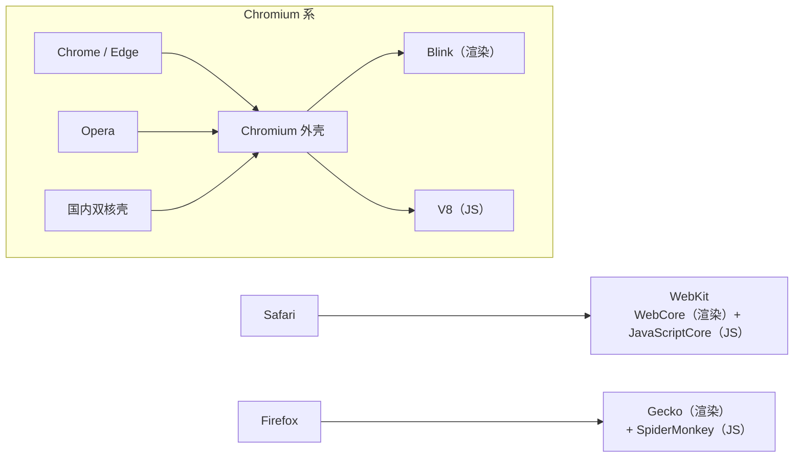
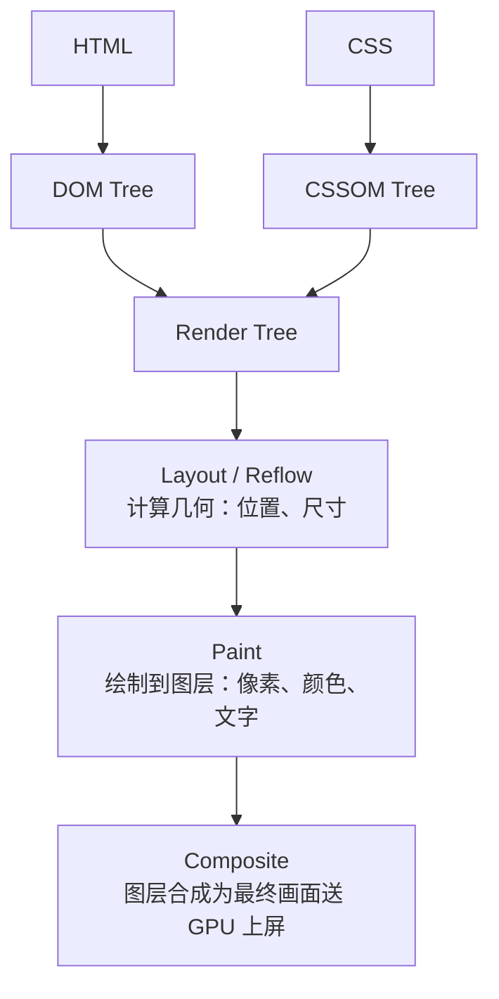
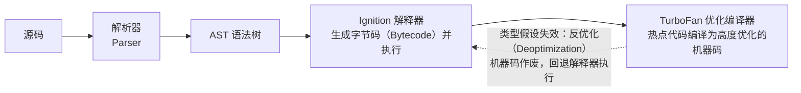

# 浏览器核心知识手册

> 参考资料：
>
> - [MDN Web Docs — 浏览器相关](https://developer.mozilla.org/zh-CN/docs/Web)
> - [MDN — 浏览器工作原理（Inside look at modern web browser）](https://developer.mozilla.org/zh-CN/docs/Web/Performance/How_browsers_work)
> - [web.dev — 渲染性能/Web Vitals](https://web.dev/)
> - [现代 JavaScript 教程 — 页面生命周期：DOMContentLoaded，load，beforeunload，unload](https://zh.javascript.info/onload-ondomcontentloaded)
> - [现代 JavaScript 教程 — 加载文档和其他资源（脚本 async/defer、资源 onload/onerror）](https://zh.javascript.info/loading)
> - [现代 JavaScript 教程 — Document（浏览器环境、DOM 树、遍历、搜索、节点属性、修改文档、样式与类、尺寸滚动、坐标）](https://zh.javascript.info/document)
> - [现代 JavaScript 教程 — 事件简介（冒泡与捕获、事件委托、浏览器默认行为、自定义事件）](https://zh.javascript.info/events)
> - [现代 JavaScript 教程 — UI 事件（鼠标、移动鼠标、拖放、指针事件、键盘、滚动）](https://zh.javascript.info/event-details)
> - [现代 JavaScript 教程 — 表单，控件（表单属性与方法、focus/blur、change/input、submit）](https://zh.javascript.info/forms-controls)
> - [现代 JavaScript 教程 — 杂项（MutationObserver、Selection 和 Range、事件循环）](https://zh.javascript.info/ui-misc)
> - [WinDocs — 浏览器原理（Chrome 架构 / 从 URL 到页面呈现 / 渲染原理 / 浏览器存储 / JS 执行机制 / 页面循环系统）](https://dongmeng22.github.io/docs/basics/browser/)
>
> 面向角色：中高级前端工程师。本文不仅罗列规范，更侧重**浏览器实际行为**、**常见坑点**与**调试手段**。与 `HTTP / HTTPS 核心知识手册`（HTTP 协议层）互补：本文聚焦**浏览器内部** — 架构、渲染、JS 引擎、缓存/存储、安全、性能调试。第九～十二章补上浏览器暴露给脚本的一侧：**页面生命周期与资源加载、DOM 模型与文档操作、DOM 事件模型、UI 事件与表单控件**。
>
> 补充说明：第一、二、三、四、五章分别补入**进程/线程隔离动机与面向服务的架构（1.6～1.7）**、**渲染流水线逐阶段详解（2.8）**、**执行上下文与变量提升、调用栈、词法环境与块级作用域、作用域链/闭包/this 绑定、事件循环规范细节与 async/await 原理（3.6～3.9）**、**刷新行为对缓存的影响（4.7）**、**Application Cache 与存储选型速查（5.7～5.8）**。

---

## 目录

1. [浏览器架构与运行原理](#一、浏览器架构与运行原理)
2. [渲染原理与关键渲染路径](#二、渲染原理与关键渲染路径)
3. [JavaScript 引擎与执行机制（V8）](#三、javascript-引擎与执行机制-v8)
4. [网络与资源加载](#四、网络与资源加载)
5. [存储与状态管理](#五、存储与状态管理)
6. [安全机制](#六、安全机制)
7. [性能与调试](#七、性能与调试)
8. [兼容性与 Web 平台能力](#八、兼容性与-web-平台能力)
9. [页面生命周期与脚本加载](#九、页面生命周期与脚本加载)
10. [DOM 模型与文档操作](#十、dom-模型与文档操作)
11. [DOM 事件模型](#十一、dom-事件模型)
12. [UI 事件与表单控件](#十二、ui-事件与表单控件)

---

## 一、浏览器架构与运行原理

### 1.1 多进程架构

现代主流浏览器（Chrome / Edge / 新版 Opera 等 Chromium 系）采用**多进程（Multi-process）架构**，核心进程如下：

| 进程         | 进程分类         | 职责                                                                 | 说明                                                                         |
| ------------ | ------------ | -------------------------------------------------------------------- | ---------------------------------------------------------------------------- |
| **Browser**  | 主进程       | 地址栏、书签、前进后退、UI、导航、管理其他进程、部分网络与存储、下载 | 用户直接接触的"外壳"，崩溃则整个浏览器挂掉                                   |
| **Renderer** | 渲染进程     | 解析 HTML/CSS、构建 DOM、执行 JS、渲染页面                           | 默认**每个标签页一个**（受 Site Isolation 影响），运行在**沙箱**中，权限极低 |
| **GPU**      | GPU 进程     | 处理 GPU 任务、图层合成、3D/Canvas/WebGL 加速                        | 所有标签页共用                                                               |
| **Network**  | 网络服务进程 | 网络请求、DNS、socket                                                | Chromium 可将其独立为进程（也可置于 Browser 进程内）                         |
| **Plugin**   | —            | 早期 NPAPI 插件（Flash 等）                                          | 已基本淘汰                                                                   |
| **Utility**  | —            | 各类辅助任务（如音频解码、打印、文件格式转换）                       | 按需派生                                                                     |

> 进程间通过 **IPC（Inter-Process Communication）** 通信。渲染进程不直接接触磁盘/网络/系统，必须经 Browser 进程代理 — 这是安全沙箱的基础。

**为什么要多进程？**

- **稳定性**：某个标签页渲染进程崩溃（JS 死循环、OOM）只会冻住该页，不影响其他页与浏览器本身。
- **安全性**：渲染进程沙箱化，即便被恶意页面攻破，也拿不到操作系统级权限。
- **性能隔离**：多核并行，一个进程长时间运算不阻塞其他页。

### 1.2 渲染进程内的线程

一个渲染进程内部又分多个**线程**，关键三者：

| 线程                              | 职责                                                                                                                                       |
| --------------------------------- | ------------------------------------------------------------------------------------------------------------------------------------------ |
| **主线程（Main thread）**         | 解析 HTML/CSS、运行 JS、计算样式（Style）、执行布局（Layout/Reflow）、处理大多数用户输入事件。GUI 渲染与 JS 执行**互斥（同处主线程）**     |
| **合成线程（Compositor thread）** | 处理滚动、平移缩放，运行合成器，把页面拆分成图层、确定绘制顺序，生成绘制指令交给光栅线程。**不依赖主线程**，所以滚动即使主线程卡死也能响应 |
| **光栅线程（Raster thread）**     | 将绘制指令（Paint 命令）光栅化为位图（像素）。可有多个并行                                                                                 |

> 其他还有：Worker 线程（Web Worker）、音频线程、网络线程等。
> **关键认知**：`transform`/`opacity` 动画只走**合成线程**（无需主线程参与），因此极其流畅；而改 `width`/`top` 会触发主线程的布局与绘制，容易掉帧。

### 1.3 引擎关系：Chromium / WebKit / Gecko / Blink / V8

**浏览器 = 外壳 + 渲染引擎 + JS 引擎**。理清关系（这是高频混淆点）：

- **Chromium**
> Google 开源的**浏览器项目**（Chrome、Edge、Opera、国内多数"双核"壳的底层都基于它）。它本身不是引擎，而是一整套浏览器实现。
- **Blink**
> Chromium 的**渲染引擎**（2013 年从 WebKit 分叉出来），负责 HTML/CSS 解析、DOM 树、布局、渲染树、绘制。
- **V8**
> Google 的 **JavaScript 引擎**（独立项目，Node.js / Deno / Electron 也都用它），负责解析并执行 JS、编译为机器码。运行在渲染进程内。
- **WebKit**
> Apple 的引擎，Safari 使用。由渲染引擎 **WebCore** + JS 引擎 **JavaScriptCore（JSC）** 组成。Blink 源自 WebKit 的 WebCore。
- **Gecko**
> Mozilla 的引擎，Firefox 使用，JS 引擎是 **SpiderMonkey**。



> 一句话记忆：**Blink 管"画页面"，V8 管"跑 JS"；二者都在 Chromium 里，而 Chromium 是 Chrome/Edge 的内核。**

### 1.4 多标签页与进程隔离（Site Isolation）

- **早期（单进程/多标签单进程）**：一个标签页崩溃拖垮全部。现代已弃用。
- **每个标签页一进程**：标签页间崩溃隔离。但同一网站多个标签页可能**共享进程**以省内存（依赖启发式策略）。
- **Site Isolation（站点隔离）**：把**每个跨站站点**放在独立的渲染进程里。关键定义：
  - **"site"（站点）** = `scheme` + **eTLD+1**（有效顶级域名+一级，如 `https://mail.google.com` 与 `https://docs.google.com` 的 site 都是 `google.com`）。
  - 跨 site 的 `<iframe>` 也会被分配**独立进程**（OOPIF — Out-of-Process Iframe）。
  - **目的**：防御 Spectre 等 CPU 侧信道攻击 — 即使 JS 能"猜"到相邻内存，跨进程也物理隔离、拿不到跨站数据。

> 在 DevTools → `Shift+Esc`（Chrome 任务管理器）或 `chrome://process-internals` 可看到每个标签页/iframe 对应的进程 ID，验证隔离是否生效。

### 1.5 浏览器如何加载一个网站（从输入 URL 到首屏渲染）

这是串联全篇的经典流程：

- 1. **地址栏输入 / 点击链接** → Browser 进程接收，校验 URL、补全协议。
- 2. **DNS 解析**：查缓存（浏览器 → 系统 hosts → 本地 DNS → 递归查询）→ 得到 IP。
- 3. **建立连接**：TCP 三次握手；若是 HTTPS，再 TLS 握手（证书校验、密钥协商）。HTTP/2 或 HTTP/3(QUIC) 在此协商。
- 4. **发送请求**：Browser 进程经 Network 进程发出 HTTP 请求（带 Cookie、缓存校验头等）。
- 5. **响应处理**：服务器返回 HTML；浏览器按 `Cache-Control`/`ETag` 等决定是否走缓存（详见第四章）。
- 6. **解析与构建**
  - 6.1 渲染进程**主线程**解析 HTML 生成 **DOM 树**；
  - 6.2 遇到 `<link>` CSS 构建 **CSSOM**；
  - 6.3 遇到 `<script>`（非 async/defer）**阻塞解析**执行 JS。
- 7. **关键渲染路径（CRP）**：DOM + CSSOM → **Render Tree** → **Layout（Reflow）** → **Paint** → **Composite**，首次像素出现在屏幕（首次绘制 FP / 最大内容绘制 LCP）。
- 8. **持续加载**：图片、字体、JS、CSS 异步资源继续加载；JS 可能触发更多请求（数据接口、懒加载）。
- 9. **交互就绪**：`load` 事件（所有资源加载完）→ 之后 `DOMContentLoaded` 早已触发（仅 DOM 解析完，不含样式/图片）。

> **调试入口**
> - 1. DevTools → Network 面板看每个请求的 **Timing waterfall**；
> - 2. Performance 面板录一段看 **Main 线程火焰图**与 **Frames**；
> - 3. Lighthouse 一键出"加载性能报告"。

### 1.6 进程与线程：为什么要做隔离

浏览器架构的取舍最终都落到两个词上：**进程（Process）**与**线程（Thread）**。

- **进程**是程序的一次运行实例：启动一个程序时，操作系统会为它分配一块内存，用来存放代码、运行时数据和一个执行任务的主线程。
- **线程**不能单独存在，它由进程启动和管理；一个进程可以拥有多条线程。

进程与线程的四条特性，直接决定了浏览器"拆还是合"：

| 特性         | 含义                                               | 对浏览器的影响                               |
| ------------ | -------------------------------------------------- | -------------------------------------------- |
| **崩溃传播** | 进程中任意一条线程执行出错，会导致**整个进程**崩溃 | 单进程下插件/渲染崩溃 → 整个浏览器跟着崩     |
| **数据共享** | 线程之间共享进程内的数据                           | 同进程内通信零成本，但故障也会互相牵连       |
| **内存回收** | 进程关闭后，操作系统回收该进程占用的全部内存       | 多进程下"关标签页"即可回收该页全部内存       |
| **进程隔离** | 进程之间的内存相互隔离，默认无法互访               | 恶意页面即便攻破自身进程，也拿不到别人的数据 |

**单进程浏览器（2007 年之前）**把页面渲染、页面展现、JavaScript 运行环境、插件全部挤在同一个进程里，由此带来三个经典问题：

| 问题       | 表现                                                                                    |
| ---------- | --------------------------------------------------------------------------------------- |
| **不稳定** | 插件、渲染引擎模块都不稳定，任一模块意外崩溃都会连带整个浏览器崩溃                      |
| **不流畅** | 所有模块跑在一条线程上，同一时刻只有一个模块能执行；页面/插件的内存泄漏会长期拖慢浏览器 |
| **不安全** | 插件与脚本共享同一份进程资源，恶意插件、恶意脚本能直接攻击页面甚至操作系统              |

**多进程浏览器（2008 年 Chrome）**把它们拆开：浏览器主进程负责下载资源、管理 IPC、显示渲染进程生成的图片；渲染进程负责解析、渲染、执行 JS、合成网页图片，并运行在**沙箱（Sandbox）**中 — 无法读写硬盘、无法获取操作系统权限；插件进程单独承载插件。进程之间通过 **IPC** 通信。一举解决四个问题：

1. **稳定性**：进程相互隔离，单个页面或插件崩溃不会波及其他页面与浏览器本身；
2. **流畅性**：不同页面跑在不同渲染进程中，一个页面卡死不影响其他页面；
3. **内存**：关闭页面即关闭对应渲染进程，其内存被系统回收；
4. **安全**：渲染进程被沙箱限制，恶意页面拿不到系统级能力。

代价同样明显：**更高的资源占用**（每个进程都有自己的内存与固定开销）与**更复杂的体系架构**（进程管理、IPC、状态同步）。这也解释了现代 Chrome 为何在"隔离"与"省内存"之间反复权衡 — 例如把同站点的多个标签页合并进同一个渲染进程（见 1.4）。

### 1.7 面向服务的架构（SOA）

2016 年起，Chrome 团队用**面向服务的架构（SOA，Services Oriented Architecture）**重构浏览器：把原来的各种模块重构成独立的**服务（Service）**，每个服务既可以在独立进程中运行，也可以按需合并进同一进程；访问服务必须经由定义好的接口，通过 IPC 通信。

- 目标是让 UI、数据库、文件、设备、网络等模块都变成类似操作系统底层服务的**基础服务**。
- 收益：**高内聚低耦合**（边界清晰、可独立演进与替换，例如更换网络栈实现）、**按硬件能力弹性部署**（低端设备把服务合并进一个进程省内存，高端设备拆成多进程换稳定性）。
- 代价：抽象层次更多 — "数一数进程数"不再能直观反映打开了几个页面，排查时更依赖 `chrome://process-internals` 之类的专门入口。

> 记忆线索：**单进程（不稳定）→ 多进程（进程隔离）→ SOA（可拆分 / 可合并的弹性隔离）**，这是浏览器架构演进的三级台阶。

---

## 二、渲染原理与关键渲染路径

### 2.1 关键渲染路径（Critical Rendering Path, CRP）

浏览器把代码变成像素要依次经过：



### 2.2 渲染树（Render Tree）

- 由 **DOM 树** 与 **CSSOM 树** 合并而成，只包含**会渲染出来的节点**；
- `display: none` 的节点**不进**渲染树（完全不占空间）；
- `visibility: hidden` **进**渲染树（占空间但不可见）；

### 2.3 重排（Reflow）与重绘（Repaint）

|              | 重排 Reflow / Layout                                            | 重绘 Repaint                                          |
| ------------ | --------------------------------------------------------------- | ----------------------------------------------------- |
| 触发         | 几何/布局变化：尺寸、位置、增删 DOM 节点、改变字体、窗口 resize | 外观变化但不影响布局：颜色、背景、visibility、outline |
| 代价         | 大（通常连带重绘，且可能影响整棵子树甚至全局）                  | 较小（只重画像素，不涉及几何计算）                    |
| 是否走主线程 | 是                                                              | 是（但比 reflow 轻）                                  |

**强制同步布局（Forced Synchronous Layout / Layout Thrashing）** — 最隐蔽的性能陷阱：

```js
// ❌ 反例：写-读-写-读 交替，每次读都强制浏览器先完成布局
for (let i = 0; i < boxes.length; i++) {
  boxes[i].style.width = "100px"; // 写
  const w = boxes[i].offsetWidth; // 读 → 强制同步布局！浏览器被迫立即 reflow
}

// ✅ 正解：先批量读，再批量写
const widths = boxes.map((b) => b.offsetWidth); // 只读
boxes.forEach((b, i) => (b.style.width = widths[i] + "px")); // 只写
```

> **口诀**：**"先读后写、批量操作、读写分离"**。也可借助 `requestAnimationFrame` 把写操作推迟到下一帧，或使用 `FastDOM` 类库。

### 2.4 合成层（Compositing Layer）与 GPU 加速

- 浏览器把页面分成多个**图层**，各自光栅化后由**合成线程**合并上屏。
- 元素被"提升"为独立合成层（Promoted Layer）的常见条件：
  - `transform: translateZ(0)` / `translate3d(0,0,0)`
  - `will-change: transform`（或其他合成器属性）
  - `position: fixed`
  - `<video>`、`<canvas>`、WebGL
  - `opacity` 动画（部分情况）
- **GPU 加速的本质**：`transform` 和 `opacity` 的动画**只走合成线程**，不触发主线程的 reflow/repaint → 极流畅、不掉帧。

### 2.5 层爆炸（Layer Explosion）与 will-change 滥用

- **层爆炸**：创建过多合成层 → 显存/内存暴涨，反而让**合成变慢**（合成器要合并的层数过多）、页面卡顿。
- **will-change 滥用**：`will-change` 会**持久**保留一个合成层（即便动画结束也不释放），千万别给大量静态元素或列表项统一加 `will-change: transform`。
- **正确姿势**：
  - 只给**真正需要动画**的元素加；
  - 动画**即将开始**前加，结束后用 `will-change: auto` 移除（或 `removeProperty('will-change')`）；
  - 优先用 `transform/opacity`（天然可合成），避免动画 `width/height/top/left`。

```css
/* ❌ 给 1000 个列表项都加 → 层爆炸 */
li {
  will-change: transform;
}

/* ✅ 仅 hover/动画时短暂提升 */
.card {
  transition: transform 0.2s;
}
.card:hover {
  will-change: transform;
} /* 鼠标移出后浏览器会自动回收 */
```

### 2.6 阻塞渲染的资源

| 资源                                  | 如何阻塞                                                                | 优化                                                                                          |
| ------------------------------------- | ----------------------------------------------------------------------- | --------------------------------------------------------------------------------------------- |
| **CSS（外部 `<link>`）**              | 阻塞渲染（需先建 CSSOM）；且**阻塞其后的 JS 执行**（JS 可能读样式）     | 关键 CSS 内联；非关键 CSS 用 `media`/`onload` 异步加载                                        |
| **同步 `<script>`（无 defer/async）** | 阻塞 HTML 解析（解析器停下，等 JS 下载+执行完）                         | 放 `<body>` 末尾；或加 `defer`（顺序执行、DOM 解析完前不跑）/ `async`（下载完立即跑、不保序） |
| **字体（Web Font）**                  | `font-display: block`（默认）会**阻塞文字渲染（FOIT，空白）**一小段时间 | `font-display: swap`（先用后备字体，字体就绪再换）；`preload` 关键字体                        |
| **JS 大包**                           | 阻塞主线程（解析/编译耗时）                                             | 代码分割、Tree-shaking、延迟加载非首屏逻辑                                                    |

```html
<!-- 关键 CSS 内联，首屏秒出；非关键 CSS 异步，不阻塞 -->
<style>
  /* 首屏必需样式 */
</style>
<link
  rel="stylesheet"
  href="non-critical.css"
  media="print"
  onload="this.media='all'"
/>

<!-- JS：defer 保序、等 DOM 解析完；async 不保序、适合独立统计脚本 -->
<script defer src="app.js"></script>
<script async src="analytics.js"></script>
```

> `defer` / `async` 的完整执行时机对比、动态插入脚本的顺序控制，以及"页面先出、脚本后到"时的用户体验处理，见 **9.5**。

### 2.7 关键渲染路径优化清单

- 1. **HTML**
  - 减少 DOM 节点数与嵌套深度；
  - 服务端渲染（SSR）直接给首屏 HTML，省去客户端建树。
- 2. **CSS**
  - 内联关键 CSS（Critical CSS）；
  - 删除未使用样式（Coverage 面板查）；
  - 避免 `@import`（串行）。
- 3. **JS**
  - 添加 `defer`/`async`；
  - 代码分割（路由懒加载）；
  - 首屏不静态 `import` 重依赖（用到才 `import()`"）。
- 4. **资源**：`preload` 关键资源、`prefetch` 预测下一页、`preconnect` 提前连域名。
- 5. **字体**：`font-display: swap` + `preload`。
- 6. **图片**：现代格式（webp/avif）、响应式 `srcset`、懒加载 `loading="lazy"`。

### 2.8 渲染流水线逐阶段详解

2.1 只给出了流水线的骨架，这里把每个阶段展开 — **优化渲染性能的第一步是定位卡在哪个阶段**，而不是凭感觉改代码。

页面由**三大元素**构成：HTML（标记 + 文本，标记决定语义）、CSS（选择器 + 属性，决定外观）、JavaScript（让内容"动"起来）。把它们变成屏幕上的像素，依次经过：**构建 DOM 树 → 样式计算 → 布局 → 分层 → 图层绘制 → 光栅化 → 合成与显示**。

#### 2.8.1 构建 DOM 树

渲染引擎把 HTML 解析成浏览器能理解的结构 — **DOM 树**。DOM 与 HTML 源码"几乎一样"，但 DOM 是**保存在内存中的树状结构**，可被 JS 查询与修改。在控制台输入 `document` 即可查看当前页面的 DOM 树。

#### 2.8.2 样式计算(分三步)

- 1. **把 CSS 转成浏览器能理解的结构**
> CSS 有三个来源 — `<link>` 引用的外部样式表、`<style>` 标签内的 CSS、元素 `style` 属性上的内联 CSS。渲染引擎把三者统一转换为 **`styleSheets`** 结构（控制台输入 `document.styleSheets` 可查看），该结构同时具备查询与修改能力。
- 2. **标准化属性值**
> 把各种写法换算成统一的标准值，例如 `2em` → `32px`、`red` → `rgb(255, 0, 0)`、`bold` → `700`。
- 3. **计算每个节点的具体样式**
> 遵守 **继承（Inheritance）** 与 **层叠（Cascade）** 两条规则 — 继承指每个节点都会带上父节点的可继承样式；层叠是"如何合并来自多个来源的属性值"的算法。该阶段输出每个节点的最终样式，保存在 **ComputedStyle** 结构中（DevTools 的 Computed 面板就是它）。

#### 2.8.3 布局

有了 DOM 树与节点样式，还缺**几何位置**。计算可见元素几何位置的过程就是**布局（Layout）**：

- **创建布局树**：DOM 树里有很多不可见节点（`<head>` 及其内容、`display: none` 的元素），布局树只收录**可见节点**；
- **布局计算**：遍历布局树算出每个节点的坐标与尺寸。注意此时**布局树既是输入也是输出**（计算结果写回布局树），这是旧布局系统的结构性问题；下一代布局系统 **LayoutNG** 的目标就是把输入与输出清晰分离。

#### 2.8.4 分层

页面里的 3D 变换、滚动、`z-index` 排序等复杂效果，靠"把页面拆成多层再叠加"实现。渲染引擎会为特定节点生成专用图层，形成 **图层树（LayerTree）**。

并非每个布局节点都对应一个图层：**没有专属图层的节点从属于父节点的图层**。元素满足以下**任意一点**就会被提升为独立图层：

1. **拥有层叠上下文属性**：明确定位的元素、定义透明度的元素、使用 CSS 滤镜的元素等都有层叠上下文；
2. **需要被剪裁（clip）的地方**：例如固定 200×200 的容器里文字溢出被裁剪，渲染引擎会为文字单独建一层；若出现滚动条，滚动条也会被提升为单独一层。

> 分层的本质是"用显存换性能"：层多了可以少重绘，但层太多会**层爆炸**（见 2.5）。

#### 2.8.5 图层绘制

渲染引擎把一个图层的绘制拆成**一系列小的绘制指令**（画矩形、画线、画文字……），按顺序组成**待绘制列表**。绘制一个元素往往需要多条指令 — 背景、前景、边框各一条。DevTools → Layers 面板选中某一层，可以看到它的绘制列表并拖动进度条重放绘制过程。

#### 2.8.6 光栅化（栅格化）

绘制列表只是"指令清单"，真正把它变成像素的是**合成线程**：

1. 主线程把绘制列表**提交（commit）**给合成线程；
2. 用户实际能看到的区域叫**视口（viewport）** — 图层可能远大于视口，整体光栅化既昂贵也没必要；
3. 合成线程把图层切成**图块（tile）**，大小通常是 **256×256** 或 **512×512**，并**优先光栅化视口附近的图块**；
4. **光栅化（Raster）** = 把图块转成**位图**，图块是光栅化的最小单位；渲染进程维护一个**光栅化线程池**并行处理；
5. 通常使用 GPU 加速（**GPU 光栅化 / 快速光栅化**），位图存放在 GPU 内存中 — 这一步是跨进程操作：渲染进程把生成图块的指令发给 GPU 进程执行。

#### 2.8.7 合成与显示

所有图块光栅化完成后，合成线程生成绘制图块的命令 **DrawQuad**，提交给浏览器进程；浏览器进程中的 **viz** 组件接收 DrawQuad，把页面内容绘制到内存，再显示到屏幕上。

#### 2.8.8 三条路径：重排 / 重绘 / 合成

2.3 讲的是"改什么属性会触发什么"，这里换成流水线的视角 — **改动越靠流水线后端的属性，跳过的阶段越多，代价越小**：

| 路径     | 触发的改动                        | 经过的流水线阶段                           | 代价                       |
| -------- | --------------------------------- | ------------------------------------------ | -------------------------- |
| **重排** | 几何属性（`width`/`height`/位置） | 布局 → 分层 → 绘制 → 光栅化 → 合成         | 最大（几乎重跑整条流水线） |
| **重绘** | 绘制属性（`background-color` 等） | 绘制 → 光栅化 → 合成（**跳过布局与分层**） | 中等                       |
| **合成** | 既不触发布局也不触发绘制的属性    | 仅合成（**跳过布局与绘制**）               | 最小（可在非主线程完成）   |

`transform` 与 `opacity` 之所以是动画首选，正是因为它们能落在这条**合成**路径上：动画在**非主线程**执行，既不占用主线程，又避开了布局与绘制两个阶段（见 2.4）。

---

## 三、JavaScript 引擎与执行机制（V8）

### 3.1 V8 引擎架构

V8 把 JS 从源码变成可执行机器码，分几个阶段：



- **Parser**：分两步 — **Pre-parser**（快速跳读，先略过函数体确认语法）与 **Parser**（真正解析用到的作用域），避免一次性解析全部代码拖慢启动。
- **Ignition（解释器）**：生成并执行**字节码**（而非直接编译机器码），启动快、内存省。
- **TurboFan（优化编译器）**：监控运行中**热点（Hot）**函数（执行频率高），基于**运行时类型假设**做激进优化（内联、去虚化），生成机器码。
- **反优化（Deoptimization）**：当类型假设失效（如某函数突然收到与之前不同类型参数），已优化的机器码作废，回退到解释器执行。

### 3.2 隐藏类（Hidden Class / Map）与内联缓存（Inline Cache）

- **隐藏类（在 V8 内部叫 Map 或 Shape）**：JS 对象看似"动态属性字典"，V8 实际会为每个**对象形状**（属性名+顺序+类型组合）生成一个隐藏类，并缓存每个属性在内存中的**偏移量**。
- **内联缓存（IC）**：V8 缓存"某隐藏类 → 某属性偏移"的映射。下次访问同形状对象时直接按偏移取，**跳过字典查找**。
- **优化建议**（否则隐藏类频繁变化、IC 失效、性能骤降）：
  - **保持对象属性顺序一致**：`{x:1, y:2}` 与 `{y:2, x:1}` 是**不同隐藏类**。
  - **初始化时一次写好所有属性**，避免后续动态增删：
    ```js
    // ❌ 每次新增属性都新建隐藏类
    const o = {};
    o.x = 1;
    o.y = 2;
    o.z = 3;
    // ✅ 字面量一次初始化（同一隐藏类）
    const o = { x: 1, y: 2, z: 3 };
    ```
  - **`delete` 会破坏隐藏类** → 改用 `obj.key = null` 或 `undefined`（保留形状）。
  - **避免同函数接收差异极大的参数类型**（如有时传 `number` 有时传 `string`），会让 TurboFan 反复优化/去优化。

### 3.3 事件循环（Event Loop）

JS 是**单线程**，靠事件循环调度异步任务：

- **调用栈（Call Stack）**：正在执行的函数栈。
- **宏任务（Macrotask）队列**：`script`（整体代码）、`setTimeout` / `setInterval`、`setImmediate`（Node）、I/O、UI 渲染、`MessageChannel`。
- **微任务（Microtask）队列**：`Promise.then/catch/finally`、`queueMicrotask()`、`MutationObserver`、`process.nextTick`（Node，优先于其他微任务）。

**一轮循环的执行顺序**（关键）：

```
1. 从宏任务队列取【一个】宏任务执行
2. 执行过程中产生的微任务，全部【清空】（包括微任务里新产生的微任务）
3. 必要时进行渲染（GUI 渲染、requestAnimationFrame 回调）
4. 回到第 1 步，取下一个宏任务
```

> **高频考点**：`setTimeout(fn, 0)` 并不"立刻"执行 — 它只是排进宏任务队列，要等**当前宏任务 + 所有微任务**清空后才轮到。

```js
console.log("1"); // 宏任务 script：同步
setTimeout(() => console.log("2"), 0); // 宏任务
Promise.resolve().then(() => console.log("3")); // 微任务
console.log("4"); // 同步
// 输出顺序：1 → 4 → 3 → 2
```

**调度细节补充**：

- **`queueMicrotask(fn)`**：把 `fn` 排进**微任务**队列 — 在当前同步代码之后、**渲染与新事件之前**执行。关键点：**微任务之间不会被插入渲染或事件处理**，所以微任务链里的"环境"是一致的（鼠标坐标没变、没有新的网络数据）。想"异步但保持状态一致"用它，而不是 `setTimeout`。
- **嵌套 `setTimeout` 的最小延迟约 4ms**：HTML 规范规定定时器嵌套超过 5 层后延迟被钳制到 ≥4ms。所以用密集的 `setTimeout(…, 0)` 做任务切片（见 7.6）会明显变慢；让出主线程优先用 `scheduler.yield()` 或 `MessageChannel`。
- **每个宏任务之后都会清空微任务队列**，包括微任务中新产生的微任务；清空完才渲染。因此"同步代码 + 所有微任务"是一个不可分割的渲染单元 — 这也是长任务卡顿的根源（见 7.6）。

### 3.4 调用栈、渲染时机与 requestAnimationFrame

- **`requestAnimationFrame(cb)`**：在**浏览器下一次重绘之前**回调，与屏幕刷新率同步（通常 60fps，约每 16.7ms 一帧）。适合做动画/逐帧更新，**不要**在里面做耗时逻辑（会占用渲染帧）。
- **渲染时机**：浏览器在"清空微任务之后、下一宏任务之前"决定是否渲染。若微任务队列**无限（或极长）**，会一直不渲染 → 页面"卡死假死"。
- **`requestIdleCallback` / `scheduler.yield()`**：把大计算拆到空闲时段，避免阻塞渲染（见第七章长任务）。

> **坑**：在 `Promise` 链里写死循环或海量同步微任务，会**饿死渲染线程**，表现为"页面能点但画面不动"。

### 3.5 JIT 优化与去优化场景

- **JIT（Just-In-Time）**：V8 在运行时收集类型信息做优化编译，比纯解释快几个数量级。
- **去优化（Deoptimization）触发**：
  - 同一函数接收到与历史**不同类型**的参数（如数组元素类型从 `int` 变 `double` 或混 `object`）。
  - 隐藏类突变（`delete`、动态加属性导致形状不匹配）。
  - 调用了被 V8 判定为"难以优化"的结构（如 `try/catch` 内热点、`arguments` 滥用，现代 V8 已大幅改善）。
- **对策**：保持数据/参数**类型稳定**；用 `TypedArray` 处理数值密集型计算；避免在热路径上频繁改变对象形状。

> 语言层面的语法、用法与常见坑点见 [JavaScript 知识点指南](/fundamentals/javascript/) 第 3 章、[ECMAScript 6 知识指南](/fundamentals/ecmascript-6/)；下面 3.6～3.9 从**引擎执行机制**的角度解释"它们为什么这样工作"。

### 3.6 执行上下文、变量提升与调用栈

**一段 JS 代码在执行前必须先被编译**，这是理解变量提升的钥匙。编译后会得到两部分产物：

- **执行上下文（Execution Context）**：代码运行时的环境，决定了这段代码执行期间能用到哪些 `this`、变量、对象与函数；其中有一个**变量环境对象（Variable Environment）**，用来保存变量提升的内容；
- **可执行代码**：编译掉声明之后剩下的语句。

**变量提升（Hoisting）**指引擎把 `var` 变量声明与 `function` 函数声明"提升"到代码开头的**行为**。注意：**声明在源码中的位置并没有改变**，只是在编译阶段就被放进了内存（变量环境）；被提升的变量默认值为 `undefined`。

```js
showName();
console.log(myname);
var myname = "极客时间";
function showName() {
  console.log("函数 showName 被执行");
}
```

编译阶段做的事：

- 第 1、2 行不是声明语句，引擎不做处理；
- 第 3 行是 `var` 声明 → 在变量环境中创建 `myname` 属性，并初始化为 `undefined`；
- 第 4 行是 `function` 声明 → 把函数定义存到**堆**中，并在变量环境中创建 `showName` 属性，指向堆中该函数。

于是变量环境里有了 `myname: undefined` 与 `showName: ƒ`，剩下的可执行代码等价于：

```js
showName(); // 命中变量环境中的函数引用 → 输出"函数 showName 被执行"
console.log(myname); // undefined  —  只提升了声明，赋值没有提升
myname = "极客时间";
```

两条容易忘的结论：**同名函数**在编译阶段只保留**后定义**的那个（后者覆盖前者）；`function` 是整体提升（含函数体），`var` 只提升声明。

**执行上下文产生（即"执行前先编译"）的三种情况**：

1. 执行**全局代码** → 创建**全局执行上下文**（整个页面生命周期内只有一份）；
2. **调用函数** → 创建**函数执行上下文**（通常函数执行结束后销毁）；
3. 执行 **`eval`** 代码 → 同样会编译并创建执行上下文。

多个执行上下文需要被管理，V8 用**栈**来做 — 创建好的执行上下文压入栈中，这个栈叫**执行上下文栈**，也就是常说的**调用栈（Call Stack）**。

```js
const a = 2;
function add(b, c) {
  return b + c;
}
function addAll(b, c) {
  const d = 10;
  result = add(b, c);
  return a + result + d;
}
addAll(3, 6);
```

执行过程：

1. 创建全局执行上下文并压入栈底，开始执行全局代码；
2. 调用 `addAll` → 编译并创建 `addAll` 的执行上下文，压入栈顶；
3. 执行到 `add` 调用 → 创建 `add` 的执行上下文，压入栈顶；
4. `add` 返回后弹栈，继续执行 `addAll`，结束后再弹栈。

- 调试手段：加断点看 **Call Stack** 面板，或在代码里 `console.trace()` 打印当前调用关系。
- **栈有大小**：入栈的执行上下文超过上限就会抛错，即**栈溢出**（`Maximum call stack size exceeded`），典型场景是没有终止条件的递归。

### 3.7 变量环境与词法环境：块级作用域如何实现

**作用域（Scope）**指程序中定义变量的区域，它决定了变量的**可访问范围**与**生命周期**。ES6 之前只有两种：全局作用域（伴随页面生命周期）与函数作用域（函数执行结束即销毁）。

没有块级作用域时，`var` 会被统一提升到函数顶部，于是"看起来声明在块里，实际全函数可见"：

```js
const myname = "极客时间";
function showName() {
  console.log(myname); // undefined（不是外层的"极客时间"！）
  if (0) var myname = "极客邦";
  console.log(myname); // undefined
}
showName();

function varTest() {
  var x = 1;
  if (true) {
    var x = 2; // 同一个变量，只是重新赋值
    console.log(x); // 2
  }
  console.log(x); // 2
}
```

ES6 引入 `let` / `const` 后才有**块级作用域**，实现方式是"两套环境"：

| 环境                                 | 存放什么                                   | 支撑的语言特性          |
| ------------------------------------ | ------------------------------------------ | ----------------------- |
| **变量环境**（Variable Environment） | `var` 声明的变量（编译阶段全部放入）       | 函数级作用域 + 变量提升 |
| **词法环境**（Lexical Environment）  | `let` / `const` 声明的变量（编译阶段放入） | **块级作用域**          |

- 进入一个**作用域块**时，块内 `let` 声明的变量被放进词法环境中的一个**单独区域**，不影响块外的同名变量；
- 词法环境内部维护的是一个**小型栈结构**：栈底是函数最外层的变量，进入一个块就把块内变量压栈，块执行完毕再从栈顶弹出；
- **变量查找顺序**：先沿**词法环境的栈顶向下**查找，找不到再去**变量环境**查找。

由此引出**暂时性死区（TDZ）**：进入块级作用域时 `let` 变量就被创建，但在**赋值之前**引用它会直接抛错 — "创建被提升了，初始化没有提升"。

三种声明的提升规则可以这样记：

| 声明            | 创建 | 初始化 | 赋值 |
| --------------- | ---- | ------ | ---- |
| `var`           | ✅   | ✅     | ❌   |
| `let` / `const` | ✅   | ❌     | ❌   |
| `function`      | ✅   | ✅     | ✅   |

> 实践建议：新代码一律用 `let` / `const` 把变量的可见范围压到最小 — 既少踩提升的坑，也让引擎更容易对其做优化（见 3.2 的隐藏类）。

### 3.8 作用域链、闭包与 this 绑定

每个执行上下文的变量环境中都有一个**外部引用 `outer`**，指向外部的执行上下文。变量查找时当前环境找不到就顺着 `outer` 继续找，这条链就是**作用域链（Scope Chain）**。

```js
function bar() {
  console.log(myName); // 输出"极客时间"
}
function foo() {
  const myName = "极客邦";
  bar();
}
var myName = "极客时间";
foo();
```

`bar` 与 `foo` 的 `outer` 都指向**全局执行上下文**，所以 `bar` 里查到的 `myName` 是全局的"极客时间"，而**不是调用者 `foo` 里的"极客邦"** — 这就是**词法作用域（静态作用域）**：作用域由代码中**函数声明的位置**决定，编译阶段就已确定，与"谁调用了它"无关。

**闭包（Closure）**：按词法作用域规则，内部函数总能访问其外部函数声明的变量。当外部函数返回内部函数后，**即使外部函数已经执行结束**（执行上下文已弹栈），内部函数引用的那些变量仍保留在内存中 — 这些变量集合就叫**外部函数的闭包**：

```js
function foo() {
  let myName = "极客时间";
  const test1 = 1;
  const innerBar = {
    getName() {
      console.log(test1);
      return myName;
    },
    setName(newName) {
      myName = newName;
    },
  };
  return innerBar;
}
const bar = foo();
bar.setName("极客邦");
bar.getName(); // 输出"极客邦"
```

`foo` 执行完后上下文出栈，但 `getName` / `setName` 引用了 `myName` 与 `test1`，于是这两个变量留在内存中，像"专属背包"一样跟着这两个方法走，而其他任何代码都访问不到这个背包。`bar.setName` 里的 `myName = ...` 会沿"当前执行上下文 → foo 闭包 → 全局执行上下文"查找并**修改闭包中的变量**。

> 使用建议：闭包长期存活（如挂到全局）是常态；若**使用频率低且占内存大**，尽量让它保持局部，避免形成隐性内存泄漏（配合 7.3 的 Memory 面板排查）。

**`this` 与执行上下文绑定** — 每个执行上下文都带一个 `this`：

- **全局执行上下文**中的 `this` 指向 **`window`**，这也是 `this` 与作用域链唯一的交点（作用域链最底端就是 `window` 对象）；
- **函数执行上下文**中的 `this` 取决于**调用方式**：
  1. 用 `call` / `apply` / `bind` 显式指定；
  2. 全局环境中直接调用函数 → `this` 是全局对象 `window`（严格模式下为 `undefined`）；
  3. 通过对象调用其方法 → `this` 指向**该对象本身**；
  4. 通过构造函数 `new` 设置。

`new CreateObj()` 时引擎做了四件事：

1. 创建一个空对象 `tempObj`；
2. 调用 `CreateObj.call(tempObj)`，把 `tempObj` 作为参数传入 — 于是 `CreateObj` 的执行上下文创建时，它的 `this` 就指向了 `tempObj`；
3. 执行 `CreateObj` 函数体（函数体内的 `this` 就是 `tempObj`）；
4. 返回 `tempObj`。

> **箭头函数不创建自己的执行上下文**，因此没有自己的 `this`，其 `this` 取决于**外层函数**。历史上"嵌套函数里 `this` 丢失"有两种标准解法：① 把 `this` 存成 `self` 变量，靠作用域机制传递；② 直接把嵌套函数改成箭头函数。

### 3.9 事件循环的规范细节与微任务检查点

3.3 给出了"宏任务 → 清空微任务 → 渲染"的主干，这里补上规范层面的细节，用来解释"为什么它总不按我预期的顺序执行"。

**宏任务从哪来**：页面中大部分任务都在主线程上执行 — 渲染事件（解析 DOM、计算布局、绘制）、用户交互事件（点击、滚动、缩放）、JS 脚本执行、网络请求完成与文件读写完成。渲染进程内部维护**多个消息队列**（如延迟执行队列、普通消息队列），主线程用一个 `for` 循环不断从队列里取任务执行，这些队列中的任务就是**宏任务（Macrotask）**。

WHATWG 规范对事件循环循环体的定义：

1. 从**多个**消息队列中选出一个**最老的任务**（`oldestTask`）；
2. 记录任务开始执行的时间，并把该任务设为"当前正在执行的任务"；
3. 任务执行完成后，删除当前任务，并从对应队列中移除这个 `oldestTask`；
4. 统计执行时长等信息，回到第 1 步。

**为什么宏任务"时间粒度大"**：往消息队列里加任务的是**系统**，JS 代码无法控制自己排在队列的哪个位置，所以 `setTimeout(fn, 0)` 只保证"尽早"，不保证"紧接着"：

```js
function timerCallback2() {
  console.log(2);
}
function timerCallback() {
  console.log(1);
  setTimeout(timerCallback2, 0);
}
setTimeout(timerCallback, 0);
// 1 和 2 之间可能被渲染引擎插入一堆任务（Performance 面板里能看到两段定时器任务中间夹着其它任务）
```

**微任务的执行时机**：异步回调有两条实现路径 — ① 把回调封装成宏任务塞进队列尾部（`setTimeout`、`XMLHttpRequest` 回调走这条）；② 在**主函数执行结束之后、当前宏任务结束之前**执行（微任务走这条）。规范把后者的时间点称为**检查点（Checkpoint）**：JS 引擎准备退出全局执行上下文、清空调用栈时，检查微任务队列并按序执行。

三条必须记住的结论：

1. **微任务与宏任务绑定**：每个宏任务执行时都会创建自己的微任务队列；
2. **微任务会拉长当前宏任务**：一个宏任务里产生 100 个各耗时 10ms 的微任务，就等于把这个宏任务延长了 1000ms（长任务与卡顿的常见成因，见 7.6）；
3. **同一个宏任务里同时产生宏任务与微任务，微任务一定先执行**。

**微任务的典型应用：MutationObserver 的演进**。监听 DOM 变化经历了三代方案：

| 代次                   | 机制                                  | 问题                                                                     |
| ---------------------- | ------------------------------------- | ------------------------------------------------------------------------ |
| ① 轮询                 | `setTimeout` / `setInterval` 定时比对 | 间隔长了响应不及时，短了白耗性能                                         |
| ② Mutation Event       | DOM 一变就**同步**回调（观察者模式）  | 实时但代价极高：改动 50 个节点触发 50 次同步回调，动画期间必卡，已被移除 |
| ③ **MutationObserver** | **异步 + 微任务**：批量记录、一次回调 | 无（DOM4 起推荐）                                                        |

MutationObserver 用**异步调用 + 合并触发次数**解决同步回调的性能问题，又用**微任务**（而非 `setTimeout` 宏任务）保住实时性 — 若走宏任务，两个任务之间可能被渲染引擎插入其它任务，响应立刻变慢。用法见 12.10。

**`async/await` 为什么能"同步写法、异步执行"**：底层是 **Promise + Generator（生成器）+ 协程（Coroutine）**。

```js
async function foo() {
  console.log(1);
  const a = await 100;
  console.log(a);
  console.log(2);
}
console.log(0);
foo();
console.log(3);
// 输出顺序：0 → 1 → 3 → 100 → 2
```

执行到 `await 100` 时引擎做的事：

1. 隐式创建一个 Promise 并 `resolve(100)` — **`resolve` 会把后续逻辑提交到微任务队列**；
2. **暂停**当前协程，把主线程控制权交回父协程，并把该 Promise 返回给它；
3. 父协程调用 `promise.then(...)` 监听状态变化，继续执行 `console.log(3)`；
4. 父协程结束前进入**微任务检查点**，执行队列中的任务，触发 `then` 回调；
5. 回调把控制权交回 `foo` 协程并传入值，`foo` 继续执行到结束，再把控制权还给父协程。

换句话说，`await` 之后的代码被切到了**微任务**里执行 — 这解释了为什么 `await` 会"让出"当前宏任务，也解释了循环中 `await` 为何会造成多次让出。协程本身是"跑在线程上的任务"，由程序在用户态控制、不由操作系统内核管理，因此切换开销远小于线程。

> `async/await`
> - 1、将异步代码写成同步的形式（执行还是异步的）。
> - 2、它是 Promise 的语法糖 
> - 3、只能在 async 函数内（顶层 await 是 ESM 模块特性，且阻塞模块加载）

---

## 四、网络与资源加载

> 协议层细节（状态码、报文、CORS 头写法）见 `HTTP / HTTPS 核心知识手册章节`。本章聚焦**浏览器侧**行为。

### 4.1 HTTP/1.1、HTTP/2、HTTP/3（浏览器表现）

| 版本               | 浏览器侧表现                                                                      | 对前端的影响                                                          |
| ------------------ | --------------------------------------------------------------------------------- | --------------------------------------------------------------------- |
| **HTTP/1.1**       | 同域名约 **6 个并发连接**，多资源排队（队头阻塞在连接层）                         | 需"雪碧图、域名分片、文件合并"等妥协                                  |
| **HTTP/2**         | **单连接多路复用**（一个 TCP 连接上并发多请求）、**HPACK 头部压缩**、**流优先级** | 6 连接限制消失；但仍有 **TCP 层队头阻塞**（丢一个包整条连接等重传）   |
| **HTTP/3（QUIC）** | 跑在 **UDP** 上，独立流互不阻塞；连接迁移（换网络不断线）                         | 彻底解决 TCP 队头阻塞；弱网/移动端更稳。DevTools Protocol 列可见 `h3` |

> 查看：DevTools → Network → 右键表头勾选 **Protocol**，可见 `h2` / `h3`。

### 4.2 缓存机制（浏览器侧）

浏览器有多级缓存，查找优先级大致为：

```
1. Service Worker Cache   （若有 SW 且命中其 fetch 逻辑）
2. Memory Cache          （内存，当前标签页会话内，最快，关页即失）
3. Disk Cache            （磁盘，持久，跨会话）
4. Push Cache            （HTTP/2 Server Push，已基本弃用）
   ↓ 都不命中才发网络请求
```

- **强缓存（不发请求）**
> `Cache-Control: max-age=3600`（或 `s-maxage` 给 CDN）、`Expires`。命中时 DevTools 显示 `200 (memory cache)` / `200 (disk cache)`，**完全不发请求**。
- **协商缓存（发请求，服务器判）**
> 首次带 `Last-Modified` / `ETag`；下次带 `If-Modified-Since` / `If-None-Match`；无更新返回 **304**（空 body，用缓存），有更新 **200 + 新内容**。
- **静态资源发布铁律**
> JS/CSS 用 **指纹文件名**（`app.3a9f.js`）配长缓存（`max-age=31536000, immutable`）；**HTML 用 `no-cache`**（每次问服务器是否新鲜）。否则"发版了用户还在跑旧 JS"。

> ⚠️ `Cache-Control: no-cache` ≠ 不缓存，它只是"用前必须问服务器"（走 304）；真·不缓存是 `no-store`。

### 4.3 预加载系列

| 指令                            | 作用                                                 | 使用场景                       |
| ------------------------------- | ---------------------------------------------------- | ------------------------------ |
| `<link rel="preload" as="...">` | **当前页急需**资源，高优先级提前加载并缓存（不执行） | 首屏关键 CSS/字体/JS chunk     |
| `<link rel="prefetch">`         | **预测未来页**会用到，低优先级、浏览器空闲时加载     | 下一步大概率进入的页面资源     |
| `<link rel="preconnect">`       | 提前建立到目标域的 **DNS + TCP + TLS** 连接          | 第三方关键域名（字体、API）    |
| `<link rel="dns-prefetch">`     | 仅提前解析 DNS（preconnect 的子集）                  | 兼容性兜底                     |
| `<link rel="modulepreload">`    | 预加载 **ES Module**（含其依赖），会解析+实例化      | 关键模块图，避免运行时链式等待 |

```html
<link rel="preconnect" href="https://fonts.googleapis.com" />
<link rel="preload" href="/critical.css" as="style" />
<link rel="modulepreload" href="/main.js" />
<link rel="prefetch" href="/next-page-chunk.js" />
```

> **坑**：`preload` 了却不使用，DevTools Console 会警告"preload 未被使用"，且浪费带宽；`preload` 必须配正确的 `as`，否则无效甚至重复下载。

### 4.4 资源优先级（Priority Hints）与加载调度

- `fetchpriority="high" | "low" | "auto"` 属性可加在 ``、`<script>`、`<link>`、`<iframe>` 上，显式告诉浏览器相对优先级。
- 配合 `loading="lazy"`（图片/iframe 懒加载）减少首屏带宽争抢。
- 浏览器内部已对资源类型有默认优先级（如 CSS > 图片 > 预取），Priority Hints 用于**纠正**自动判断。

```html


```

### 4.5 CORS、CSP、SameSite、跨域隔离（COOP/COEP）

- **CORS**（详见 `HTTP / HTTPS 核心知识手册` 5.2）：跨源请求的安全闸门；简单请求直发，非简单请求先发 `OPTIONS` 预检。
- **CSP**：见第六章。
- **SameSite**：Cookie 跨站是否随请求发送（`Strict` / `Lax` / `None`），默认 `Lax` → 跨站 POST 默认不带 Cookie。
- **跨域隔离（Cross-Origin Isolation）**：
  - 响应头 `Cross-Origin-Opener-Policy: same-origin` + `Cross-Origin-Embedder-Policy: require-corp`。
  - 满足后 `window.crossOriginIsolated === true`，可启用 **SharedArrayBuffer**、`performance.measureUserAgentSpecificMemory()` 等高性能/高安全特性；
  - 代价：所有跨源子资源必须带 `Cross-Origin-Resource-Policy` 或 CORS 头，否则加载失败（是 PWA/视频会议/WebAssembly 多线程应用的硬前置）。

### 4.6 连接数限制与域名分片

- **HTTP/1.1**：同域约 **6 个并发连接**，资源多就排队。
- **域名分片（Domain Sharding）**：把资源分散到 `a.example.com` / `b.example.com` 多个子域以突破 6 连接限制 — **这是 HTTP/1.1 时代的妥协**。
- **HTTP/2 下反成负优化**：多域名会破坏单一连接的多路复用、增加 TLS 握手与连接数，应当**合并到同一域名**。

### 4.7 刷新行为对缓存的影响

同一个 URL，用不同方式打开，走的缓存链路完全不同 — 这是"本地明明改了、浏览器却还是旧文件"的高频原因：

| 操作方式                           | 强缓存   | 协商缓存       | 说明                                                       |
| ---------------------------------- | -------- | -------------- | ---------------------------------------------------------- |
| **Ctrl + F5**（强制刷新）          | 跳过     | 跳过           | 直接从服务器重新加载，等价于"完全不走缓存"                 |
| **F5** / 刷新按钮                  | **跳过** | **仍然校验**   | 会带上 `If-None-Match` / `If-Modified-Since`，没变则 304   |
| **地址栏输入 URL 回车 / 普通导航** | 正常命中 | 未命中时才校验 | 强缓存有效则**不发请求**直接用本地副本（最快）；否则走协商 |

> 需要注意：DevTools → Network 的 **Disable cache** 只在开着 DevTools 时生效，且它偏向"绕过强缓存"，不要拿它来验证线上缓存策略 — 验证缓存请用真实的刷新方式与 `Age` / `Cache-Control` 响应头。

> 因此排查"线上是旧代码"时的标准动作是：**先确认资源文件名是否带 content hash**。带指纹的文件名配合 `max-age=31536000, immutable` 走强缓存是预期行为；**HTML 必须 `no-cache`**（每次协商），否则用户永远拿不到新的资源引用（见 4.2）。

---

## 五、存储与状态管理

> 本章给出各存储机制的**结论性对比与坑点**；可直接落地的封装实现、选型决策树、配额与持久化、离线协作、性能优化与最佳实践，见 **[浏览器存储指南](/fundamentals/browser-storage/)**。

### 5.1 Cookie

| 维度                  | 说明 / 限制                                                                              |
| --------------------- | ---------------------------------------------------------------------------------------- |
| **大小**              | 单 Cookie 约 **4KB**；每个域名约 20~50 个（视浏览器）                                    |
| **Domain**            | 默认当前域；可设父域（`.example.com`）让其子域共享                                       |
| **Path**              | 生效路径前缀                                                                             |
| **Expires / Max-Age** | 过期时间；不设则为"会话 Cookie"，关浏览器即失                                            |
| **Secure**            | 仅经 HTTPS 传输                                                                          |
| **HttpOnly**          | JS 的 `document.cookie` **读不到**，防 XSS 窃取                                          |
| **SameSite**          | `Strict`（完全不跨站带）/ `Lax`（默认，跨站 POST 不带）/ `None`（跨站带，须配 `Secure`） |

> ⚠️ **Cookie 巨型化会拖慢每个请求**：Cookie 随每个同域请求（含图片、API）自动发送，过大 → 请求头膨胀、甚至触发 `431 Request Header Fields Too Large`。只放必要标识，业务数据放 `localStorage`/Token。

### 5.2 localStorage / sessionStorage

|          | localStorage                      | sessionStorage                                         |
| -------- | --------------------------------- | ------------------------------------------------------ |
| 生命周期 | 永久（除非代码/用户清除）         | 仅当前**标签页会话**（关页即失；同源多标签页彼此独立） |
| 容量     | 约 **5MB/域**                     | 约 5MB/域                                              |
| 类型     | 字符串（需 `JSON.stringify`）     | 同左                                                   |
| 同步     | **同步 API**，读写为阻塞主线程    | 同左                                                   |
| 跨标签页 | 同源可共享、可监听 `storage` 事件 | 不共享                                                 |

> **坑**：`localStorage` 是**同步**的，存大对象/循环写入会卡主线程；且**隐私模式**下 Safari 等会直接抛异常（写操作 `QuotaExceededError` 或 `SecurityError`），务必 `try/catch` 包裹。

### 5.3 IndexedDB

- **结构化**数据库（键值 + 索引），**异步** API，**容量大**（按配额，常达数百 MB 甚至 GB）。
- 适合：离线数据、大文件（Blob）、PWA 缓存、本地草稿。
- 事务模型：`readonly` / `readwrite`；版本升级 `onupgradeneeded`。
- 比 `localStorage` 复杂但强大；可配合 `idb` / `Dexie` 等库简化。

### 5.4 Cache Storage 与 Service Worker

- **Cache Storage API**：以 `Request` 为键存 `Response`，供 **Service Worker** 编程式控制缓存（离线优先、 stale-while-revalidate 等策略）。
- 属于"渐进增强"，无 SW 时不影响正常加载。

### 5.5 存储配额与持久化

```js
// 查询配额与使用量
const { usage, quota } = await navigator.storage.estimate();
console.log(
  `已用 ${(usage / 1024 / 1024).toFixed(1)}MB / 配额 ${(quota / 1024 / 1024).toFixed(0)}MB`,
);

// 请求持久化存储（不被浏览器自动清理，需用户授权/习惯判定）
const granted = await navigator.storage.persist();
```

- 浏览器在存储压力时会**自动清理**非持久化源（LRU）。`persist()` 可避免关键数据被清。
- **存储分区（Storage Partitioning）**：第三方（跨站）上下文的存储（Cookie 之外也包括 localStorage/IndexedDB 等）自 2021 起按**顶级站点**分区，即同一第三方脚本在不同站点下看到的是**不同存储** — 影响跨站登录态共享类方案。

### 5.6 隐私模式与第三方 Cookie 限制

- **隐私/无痕模式**：临时存储不落盘，关窗即清；且 `localStorage` 写入可能受限（见 5.2）。
- **第三方 Cookie 淘汰趋势**：Safari（ITP）早已严格限制第三方 Cookie；Chrome 推进"隐私沙盒"逐步限制第三方 Cookie（时间表多次调整）。依赖第三方 Cookie 的广告/追踪/跨站登录方案需迁移到 **FedCM / CHIPS（分区 Cookie）/ 隐私沙盒 API**。

### 5.7 Application Cache（已废弃，仅用于读旧代码）

**Application Cache（AppCache）**是 HTML5.1 提出的离线缓存技术：页面通过 `<html manifest="cache.manifest">` 声明一份缓存清单，浏览器据此把清单里的资源缓存下来，让 Web 应用在断网时也能运行。它的好处是离线浏览、提升载入速度、降低服务器压力。

但它在工程实践中被证明**过于难用**，已被标准移除，现代浏览器只在部分场景下保留兼容：

| 问题               | 具体表现                                                             |
| ------------------ | -------------------------------------------------------------------- |
| **更新时机不可控** | 清单文件字节变化才触发更新，且新缓存要等页面再次加载才生效           |
| **一坏全坏**       | 清单中任意一个资源下载失败，整个更新过程直接失败，页面可能停在旧版本 |
| **语义歧义多**     | "什么时候用缓存、什么时候回源"的规则复杂且反直觉，难调试             |

替代方案就是 **Service Worker + Cache Storage**（见 5.4 / 8.5）：缓存什么、什么策略（`cache-first` / `stale-while-revalidate`）、何时更新全部由开发者用代码掌握。**新项目不要再使用 AppCache**，遇到 `manifest` 属性只需知道它属于历史包袱。

### 5.8 存储选型速查

| 需求                                   | 首选                                       | 理由                                                          |
| -------------------------------------- | ------------------------------------------ | ------------------------------------------------------------- |
| 服务端鉴权态、需要随每个请求自动带上   | **Cookie**（配 `HttpOnly` + `Secure`）     | 同域请求自动携带、服务端可读写、可设 `SameSite`               |
| 小体积、前端自用、同步读写的配置项     | **localStorage**                           | 简单持久、API 同步（但**别放大对象**，会卡主线程）            |
| 单标签页会话内临时数据（登录态、草稿） | **sessionStorage**                         | 关页即失、标签页之间彼此独立                                  |
| 大量结构化数据 / 离线数据 / Blob 文件  | **IndexedDB**                              | 异步不阻塞、容量大（≥250MB）、支持事务、索引与二进制存储      |
| 离线可用的静态资源缓存                 | **Cache Storage + Service Worker**         | 缓存策略可编程，支持离线优先与后台更新                        |
| 需要跨会话保留且不允许被自动清理       | **IndexedDB / localStorage + `persist()`** | 见 5.5，未持久化的源在存储压力下会被 LRU 清理                 |
| 敏感凭据（Token、密钥）                | **不放前端**                               | 同源脚本都能读到；必须放就用 `HttpOnly` Cookie + 后端短期凭证 |

> 一句话决策：**"要不要随请求发给服务器"决定用不用 Cookie；"数据多大、要不要事务"决定用不用 IndexedDB；"要不要离线"决定用不用 Cache Storage**。更完整的选型决策树、配额与封装实现见 [浏览器存储指南](/fundamentals/browser-storage/)。

---

## 六、安全机制

### 6.1 同源策略（SOP）与跨域解决方案

**同源** = 协议 + 域名 + 端口 **三者全同**。
> 例：`https://a.com:443` 与 `https://a.com`（默认 443 同源）、与 `http://a.com`（协议不同）、与 `https://api.a.com`（域名不同）、与 `https://a.com:8080`（端口不同）均**不同源**。

**SOP 限制**

- 跨源**无法读**对方 DOM（`iframe.contentDocument` 受限）。
- 跨源 **XHR/fetch 默认被拦**（CORS 是"显式放宽"机制）。
- Cookie 默认不跨子域（除非设 `Domain`）。

**跨域解决方案**

- **CORS**（服务端加 `Access-Control-Allow-*` 头，最正统）。
- **代理**：开发用 Vite/webpack `proxy`；生产用同源网关反向代理（最省心）。
- **postMessage**：`window.postMessage` + 校验 `event.origin` 实现跨窗口/跨 iframe 安全通信。
- **JSONP**：`<script>` 不受 SOP 限制（仅 GET，已过时，仅老系统兼容用）。
- `document.domain`：已被标准**弃用**（Chrome 已移除支持），勿再用。

### 6.2 XSS、CSRF、点击劫持及浏览器层防御

| 攻击                         | 原理                                           | 浏览器/标准层防御                                                                               |
| ---------------------------- | ---------------------------------------------- | ----------------------------------------------------------------------------------------------- |
| **XSS（跨站脚本）**          | 恶意脚本注入页面并执行（反射型/存储型/DOM 型） | `HttpOnly` Cookie（偷不到）、**CSP**（限制脚本源）、`X-Content-Type-Options: nosniff`、输入转义 |
| **CSRF（跨站请求伪造）**     | 诱导用户浏览器向已登录站点发非本意请求         | `SameSite=Lax/Strict` Cookie、CSRF Token、校验 `Origin`/`Referer`                               |
| **点击劫持（Clickjacking）** | 透明 iframe 覆盖诱导点击                       | `X-Frame-Options: DENY/SAMEORIGIN` 或 CSP `frame-ancestors`                                     |

> **XSS 防御口诀**：不信任任何用户输入；输出到 HTML 时**按上下文转义**（HTML 文本、属性、JS 字符串、URL 各有不同）；用框架的自动转义（React/Vue 默认）；`innerHTML` 必须 sanitize（如 DOMPurify）；`HttpOnly` + `CSP` 兜底。

### 6.3 CSP（内容安全策略）

通过 `Content-Security-Policy` 响应头（或 `<meta http-equiv>`）给出**白名单**，浏览器据此拦截违例资源：

```http
Content-Security-Policy: default-src 'self';
  script-src 'self' https://trusted.cdn.com;
  style-src 'self' 'unsafe-inline';
  img-src 'self' data: https:;
  frame-ancestors 'none';
  object-src 'none'
```

- 常用指令：`default-src`、`script-src`、`style-src`、`img-src`、`connect-src`（限制 fetch/XHR/WebSocket）、`frame-src`、`frame-ancestors`、`object-src`。
- **报告模式**：`Content-Security-Policy-Report-Only` 只上报不拦截，用于平滑迁移。
- **`strict-dynamic` / `nonce` / `hash`**：现代 CSP 不再依赖域名白名单，而是给可信脚本打 `nonce`（一次性随机数）或哈希，彻底杜绝内联脚本注入。

### 6.4 沙箱（Sandbox）与 iframe 安全

- 渲染进程**沙箱**：Chromium 渲染进程以极低权限运行（无法直连文件系统/网络），是 XSS 等攻击的"最后一道墙"。
- **`<iframe sandbox>`**：限制 iframe 内行为，如 `allow-scripts`（允许 JS）、`allow-same-origin`、`allow-forms`、`allow-popups` 等。**最严格是 `sandbox=""`**（几乎啥都不能干）。嵌入第三方内容务必加 `sandbox` 并最小授权。

```html
<iframe
  src="https://third-party.com/widget"
  sandbox="allow-scripts allow-same-origin"
></iframe>
```

- **权限策略（Permissions Policy，原 Feature Policy）**：通过 `<iframe allow="camera 'none'; microphone 'self'">` 或 `Permissions-Policy` 响应头，限制页面/iframe 能用哪些浏览器能力（摄像头、麦克风、地理位置等）。

### 6.5 HTTPS、混合内容、HSTS

- **HTTPS** = HTTP over TLS，加密 + 身份认证。所有新项目应默认 HTTPS。
- **混合内容（Mixed Content）**：HTTPS 页面加载 HTTP 资源 —
  - **主动混合内容**（脚本、iframe、CSS）：浏览器**直接拦截**（红错）。
  - **被动混合内容**（图片）：旧浏览器允许但警告，新版本也趋严。
  - 解法：全站 HTTPS，或把接口/资源走同源代理。
- **HSTS**（`Strict-Transport-Security: max-age=31536000; includeSubDomains`）：告诉浏览器"以后只走 HTTPS"，防 SSL 剥离。

### 6.6 浏览器指纹与隐私（ITP、隐私沙盒）

- **浏览器指纹（Fingerprinting）**：不依赖 Cookie，而是收集 `User-Agent`、屏幕分辨率、时区、语言、已安装字体、**Canvas/WebGL 渲染特征**、音频指纹等，拼出一个"几乎唯一"的标识，用于追踪。
- **防御（浏览器侧）**：
  - **Safari ITP（Intelligent Tracking Prevention）**：限制跨站追踪、收缩 Cookie 生命周期、划分存储。
  - **Chrome 隐私沙盒（Privacy Sandbox）**：用 **FedCM**（联邦身份凭证，替代第三方登录 Cookie）、**Topics API / Attribution Reporting** 等替代跨站追踪，同时承诺不引入永久指纹机制。
  - **`navigator.userAgent` 逐步冻结**（User-Agent Reduction）：只给粗粒度信息，削弱指纹强度。

---

## 七、性能与调试

> 本节以 Chromium DevTools 为主。核心心法：**先用面板看"真凶"，再改代码**，别靠猜。系统性的性能优化体系（指标 / 加载 / 渲染 / 运行时 / 监控 / 坑点清单）另见 [前端性能优化知识手册](/fundamentals/front-end-performance/)。

### 7.1 Performance 面板

- **FPS 条**（顶部绿色）：掉到 60 以下=卡顿；红色块=长任务。
- **CPU 区**：各线程占用；主线程爆满=JS 太重。
- **Main（主线程火焰图）**：自顶向下看每个任务的调用栈，找耗时函数。
- **Frames（帧）**：每帧耗时 > 16.7ms 即可能掉帧；点帧看其各阶段（脚本/渲染/绘制）占比。
- **录制技巧**：勾 "Screenshots" 看逐帧画面；"Web Vitals" 直接标 LCP/CLS/INP；点长任务看"Bottom-Up"/"Call Tree"。

### 7.2 Lighthouse / Web Vitals

**Core Web Vitals（核心网页指标）**：

| 指标                                 | 含义                             | 良好阈值 | 说明                                          |
| ------------------------------------ | -------------------------------- | -------- | --------------------------------------------- |
| **LCP**（Largest Contentful Paint）  | 最大内容元素绘制完成时间         | ≤ 2.5s   | 衡量"加载快慢"                                |
| **INP**（Interaction to Next Paint） | 用户交互到下次绘制（取代旧 FID） | ≤ 200ms  | 衡量"交互响应"，2024 年 3 月起为官方核心指标  |
| **CLS**（Cumulative Layout Shift）   | 累积布局偏移                     | ≤ 0.1    | 衡量"视觉稳定性"（图片/广告突然插入导致跳动） |
| **TTFB**（Time to First Byte）       | 首字节时间（支持性指标）         | ≤ 0.8s   | 服务器/网络响应                               |

> **FID vs INP**：`FID`（First Input Delay，首次输入延迟）已于 2024 年被 **INP** 取代 — INP 考察**所有**交互的延迟而非仅首次，更贴近真实体验。

- **Lighthouse**：DevTools 内置，一键审计性能/可访问性/SEO/最佳实践，给出可操作建议（压缩图片、消除阻塞资源、减少主线程工作等）。

### 7.3 Memory 面板（内存泄漏）

- **堆快照（Heap Snapshot）**：抓两时刻快照对比，找"该释放却没释放"的对象。
- **常见泄漏源**：
  - **分离的 DOM 节点（Detached DOM）**：已从文档移除但 JS 仍引用（如闭包、数组缓存）→ 无法 GC。
  - **未清理的监听器 / 定时器**：`addEventListener` / `setInterval` 在组件销毁时未移除。
  - **意外的全局变量**、`Map`/`Set` 无限增长。
- **Allocation instrumentation**：随时间记录内存分配，定位持续上涨的源头。

### 7.4 Network 面板

- **瀑布图（Waterfall）**：每个请求的时序 — 排队（Queueing）、阻塞、DNS、TLS、TTFB、内容下载。
- **Timing 标签**：细看各阶段耗时（如 `Stalled` 长时间=连接争抢/队头阻塞）。
- **Priority 列**：资源优先级（Highest/High/Medium/Low），配合 4.4 优化。
- 技巧：勾 **Disable cache** 排除缓存；**Preserve log** 跨导航保留；右键请求 "Copy as cURL" 复现给后端。

### 7.5 Coverage / Rendering / Layers 面板

- **Coverage（覆盖率）**：录制看 JS/CSS 有多少**未被使用**（红条=未用），指导删代码/按需加载。
- **Rendering（渲染面板）**：
  - **Paint flashing**：重绘区域高亮闪烁 → 找出不必要重绘。
  - **Layout Shift Regions**：布局偏移区域高亮。
  - **Frame Rendering Stats / FPS meter**：实时 FPS、GPU 占用。
- **Layers（图层）**：可视化所有合成层，看是否有**层爆炸**（层数异常多）。

### 7.6 长任务（Long Task）与卡顿

- **Long Task**：主线程**连续阻塞 > 50ms** 的任务（用户能感知卡顿）。DevTools 标红、Performance Observer 可代码监听。
- **对策**：
  - **拆分大任务**：用 `await new Promise(r => setTimeout(r))`（让出主线程）、`scheduler.yield()`（实验）、`requestIdleCallback` 把工作切片。
  - **Web Worker**：把重计算搬出主线程。
  - **减少同步布局**（见 2.3）、**减少强制 reflow**。
  - 用 `PerformanceObserver` 监控真实用户的 INP/长任务：

```js
new PerformanceObserver((list) => {
  for (const entry of list.getEntries()) {
    if (entry.duration > 50)
      console.warn("Long Task:", entry.duration, entry.attribution);
  }
}).observe({ type: "longtask", buffered: true });
```

---

## 八、兼容性与 Web 平台能力

### 8.1 内核差异与特性检测（Feature Detection）

| 内核       | 代表浏览器                                     | 渲染引擎 / JS 引擎      |
| ---------- | ---------------------------------------------- | ----------------------- |
| **Blink**  | Chrome、Edge、Opera、国内主流壳                | Blink / V8              |
| **WebKit** | Safari（含 iOS 所有浏览器，iOS 只允许 WebKit） | WebKit / JavaScriptCore |
| **Gecko**  | Firefox                                        | Gecko / SpiderMonkey    |

> **iOS 铁律**：苹果的 App Store 政策要求 iOS 上所有浏览器**必须用 WebKit 内核**（即便 Chrome 也如此），所以 iOS 上"Chrome"与"Safari"行为高度一致、都受 WebKit 限制（如 `position: fixed` 在输入框聚焦时的诡异行为、某些 API 缺失）。

**特性检测（而非"UA 嗅探"）**：

```js
// ✅ 检测能力存在，而非判断浏览器品牌
if ('IntersectionObserver' in window) { /* 用 IO */ }
else { /* 降级方案 */ }

// ❌ 不要靠 UA 字符串判断（易误判、易被伪造）
if (/Chrome/.test(navigator.userAgent)) { ... }
```

### 8.2 Polyfill / Transpiling / Browserslist

- **Transpile**：用 **Babel/SWC** 把新语法（ES2022+、JSX、TS）转成旧浏览器能跑的 ES5/ES2015。
- **Polyfill**：补齐缺失的 API（如 `core-js`、`regenerator-runtime` 补 `Promise`/`Array.prototype.flat`）。
- **Browserslist**：在 `package.json` / `.browserslistrc` 声明目标浏览器（如 `> 0.5%, last 2 versions, not dead`），Babel/Autoprefixer/esbuild 据此决定转译与加前缀范围。目标越宽 → 产物越大。

```
# .browserslistrc 示例
last 2 Chrome versions
last 2 Firefox versions
last 2 Safari versions
> 0.5% in CN
not dead
```

### 8.3 渐进增强与优雅降级

- **渐进增强（Progressive Enhancement）**：先保证基础功能在一切环境可用，再为现代浏览器加增强（动画、离线、新 API）。
- **优雅降级（Graceful Degradation）**：先按现代能力实现，再为旧环境提供兜底（如 `WebP` 不支持回退 `JPEG`、无 `IntersectionObserver` 用滚动监听）。
- 实践中二者结合：核心功能不依赖新特性；新特性用 `if (capability)` 包裹并备 fallback。

### 8.4 新兴 Web API

| API                     | 能力                                                | 典型用途                                |
| ----------------------- | --------------------------------------------------- | --------------------------------------- |
| **Web Worker**          | 后台线程跑 JS（不阻塞主线程）                       | 重计算、大数组处理                      |
| **SharedWorker**        | 同源多标签页共享的 Worker                           | 跨标签页通信/状态同步                   |
| **Service Worker**      | 拦截网络请求、离线缓存、推送                        | PWA、离线应用                           |
| **WebSocket**           | 全双工实时通信（基于 101 升级）                     | 聊天、协同、行情                        |
| **WebRTC**              | 浏览器间点对点音视频/数据                           | 视频会议、直播、P2P                     |
| **WebAssembly（Wasm）** | 接近原生的二进制执行（C/Rust/Go 编译）              | 图像/音视频处理、游戏、加密、高性能计算 |
| **Web Components**      | `Custom Elements` + `Shadow DOM` + `HTML Templates` | 框架无关的可复用组件                    |

> **WebAssembly 与多线程**：Wasm 要用 `SharedArrayBuffer` 做多线程，需先满足**跨域隔离**（见 4.5 的 COOP/COEP）。

### 8.5 PWA 与 Service Worker 生命周期

**Service Worker 生命周期**：

```
注册(sw.js) → install(缓存静态资源) → activate(清理旧缓存) → fetch(拦截请求, 自定义缓存策略)
```

- **install**：首次注册时触发，常用于预缓存 App Shell（`cache.addAll`）。
- **activate**：旧 SW 退出后触发，清理过期 Cache（`caches.keys()` + `caches.delete`）。
- **更新机制**：SW 文件**字节变化**才被视为新版本。新 SW 先 `waiting`，默认要等所有旧页面关闭才激活。
  - **`skipWaiting()`**（在 install 里调）+ **`clients.claim()`**（在 activate 里调）= 新 SW 立即接管，无需等页面刷新。
  - 开发期想每次都用最新：DevTools → Application → Service Workers → 勾 **Update on reload**。

```js
// sw.js 立即生效（牺牲"等旧页关闭"的稳定性，换取即时更新）
self.addEventListener("install", (e) => self.skipWaiting());
self.addEventListener("activate", (e) => e.waitUntil(self.clients.claim()));
```

- **Web App Manifest**（`manifest.json` + `<link rel="manifest">`）：定义图标、名称、启动屏、显示模式（`standalone`），让网站"可安装"成桌面/主屏应用。
- **离线策略示例（stale-while-revalidate）**：先返回缓存（快），同时后台更新缓存，下次更准。

---

## 九、页面生命周期与脚本加载

> 第一、二章讲"浏览器怎么把页面画出来"，本章讲**页面从解析到卸载暴露给 JS 的钩子**，以及**脚本与资源加载的时机和坑**。

### 9.1 四个生命周期事件

| 事件               | 触发时机                                            | 典型用途                              | 注意                                                   |
| ------------------ | --------------------------------------------------- | ------------------------------------- | ------------------------------------------------------ |
| `DOMContentLoaded` | HTML 解析完、DOM 树构建完成（图片、样式可能还没好） | 绑定事件、初始化组件、读取 DOM 结构   | 挂在 `document` 上，**只能用 `addEventListener` 捕获** |
| `load`             | 所有资源（图片、样式、iframe、字体）都加载完        | 需要真实图片尺寸、做完整加载埋点      | 挂在 `window` 上；业务里通常不必等这么久               |
| `beforeunload`     | 用户即将离开（关闭 / 跳转 / 刷新）                  | 提示"有未保存内容"                    | 不能自定义提示文案；`event.preventDefault()` **无效**  |
| `unload`           | 用户已经离开                                        | 收尾（关弹窗）；发统计用 `sendBeacon` | 不可靠：bfcache、移动端、被系统杀掉的标签页常不触发    |

> **坑**：`DOMContentLoaded` 时图片尺寸是 `0`（`img.offsetWidth === 0`）。要拿真实尺寸必须等 `load`，或监听该 `img.onload`。

### 9.2 DOMContentLoaded 会被什么阻塞

原理很简单：`<script>` 可能改 DOM（甚至 `document.write`），所以浏览器必须先执行它才能继续建树，因此 `DOMContentLoaded` **一定晚于所有同步脚本**。

但有两类脚本**不会**阻塞它：

1. 带 `async` 属性的脚本；
2. 用 `document.createElement('script')` 动态插入的脚本。

**样式不直接影响 DOM，但会"绕一圈"影响 DCL**：外部样式表本身不阻塞 DOM 构建，但如果**样式后面还有一个脚本**，那个脚本必须等样式加载完才执行（脚本可能读 `getComputedStyle`、坐标），于是 `DOMContentLoaded` 也间接被样式拖住。

```html
<link rel="stylesheet" href="style.css" />
<script>
  // 必须等 style.css 加载完，才轮到这个脚本执行
  console.log(getComputedStyle(document.body).marginTop);
</script>
```

> 附带影响：Firefox / Chrome / Opera 会在 `DOMContentLoaded` 时做**表单自动填充**。如果 DCL 被慢脚本推迟，用户名密码的自动填充也会明显延后。

### 9.3 document.readyState 与幂等初始化

`document.readyState` 有三个值：

| 值            | 含义                                                    | 对应事件           |
| ------------- | ------------------------------------------------------- | ------------------ |
| `loading`     | 文档正在加载                                            | —                  |
| `interactive` | 文档解析完毕（**早于 DCL 一瞬**）                       | `DOMContentLoaded` |
| `complete`    | 文档与所有资源都加载完（**早于 `window.onload` 一瞬**） | `load`             |

典型事件流（含 `<iframe>` 与 ``）：

```text
[1] initial readyState:loading
[2] readyState:interactive
[2] DOMContentLoaded
[3] iframe onload
[4] img onload
[4] readyState:complete
[4] window onload
```

**"DOM 好了就执行，否则挂事件"的幂等写法**（第三方脚本、被 `async` 引入的初始化代码必备）：

```js
function init() {
  /* 依赖 DOM 的逻辑 */
}

if (document.readyState === "loading") {
  // 还在加载，等事件
  document.addEventListener("DOMContentLoaded", init);
} else {
  // 已经 interactive/complete，直接跑
  init();
}
```

> `readystatechange` 事件可以跟踪状态迁移，但属于历史遗留机制，现代代码用上面这段就够了。

### 9.4 beforeunload / unload 与 sendBeacon

```js
// 1) 离开确认：不能自定义文案，只能设置 returnValue
window.addEventListener("beforeunload", (event) => {
  if (hasUnsavedChanges) {
    event.preventDefault(); // 多数浏览器会忽略
    event.returnValue = "有未保存的内容，确定离开吗？"; // 起作用的是这一行
  }
});

// 2) 离开时上报：用 sendBeacon，浏览器会在后台发完，不阻塞跳转
window.addEventListener("unload", () => {
  navigator.sendBeacon("/analytics", JSON.stringify(analyticsData));
});
```

- **`beforeunload` 的两个坑**：① `event.preventDefault()` 在多数浏览器被忽略，要设 `event.returnValue`（或 `return` 一个非空字符串）；② **提示文案不可自定义**（历史上有站长用它显示欺骗性文案，规范已禁止）。
- **别在 `unload` 里做重活**：弹窗、同步 XHR 都会拖慢或中断导航，且 bfcache 下 `unload` 可能根本不执行。
- **`navigator.sendBeacon(url, data)`**：以 POST 发送、上限 **64KB**、不阻塞页面卸载、拿不到响应（埋点正好不需要）。通用请求要走"页面卸载后仍发出"，用 `fetch(url, { keepalive: true })`。

### 9.5 defer 与 async：到底什么时候执行

| 维度                  | 普通 `<script>`             | `defer`                                               | `async`                                  |
| --------------------- | --------------------------- | ----------------------------------------------------- | ---------------------------------------- |
| 是否阻塞 HTML 解析    | **是**（下载 + 执行都阻塞） | 否（后台下载）                                        | 否（后台下载）                           |
| 执行时机              | 下载完立即执行              | **DOM 解析完之后、`DOMContentLoaded` 之前**           | **下载完立即执行**，与 DOM/DCL 互不等待  |
| 执行顺序              | 文档顺序                    | **文档顺序**（即使小文件先下载完也要等前面的）        | **加载优先**（谁先下载完谁先跑）         |
| 与 `DOMContentLoaded` | 阻塞它                      | 在它**之前**执行完                                    | **不相关**，可能早于也可能晚于 DCL       |
| 适用                  | 极少数必须同步执行的老脚本  | 需要 DOM、且有依赖顺序的业务代码（库 + 依赖它的代码） | 完全独立的第三方脚本（统计、广告、埋点） |

```html
<!-- 保序、等 DOM：业务主包 -->
<script defer src="lodash.js"></script>
<script defer src="app.js"></script>

<!-- 独立、不保序：埋点 -->
<script async src="analytics.js"></script>
```

**动态插入的脚本默认是 async 的** — 想让它保序，显式关掉：

```js
function loadScript(src) {
  const script = document.createElement("script");
  script.src = src;
  script.async = false; // 关键：改为文档顺序执行，等价于 defer 语义
  document.body.append(script);
}

loadScript("/long.js"); // 一定先执行
loadScript("/small.js"); // 一定后执行
```

> **两个常识**：① `defer` / `async` **只对带 `src` 的外部脚本生效**，内联脚本写了也无效；② 用了它们意味着"用户先看到页面、脚本后到位"，此时按钮/组件可能还没初始化 — **必须加 loading 提示并禁用不可用按钮**。

### 9.6 资源加载事件：onload / onerror

凡是带外部 `src` 的资源（`<script>`、``、`<link>`、`<iframe>`）都有 `load` / `error` 事件：

```js
const script = document.createElement("script");
script.src = "https://cdn.example.com/lodash.js";

script.onload = () => {
  console.log("加载并执行完毕，可以调用其中的函数了");
};
script.onerror = () => {
  console.error("加载失败"); // 拿不到 404 还是 500，只知道失败
};

document.head.append(script);
```

坑点清单：

- **`onerror` 没有 HTTP 细节**：只知道失败，拿不到状态码。想区分 404/500 得自己发 `fetch` 探测。
- **`onload` 只代表"加载并执行完"**：脚本内部抛错照样触发 `onload`，运行时错误要交给 `window.onerror`（见下）。
- **`` 是先设 `src` 才开始加载**，其他资源大多是插入文档后才开始。
- **`<iframe>` 是历史例外**：无论成功还是 404，`iframe.onload` 都会触发。
- 动态创建 `` 并设 `src` 是经典的**图片预加载**手法（进缓存后，真正插入 DOM 时立即显示）。

### 9.7 跨域脚本只报 "Script error." 及其解法

跨源策略同样作用于脚本错误：从别的域加载的脚本内部报错时，浏览器**故意隐藏一切细节**，全局 `window.onerror` 只会收到：

```text
Script error. , 0:0
```

拿不到 message、url、行列号，更没有堆栈 — 前端监控看到满屏 `Script error.` 就是这个原因。

**解法**：给 `<script>` 加 `crossorigin` 属性，**并且**资源服务器返回 CORS 头。三档权限：

| `crossorigin` 值                | 是否发送 Cookie / 凭据 | 服务端需要                                                                                       |
| ------------------------------- | ---------------------- | ------------------------------------------------------------------------------------------------ |
| 无（默认）                      | 不发送                 | —（跨源访问被禁止，错误细节全隐藏）                                                              |
| `crossorigin="anonymous"`       | 不发送                 | `Access-Control-Allow-Origin: *` 或具体源                                                        |
| `crossorigin="use-credentials"` | **发送** Cookie / 凭据 | `Access-Control-Allow-Origin: <具体源>` + `Access-Control-Allow-Credentials: true`（不能用 `*`） |

```html
<!-- 监控要拿到完整堆栈：CDN 必须同时配好 CORS 头 -->
<script src="https://cdn.example.com/app.js" crossorigin="anonymous"></script>
```

```js
// 全局兜底：捕获未被处理的运行时错误
window.addEventListener("error", (event) => {
  report({
    message: event.message,
    file: event.filename,
    line: event.lineno,
    col: event.colno,
    stack: event.error?.stack,
  });
});

// Promise 未处理拒绝（window.onerror 管不到）
window.addEventListener("unhandledrejection", (event) => {
  report({ reason: event.reason });
});
```

> 静态资源用了指纹文件名（见 4.2）并配 `immutable` 长缓存时，别忘记 CDN 的 CORS 头要**随资源响应**返回，否则加了 `crossorigin` 也照样是 `Script error.`。

---

## 十、DOM 模型与文档操作

### 10.1 浏览器环境：window、DOM、BOM、CSSOM

| 概念                      | 是什么                                                                                       | 规范                             |
| ------------------------- | -------------------------------------------------------------------------------------------- | -------------------------------- |
| **`window`**              | 根对象，身兼两职：① JS 的**全局对象**；② 代表"浏览器窗口"（`innerHeight` 等）                | HTML 规范                        |
| **DOM（文档对象模型）**   | 把页面内容表示为可读写**对象**，`document` 是主入口                                          | <https://dom.spec.whatwg.org>    |
| **BOM（浏览器对象模型）** | 文档之外由浏览器提供的一切：`navigator`、`location`、`history`、`screen`、`alert/setTimeout` | HTML 规范（"广义 HTML"）         |
| **CSSOM**                 | 把样式表与 CSS 规则表示为对象，供 JS 读写（平时很少直接用）                                  | <https://www.w3.org/TR/cssom-1/> |

> 排错技巧：查某个 API 的行为，搜 `MDN <term>` 看用法；要确认"到底该怎么实现"则搜 `WHATWG <term>` 看规范原文。

### 10.2 DOM 树与节点类型

- HTML 里**所有东西都会进 DOM**：标签 → **元素节点**；文字（含空格与换行）→ **文本节点**（`#text`）；注释 → `#comment`；`<!DOCTYPE>` 也是一个节点。
- 常用的是 4 类：`document`（入口）、元素节点、文本节点、注释节点。`nodeType` 是最快的判别方式：**元素 = 1，文本 = 3，document = 9**（另有 `instanceof HTMLElement` 等基于类的判断）。
- **浏览器会自动修正非法 HTML**，导致 DOM 与你写的源码不一致：
  - 哪怕源文件只有 `Hello` 一个词，DOM 里也会有 `<html>` / `<head>` / `<body>`；
  - **`<table>` 永远有 `<tbody>`**，即使源码里没写（用 `table.rows` 取行时不会被坑，用 `children` 就会意外拿到 `tbody`）；
  - `</body>` 之后的内容会被搬回 `<body>` 内；`<head>` 之前的空白被忽略。
- `<script>` 执行时**只能看见它之前已解析的 DOM** — `document.body` 在 `<head>` 里的脚本中是 `null`。

### 10.3 遍历：两套导航属性

| 作用域         | 属性                                                                                                                 |
| -------------- | -------------------------------------------------------------------------------------------------------------------- |
| **所有节点**   | `parentNode`、`childNodes`、`firstChild`、`lastChild`、`previousSibling`、`nextSibling`                              |
| **仅元素节点** | `parentElement`、`children`、`firstElementChild`、`lastElementChild`、`previousElementSibling`、`nextElementSibling` |

- 表格有专属快捷方式：`table.rows` / `table.tBodies` / `tr.cells` / `td.cellIndex` / `tr.rowIndex`。
- `document.documentElement.parentElement === null`（父节点是 `document`，不是元素），而 `parentNode === document`。

**DOM 集合的三个特性**（极易踩坑）：

```js
const nodes = document.body.childNodes;

nodes.length; // 数量
for (const n of nodes) {
  /* ✅ 集合是可迭代的 */
}
nodes.filter(/* ... */); // ❌ 不是数组，没有数组方法，要用 Array.from(nodes)
for (const k in nodes) {
  /* ❌ 别用 for..in，会枚举出 length/item/values 等额外属性 */
}

// ⚠️ 绝大多数 DOM 集合是 **live（实时）** 的：DOM 变了它跟着变
const divs = document.getElementsByTagName("div");
// 之后再插入一个 <div>，divs.length 会自动 +1
```

> 集合还是**只读**的：不能 `childNodes[i] = x`，改结构要用 10.7 的插入/移除方法。

### 10.4 查询元素

| 方法                            | 依据       | 元素上可调用      | 实时集合 | 备注                              |
| ------------------------------- | ---------- | ----------------- | -------- | --------------------------------- |
| `querySelector(css)`            | CSS 选择器 | ✅                | —        | 只取第一个，最快最常用            |
| `querySelectorAll(css)`         | CSS 选择器 | ✅                | **静态** | 返回那一刻的快照                  |
| `getElementById(id)`            | `id`       | ❌（仅 document） | —        | `id` 必须唯一，重复时行为不可预测 |
| `getElementsByName(name)`       | `name`     | ❌                | ✅       | 少用                              |
| `getElementsByTagName(tag)`     | 标签 / `*` | ✅                | ✅       | 历史遗留                          |
| `getElementsByClassName(class)` | class      | ✅                | ✅       | 历史遗留                          |

配套三个判定方法：

```js
elem.matches(".card.active"); // 自身是否匹配选择器（用于过滤，不搜索）
elem.closest("td"); // 从自身向上找最近的匹配祖先（事件委托核心）
table.contains(target); // target 是否在 table 内（含自身）
```

> **live vs static 是高频坑**：`querySelectorAll` 拿到的是快照，之后新增的元素不会出现在里面；`getElementsBy*` 拿到的是活引用，在循环中一边遍历一边增删会"跳过元素"。要遍历并删除，用 `while (elem.firstChild) elem.firstChild.remove()`。

### 10.5 节点属性：读什么、写什么

| 属性                   | 作用                           | 要点                                                                                     |
| ---------------------- | ------------------------------ | ---------------------------------------------------------------------------------------- |
| `nodeType`             | 节点类型数值                   | 元素 1 / 文本 3 / document 9；只读                                                       |
| `nodeName` / `tagName` | 标签名                         | **HTML 模式下恒为大写**（`BODY`）；`tagName` 仅元素有，非元素用 `nodeName`（`#comment`） |
| `innerHTML`            | 元素内的 HTML 字符串           | 可写；写入的 `<script>` **不会执行**                                                     |
| `outerHTML`            | 含自身的完整 HTML              | **写它不改变量本身**，而是在 DOM 中把该元素替换掉                                        |
| `textContent`          | 元素内的纯文本（去掉所有标签） | **安全插入用户输入的首选**（防 XSS，见 6.2）                                             |
| `nodeValue` / `data`   | 文本节点 / 注释节点的内容      | `innerHTML` 只对元素有效，文本节点用这两个                                               |
| `hidden`               | 等价于 `style="display:none"`  | 语义更清晰                                                                               |

```js
// ❌ innerHTML += 不是"追加"，是「整体重写」
chat.innerHTML += "<div>hi</div>"; // 已有图片会被重新加载、选中态丢失、输入框内容被清空
// ✅ 追加用 append / insertAdjacentHTML
chat.insertAdjacentHTML("beforeend", "<div>hi</div>");
```

```js
// ❌ outerHTML 赋值的陷阱
const div = document.querySelector("div");
div.outerHTML = "<p>new</p>";
console.log(div.outerHTML); // 还是旧的 <div>...</div>！div 已被移出文档，变量指向的仍是旧节点
```

```js
// ✅ 用户输入一律按文本插入
elem1.innerHTML = userInput; // 危险：input 里的  会执行
elem2.textContent = userInput; // 安全：原样显示为文本
```

### 10.6 特性（attribute）与属性（property）

一句话：**特性写在 HTML 里，属性活在 DOM 对象里**。标准特性会自动映射成同名属性，但映射**不是一一对应**。

| 对比       | 属性（property）         | 特性（attribute）                                                           |
| ---------- | ------------------------ | --------------------------------------------------------------------------- |
| 值的类型   | 任意（布尔、对象、数字） | **永远是字符串**                                                            |
| 名字大小写 | **敏感**（`nodeType`）   | 不敏感（`ID` 同 `id`）                                                      |
| 访问方式   | `elem.id`                | `getAttribute/setAttribute/removeAttribute/hasAttribute`、`elem.attributes` |

**同步规则与例外**：

```js
input.setAttribute("id", "x");
input.id; // "x"  —  特性 ⇒ 属性，同步

input.id = "y";
input.getAttribute("id"); // "y"  —  属性 ⇒ 特性，同步

// ❌ 例外 1：value 只单向同步（特性 ⇒ 属性）
input.setAttribute("value", "text");
input.value = "typed";
input.getAttribute("value"); // "text"  —  还是 HTML 里的原值（可用于"恢复初始值"）

// ❌ 例外 2：类型不同
a.getAttribute("href"); // "#hello"（HTML 里写的原样）
a.href; // "https://site.com/page#hello"（永远是**绝对 URL**）
input.getAttribute("checked"); // ""（字符串）
input.checked; // true（布尔）
div.getAttribute("style"); // "color:red"（字符串）
div.style; // CSSStyleDeclaration 对象
```

**自定义数据一律用 `data-*`（走 `dataset` 读写）**，不要用自定义特性名（可能与未来的标准特性撞车）：

```html
<div id="order" data-order-state="new"></div>
```

```js
order.dataset.orderState; // "new"（多词特性自动转驼峰）
order.dataset.orderState = "pending"; // 写入后，CSS 的 [data-order-state="pending"] 立即生效
```

> 只在两种情况下必须用特性 API：① 读非标准特性；② 要读 **HTML 里写的原值**（如相对路径的 `href`）。

### 10.7 修改文档

现代插入 API（参数可以是节点或字符串，**字符串一律按"文本"插入**，天然防注入）：

| 方法                    | 插入位置            |
| ----------------------- | ------------------- |
| `node.append(...)`      | `node` **内部末尾** |
| `node.prepend(...)`     | `node` **内部开头** |
| `node.before(...)`      | `node` **前面**     |
| `node.after(...)`       | `node` **后面**     |
| `node.replaceWith(...)` | 替换 `node`         |
| `node.remove()`         | 移除 `node`         |

```js
// 要按 HTML 插入，用 insertAdjacentHTML
one.insertAdjacentHTML("afterend", "<li>2</li><li>3</li>");
// where: "beforebegin" | "afterbegin" | "beforeend" | "afterend"
```

其他要点：

- **移动节点不需要先 `remove()`**：所有插入方法都会自动把节点从旧位置摘走（表格排序就靠 `tbody.append(...sortedRows)` 一次搞定）。
- `elem.cloneNode(true)` 深克隆（含后代），`false` 只克隆自身。
- `DocumentFragment` 适合一次性塞入一批节点（只触发一次重排），不过现在更常见的是 `append(...nodeArray)`。
- 老式 `appendChild` / `insertBefore` / `removeChild` / `replaceChild` 只在维护旧代码时会遇到。
- **`document.write(html)` 只在页面加载期间安全**；加载完成后调用会**清空整个文档**。别在新代码里用。

### 10.8 样式与类

```js
// 类：优先 classList（单个操作），整串替换才用 className
elem.classList.add("active");
elem.classList.remove("active");
elem.classList.toggle("active"); // 有则删、无则加
elem.classList.contains("active"); // 布尔

// 样式：驼峰命名，且**必须带单位**
elem.style.backgroundColor = "red"; // background-color
elem.style.zIndex = "10"; // z-index
elem.style.margin = "20px"; // ❌ 写 20（数字）会被忽略
elem.style.display = ""; // 移除该内联样式（不是 delete）
elem.style.removeProperty("display"); // 等价写法
elem.style.cssText = "color:red; width:100px"; // 整体**替换**（不是追加）
```

**读取最终生效的样式用 `getComputedStyle`**（`elem.style` 只能读到内联 `style` 属性，看不到 CSS 类）：

```js
const cs = getComputedStyle(elem, "::before"); // 第二个参数可选，读伪元素
cs.marginTop; // "5px"（解析值 resolved：相对单位已换算成绝对单位）
```

坑点：

- **必须传完整属性名**：`getComputedStyle(elem).padding` 没有标准行为，要写 `paddingLeft` / `paddingTop`。
- **`:visited` 的样式被刻意隐藏** — 否则任意页面都能探测用户的浏览历史（隐私泄漏）。
- **读元素尺寸不要用 `getComputedStyle().width`**：它可能返回 `"auto"`（内联元素）、受 `box-sizing` 影响、且各浏览器对"是否扣掉滚动条"不一致。要尺寸请用 10.9 的几何属性。

### 10.9 元素几何：尺寸与滚动

以 `width:300px; height:200px; border:25px; padding:20px; overflow:auto` 的盒子为例：

| 属性                                        | 含义                                                         | 示例值        |
| ------------------------------------------- | ------------------------------------------------------------ | ------------- |
| `offsetWidth` / `offsetHeight`              | **外框**尺寸（含 border、padding、滚动条）                   | `390` / `290` |
| `clientWidth` / `clientHeight`              | 边框**内**区域（含 padding，**不含滚动条**）                 | `324` / `240` |
| `scrollWidth` / `scrollHeight`              | 内容**完整**尺寸，含滚出去看不见的部分                       | `324` / `723` |
| `scrollLeft` / `scrollTop`                  | 已滚动出去的距离（**可写**，写了就滚动）                     | —             |
| `clientLeft` / `clientTop`                  | 外角到内角的距离，通常 = 左/上 border 宽（RTL 下还含滚动条） | `25` / `25`   |
| `offsetParent` / `offsetLeft` / `offsetTop` | 相对最近的**定位祖先**的偏移                                 | —             |

```js
// 滚动到底部（"已加载完"判定）
const atBottom = el.scrollHeight - el.scrollTop - el.clientHeight <= 1;

// 元素是否隐藏（display:none 或不在文档中时，所有几何属性为 0 / null）
function isHidden(elem) {
  return !elem.offsetWidth && !elem.offsetHeight;
}
```

> **坑**：元素 `display:none`、或还没插入文档时，`offsetWidth/offsetHeight` 全是 `0` — 所以"先插入文档，再量尺寸"；`` 若未声明 `width/height`，在加载完成前 `offsetWidth` 也是 `0`。

### 10.10 坐标：两套坐标系

| 坐标系       | 原点       | 事件属性          | 等价 CSS            | 获取方式                                   |
| ------------ | ---------- | ----------------- | ------------------- | ------------------------------------------ |
| **窗口坐标** | 窗口左上角 | `clientX/clientY` | `position:fixed`    | `elem.getBoundingClientRect()`             |
| **文档坐标** | 文档左上角 | `pageX/pageY`     | `position:absolute` | `getBoundingClientRect()` **+ 当前滚动量** |

```js
const box = elem.getBoundingClientRect();
// { x, y, width, height, top, right, bottom, left }，都是**窗口坐标**
// 可能是小数（如 10.5），也可能为负（元素滚出视口上方时 top < 0）

// 文档坐标 = 窗口坐标 + 滚动量
function getCoords(elem) {
  const b = elem.getBoundingClientRect();
  return {
    top: b.top + window.pageYOffset,
    left: b.left + window.pageXOffset,
    bottom: b.bottom + window.pageYOffset,
    right: b.right + window.pageXOffset,
  };
}
```

```js
// 命中测试：窗口坐标 (x, y) 处最内层的元素（视口外返回 null！）
const el = document.elementFromPoint(x, y);
if (el) el.style.background = "red"; // 不做 null 判断会 TypeError
```

> 定位浮层时：用**窗口坐标 + `position:fixed`**（跟随视口，但页面滚动时会脱离锚点）；要"跟着元素走"则用**文档坐标 + `position:absolute`**。

---

## 十一、DOM 事件模型

### 11.1 三种注册方式

| 方式               | 写法                                    | 能否注册多个 | 何时用                                  |
| ------------------ | --------------------------------------- | ------------ | --------------------------------------- |
| HTML 特性          | `onclick="fn()"`                        | ❌           | 几乎不用（逻辑散在 HTML 里，难以维护）  |
| DOM 属性           | `elem.onclick = fn`                     | ❌（会覆盖） | 简单场景；移除用 `elem.onclick = null`  |
| `addEventListener` | `elem.addEventListener(type, fn, opts)` | ✅           | **默认选择**，唯一支持捕获/passive/once |

```js
// 第三个参数可以是对象
elem.addEventListener("click", handler, {
  once: true, // 触发一次后自动移除
  capture: true, // 在捕获阶段处理（也可简写为传 true）
  passive: true, // 承诺不调用 preventDefault()（滚动性能，见 11.5）
});

// ❌ 移除必须传同一个函数引用
elem.addEventListener("click", () => alert(1));
elem.removeEventListener("click", () => alert(1)); // 无效！两个不同的函数对象

// ✅
function handler() {
  alert(1);
}
elem.addEventListener("click", handler);
elem.removeEventListener("click", handler);
```

其他要点：

- 少数事件**只能**用 `addEventListener`，例如 `DOMContentLoaded`、`transitionend`（`document.onDOMContentLoaded = …` 永远不会执行）。
- DOM 属性**大小写敏感**（`elem.onclick`，不是 `elem.ONCLICK`）；不要用 `setAttribute('onclick', fn)`（函数会被转成字符串，失效）。
- 也可以传**对象**作处理器，事件发生时调用其 `handleEvent` 方法（适合用类组织多事件逻辑）。
- 处理器里的 `this` === `event.currentTarget`（箭头函数除外，那时用 `event.currentTarget`）。

### 11.2 事件对象

浏览器在事件发生时创建 `event` 对象作为第一个参数传入。常用属性：

| 属性                           | 含义                                                       |
| ------------------------------ | ---------------------------------------------------------- |
| `event.type`                   | 事件类型，如 `"click"`                                     |
| `event.target`                 | **真正发生事件的最深层元素**（冒泡全程不变）               |
| `event.currentTarget` / `this` | 当前正在执行处理器所绑定的元素                             |
| `event.eventPhase`             | 阶段：捕获 1 / 目标 2 / 冒泡 3                             |
| `event.defaultPrevented`       | 默认行为是否已被某个处理器阻止                             |
| `event.isTrusted`              | `true` = 真实用户操作；`false` = 脚本 `dispatchEvent` 产生 |
| `event.detail`                 | 自定义事件携带的数据（`CustomEvent`）                      |

### 11.3 冒泡与捕获：三阶段

标准把一次事件传播分成 3 个阶段：**捕获（自上而下）→ 目标 → 冒泡（自下而上）**。用 `on<event>` 或两参数 `addEventListener` 注册的处理器**只在后两个阶段跑**；要用捕获阶段必须显式 `{ capture: true }`。

```js
// 给每个元素同时挂捕获和冒泡
for (const el of document.querySelectorAll("*")) {
  el.addEventListener("click", (e) => console.log("捕获:", el.tagName), true);
  el.addEventListener("click", (e) => console.log("冒泡:", el.tagName));
}
// 点击 <p>：HTML → BODY → FORM → DIV（捕获）→ P（目标，两个都触发）→ DIV → FORM → BODY → HTML（冒泡）
```

- **`stopPropagation()`**：停止向上传播，但**当前元素上的其他处理器照常执行**。
- **`stopImmediatePropagation()`**：连当前元素上剩余的处理器也一起掐掉。
- **尽量别阻止冒泡**。典型反例：菜单为"自己处理点击"而 `stopPropagation`，后来全局埋点 `document.addEventListener('click')` 就在那片区域成了**死区**。需要"已处理"的信号时用 `event.defaultPrevented`（见 11.5）。
- **不是所有事件都冒泡**：`focus` / `blur` 不冒泡（见 12.6），`mouseenter` / `mouseleave` 也不冒泡（见 12.2） — 这些都是"不能用事件委托"的信号。
- `removeEventListener` 时**阶段要一致**：用 `true` 加的，也要用 `true` 移除。

### 11.4 事件委托

> 定义：利用JS事件冒泡机制，把子元素的事件监听"委托"给父元素统一处理 — 父元素只挂一个监听器，通过 event.target 判断是哪个子元素触发的。

**做法**：不为 N 个子元素各挂一个处理器，而是在**共同祖先**上挂一个，靠 `event.target` 判断来源。

```js
table.onclick = function (event) {
  const td = event.target.closest("td"); // ① 从实际点击处向上找
  if (!td) return; // ② 点在了 td 之外
  if (!table.contains(td)) return; // ③ 嵌套表格的 td，不属于本表
  highlight(td); // ④
};
```

**"行为模式"**（用 `data-*` 声明式扩展 HTML，无需为每个元素写 JS）：

```html
<button data-action="save">保存</button>
<button data-toggle-id="subscribe-mail">显示订阅表单</button>
```

```js
document.addEventListener("click", (event) => {
  const { action, toggleId } = event.target.dataset;
  if (action) menu[action](); // 语义化分派
  if (toggleId) {
    const el = document.getElementById(toggleId);
    el.hidden = !el.hidden;
  }
});
```

| 优点                                                        | 局限                                                                                  |
| ----------------------------------------------------------- | ------------------------------------------------------------------------------------- |
| 初始化简单、省内存（一个处理器顶一万个）                    | **事件必须冒泡**（`focus`、`mouseenter` 等不行）                                      |
| 增删子元素无需增删监听器，配合 `innerHTML` 批量渲染尤其合适 | 底层若调用了 `stopPropagation()` 委托就失效                                           |
| 代码量小、结构灵活                                          | 容器级处理器对**容器内一切**事件都响应，极端高频场景有一点额外 CPU 开销（通常可忽略） |

> 在 `document` 上挂处理器**必须**用 `addEventListener` — `document.onclick = …` 会覆盖别人的处理器。

### 11.5 浏览器默认行为

```js
// 方式一（推荐）：preventDefault()
link.addEventListener("click", (e) => e.preventDefault());

// 方式二：仅对 on<event> 赋值的处理器有效
link.onclick = () => false;
```

> **坑**：从 `on<event>` 里 `return false` 只在**直接赋值**的场景生效。`onclick="handler()"` 这种 HTML 写法里，`handler` 的返回值会被包一层函数丢弃，必须写成 `onclick="return handler()"`。

**`passive: true`**：向浏览器承诺"不会 `preventDefault()`"。滚动类事件（`touchstart` / `touchmove` / `wheel`）默认行为就是滚动，浏览器原本必须**等所有处理器跑完**才能确定要不要滚；声明 `passive` 后浏览器立即滚动，消除卡顿。Chrome/Firefox 对 `touchstart`/`touchmove` **默认就是 passive**（此时调用 `preventDefault()` 会报控制台警告）。

**用 `defaultPrevented` 代替 `stopPropagation`**（嵌套右键菜单的经典解法）：

```js
button.addEventListener("contextmenu", (event) => {
  event.preventDefault(); // 已接管
  showButtonMenu();
});

document.addEventListener("contextmenu", (event) => {
  if (event.defaultPrevented) return; // 已被下层处理，不再弹全局菜单
  event.preventDefault();
  showDocMenu();
});
```

**后续事件**：有些默认行为会"连锁触发"。例如 `<input>` 上的 `mousedown` 会带来焦点与 `focus` — 阻止 `mousedown` 就无法用鼠标聚焦（但 Tab 键仍可聚焦）。

> 提醒：技术上可以让 `<a>` 当按钮、`<button>` 当链接，但**别破坏语义** — 否则损失右键"在新窗口打开"、SEO 与可访问性。

### 11.6 自定义事件

```js
// 1) 通用事件
const ev = new Event("hello", { bubbles: true, cancelable: true });
elem.dispatchEvent(ev);

// 2) 自定义事件（带数据） — 用 CustomEvent 的 detail
elem.addEventListener("hide", (e) => console.log(e.detail.reason));
const ok = elem.dispatchEvent(
  new CustomEvent("hide", { detail: { reason: "esc" }, cancelable: true }),
);
if (!ok) console.log("被某个处理器 preventDefault 取消了");
```

要点：

- 默认 `bubbles: false` — **不冒泡就无法被事件委托捕获**，这是自定义事件最常见的"监听不到"原因。
- 自定义事件必须用 `addEventListener`（`document.onhello` 不存在）。
- 要让 `preventDefault()` 生效，构造时必须带 `cancelable: true`；`dispatchEvent()` 的返回值即"是否被取消"。
- `event.isTrusted` 用来区分真实用户事件（`true`）与脚本派发（`false`）；自动化测试里"用脚本点按钮"是少数合理的内建事件派发场景。
- **`dispatchEvent` 是同步的**：在 A 事件处理器里派发 B 事件，B 会**立刻**处理完再回到 A（输出 `1 → nested → 2`）。想解耦就把它包进 `setTimeout(…, 0)`（`1 → 2 → nested`）。

---

## 十二、UI 事件与表单控件

### 12.1 鼠标事件

**事件顺序固定**：`mousedown` → `mouseup` → `click`（同一元素上）；快速双击再触发 `dblclick`。

| 属性                                          | 含义                                                                                 |
| --------------------------------------------- | ------------------------------------------------------------------------------------ |
| `event.button`                                | 按键编号：左 0 / 中 1 / 右 2 / X1(后退) 3 / X2(前进) 4（`event.which` 已废弃，别用） |
| `event.buttons`                               | 位掩码，表示**当前按住的**所有键（拖拽场景）                                         |
| `shiftKey` / `altKey` / `ctrlKey` / `metaKey` | 组合键是否按下（Mac 的 Cmd = `metaKey`）                                             |
| `clientX/Y`                                   | 窗口坐标                                                                             |
| `pageX/Y`                                     | 文档坐标                                                                             |
| `screenX/Y`                                   | 屏幕坐标                                                                             |

```js
// 跨平台组合键：Mac 用 Cmd，Windows/Linux 用 Ctrl
button.onclick = (event) => {
  if (event.metaKey || event.ctrlKey) selectToggle(event.target);
};
```

> 两个常见需求：① **阻止双击/拖拽选中文本** → 在 `mousedown` 上 `preventDefault()`（或用 CSS `user-select: none`）；② **禁止复制** → 监听 `copy` 并 `preventDefault()`（只能防君子，源码照样能看到）。

### 12.2 mouseover/out 与 mouseenter/leave

| 事件                        | 移到子元素时 | 是否冒泡 | 能否事件委托 |
| --------------------------- | ------------ | -------- | ------------ |
| `mouseover` / `mouseout`    | **会触发**   | ✅       | ✅           |
| `mouseenter` / `mouseleave` | 不触发       | ❌       | ❌           |

- 浏览器认为**同一时刻鼠标只在一个元素上**（最深的那个），所以从父移到子，父会先收到 `mouseout` 再收到冒泡上来的 `mouseover`。不想被干扰就用 `mouseenter/leave`，或用 `relatedTarget` 过滤。
- **`event.relatedTarget`**：`mouseover` 时是"来自哪个元素"，`mouseout` 时是"去了哪个元素"。**可能为 `null`**（鼠标从窗口外进来/离开窗口），直接读 `.tagName` 会报错。
- **鼠标移动太快会跳过中间元素**（浏览器按帧采样，这是有意的性能优化）。但可以确信：只要触发过 `mouseover`，离开时一定会有对应的 `mouseout`。
- `mouseenter/leave` **不冒泡**，因此无法用它们做"表格单元格悬停"的委托 — 那类需求只能用 `mouseover/out` + `closest` + `relatedTarget` 判断。
- `mousemove` 触发极其频繁，务必**节流 / `requestAnimationFrame` 合并**，不要在处理器里做重活。

### 12.3 键盘事件

只有两个事件值得用：`keydown`（按下，长按会**自动重复**，`event.repeat === true`）与 `keyup`。`keypress` 与 `keyCode` / `which` 已废弃。

| 属性         | 含义                                   | 例子                           |
| ------------ | -------------------------------------- | ------------------------------ |
| `event.key`  | **字符**（受语言、Shift 影响）         | `z` / `Z` / `Shift` / `Enter`  |
| `event.code` | **物理按键位置**（与语言、大小写无关） | `KeyZ` / `ShiftLeft` / `Enter` |

```js
// 撤销热键：即使切换输入法/语言也稳定  —  用 code
document.addEventListener("keydown", (event) => {
  if (event.code === "KeyZ" && (event.ctrlKey || event.metaKey)) undo();
});
```

选择依据：**与字符/布局有关的判断用 `key`；热键（要求跨语言稳定）用 `code`**。注意 `code` 在 QWERTY 与 QWERTZ 等布局下，同一个物理键可能对应不同字母（德式布局按 Y 得到 `KeyZ`）。

> **别用键盘事件做输入校验**：输入还可能来自粘贴、语音输入、输入法（IME 下 `key` 可能是 `"Unidentified"`、移动端 `keyCode` 恒为 `229`）。校验/计数请用 12.8 的 `input` 事件。

### 12.4 指针事件（Pointer Events）

指针事件用**一套 API 统一鼠标 / 触摸 / 触控笔**：把代码里的 `mouse<event>` 换成 `pointer<event>`，就同时获得了鼠标兼容与触屏支持。

| 属性                            | 含义                                                |
| ------------------------------- | --------------------------------------------------- |
| `pointerId`                     | 每个**触点**的唯一 ID（5 指同时触摸 = 5 个不同 ID） |
| `pointerType`                   | `"mouse"` / `"pen"` / `"touch"`                     |
| `isPrimary`                     | 是否第一根手指（多点触控时区分主触点）              |
| `pressure` / `width` / `height` | 压感与接触面积（多数设备不支持，取默认值）          |

两个实战要点：

1. **`pointercancel`**：浏览器"劫持"了交互（原生图片拖放、手势缩放、设备旋转）时会触发，之后不再有 `pointermove`。解法：
   ```js
   ball.ondragstart = () => false; // 阻止原生拖放
   ```
   ```css
   #ball {
     touch-action: none;
   } /* 阻止浏览器接管触摸手势 */
   ```
2. **指针捕获 `setPointerCapture(pointerId)`**：把该触点后续所有事件**重定向到指定元素**，直到 `pointerup`/`pointercancel` 自动释放。做拖拽/滑块时不必再往 `document` 上挂 `mousemove`，也不会误触发其他元素的悬停逻辑。

```js
thumb.onpointerdown = (event) => {
  thumb.setPointerCapture(event.pointerId); // 后续事件都打到 thumb 上
  thumb.onpointermove = (e) => {
    thumb.style.left = `${e.clientX - slider.getBoundingClientRect().left}px`;
  };
  thumb.onpointerup = () => {
    thumb.onpointermove = thumb.onpointerup = null; // 捕获自动释放，无需手动 release
  };
};
```

### 12.5 滚动

```js
window.addEventListener("scroll", () => {
  // 用 window.pageYOffset / scrollY 读页面滚动量
});
```

- **`scroll` 事件无法用 `preventDefault()` 取消** — 它在滚动**已经发生之后**才触发。要禁止滚动，请对**引发滚动的事件**（`keydown` 的 PageUp/PageDown、wheel、touchmove）`preventDefault()`，或直接用 CSS `overflow: hidden`。
- 滚动是**弹性**且**不精确**的：触屏/触控板能滚出边界再回弹，滚到底时距真实底部可能有 0~50px 误差。判定"到底"要留余量：

  ```js
  const nearBottom =
    document.documentElement.getBoundingClientRect().bottom <=
    document.documentElement.clientHeight + 100;
  ```

- 高频场景（`scroll` 每秒可触发几十次）：**监听要 passive + 节流**，做"元素是否进入视口"优先用 `IntersectionObserver`（不占主线程、不触发强制布局），懒加载图片用它替代 `getBoundingClientRect` 轮询。
- `scrollIntoView()` / `scrollTo({ behavior: 'smooth' })` 做锚点定位；`scrollTop = 0` 回顶，`scrollTop = 1e9` 到底。

### 12.6 焦点：focus / blur

```js
input.onblur = () => {
  if (!input.value.includes("@")) showError();
};
input.onfocus = () => clearError();
```

- **`focus` / `blur` 不冒泡**。要"表单内任意控件聚焦就高亮整个表单"，两种办法：
  ```js
  form.addEventListener("focus", () => form.classList.add("focused"), true); // ① 捕获阶段
  form.addEventListener("focusin", () => form.classList.add("focused")); // ② 用会冒泡的 focusin/focusout
  ```
- **默认只有可交互元素（`<button>`/`<input>`/`<select>`/`<a>`）可聚焦**；给 `<div>`/`<li>` 加 `tabindex` 就能聚焦并触发事件：
  - `tabindex="0"`：可聚焦 + 保持默认 Tab 顺序；
  - `tabindex="-1"`：只能被 `elem.focus()` 程序化聚焦，Tab 跳过；
  - `tabindex="1+"`：人为提前到最前（**通常应避免**，会打乱自然的 Tab 顺序）。
- `document.activeElement` 读当前焦点元素。
- **`alert()` 会抢焦点**（触发 `blur`，关闭后又 `focus`）；**元素从 DOM 移除也会丢焦点**，且插回来不会自动恢复 — 这些"非用户导致的焦点变化"常常让 `focus/blur` 处理器意外触发。
- 不能在 `blur` 里 `preventDefault()` 阻止失焦（那时已经失焦了）。

### 12.7 表单导航与控件取值

```js
const form = document.forms.my; // 或 document.forms[0]
form.elements.one; // name="one" 的控件（可简写为 form.one）
form.elements.age; // 同名 radio 会得到一个**集合**，用 ageElems[0] 访问

loginInput.form; // 反向引用所属表单
```

- **`form.elements` 不看嵌套层级**：控件藏多深都能按 `name` 取到；`<fieldset>` 也有 `elements`（相当于子表单）。
- **取值**：`input.value` / `textarea.value`（**不要用 `textarea.innerHTML`**，那只是初始 HTML）/ `input.checked`（checkbox/radio 的布尔）。
- **`<select>`**：`select.options`（所有 `<option>`）、`select.value`（当前值）、`select.selectedIndex`（当前索引）。设值三选一：`options[i].selected = true` / `select.value = 'banana'` / `select.selectedIndex = 2`。多选（`multiple`）时用 `Array.from(select.options).filter(o => o.selected).map(o => o.value)`。
- 创建选项：`new Option(text, value, defaultSelected, selected)`。

> `form.login` 这种简写有个历史包袱：改了元素的 `name` 后，**旧名字依然可访问**（`form.elements` 会更新，直接属性不会）。通常无所谓，但重构时别依赖它。

### 12.8 数据变更事件：change / input / cut / copy / paste

| 事件                     | 何时触发                                                        | 能否阻止 | 用途                       |
| ------------------------ | --------------------------------------------------------------- | -------- | -------------------------- |
| `change`                 | 文本类：**失焦时**；`select` / checkbox / radio：**改动即触发** | ✅       | 表单提交前的最终校验       |
| `input`                  | **值每次变化立即触发**（粘贴、语音输入也会）                    | ❌       | 实时校验、字数统计、计算器 |
| `cut` / `copy` / `paste` | 剪贴板操作                                                      | ✅       | 格式化粘贴内容、防泄密     |

```js
// input 事件里 preventDefault 无效：值已经改完了，来不及
input.addEventListener("input", (e) => {
  result.textContent = input.value; // 实时联动
});

// 剪贴板：只在**用户发起的事件**上下文中可读
input.addEventListener("paste", (event) => {
  const text = event.clipboardData.getData("text/plain");
  event.preventDefault(); // 阻止默认粘贴，改成自己处理
});
```

> 剪贴板是**操作系统级**资源，安全限制严格：`event.clipboardData` 只在用户触发的事件处理器内有效（存起来稍后用会失效），除 Firefox 外都禁止用 `dispatchEvent` 伪造剪贴板事件。任意上下文读写请用异步的 `navigator.clipboard`（需用户授权）。

### 12.9 表单提交

- **`submit` 事件的两种触发方式**：点击 `<input type="submit">`，或在输入框里按 **Enter**（此时会顺带在 submit 按钮上触发一次 `click` — 明明没点却有 click，就是这个原因）。
- 校验不通过就 `event.preventDefault()`，然后自己 `fetch` 提交：

  ```js
  form.addEventListener("submit", async (event) => {
    event.preventDefault();
    if (!validate()) return;
    await fetch(form.action, { method: form.method, body: new FormData(form) });
  });
  ```

- **`form.submit()` 不会触发 `submit` 事件** — 规范认为此时脚本已经自己处理完了一切。用它动态创建并提交表单时，注意别指望事件处理器会跑。
- 表单必须**在文档中**才能 `submit()`（先 `append` 再提交）。

### 12.10 MutationObserver：监听 DOM 变化

`MutationObserver` 异步、批量地观察 DOM 变动，是"响应别人（第三方脚本）改 DOM"的标准手段。

```js
const observer = new MutationObserver((mutations) => {
  for (const m of mutations) {
    for (const node of m.addedNodes) {
      if (!(node instanceof HTMLElement)) continue; // 跳过文本节点
      if (node.matches("pre[class*='language-']")) Prism.highlightElement(node);
      node
        .querySelectorAll("pre[class*='language-']")
        .forEach(Prism.highlightElement);
    }
  }
});

observer.observe(document.body, {
  childList: true, // 直接子节点的增删
  subtree: true, // 及所有后代
  // attributes: true,        // 特性变化
  // attributeFilter: ["class"], // 只看指定特性（性能优化）
  // characterData: true,     // 文本节点内容变化
  // attributeOldValue / characterDataOldValue: true  // 需要 oldValue 时
});

// 收尾：先取走未处理的记录，再断开
const pending = observer.takeRecords();
observer.disconnect();
```

要点：

- 配置越精确，回调越少、开销越低（`config` 本质是"订阅哪些变化"）。
- 回调在**微任务**中执行且**批量**传入 `MutationRecord[]`（`type` / `target` / `addedNodes` / `removedNodes` / `oldValue` 等），不会像已废弃的 Mutation Events 那样每条变动同步触发一次。
- 典型用途：检测并清理第三方脚本插入的 DOM、给动态加载的内容自动做代码高亮/懒加载/埋点绑定。
- 观察器对节点持**弱引用**，不会阻止节点被 GC。

---

## 附：高频面试题速记

1. **输入 URL 到页面显示经历了什么？** → 见 1.5（DNS→连接→请求→解析→CRP→渲染→交互）。
2. **浏览器进程 vs 线程？** → 多进程隔离稳定/安全；渲染进程内主线程（JS+布局）、合成线程（滚动/GPU）、光栅线程（绘制位图）分工（1.2）。
3. **重排和重绘区别？如何避免？** → 几何变化 vs 外观变化；读写分离防 Layout Thrashing（2.3）。
4. **为什么 transform 动画更流畅？** → 只走合成线程，不触发主线程 reflow/repaint（2.4）。
5. **宏任务与微任务执行顺序？** → 一个宏任务 → 清空所有微任务 → 渲染 → 下一宏任务（3.3）。
6. **V8 如何提升 JS 性能？** → 隐藏类 + 内联缓存 + 解释器/优化编译器双段 JIT（3.1/3.2）。
7. **强缓存 vs 协商缓存？** → `max-age`/200 from cache vs `ETag`/304（4.2，详见 http.md 5.1）。
8. **Cookie / localStorage / IndexedDB 区别？** → 见 5.1/5.2/5.3 表格；封装实现、选型与性能优化见 [浏览器存储指南](/fundamentals/browser-storage/)。
9. **同源策略与跨域方案？** → 见 6.1。
10. **XSS / CSRF / 点击劫持如何防御？** → HttpOnly + CSP / SameSite + Token / X-Frame-Options（6.2/6.3）。
11. **`DOMContentLoaded` 与 `load` 区别？为什么 DCL 会被样式拖住？** → DOM 就绪 vs 资源就绪；样式后的脚本要等样式 → DCL 间接等待（9.1/9.2）。
12. **`defer` 与 `async` 的区别？动态插入的脚本呢？** → 文档顺序 + DCL 之前 vs 加载优先 + 与 DCL 无关；动态脚本默认 async，`script.async = false` 可恢复保序（9.5）。
13. **跨域脚本为什么只报 "Script error."？** → 跨源策略隐藏细节；`crossorigin` + 服务端 CORS 头才能拿到完整堆栈（9.7）。
14. **事件冒泡与捕获三阶段？事件委托怎么写？** → 捕获→目标→冒泡；祖先上挂一个 + `closest()` + `contains()`（11.3/11.4）。
15. **`mouseover` 与 `mouseenter` 区别？`focus` 为什么无法委托？** → 前者移入子元素也触发且会冒泡，后者不会；`focus` 不冒泡，改用 `focusin` 或捕获阶段（12.2/12.6）。
16. **`input` 与 `change` 何时触发？做输入校验用哪个？** → `input` 每次改值立即触发（不可 preventDefault），`change` 文本类失焦才触发；校验用 `input`（12.8）。
17. **变量提升的根因是什么？`var` 与 `let` 的提升有何不同？** → 根因是"执行前必须先编译"；`var` 进**变量环境**（创建 + 初始化提升，赋值不提升），`let`/`const` 进**词法环境**（只提升创建，赋值前引用会命中**暂时性死区**）（3.6/3.7）。
18. **块级作用域是怎么实现的？** → 词法环境内部维护一个**小型栈结构**（进块压栈、出块弹栈），查找时先查词法环境栈顶再查变量环境（3.7）。
19. **闭包为什么能记住外部变量？** → 外部函数执行上下文虽已出栈，但内部函数引用的变量集合仍保留在内存中，这个"专属背包"就是闭包（3.8）。
20. **`new` 调用时 `this` 是怎么来的？** → 创建空对象 → `Constructor.call(obj)` 让执行上下文的 `this` 指向它 → 执行函数体 → 返回该对象（3.8）。
21. **`await` 之后的代码什么时候执行？** → 隐式 `resolve` 把后续逻辑提交到**微任务队列**，在当前宏任务进入检查点时执行 — 所以是 `0 → 1 → 3 → 100 → 2`（3.9）。
22. **一段完整渲染流水线有哪些阶段？** → DOM 树 → 样式计算 → 布局 → 分层 → 绘制 → 光栅化 → 合成与显示；重排走全程，重绘跳过布局与分层，合成两条都跳（2.8）。
23. **为什么 `Ctrl+F5` 才能看到最新代码？** → 强刷会同时跳过强缓存与协商缓存；F5 只跳过强缓存、仍走协商校验（4.7）。

---

> 本文持续更新。核心心法：**"浏览器不是黑盒"** — 架构决定进程隔离、CRP 决定渲染性能、事件循环决定响应、缓存/存储决定状态、安全头决定边界、DOM 与事件模型决定脚本能做什么。多数"玄学报错"都能在 DevTools 的 **Network / Performance / Memory / Application / Elements（Event Listeners）** 面板里找到真相。
