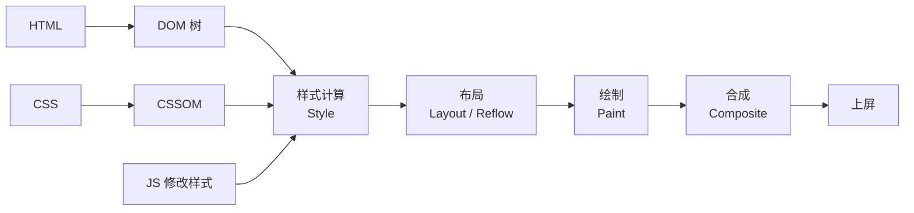

# CSS / CSS3 从入门到精通指南

> 一份面向前端开发工程师的 CSS 全栈学习与速查指南：从「什么是 CSS、怎么写第一条样式」讲到「层叠上下文、Flex / Grid 布局、渲染性能、现代 CSS 新特性」。
> 适用人群：**从入门到精通**。新手可按「一 → 五」顺序打基础，再啃「六 → 九」的布局主线；有经验的工程师可直接查阅「八、九」布局详解、「十一」现代特性、「十三」性能内核与「十五」速查表。
>
> 参考资料：
>
> - [CSS 总体概述与体系入门（dongmeng22 前端笔记）](https://dongmeng22.github.io/docs/basics/css/01总体概述.html)
> - [阮一峰 — Flex 布局教程：语法篇](https://www.ruanyifeng.com/blog/2015/07/flex-grammar.html)
> - [阮一峰 — Flex 布局教程：实例篇](https://www.ruanyifeng.com/blog/2015/07/flex-examples.html)
> - [阮一峰 — CSS Grid 网格布局教程](https://ruanyifeng.com/blog/2019/03/grid-layout-tutorial.html)
> - [MDN — CSS 参考（中文）](https://developer.mozilla.org/zh-CN/docs/Web/CSS)
> - [XP 中文网 — CSS3 教程](https://old.xp.cn/css3/)
> - [前端工程师手册 — 盒模型](https://leohxj.gitbooks.io/front-end-database/content/html-and-css-basic/box-module.html)
> - [前端工程师手册 — CSS 定位方式](https://leohxj.gitbooks.io/front-end-database/content/html-and-css-basic/css-position.html)
> - [前端工程师手册 — CSS 选择器](https://leohxj.gitbooks.io/front-end-database/content/html-and-css-basic/css-selector.html)
> - [前端工程师手册 — CSS 书写与命名](https://leohxj.gitbooks.io/front-end-database/content/html-and-css-basic/css-write-and-name.html)
> - [前端工程师手册 — CSS3 新增特性](https://leohxj.gitbooks.io/front-end-database/content/html-and-css-basic/css3-news.html)
> - [前端工程师手册 — 自定义字体](https://leohxj.gitbooks.io/front-end-database/content/html-and-css-advance/custom-fonts.html)

---

## 目录

1. [一、CSS 基础与引入方式](#一、css-基础与引入方式)
2. [二、选择器与优先级](#二、选择器与优先级)
3. [三、盒模型、尺寸与单位](#三、盒模型、尺寸与单位)
4. [四、文本、字体与列表](#四、文本、字体与列表)
5. [五、背景、边框、阴影与滤镜](#五、背景、边框、阴影与滤镜)
6. [六、定位、浮动与层叠上下文](#六、定位、浮动与层叠上下文)
7. [七、CSS3 变换、过渡与动画](#七、css3-变换、过渡与动画)
8. [八、Flexbox 弹性布局从入门到精通](#八、flexbox-弹性布局从入门到精通)
9. [九、Grid 网格布局从入门到精通](#九、grid-网格布局从入门到精通)
10. [十、响应式设计与容器查询](#十、响应式设计与容器查询)
11. [十一、现代 CSS 新特性](#十一、现代-css-新特性)
12. [十二、CSS 工程化与架构](#十二、css-工程化与架构)
13. [十三、渲染原理与性能优化](#十三、渲染原理与性能优化)
14. [十四、可访问性与最佳实践](#十四、可访问性与最佳实践)
15. [十五、速查表与常见面试题](#十五、速查表与常见面试题)

---

## 一、CSS 基础与引入方式

### 1.1 CSS 是什么

**CSS（Cascading Style Sheets，层叠样式表）** 是描述「文档该长什么样」的语言：它把**结构**（HTML）与**表现**分离，让同一份内容可以适配不同设备、不同主题、不同状态。

| 层   | 技术           | 职责                             | 具体产物                         |
| ---- | -------------- | -------------------------------- | -------------------------------- |
| 结构 | HTML           | 内容与语义：有什么、是什么       | DOM 树                           |
| 表现 | **CSS**        | 样式与布局：长什么样、排在哪里   | CSSOM + 渲染树                   |
| 行为 | JavaScript     | 交互与逻辑：点击之后发生什么     | 事件与状态变更                   |

一句话记住三个核心概念，它们贯穿全文：

- **层叠（Cascade）**：多个规则命中同一元素时，谁生效由「来源 → 重要性 → 层 → 特殊度 → 顺序」逐级裁决（见 2.6、2.7）。
- **继承（Inheritance）**：部分属性（如 `color`、`font-size`）会自动传给子元素，部分（如 `margin`、`border`）不会（见 2.10）。
- **盒模型（Box Model）**：每个元素都是矩形盒子，由内容 + 内边距 + 边框 + 外边距构成（见第三章）。

### 1.2 CSS3 是什么：从「一个规范」到「一堆模块」

早期 CSS 按版本号冻结（CSS1、CSS2、CSS2.1）。**CSS3 开始改为模块化（CSS Modules）**：把规范拆成几十个独立模块，各自演进、各自达到不同成熟度。

| 模块（Module）               | 典型内容                                   | 成熟度示例             |
| ---------------------------- | ------------------------------------------ | ---------------------- |
| Selectors Level 4            | `:is()` `:where()` `:has()` `:nth-child(An+B of S)` | 主流浏览器已可用       |
| Box Model                    | `box-sizing`、逻辑属性                     | 全量可用               |
| Color Level 4/5              | `hsl()`、`lab()`、`oklch()`、`color-mix()` | 现代浏览器可用         |
| Flexbox Level 1              | 弹性布局                                   | 全量可用               |
| Grid Level 1/2               | 网格布局、`subgrid`                        | 全量可用（subgrid 稍晚） |
| Transforms / Transitions / Animations | 变换、过渡、关键帧动画            | 全量可用               |
| Media Queries Level 4/5      | 范围语法、`prefers-*`                      | 广泛可用               |
| Container Queries            | `@container`、`cqw` 等容器单位             | 现代浏览器可用         |
| Nesting                      | 原生嵌套语法                               | 现代浏览器可用         |

> 工程口径：今天说「CSS3」早已不是某个冻结版本，而是「**现代 CSS 能力集合**」。能不能用，不看版本号，看 **Can I use + `@supports` 探测**（见 10.4、14.6）。

### 1.3 三种引入方式

| 方式     | 写法                                                     | 位置         | 评价                                             |
| -------- | -------------------------------------------------------- | ------------ | ------------------------------------------------ |
| 行内样式 | `<div style="color: red">`                               | HTML 标签上  | 特殊度高、无法复用，**只用于动态计算值**         |
| 内部样式 | `<head><style>…</style></head>`                          | HTML 文档内  | 单页原型可用；多页会重复下载                     |
| 外部样式 | `<link rel="stylesheet" href="main.css">`                | 独立文件     | **生产首选**：可缓存、可并行、可压缩             |
| `@import` | `@import url("reset.css");`（写在 CSS 文件最前）        | CSS 内部     | 串行加载、阻塞渲染，**不推荐**（见 13.5）        |

```html
<!-- 推荐：放在 <head>，浏览器尽早发现并发起请求 -->
<link rel="stylesheet" href="/assets/main.css" />
<!-- 关键样式（首屏）可用 preload 提前 -->
<link rel="preload" href="/assets/critical.css" as="style" onload="this.rel='stylesheet'" />
```

### 1.4 CSS 语法：规则集与 @ 规则

```css
/* 规则集 = 选择器 + 声明块 */
.card-title {
  color: #1f2937;
  font-size: 16px;
}

/* @ 规则（at-rule）：以 @ 开头的特殊语句 */
@media (min-width: 768px) { /* 媒体查询 */
  .card-title { font-size: 18px; }
}
@supports (display: grid) { /* 特性查询 */ }
@layer components { /* 级联层 */ }
@keyframes fade-in { /* 关键帧 */ }
@font-face { /* 自定义字体 */ }
```

- 注释只有 `/* … */` 一种（`//` 是 Sass/Less 的写法，原生 CSS 不支持）。
- 声明以 `;` 结尾，**最后一条可省但强烈建议保留**（便于后续追加）。
- 属性名大小写不敏感，值中除了自定义标识符（如动画名、`grid-area` 名）外也大小写不敏感。

### 1.5 浏览器如何解析 CSS

理解这条链路，后面讲性能、优先级、`@layer` 才能落地：

```text
HTML 字节流 ──解析──▶ DOM 树
CSS  字节流 ──解析──▶ CSSOM 树
                        │
        DOM + CSSOM ──▶ 样式计算(Style) ──▶ 布局(Layout) ──▶ 绘制(Paint) ──▶ 合成(Composite)
```

1. **构建 CSSOM**：CSS 是**阻塞渲染**的资源——未下载并解析完之前，浏览器不会绘制首屏（避免无样式闪屏 FOUC）。
2. **样式计算**：为每个 DOM 节点匹配选择器、计算层叠与继承，得到每个元素的「计算值（computed value）」。
3. **布局**：算出每个盒子的几何位置（`layout`，也称 `reflow`）。
4. **绘制 / 合成**：生成绘制指令，分图层交由 GPU 合成上屏。

> **精通视角**：`DOMContentLoaded` 与 `load` 的差异、CSS 阻塞首屏、JS 改样式触发的重排重绘，全部由这条链路解释（详见第十三章）。

### 1.6 第一个完整示例

```html
<!DOCTYPE html>
<html lang="zh-CN">
  <head>
    <meta charset="UTF-8" />
    <title>CSS 入门示例</title>
    <style>
      /* 1) 重置常用默认样式 */
      * { box-sizing: border-box; }
      body {
        margin: 0;
        font-family: system-ui, -apple-system, 'PingFang SC', 'Microsoft YaHei', sans-serif;
        color: #1f2937;
        background: #f8fafc;
      }
      /* 2) 布局容器：Flex 水平垂直居中 */
      .hero {
        min-height: 100vh;
        display: flex;
        flex-direction: column;
        align-items: center;
        justify-content: center;
        gap: 12px;
      }
      /* 3) 组件样式 */
      .btn {
        padding: 10px 20px;
        border: 0;
        border-radius: 8px;
        background: #4f30e8;
        color: #fff;
        cursor: pointer;
        transition: background-color 0.2s ease;
      }
      .btn:hover { background: #3f24c4; }
      .btn:focus-visible { outline: 2px solid #4f30e8; outline-offset: 2px; }
    </style>
  </head>
  <body>
    <main class="hero">
      <h1>Hello CSS</h1>
      <button class="btn">开始学习</button>
    </main>
  </body>
</html>
```

### 1.7 学习路径（新手照此推进）

| 阶段     | 目标                             | 本文对应章节        |
| -------- | -------------------------------- | ------------------- |
| 入门     | 会写选择器、会调盒模型与文字外观 | 一 ~ 五              |
| 进阶     | 能独立完成整页布局               | 六 ~ 九（重点 Flex/Grid） |
| 熟练     | 会做响应式、动画、主题切换       | 十、十一             |
| 精通     | 懂层叠内核、渲染性能与工程架构   | 二、十二、十三       |

---

## 二、选择器与优先级

### 2.1 基础选择器

| 类型         | 语法              | 示例                     | 说明                          |
| ------------ | ----------------- | ------------------------ | ----------------------------- |
| 通配符       | `*`               | `* { box-sizing: border-box }` | 匹配所有元素；`*` 特殊度为 0 |
| 标签（类型） | `tag`             | `p { line-height: 1.6 }` | 特殊度最低                     |
| 类           | `.class`          | `.btn {}`                | **最常用**，可复用             |
| ID           | `#id`             | `#app {}`                | 特殊度高，样式里应尽量避免     |
| 属性         | `[attr]`          | `[disabled] {}`          | 见 2.3                         |
| 伪类         | `:state`          | `a:hover {}`             | 见 2.4                         |
| 伪元素       | `::pseudo`        | `p::first-line {}`       | 见 2.5                         |

### 2.2 组合器（Combinators）

| 组合器          | 语法        | 含义                       | 示例                 |
| --------------- | ----------- | -------------------------- | -------------------- |
| 后代            | `A B`       | B 是 A 的任意后代          | `ul li {}`           |
| 子              | `A > B`     | B 是 A 的直接子元素        | `ul > li {}`         |
| 相邻兄弟        | `A + B`     | 紧跟在 A 后的同级 B        | `h2 + p {}`          |
| 通用兄弟        | `A ~ B`     | A 之后的所有同级 B         | `input:checked ~ label {}` |
| 选择器列表      | `A, B`      | 同时匹配多个选择器         | `.a, .b {}`          |

> 另有「列组合器（Column Combinator）」：两个竖线，用于选中同一列（`<col>`）中的单元格，如 `col.selected` 加两竖线再跟 `td { … }`。

> **实用技巧**：`:hover` 作用于父级、样式作用于子级 —— `.card:hover .card-title { color: #4f30e8 }`；或用 `:has()` 反向实现 `.card:has(.badge) { … }`（见 11.5）。

### 2.3 属性选择器

| 写法                | 匹配条件                     | 示例                          |
| ------------------- | ---------------------------- | ----------------------------- |
| `[attr]`            | 存在该属性                   | `[disabled] {}`               |
| `[attr="v"]`        | 值完全等于 v                 | `[type="text"] {}`            |
| `[attr~="v"]`       | 值用空格分隔且含 v           | `[class~="btn"] {}`           |
| `[attr\|="v"]`      | 值等于 v 或以 `v-` 开头      | `[lang\|="zh"] {}`            |
| `[attr^="v"]`       | 值以 v 开头                  | `a[href^="https://"] {}`      |
| `[attr$="v"]`       | 值以 v 结尾                  | `a[href$=".pdf"] {}`          |
| `[attr*="v"]`       | 值包含 v                     | `a[href*="example"] {}`       |
| `[attr="v" i]`      | 不区分大小写（加 `i` 标志）  | `[type="TEXT" i] {}`          |

```css
/* 常见用途：外链自动加图标、下载链接提示 */
a[href^="http"]::after { content: " ↗"; }
a[href$=".pdf"]::before { content: url(/icons/pdf.svg); }
```

### 2.4 伪类（Pseudo-classes）

**状态类**（常见于表单与交互）：

| 伪类                  | 命中时机                                     |
| --------------------- | -------------------------------------------- |
| `:hover`              | 鼠标悬停                                     |
| `:active`             | 按下瞬间                                     |
| `:focus` / `:focus-visible` / `:focus-within` | 获得焦点 / **仅键盘可见焦点** / 内部有焦点 |
| `:link` / `:visited`  | 未访问 / 已访问链接                          |
| `:checked`            | 勾选态（checkbox / radio / option）          |
| `:disabled` / `:enabled` | 禁用 / 可用                               |
| `:required` / `:optional` / `:valid` / `:invalid` | 表单校验态         |
| `:placeholder-shown`  | 输入框正显示占位符（即「空」）               |
| `:autofill`           | 浏览器自动填充后                             |
| `:target`             | URL 片段（`#id`）指向该元素                  |
| `:root`               | 文档根（`<html>`），**自定义属性常挂这里**   |

**结构类**：

| 伪类                          | 含义                                        |
| ----------------------------- | ------------------------------------------- |
| `:first-child` / `:last-child` | 第一个 / 最后一个子元素                    |
| `:only-child`                 | 唯一的子元素                                |
| `:nth-child(An+B)`            | 第 An+B 个子元素（`2n` 偶数、`2n+1` 奇数）  |
| `:nth-last-child(An+B)`       | 从后往前计数                                |
| `:first-of-type` / `:nth-of-type()` | 同类型中的第一个 / 第 N 个            |
| `:empty`                      | 无任何子节点（含文本）                      |
| `:nth-child(An+B of S)`（新） | 在「满足 S 的元素」里按序号选               |

```css
/* 只给「同类型集合」中的奇数行加背景（避免被其它兄弟干扰） */
tr:nth-of-type(odd) { background: #f9fafb; }

/* 选中前 3 个 .item */
.item:nth-child(-n + 3) { color: #4f30e8; }

/* 新语法：只在 .post 之后出现的元素中计数 */
:is(.post) ~ .item:nth-child(2 of .item) { font-weight: 700; }
```

**逻辑（函数式）伪类**：

```css
/* :is 取其参数中最高的特殊度；:where 特殊度恒为 0（适合做基础样式） */
:where(h1, h2, h3) { margin-block: 0; }
.card :is(h1, h2, h3) { color: #111827; }

/* :not 支持选择器列表，可反向排除 */
input:not(:disabled, [readonly]) { background: #fff; }

/* :has 相对选择器：父元素根据子元素状态变化（"CSS 之父选择器"） */
.form-field:has(input:invalid) { border-color: #dc2626; }
.card:has(> img) { padding-top: 0; }
```

> ⚠️ 例外：`:is()` / `:not()` / `:has()` 内部**不参与特殊度累加**，特殊度取参数中最高者（`:where()` 恒为 0）。这是精确控权的关键，见 2.6。

### 2.5 伪元素（Pseudo-elements）

| 伪元素                 | 作用                                        |
| ---------------------- | ------------------------------------------- |
| `::before` / `::after` | 生成行内内容，**必须配 `content`**          |
| `::first-line` / `::first-letter` | 首行 / 首字母                    |
| `::selection`          | 选中文本的样式                              |
| `::placeholder`        | 输入框占位符                                |
| `::marker`             | 列表项标记（圆点 / 数字）                   |
| `::backdrop`           | `dialog` / 全屏元素背后的遮罩               |
| `::file-selector-button` | 文件输入框按钮                            |
| `::part()` / `::slotted()` | Web Component 影子 DOM 暴露的样式挂钩   |

```css
.timeline-item::before {
  content: "";
  position: absolute;
  inset-block-start: 8px;
  inline-size: 8px;
  block-size: 8px;
  border-radius: 50%;
  background: #4f30e8;
}

/* 用 attr() 消费 HTML 属性（现代浏览器已支持任意属性） */
.tooltip::after {
  content: attr(data-tip);
}
```

### 2.6 特殊度（Specificity）：谁更「重」

特殊度是三个等级的多位计数，**从左到右逐位比较**（可理解为 `(A, B, C)`）：

| 等级 | 计什么                                        | 权重位 |
| ---- | --------------------------------------------- | ------ |
| A    | ID 选择器数量                                 | 1      |
| B    | 类、属性选择器、伪类数量                      | 2      |
| C    | 标签、伪元素数量                              | 3      |

`(0, 2, 1)` 的写法（**行内样式与 `!important` 不在此序列中**）：

| 选择器                       | 特殊度      | 说明                         |
| ---------------------------- | ----------- | ---------------------------- |
| `*`                          | `(0,0,0)`   | 通配符不计数                 |
| `div`                        | `(0,0,1)`   | 一个标签                     |
| `div::before`                | `(0,0,2)`   | 标签 + 伪元素                |
| `.btn`                       | `(0,1,0)`   | 一个类                       |
| `.btn:hover`                 | `(0,2,0)`   | 类 + 伪类                    |
| `#app`                       | `(1,0,0)`   | 一个 ID                      |
| `#app .btn:hover`            | `(1,2,0)`   | ID + 类 + 伪类               |
| `.a:is(#x, .y)`              | `(1,1,0)`   | `:is` 取参数中最高（`#x`）   |
| `.a:where(#x)`               | `(0,1,0)`   | `:where` 恒为 0              |

```css
/* 常见陷阱：期望权重一样、实际不一样 */
a:hover { color: red; }         /* (0,2,0) */
.btn { color: blue; }           /* (0,1,0) → 被上面的 hover 覆盖 */
```

**`!important` 与行内样式**：

- 行内 `style="…"`（除 `!important` 外）**高于**任何选择器，仅低于带 `!important` 的声明。
- `!important` 会跳到层叠的「重要声明层」（见 2.7），**同一层内仍比较特殊度与顺序**。
- **工程建议**：样式表里不写 `!important`；只在覆盖第三方库内联样式或做「用户样式」时才用。

### 2.7 层叠（Cascade）：完整的裁决顺序

同一元素、同一属性、多条声明冲突时，按以下顺序裁决，**从上到下第一个分出胜负的即生效**：

```text
① 来源与重要性（Origin & Importance）
   用户代理普通 → 用户普通 → 作者普通 → 层( @layer 顺序 ) → 作者重要 → 用户重要 → 用户代理重要
   （注意：加 !important 后「来源顺序反转」，用户/UA 的重要声明反而压过作者）
② 特殊度（Specificity）
③ 出现顺序（Order of Appearance，后写的赢）
```

**`@layer` 级联层**：不靠堆特殊度，直接声明「谁优先」。

```css
/* 先声明层的顺序，越靠后优先级越高（未分层的声明优先级高于所有分层） */
@layer reset, base, components, utilities;

@layer base {
  a { color: #4f30e8; }
}
@layer components {
  .link { color: #dc2626; } /* 同层内才比较特殊度 */
}
```

> **精通要点**：`@layer` 让「可覆盖性」由架构显式声明，而非靠 `!important` 或更长选择器硬拼 —— 这是现代组件库与工具类（如 Tailwind）共存的关键机制。

### 2.8 继承与值的关键字

**会继承的属性**（多为文字相关）：`color`、`font*`、`line-height`、`letter-spacing`、`text-align`、`visibility`、`cursor`、`list-style`、`quotes` 等。
**不继承的属性**（多为盒模型与布局）：`margin`、`padding`、`border`、`background`、`width/height`、`position`、`display`、`overflow` 等。

| 关键字      | 含义                                                     |
| ----------- | -------------------------------------------------------- |
| `inherit`   | 强制取父级计算值（可让「不继承」的属性也继承）           |
| `initial`   | 取该属性的**规范初始值**（如 `display: initial` = `inline`） |
| `unset`     | 可继承属性 = `inherit`，否则 = `initial`                 |
| `revert`    | 回退到**上一来源层**的值（用户代理 / 用户样式表的值）     |
| `revert-layer` | 回退到上一个 `@layer` 的值                            |

```css
/* 常见用法：让按钮摆脱浏览器默认字体（表单控件不继承字体） */
button, input, select, textarea { font: inherit; color: inherit; }

/* all 一次性重置（慎用，会连 cursor、display 一起重置） */
.widget * { all: unset; }
```

### 2.9 简写会重置未写的属性

```css
/* 常见坑：先设了 background-image，后面又用简写覆盖 → 图片被清空 */
.box {
  background-image: url(a.png);
  background: #fff; /* 等价于把 image 重置为 none */
}

/* 同理：font / border / margin 简写都会把未提及的子属性重置为初始值 */
```

### 2.10 选择器实践建议

- **优先用类**，不用 ID 写样式（特殊度过高、难以覆盖）。
- **控制选择器深度**（建议不超过 3 层），避免 `div > ul > li > a` 这类结构强耦合写法。
- 用 `:where()` 写「可被随意覆盖」的基础样式，用 `@layer` 管理覆盖关系。
- 用 `:focus-visible` 代替 `:focus`，兼顾键盘可访问性与鼠标体验。
- 不要用 `:has()` 做「每帧求值」的重活（极端场景下会带来样式失效范围扩大，见 13.4）。

### 2.11 交互伪类的书写顺序（LVHA）

链接的四个状态伪类（`:link` / `:visited` / `:hover` / `:active`）**特殊度完全相同**，因此「谁写在后面谁生效」。业界统一按 **LVHA** 排列（记忆法：LoVe / HAte）：

```css
a:link    { color: #2563eb; }   /* 未访问 */
a:visited { color: #7c3aed; }   /* 已访问 */
a:hover   { color: #1d4ed8; }   /* 悬停 */
a:active  { color: #dc2626; }   /* 按下瞬间 */
```

顺序写错的典型症状：`:hover` 写在 `:visited` 之前 → 访问过的链接悬停不生效；`:active` 写太靠前 → 点击态永远看不到。

| 注意点                | 说明                                                                                          |
| --------------------- | --------------------------------------------------------------------------------------------- |
| `:visited` 有隐私限制 | 只能改颜色类属性（`color`、`background-color`、`border-color`、`outline-color`、`fill`、`stroke` 等），**不能改尺寸、位置与背景图**；`getComputedStyle()` 也会返回伪造值，防止历史记录被探测 |
| 触屏没有 `hover`      | 移动端 `:hover` 会「粘住」上一次点击的元素，交互反馈必须另有 `:focus-visible` / `:active` 兜底（可用 `@media (hover: none)` 单独处理，见 10.2） |
| `:active` 的时机      | 只在「按下未松开」期间生效，做按压反馈时放最后                                                  |
| `:focus` 与键盘       | 键盘 Tab 会同时命中 `:focus` 与 `:focus-visible`，鼠标点击一般只命中 `:focus`（见 14.1）        |

```css
/* 状态样式的特殊度归零，便于业务层覆盖（见 2.6） */
:where(a):hover { text-decoration-thickness: 2px; }
```

---

## 三、盒模型、尺寸与单位

### 3.1 盒模型（Box Model）

每个元素都是一个盒子，由内到外四层（图示可拖拽平移、可缩放）：

<CssBoxModelDiagram />

| `box-sizing`    | `width` 的含义                       | 实际占宽                                   |
| --------------- | ------------------------------------ | ------------------------------------------ |
| `content-box`（默认） | 仅内容区宽度                   | `width + padding×2 + border×2`             |
| `border-box`    | 内容 + padding + border            | 就是 `width`（超过则内容被压缩）           |

```css
/* 现代项目几乎必写的全局重置 */
*,
*::before,
*::after {
  box-sizing: border-box;
}
```

> **为什么推荐 `border-box`**：响应式布局里「百分比宽度 + 内边距」不会撑破容器，配合 `width: 100%` 才不会出现水平滚动条。

### 3.2 尺寸与限制

```css
.box {
  inline-size: 320px;        /* 逻辑属性版 width（见 11.7） */
  block-size: 180px;         /* 逻辑属性版 height */
  min-inline-size: 0;        /* Flex/Grid 子项防溢出关键（见 8.7） */
  max-inline-size: 100%;
  aspect-ratio: 16 / 9;      /* 固定宽高比：只给宽就能自动算高 */
  box-sizing: border-box;
}
```

| 属性            | 作用                                                     |
| --------------- | -------------------------------------------------------- |
| `width` / `height` | 尺寸（对行内非替换元素无效）                          |
| `min-*` / `max-*` | 尺寸上下限；优先级高于 `width/height`                  |
| `aspect-ratio`  | 宽高比；与 `object-fit` 搭配用于媒体                       |
| `auto`          | 由内容或布局算法决定（Flex/Grid 中含义会变，见第八、九章） |
| `fit-content`   | 收缩到内容宽度但不超过可用宽度                             |
| `min-content` / `max-content` | 最小 / 最大内容宽度                     |

### 3.3 外边距与内边距

```css
.box {
  /* 四值：上 右 下 左（顺时针） */
  padding: 8px 16px 8px 16px;
  /* 三值：上 左右 下 */
  margin: 8px 16px 12px;
  /* 两值：上下 左右 */
  margin: 8px 16px;
  /* 一值：全部 */
  padding: 12px;

  /* 单边（物理） */
  margin-top: 4px;
  /* 单边（逻辑，随书写模式翻转） */
  margin-block-start: 4px;
  margin-inline: auto;   /* 水平居中常用写法 */
}
```

### 3.4 外边距折叠（Margin Collapsing）★ 高频坑

**相邻的垂直外边距会合并为较大的那个**，只发生在**普通流的块级元素之间**：

```css
/* 父子折叠：父元素没有 border/padding/内容隔开时，子元素 margin-top 会「跑出去」 */
.parent { /* 修复之一：加 padding 或 border，或创建 BFC */ }
.parent { overflow: hidden; }      /* 建立 BFC（见 6.6） */
.parent { display: flow-root; }    /* 更语义化的 BFC 创建方式 */
```

| 折叠场景         | 是否折叠 | 说明                                   |
| ---------------- | -------- | -------------------------------------- |
| 相邻兄弟（垂直） | ✅       | 取较大值                               |
| 父子上边界       | ✅       | 父无 `border`/`padding`/BFC 时         |
| 父子下边界       | ✅       | 父 `height: auto` 时                   |
| 空元素自身       | ✅       | 上下 margin 合并                       |
| 水平方向         | ❌       | 左右 margin 不折叠（相邻则相加）       |
| Flex / Grid 容器内 | ❌     | 子项之间不折叠                         |
| 浮动 / 绝对定位元素 | ❌     | 不参与普通流折叠                       |

### 3.5 overflow 与滚动

```css
.scroll-area {
  max-block-size: 240px;
  overflow: auto;                /* 按需出滚动条 */
  overflow-x: hidden;            /* 单独控制某一轴 */
  overscroll-behavior: contain;  /* 阻止滚动穿透到父级/页面 */
  scrollbar-gutter: stable;      /* 预留滚动条位置，避免布局抖动 */
}
```

| 值        | 表现                                     |
| --------- | ---------------------------------------- |
| `visible` | 默认，溢出内容可见（可能重叠）             |
| `hidden`  | 裁切，内容仍可滚动（可用 JS 滚动）         |
| `clip`    | 裁切且**不可滚动**（不会创建滚动容器）     |
| `scroll`  | 始终显示滚动条                             |
| `auto`    | 需要时才显示                               |

> **注意**：设置 `overflow: hidden/auto/scroll` 会创建 **BFC**，也会把 `position: sticky` 的滚动祖先限制在此容器内（sticky 失效的常见原因，见 6.2）。

### 3.6 长度单位全解

| 单位            | 相对基准                      | 典型用途                                   |
| --------------- | ----------------------------- | ------------------------------------------ |
| `px`            | 绝对（CSS 像素）              | 边框、小间距、1px 线                        |
| `em`            | **当前元素**的 `font-size`    | 与自身字号联动的间距（可嵌套放大，慎用）     |
| `rem`           | **根元素**（`html`）字号      | 全站尺度（推荐做字号/间距基准）              |
| `%`             | 父级对应属性                  | 宽度、`translate`（相对自身）、`line-height`（相对自身字号） |
| `vw` / `vh`     | 视口宽 / 高                   | 全屏区块、流式排版                           |
| `dvh` / `svh` / `lvh` | 动态 / 最小 / 最大视口高 | **移动端解决地址栏伸缩抖动**（`dvh`）        |
| `vmin` / `vmax` | 视口较小 / 较大边             | 正方形随视口缩放                             |
| `ch` / `ex`     | 数字 0 宽度 / x 高度          | 输入框按字符宽度（`width: 20ch`）            |
| `cqw` / `cqh` / `cqi` / `cqb` | 容器查询单位（见 10.3） | 组件级响应式                                 |
| `q` `cm` `mm` `in` `pt` `pc` | 绝对物理单位（打印） | 打印样式                                     |

```css
:root { font-size: 16px; }
.card { font-size: 1.25rem; }      /* 20px，不被父级放大 */
.card__title { margin-block-end: 0.5em; } /* 10px，随自身字号缩放 */

/* 移动端全屏区块：优先 dvh，避免地址栏伸缩导致跳动 */
.hero { min-block-size: 100dvh; }
```

### 3.7 计算函数与新数学函数

```css
.sidebar {
  /* calc 可混算不同单位：注意 + - 两侧必须有空格 */
  inline-size: calc(100% - 272px);

  /* min / max / clamp */
  padding-inline: clamp(16px, 4vw, 48px);
  font-size: max(14px, 1rem);
  inline-size: min(72ch, 100%);
}

/* CSS Values 4：更多数学函数（现代浏览器） */
.box {
  inline-size: round(nearest, 57px, 10px);   /* 57px → 60px */
  rotate: calc(mod(360deg, 7) * 1deg);
  aspect-ratio: 1;
}
```

> **口诀**：`calc()` 用于**混合单位运算**；`min()/max()/clamp()` 用于**取边界**（`clamp(min, 理想值, max)` 是流体排版核心）。

### 3.8 颜色值全解

| 写法                        | 示例                            | 说明                                 |
| --------------------------- | ------------------------------- | ------------------------------------ |
| 关键字                      | `red`、`transparent`、`currentColor` | `currentColor` = 当前 `color` 值 |
| 十六进制                    | `#4f30e8`、`#4f30e880`（8 位含透明度） | 最常见的写法                    |
| `rgb()` / `rgba()`          | `rgb(79 48 232 / 0.5)`          | 现代语法用空格与斜杠                  |
| `hsl()` / `hsla()`          | `hsl(250 68% 55% / .5)`         | 更适合「调明暗」                     |
| `hwb()`                     | `hwb(250 20% 10%)`              | 色相 + 白度 + 黑度                    |
| `lab()` / `lch()`           | `lch(48% 90 300)`               | 感知均匀（CIELAB 系）                 |
| `oklab()` / `oklch()`       | `oklch(0.6 0.18 285)`           | **推荐**：感知均匀且便于做明暗序列     |
| `color(display-p3 …)`       | `color(display-p3 0.3 0.1 0.9)` | 广色域                                 |
| `color-mix()`               | `color-mix(in oklch, red 40%, blue)` | 混合两色（做主题变量极方便）      |
| 相对颜色（新）              | `oklch(from var(--brand) l c calc(h + 30))` | 基于已有色计算派生色       |

```css
:root {
  --brand: oklch(0.62 0.19 285);
  /* 派生 hover / 浅底：不用预定义一堆十六进制 */
  --brand-hover: oklch(from var(--brand) calc(l - 0.08) c h);
  --brand-soft: color-mix(in oklch, var(--brand) 12%, white);
}
```

> **实践建议**：新项目用 `oklch` 定义设计令牌（明度随 `l` 线性变化，同 `l` 不同色相在视觉上「一样亮」），用 `color-mix()` 派生状态色，能显著减少色值硬编码。

### 3.9 自定义属性（CSS 变量）速览

```css
:root {
  --gap: 16px;
  --radius: 12px;
}
.card {
  padding: var(--gap);
  border-radius: var(--radius, 8px); /* 第二参数为回退值 */
  /* 局部覆盖：作用域为「继承树」而不是全站覆盖 */
  --gap: 24px;
}
```

- **变量本身不解析值，取用时才解析**（所以 `var()` 可以跨 `@media` 生效）。
- 变量是**继承**的，可写在任意选择器上做「局部主题」。
- 深度用法（`@property` 注册类型、与 JS 交互、参与动画）见 11.1。

### 3.10 块级、行内与行内块：盒模型差异

`display` 的三种基础值决定了元素如何参与布局，其盒模型表现差异是面试与排错的高频考点。

| 特性              | `block`            | `inline`（非替换元素）                         | `inline-block`             |
| ----------------- | ------------------ | ---------------------------------------------- | -------------------------- |
| `width` / `height` | 可设置             | ❌ 由内容决定，设置无效                         | 可设置                     |
| 垂直 `margin`     | 生效，会折叠       | ❌ 不生效                                       | 生效                       |
| 垂直 `padding` / `border` | 生效并撑开父级 | 可见但不撑开行盒高度，可能覆盖相邻行            | 生效并撑开父级             |
| 换行              | 独占一行           | 与其它行内元素共行                             | 与其它行内元素共行         |
| 默认典型元素      | `div`、`p`、`h1`   | `span`、`a`、`em`                              | `img`、`input`、`button`（可改） |

```css
/* 反例：给行内 a 加 padding，背景会压到上下行 */
.tag {
  padding: 8px 12px;
  background: #eef2ff;
}

/* 正例：改成行内块，盒子真实占位 */
.tag {
  display: inline-block;
  padding: 8px 12px;
  background: #eef2ff;
}
```

**替换元素（replaced element）**：`img`、`video`、`canvas`、`input`、`svg` 等即使 `display: inline`，也可以设置 `width` / `height`，因为内容不由 CSS 盒模型直接决定。

**`img` 底部空隙**：图片作为行内替换元素默认与文字基线（baseline）对齐，基线下方会留下「下伸部」间隙 → 图片底部出现几 px 空隙。消除方法：

```css
img { display: block; }          /* 最常用 */
img { vertical-align: bottom; }  /* 保留行内但改变对齐 */
.parent { line-height: 0; }      /* 消除基线间隙 */
```

**`inline-block` 之间的空白间隙**：HTML 中的换行/空格会被渲染为文本节点，导致元素之间出现约 1/4 `font-size` 的间隙。修复：父级 `font-size: 0`（子元素恢复字号）、`display: flex`、或注释掉标签间空白。

### 3.11 margin / padding 的取值规则：百分比、负值与 auto

| 取值     | 基准/行为                                           | 注意点                                                              |
| -------- | --------------------------------------------------- | ------------------------------------------------------------------- |
| 百分比   | 相对**包含块的宽度**（水平和垂直方向都是）          | `padding-block-start: 56.25%` 是相对父级宽度，不是高度              |
| 负值     | 仅 `margin` 允许负值，`padding` 不允许              | 负 margin 用于「拉宽/重叠/回拉」布局                                |
| `auto`   | `width: auto` 填满可用空间；`margin-inline: auto` 居中需元素有确定宽度 | 普通流中 `margin-block: auto` 计算为 0（绝对定位 / Flex / Grid 除外） |

**百分比的经典应用——旧版 16:9 占位**：

```css
.ratio {
  position: relative;
  block-size: 0;
  padding-block-start: 56.25%;   /* 9 / 16 = 56.25% */
}
.ratio > iframe { position: absolute; inset: 0; }
```

现代写法：`aspect-ratio: 16 / 9`。

**负 margin 的常见用法**：

```css
/* ① 元素向两侧破格拉宽 */
.breakout { margin-inline: -24px; }

/* ② 与相邻元素/父级边界产生压边效果 */
.overlap { margin-block-start: -32px; }
```

> 负 margin 会真实改变布局（与 `translate` 只在视觉上偏移不同），可能引起父级高度塌陷或滚动区域变化，使用时要复核可点击区域与可访问性顺序。

**`margin: auto` 居中的前提**：

1. 元素必须有**确定的宽度**（否则块级元素 `width: auto` 会填满整行，auto 余量为 0）。
2. 元素不能是浮动元素或行内非替换元素。
3. 绝对定位元素配合 `inset: 0` 与 `margin: auto` 可同时实现水平垂直居中（见 6.7）。

---

## 四、文本、字体与列表

### 4.1 文本样式

```css
.text {
  color: #1f2937;
  text-align: start;            /* start/end 优于 left/right，配合 RTL 书写模式 */
  text-indent: 2em;             /* 首行缩进 */
  letter-spacing: 0.02em;       /* 字间距 */
  word-spacing: 0.1em;          /* 词间距 */
  line-height: 1.6;             /* 无单位 = 相对自身字号倍数，推荐 */
  text-decoration: underline wavy #dc2626 2px;
  text-underline-offset: 4px;
  text-transform: uppercase;    /* 仅改变显示，不改变内容 */
  text-shadow: 0 1px 2px rgb(0 0 0 / 0.2);
  text-wrap: balance;           /* 标题换行更均匀（见 11.10） */
}
```

| 属性               | 要点                                                       |
| ------------------ | ---------------------------------------------------------- |
| `line-height`      | 用**无单位数值**，避免子元素继承到「px 固定行高」           |
| `vertical-align`   | 只对 `inline` / `inline-block` / 表格单元格有效             |
| `text-align-last`  | 强制对齐最后一行（两端对齐时）                              |
| `hyphens`          | 自动断词加连字符（需 `lang` 配合）                          |
| `text-wrap`        | `wrap`（默认）/ `nowrap` / `balance`（标题）/ `pretty`      |

> **文字描边（`-webkit-text-stroke`）**：CSS3 文字渲染特性，目前仍需 `-webkit-` 前缀实现空心或描边效果。

```css
/* 空心字 */
.stroke-text {
  -webkit-text-stroke: 2px #4f30e8;
  color: transparent;
}

/* 描边 + 填充 */
.stroke-fill {
  -webkit-text-stroke: 1px #4f30e8;
  -webkit-text-fill-color: #fff;
}
```

### 4.2 文本溢出与断行 ★ 高频

```css
/* 单行省略 */
.ellipsis {
  overflow: hidden;
  white-space: nowrap;
  text-overflow: ellipsis;
}

/* 多行省略（WebKit 方案，兼容性最好） */
.ellipsis-2 {
  display: -webkit-box;
  -webkit-line-clamp: 2;
  -webkit-box-orient: vertical;
  overflow: hidden;
}
```

| 属性             | 作用与取值                                                       |
| ---------------- | ---------------------------------------------------------------- |
| `white-space`    | `normal` / `nowrap` / `pre` / `pre-wrap` / `pre-line` / `break-spaces` |
| `overflow-wrap`  | `normal` / `break-word` / `anywhere`（长英文/URL 换行）           |
| `word-break`     | `normal` / `break-all` / `keep-all`（中文不断词）                 |
| `text-overflow`  | `clip` / `ellipsis`（必须配合 `overflow: hidden`）                |
| `hyphenate-character` | 连字符样式                                                   |

> **选择建议**：中文长文本用 `word-break: keep-all` 保持词组完整；纯数字/URL 溢出用 `overflow-wrap: anywhere`；不要滥用 `break-all`（会把英文单词从中间劈开）。

### 4.3 字体家族与字号

```css
:root {
  /* 系统字体栈：零下载、渲染最快，中文补齐常见平台字体 */
  --font-sans: system-ui, -apple-system, 'Segoe UI', Roboto, 'PingFang SC',
    'Hiragino Sans GB', 'Microsoft YaHei', 'Noto Sans SC', sans-serif;
  --font-mono: ui-monospace, SFMono-Regular, Menlo, Consolas, 'Courier New', monospace;
}
body { font-family: var(--font-sans); }
```

| 属性            | 说明                                                            |
| --------------- | --------------------------------------------------------------- |
| `font-size`     | 可用 `rem` / `clamp()` 做流体字号                                |
| `font-weight`   | `100`–`900`；注意「字重是否真的存在」（需字体文件支持）          |
| `font-style`    | `normal` / `italic` / `oblique`                                  |
| `font-stretch`  | 字宽（可变字体支持）                                             |
| `font-variant-*`| 小型大写、数字对齐（`tabular-nums` 做表格数字对齐）              |
| `font`（简写）  | `font: italic 700 16px/1.5 var(--font-sans)`；**会重置其他字体属性** |

```css
/* 表格、金额、计时器：等宽数字，避免数字跳动 */
.nums { font-variant-numeric: tabular-nums; }
```

### 4.4 Web 字体与性能

```css
@font-face {
  font-family: 'BrandSans';
  src: url('/fonts/brand-sans.woff2') format('woff2-variations');
  font-weight: 100 900;         /* 可变字体范围 */
  font-display: swap;           /* 先用后备字体显示，字体到达后替换 */
  unicode-range: U+4E00-9FFF;   /* 仅在使用到这些字符时下载 */
  size-adjust: 100%;            /* 校正后备字体与自定义字体的度量差，减少 CLS */
}
```

- `font-display` 取值：`auto` / `block`（FOIT）/ `swap`（FOUT，推荐）/ `fallback` / `optional`。
- **字体子集化**：中文字体动辄数 MB，务必按字符集裁剪或改用系统字体栈。
- **可变字体**：一个文件覆盖多字重，减少请求数。
- 优化手段：`preload` 首屏字体、`unicode-range` 分片、`size-adjust` 对齐度量（见 13.5）。

### 4.5 列表与计数器

```css
ul.custom {
  list-style: none;            /* 去掉默认圆点 */
  padding-inline-start: 0;
}

/* 用 counter 做自动编号 */
.steps { counter-reset: step; }
.steps > li { counter-increment: step; }
.steps > li::before {
  content: counter(step) ". ";
  color: #4f30e8;
  font-weight: 700;
}
```

| 属性             | 说明                                                   |
| ---------------- | ------------------------------------------------------ |
| `list-style-type`| `disc` / `decimal` / `lower-alpha` / `none`            |
| `list-style-position` | `outside`（默认）/ `inside`                       |
| `counter-reset` / `counter-increment` / `counter()` | 自定义编号系 |
| `::marker`       | 单独美化列表标记（注意：可用属性有限）                 |

### 4.6 多列布局与书写模式

```css
/* 多列（长文排版） */
.article {
  column-count: 2;
  column-gap: 32px;
  column-rule: 1px solid #e5e7eb; /* 列间分隔线 */
  break-inside: avoid;            /* 避免元素被拆到两列 */
}

/* 竖排（东亚排版） */
.vertical {
  writing-mode: vertical-rl;
  text-orientation: upright;
}
```

> **书写模式是逻辑属性的前提**：`writing-mode` 改变后，`inline` 轴与 `block` 轴互换，逻辑属性（`margin-inline-start` 等）会自动跟随，物理属性（`margin-left`）不会（见 11.7）。

### 4.7 自定义字体全解：`@font-face`、字体格式与子集化

自定义字体让网页使用品牌字体或特殊图标，但代价是**额外请求、FOUT/FOIT、CLS** 与授权问题，需要系统化处理。

#### `@font-face` 描述符

| 描述符                | 作用                                                                 | 常用值/说明                                           |
| --------------------- | -------------------------------------------------------------------- | ----------------------------------------------------- |
| `font-family`         | 自定义族名                                                           | 引用时用同名，如 `font-family: 'BrandSans'`           |
| `src`                 | 字体来源列表，按优先级回退                                           | `local('PingFang SC')`、`url(...)`、`format('woff2')` |
| `font-style`          | 样式范围                                                             | `normal` / `italic` / `oblique`                       |
| `font-weight`         | 字重范围                                                             | 可变字体可写 `100 900`                                |
| `font-stretch`        | 宽度范围                                                             | `75% 125%`（可变字体）                                |
| `font-display`        | 加载期间渲染策略                                                     | `swap` / `optional` / `fallback` / `block` / `auto`   |
| `unicode-range`       | 生效码位区间                                                         | 分片懒加载、中文按字符集切片                          |
| `size-adjust`         | 字体整体缩放                                                         | 用于与后备字体对齐，减少 CLS                          |
| `ascent-override`     | 覆盖上升部度量                                                       | 与后备字体基线对齐                                    |
| `descent-override`    | 覆盖下降部度量                                                       | 与后备字体基线对齐                                    |
| `line-gap-override`   | 覆盖行距度量                                                         | 用于度量覆盖                                          |
| `font-feature-settings` / `font-variation-settings` | 高级特性 / 可变字体轴                                    | `font-variation-settings: 'wght' 550`                 |

#### 字体格式与浏览器支持

| 格式  | 扩展名     | 特点                                | 现状                    |
| ----- | ---------- | ----------------------------------- | ----------------------- |
| WOFF2 | `.woff2`   | Brotli 压缩，体积最小               | **首选**，现代浏览器全支持 |
| WOFF  | `.woff`    | zlib 压缩，兼容旧浏览器             | 第二顺位兜底            |
| TTF   | `.ttf`     | 原始轮廓字体                        | 可省                    |
| OTF   | `.otf`     | PostScript 轮廓字体                 | 可省                    |
| EOT   | `.eot`     | IE 专用                             | **已淘汰**              |
| SVG   | `.svg`     | 已废弃                              | 不用                    |

#### 现代最简写法

```css
@font-face {
  font-family: 'BrandSans';
  src: local('BrandSans'), url('/fonts/brand-sans.woff2') format('woff2');
  font-weight: 400;
  font-style: normal;
  font-display: swap;
  unicode-range: U+0000-00FF, U+4E00-9FFF;
}
```

#### 历史兼容写法（Bulletproof @font-face）

早期为了兼容 IE6–IE8，需要 `?#iefix` hack 让 IE 正确解析 `embedded-opentype`：

```css
@font-face {
  font-family: 'BrandSans';
  src: url('brand-sans.eot');
  src: url('brand-sans.eot?#iefix') format('embedded-opentype'),
       url('brand-sans.woff') format('woff'),
       url('brand-sans.ttf') format('truetype'),
       url('brand-sans.svg#BrandSans') format('svg');
}
```

> 现代项目已无需 `eot` / `svg` 字体，**WOFF2 单格式即可覆盖所有现代浏览器**。

#### 字体加载策略

| 策略      | 行为                                             | 适用场景                  |
| --------- | ------------------------------------------------ | ------------------------- |
| `block`   | 短暂 invisible 期（最长 3s），超时 fallback      | 品牌字体必须显示          |
| `swap`    | 0.1s 后立即用后备字体，加载完成再替换（FOUT）    | **推荐**，兼顾内容与品牌  |
| `fallback` | 短暂 invisible 期后 swap                        | 折中方案                  |
| `optional` | 100ms 内到达才用，否则下次访问再用               | 性能优先，品牌字体弱场景  |
| `auto`    | 浏览器默认（多为 block）                         | 不推荐                    |

#### 减少字体切换导致的 CLS

字体文件与后备字体往往度量不同，切换时会造成布局偏移。三种治理手段：

1. **预加载关键字体**：
   ```html
   <link rel="preload" href="/fonts/brand-sans.woff2" as="font" type="font/woff2" crossorigin>
   ```
   > 字体预加载**必须带 `crossorigin`**，否则浏览器会再次发起不带 credentials 的请求。

2. **使用 `font-display: optional`** 或 **度量覆盖字体**：
   ```css
   @font-face {
     font-family: 'BrandSans-fallback';
     src: local('Arial');
     size-adjust: 105.2%;
     ascent-override: 92%;
     descent-override: 24%;
   }
   body { font-family: 'BrandSans', 'BrandSans-fallback', sans-serif; }
   ```

3. **子集化与 `unicode-range` 分片**：只下载页面实际用到的字符，尤其是中文字体。

#### 中文字体处理

中文字体文件通常 3–10MB，不能整包下载。三种方案：

1. **系统字体栈优先**（零下载，最稳），见 4.3。
2. **子集化**：按项目字符集裁剪字体文件。
   ```bash
   # 用 fonttools 裁出「只用到的字符」子集
   pyftsubset brand-cn.ttf --text-file=used-chars.txt --flavor=woff2 --output-file=brand-cn.subset.woff2
   ```
3. **按需分片 + `unicode-range`**：把字体按常用字、生僻字切成多片，浏览器只下载命中片。

#### 字体托管方式

| 方式       | 优点                          | 缺点                                            |
| ---------- | ----------------------------- | ----------------------------------------------- |
| 自托管     | 可控、无第三方依赖、长缓存    | 需要自己处理子集化、缓存、CDN                   |
| 字体服务   | 自动优化、CDN 分发            | 额外 DNS/TLS、境外服务可能不稳定、需注意授权    |

> 生产环境推荐自托管，文件名带哈希，配合 `Cache-Control: immutable`。

### 4.8 图标字体（iconfont）与替代方案

图标字体把图标做成字体里的字形，映射到 Unicode **私有使用区（PUA：U+E000–U+F8FF）**，用「字符」来显示图标。

```css
@font-face {
  font-family: 'iconfont';
  src: url('/fonts/iconfont.woff2') format('woff2');
  font-display: block;
}
.icon {
  font-family: 'iconfont';
  font-style: normal;
  line-height: 1;
  -webkit-font-smoothing: antialiased;
}
.icon-search::before { content: '\e601'; }   /* 对应字体里的码位 */
```

```html
<span class="icon icon-search" aria-hidden="true"></span>
```

| 维度       | 图标字体                      | 内联 SVG / SVG Sprite                      |
| ---------- | ----------------------------- | ------------------------------------------ |
| 着色       | 单色（`color` 生效）          | 任意多色（`fill` / `stroke` 各自控制）     |
| 缩放       | 矢量，但依赖字体渲染          | 矢量精确                                   |
| 动画       | 只能整体改颜色/大小           | 可对路径做动画                             |
| 体积       | 一个文件含全部图标            | 按需 pick，可 tree-shake                   |
| 加载失败   | 显示方块/空白                 | 与文档同渲染                               |
| 可访问性   | 需 `aria-hidden`              | 可控 `title` / `aria-label`                |
| 推荐度     | 旧项目常见                    | **现代项目推荐**                           |

> 结论：新项目优先使用 **内联 SVG / SVG Sprite / 图标组件库**；图标字体仅用于「已有资产、需在 `content` 里插入图标」的场景。

---

## 五、背景、边框、阴影与滤镜

### 5.1 背景（background）系列

```css
.bg {
  background-color: #f8fafc;
  background-image: url('/images/pattern.svg');
  background-repeat: no-repeat;
  background-position: center right 16px;   /* 多值语法：横向 纵向+偏移 */
  background-size: cover;                    /* contain / 100% auto / 20px 20px */
  background-attachment: fixed;              /* local / scroll；移动端慎用 */
  background-origin: border-box;             /* 定位原点 */
  background-clip: padding-box;              /* 裁切范围（text 可做文字渐变） */
}

/* 多重背景：自上而下叠放 */
.hero {
  background:
    linear-gradient(rgb(0 0 0 / 0.5), rgb(0 0 0 / 0.5)),
    url('/images/hero.jpg') center / cover no-repeat;
}

/* 文字渐变（常用技巧） */
.gradient-text {
  background: linear-gradient(90deg, #4f30e8, #0ea5e9);
  -webkit-background-clip: text;
  background-clip: text;
  color: transparent;
}
```

> **简写陷阱**：`background` 简写会重置 `background-size`、`origin`、`clip` 等未写属性（见 2.9）。多重背景时，`background-color` 只能写在最后一层。

### 5.2 渐变

```css
/* 线性：角度 + 色标（可加位置） */
.linear { background: linear-gradient(135deg, #4f30e8 0%, #0ea5e9 100%); }

/* 径向：形状 大小 at 位置 */
.radial { background: radial-gradient(circle at 30% 30%, #fff, #4f30e8); }

/* 锥形：从中心按角度扫过，适合做饼图/色环 */
.conic { background: conic-gradient(#4f30e8 0 25%, #0ea5e9 0 50%, #22c55e 0 75%, #f59e0b 0); }

/* 重复渐变：条纹背景 */
.stripes {
  background: repeating-linear-gradient(
    45deg,
    #eef2ff 0 10px,
    #e0e7ff 10px 20px
  );
}
```

| 概念       | 说明                                                       |
| ---------- | ---------------------------------------------------------- |
| 色标（color stop） | `颜色 位置`，位置可为 `%` / 长度；未写位置则自动均分 |
| 硬边界     | 两个色标位置相同 → 直接跳变（做条纹/色块）                 |
| `in oklab` | 指定插值色彩空间：`linear-gradient(in oklch, red, blue)`，避免灰带 |
| 动画渐变   | 渐变本身不可动画，需用「背景平铺 + `background-position` 位移」或变量插值 |

### 5.3 边框与圆角

```css
.box {
  border: 1px solid #e5e7eb;
  border-inline-start: 4px solid #4f30e8;   /* 逻辑属性：书写模式自适应 */
  border-radius: 12px;
  border-start-start-radius: 12px;          /* 逻辑圆角 */
  border-image: linear-gradient(90deg, #4f30e8, #0ea5e9) 1;  /* 渐变边框 */
}

/* 只影响某个角 */
.pill { border-radius: 999px; }
```

| 技巧                  | 做法                                                     |
| --------------------- | -------------------------------------------------------- |
| 用 `outline` 做焦点框 | `outline: 2px solid; outline-offset: 2px`（不占布局）    |
| 多重边框（不占空间）  | `box-shadow: 0 0 0 2px #fff, 0 0 0 4px #4f30e8`          |
| 渐变边框              | `border-image` 或「父级渐变背景 + 子级白色背景内缩 1px」 |
| 三角（兼容写法）      | 宽高 0 + 三个透明边框 + 一个实色边框                     |

### 5.4 阴影

```css
.card {
  /* 偏移X 偏移Y 模糊 扩散 颜色 */
  box-shadow: 0 1px 2px rgb(0 0 0 / 0.06), 0 8px 24px rgb(15 23 42 / 0.08);
  text-shadow: 0 1px 0 rgb(255 255 255 / 0.6);
  filter: drop-shadow(0 4px 8px rgb(0 0 0 / 0.2)); /* 沿「非透明轮廓」投影 */
}
```

- `box-shadow` 按**盒子矩形**投影；`drop-shadow()` 按**实际不透明像素轮廓**投影（适合异形/透明 PNG/SVG）。
- `box-shadow` 支持 `inset`（内阴影）与多阴影堆叠。

### 5.5 替换元素与媒体适配

```css
.thumb {
  inline-size: 100%;
  aspect-ratio: 4 / 3;
  object-fit: cover;          /* contain / fill / none / scale-down */
  object-position: center 20%;
  border-radius: 12px;
}
```

| 属性              | 用途                                                     |
| ----------------- | -------------------------------------------------------- |
| `object-fit`      | 图片/视频在固定框内如何排布（`cover` 最常用于卡片封面）   |
| `object-position` | 焦点位置                                                 |
| `image-rendering` | `pixelated` 做像素风缩放                                 |

### 5.6 滤镜与混合模式

```css
.effects {
  filter: blur(4px) grayscale(60%) brightness(1.1) contrast(0.95);
  backdrop-filter: blur(12px) saturate(150%);  /* 毛玻璃：作用于「背后」内容 */
  mix-blend-mode: multiply;                    /* 与「背后同级元素」混合 */
  background-blend-mode: overlay;              /* 元素自身背景层之间混合 */
  isolation: isolate;                          /* 创建孤立混合组，避免越界混合 */
  opacity: 0.9;
}
```

> **毛玻璃要点**：`backdrop-filter` 必须作用在「有透明背景 + 位于内容之上」的元素上，且该元素的**祖先不能有 `filter/transform` 造成的层叠上下文断裂**（否则背景采样范围不对）。性能开销较高（每帧重采样），大面积慎用（见 13.3）。

### 5.7 遮罩与裁切

```css
.clip {
  /* clip-path：按几何图形裁切 */
  clip-path: polygon(0 0, 100% 0, 100% 85%, 0 100%);
}

.mask {
  /* mask：按图片/渐变透明度裁切（可做淡出、遮罩动画） */
  mask-image: linear-gradient(to bottom, #000 70%, transparent);
  mask-size: 100% 100%;
}
```

| 工具            | 依据                     | 典型用途                           |
| --------------- | ------------------------ | ---------------------------------- |
| `clip-path`     | 几何形状（path / 基本图形） | 异形卡片、图片裁切、动画展开       |
| `mask-image`    | 图片或渐变的**透明度**    | 渐变淡出、纹理遮罩、复杂形状        |

---

## 六、定位、浮动与层叠上下文

### 6.1 display 全解

| 值                     | 表现                                              | 备注                          |
| ---------------------- | ------------------------------------------------- | ----------------------------- |
| `none`                 | 不生成盒子，不占位（与 `visibility: hidden` 不同） | 触发子元素全部失效            |
| `block`                | 块级：独占一行、可设宽高                          |                               |
| `inline`               | 行内：不换行、宽高由内容决定                      | 上下 `margin` 不生效          |
| `inline-block`         | 行内但可设宽高                                    | 元素间有空白间隙（见 6.5）    |
| `flex` / `inline-flex` | 弹性容器                                          | 见第八章                      |
| `grid` / `inline-grid` | 网格容器                                          | 见第九章                      |
| `flow-root`            | 块级且**创建 BFC**                                | 替代 `overflow: hidden` 清浮动 |
| `contents`             | 自身盒子消失，子元素直接参与父级布局              | 可用于包裹组件不破坏布局      |
| `table` / `table-cell` | 表格布局                                          | 兼容性极好但语义与灵活性差    |

### 6.2 position 五种定位

| 值         | 参照物（包含块）              | 是否脱离文档流 | 典型用途                       |
| ---------- | ----------------------------- | -------------- | ------------------------------ |
| `static`   | ——（默认，忽略 `top/left`）   | 否             | 普通流                         |
| `relative` | 自身原位置                    | 否（保留原位） | 微调位置、给绝对定位子元素做参照 |
| `absolute` | 最近的**已定位祖先**；无则初始包含块 | 是       | 弹层、角标、任意摆放            |
| `fixed`    | 视口（有 `transform` 祖先时改为该祖先） | 是   | 固定头部、悬浮按钮、弹窗        |
| `sticky`   | 最近滚动容器 + 滚动阈值       | 否（占位保留） | 吸顶表头、吸底操作栏            |

```css
/* 绝对定位居中三件套 */
.center-abs {
  position: absolute;
  inset: 0;                 /* 等价 top/right/bottom/left: 0 */
  margin: auto;             /* 配合固定宽高实现居中 */
  inline-size: 200px;
  block-size: 120px;
}

/* sticky 正确姿势 */
.table-head th {
  position: sticky;
  inset-block-start: 0;     /* 阈值必须写 */
  z-index: 1;               /* 避免被后续内容盖住 */
  background: #fff;         /* 必须有不透明背景，否则透出下方内容 */
}
```

**`sticky` 失效的四大原因**（高频排查点）：

1. 没有写 `top/right/bottom/left` 阈值；
2. 任意祖先设置了 `overflow: hidden/auto/scroll`（把滚动容器换成了它，且它本身滚不动）；
3. 元素高度等于父容器高度（没有可黏贴的滚动区间）；
4. 父容器 `display: flex/grid` 且子项被拉伸（`align-items: stretch` 时高度撑满）。

### 6.3 z-index 与层叠上下文 ★ 难点

- `z-index` **只对「已定位元素」（`position ≠ static`）以及 Flex/Grid 子项、`opacity < 1` 等特定元素生效**。
- 一旦某个元素**创建了层叠上下文（Stacking Context）**，它内部所有后代的 `z-index` 只在该上下文内比较，无法「穿透」去压过外部元素。

**常见创建层叠上下文的触发条件**：

| 触发者                                             | 备注                             |
| -------------------------------------------------- | -------------------------------- |
| 根元素 `<html>`                                    | 最外层上下文                     |
| `position` + `z-index` 非 `auto`                   | 经典触发条件                     |
| `position: fixed` / `sticky`                       | 即使 `z-index: auto` 也创建      |
| `opacity` 小于 1                                   | 常被忽略                         |
| `transform` / `filter` / `backdrop-filter` / `perspective` 非 `none` | 常见于动画元素 |
| `will-change` 指定上述属性                         | 提前提升                         |
| `isolation: isolate`                               | **显式创建**（推荐用这个）       |
| `mix-blend-mode` 非 `normal`                       |                                  |
| `contain: layout/paint`、`container-type: size/inline-size` | 容器查询会创建           |
| Flex/Grid 子项且 `z-index` 非 `auto`               | 注意：无需 `position`            |

```css
/* 症状：弹层 z-index: 9999 仍被盖上 —— 因为弹层所在祖先创建了层叠上下文，祖先整体在下面 */
.modal-root { isolation: isolate; }   /* 隔离，避免混入外层上下文 */
```

> **排查口诀**：`z-index` 不生效时，**顺着祖先链找第一个创建层叠上下文的元素**（DevTools 的 Layers 面板或在元素上临时加 `isolation: isolate` 验证）。同级比较才是有效比较。

### 6.4 包含块（Containing Block）

绝对定位与百分比尺寸的「参照物」，规则如下：

| 元素定位方式     | 包含块                                                         |
| ---------------- | -------------------------------------------------------------- |
| `static` / `relative` | 最近的**块级祖先**的内容框（`width: 50%` 相对它）         |
| `absolute`       | 最近的「已定位祖先」的**内边距框**（padding box）              |
| `absolute`（无已定位祖先） | 初始包含块（视口大小的块）                           |
| `fixed`          | 视口（若祖先有 `transform/filter/perspective`，则改为该祖先）  |
| `sticky`         | 最近滚动容器的**内边距框**                                     |

### 6.5 浮动（float）与清除

浮动最初用于图文混排，历史上被用来做布局（今天应换 Flex/Grid）：

```css
.img-float {
  float: inline-start;                 /* 逻辑属性版 float: left */
  margin-inline-end: 16px;
}

/* 清除浮动 */
.clearfix::after {
  content: "";
  display: block;
  clear: both;
}
/* 或者更现代：父元素 display: flow-root */
```

| 现象                          | 说明与对策                                                 |
| ----------------------------- | ---------------------------------------------------------- |
| 浮动元素脱离普通流、父容器高度塌陷 | 父元素设 `display: flow-root`（创建 BFC）或 `.clearfix`  |
| `inline-block` 之间有空白间隙 | HTML 换行符所致；用 `flex`、或父级 `font-size: 0`、或注释消除空白 |
| 文字环绕浮动元素              | 这正是浮动的设计目的（用 `shape-outside` 可做曲线环绕）    |

### 6.6 格式化上下文（BFC / IFC）

**BFC（Block Formatting Context，块级格式化上下文）**：一块独立的布局区域，内部布局不影响外部。**创建 BFC 的方式**：

- 根元素；
- `float` 非 `none`；
- `position: absolute` / `fixed`；
- `display: flow-root`（**最推荐**，无副作用）；
- `overflow` 非 `visible`（会带来裁切/滚动副作用）；
- `display: inline-block` / `table-cell` / `flex` / `grid` 的子项；
- `contain: layout` / `paint`。

**BFC 的三大作用**：

1. **清除浮动**：父元素成 BFC 后能包住浮动子元素（高度不再塌陷）；
2. **阻止外边距折叠**：BFC 与其外部元素之间不折叠；
3. **隔离环绕**：BFC 不与浮动元素重叠（经典「两栏自适应」写法）。

```css
/* 经典两栏：左浮动定宽 + 右侧 BFC 自适应 */
.layout { display: flow-root; }
.layout .aside { float: inline-start; inline-size: 240px; }
.layout .main { overflow: hidden; }  /* 或 display: flow-root */
```

### 6.7 居中方案大全（收藏级）

```css
/* ① Flex：最通用（推荐） */
.flex-center {
  display: flex;
  align-items: center;
  justify-content: center;
}

/* ② Grid：一行搞定 */
.grid-center { display: grid; place-items: center; }

/* ③ 绝对定位 + margin auto（需已知尺寸） */
.abs-center {
  position: absolute;
  inset: 0;
  margin: auto;
  inline-size: 240px;
  block-size: 160px;
}

/* ④ 绝对定位 + translate(-50%, -50%)（需已知定位点，不必知尺寸） */
.translate-center {
  position: absolute;
  inset-inline-start: 50%;
  inset-block-start: 50%;
  transform: translate(-50%, -50%);
}

/* ⑤ 仅水平居中 */
.h-center { margin-inline: auto; inline-size: fit-content; }

/* ⑥ 行内内容垂直居中（单行文本） */
.line-center { block-size: 48px; line-height: 48px; }

/* ⑦ 未知高度的「表格单元」法（老项目兼容） */
.table-center { display: table-cell; text-align: center; vertical-align: middle; }
```

> **选型建议**：现代项目一律优先 `Flex`（布局语义清晰）或 `Grid`（`place-items: center` 最简洁）；`translate` 法适合「脱离文档流的浮层」；`margin: auto` 法在绝对定位下需要已知尺寸。

### 6.8 绝对定位元素的行为特征

`position: absolute` 不只是「相对于谁偏移」，它还会改变元素本身的盒模型行为。

| 行为               | 说明                                                                     |
| ------------------ | ------------------------------------------------------------------------ |
| 脱离文档流         | 不占位、不影响兄弟元素；父级高度不会被子元素的 absolute 盒撑开            |
| 块级化             | `display` 计算值按块级处理（`inline` / `inline-block` 都会变成 `block`） |
| 宽度收缩           | 未设宽高时，宽度由内容撑开（shrink-to-fit），而不是像普通块级填满整行     |
| `z-index` 生效     | 定位元素参与层叠上下文，`z-index` 按 6.3 规则生效                        |
| 清除浮动对其无效   | `clear` 属性对 absolute 元素无意义                                       |

```css
/* 卡片角标：父级创建包含块，子级绝对定位 */
.card { position: relative; }
.card__badge {
  position: absolute;
  inset-block-start: 8px;
  inset-inline-end: 8px;
}

/* 绝对定位元素用 margin:auto 居中（需已知尺寸） */
.dialog {
  position: absolute;
  inset: 0;
  inline-size: 400px;
  block-size: 300px;
  margin: auto;
}
```

> 绝对定位元素的**包含块**是最近已定位祖先的**内边距框**（含 padding）。如果祖先同时有 `transform`、`filter`、`perspective` 等属性，也会成为包含块（见 6.4）。

### 6.9 层叠顺序（Stacking Order）

同一层叠上下文内，浏览器绘制顺序（从下到上）固定为以下七层：

| 层级 | 内容                                              |
| ---- | ------------------------------------------------- |
| 1    | 层叠上下文根元素的背景与边框                      |
| 2    | `z-index` 为负的定位后代（从小到大）              |
| 3    | 普通流中的块级盒                                  |
| 4    | 浮动盒                                            |
| 5    | 行内 / 行内块 / 行内表格（非定位）                |
| 6    | `z-index: auto` 或 `z-index: 0` 的定位后代        |
| 7    | `z-index` 为正的定位后代（从小到大）              |

```css
/* 想让普通 div 盖住浮动元素？顺序上做不到，必须定位并给 z-index */
.plain {
  position: relative;
  z-index: 1;
}
```

**`z-index: auto` 与 `z-index: 0` 的关键区别**：

| 值    | 是否创建层叠上下文 | 子元素 `z-index` 的参考系                     |
| ----- | ------------------ | --------------------------------------------- |
| `auto` | 否（默认）         | 由最近的层叠上下文决定，子元素可「穿透」出去  |
| `0`   | 是                 | 只在本上下文内排序，无法压过外部元素          |

> 排查 `z-index` 不生效时，先用 DevTools 的 **Layers / 3D 视图**找到「元素实际属于哪个层叠上下文」，再看它是不是被更高层的上下文整体盖住。

---

## 七、CSS3 变换、过渡与动画

### 7.1 transform（变换）

`transform` 不改变文档流（不影响其它元素位置），且**不会触发重排**（仅重绘或仅合成，见第十三章）。

```css
.card {
  /* 2D 变换：可链式组合，按书写顺序从右到左作用于坐标系 */
  transform: translate(10px, 20px) rotate(15deg) scale(1.1) skewX(5deg);

  /* 简写之外还有独立属性（推荐：可单独动画、顺序固定） */
  translate: 10px 20px;
  rotate: 15deg;
  scale: 1.1;
}
```

| 函数                       | 含义                                     | 备注                             |
| -------------------------- | ---------------------------------------- | -------------------------------- |
| `translate(x, y)` / `translateX()` | 平移                             | 百分比相对**自身尺寸**           |
| `scale(sx, sy)`            | 缩放                                     | 影响子元素与文字清晰度需注意      |
| `rotate(θ)`                | 旋转（`deg` / `turn` / `rad`）           |                                  |
| `skew(θx, θy)`             | 斜切                                     |                                  |
| `matrix(a,b,c,d,e,f)`      | 2D 矩阵                                  | 一般由工具生成                    |
| `perspective()`            | 透视距离                                 | 3D 必用                           |
| `translate3d/rotate3d/scale3d` | 3D 变换                             | 会创建层叠上下文并可能提升图层     |

```css
/* 3D 卡片翻转 */
.flip { perspective: 1000px; }
.flip__inner {
  position: relative;
  transform-style: preserve-3d;  /* 让子元素保留 3D 空间 */
  transition: transform 0.6s ease;
}
.flip:hover .flip__inner { transform: rotateY(180deg); }
.flip__face {
  position: absolute;
  inset: 0;
  backface-visibility: hidden;   /* 背面不可见：避免镜像内容透出 */
}
.flip__back { transform: rotateY(180deg); }
```

| 相关属性                | 作用                                                       |
| ----------------------- | ---------------------------------------------------------- |
| `transform-origin`      | 变换原点（默认 `50% 50%`）；动画旋转/缩放必调               |
| `perspective`           | 设置**在父元素**上，给子元素 3D 透视                        |
| `perspective-origin`    | 透视消失点                                                  |
| `transform-style`       | `flat`（默认）/ `preserve-3d`                              |
| `backface-visibility`   | 是否显示元素背面                                            |
| `will-change`           | 提前提升为合成层（**用完即撤**，滥用会爆显存，见 13.3）      |

### 7.2 transition（过渡）

```css
.btn {
  /* 属性 时长 缓动 延迟 */
  transition: background-color 0.2s ease, transform 0.2s ease-out 0.05s;
  /* 或分开写 */
  transition-property: background-color;
  transition-duration: 200ms;
  transition-timing-function: cubic-bezier(0.4, 0, 0.2, 1);
  transition-delay: 0ms;
}
```

| 关键点             | 说明                                                         |
| ------------------ | ------------------------------------------------------------ |
| `transition-property` | 用 `all` 会监听所有属性（含布局属性）→ 性能风险，**建议显式列举** |
| 不触发的常见原因   | 属性不可插值（`display`、`height: auto`）、元素初次渲染、同一帧内改值被合并 |
| 可插值属性         | 长度、颜色、`transform`、`opacity`、滤镜……（`display` 在支持 `transition-behavior: allow-discrete` 后可过渡离散值） |
| 与 `visibility`    | `visibility` 可插值，常用于「淡出后不可点」的消失动画            |

```css
/* 出现/消失动画（配合 @starting-style 做「入场」） */
.dialog {
  opacity: 0;
  transform: translateY(8px);
  transition: opacity 0.2s, transform 0.2s, display 0.2s allow-discrete;
}
.dialog[open] {
  opacity: 1;
  transform: none;
  @starting-style { opacity: 0; transform: translateY(8px); }
}
```

### 7.3 animation 与 @keyframes

```css
@keyframes pulse {
  from { transform: scale(1); opacity: 0.9; }
  50%  { transform: scale(1.06); opacity: 1; }
  to   { transform: scale(1); opacity: 0.9; }
}

.spinner {
  animation: pulse 1.2s cubic-bezier(0.4, 0, 0.6, 1) infinite alternate both paused;
  /* 对应 8 个长写属性 */
  animation-name: pulse;
  animation-duration: 1.2s;
  animation-timing-function: cubic-bezier(0.4, 0, 0.6, 1);
  animation-delay: 0s;
  animation-iteration-count: infinite;
  animation-direction: alternate;
  animation-fill-mode: both;      /* none / forwards / backwards / both */
  animation-play-state: running;  /* 可 paused 暂停（常用于 JS 控制） */
}
```

| 概念               | 要点                                                       |
| ------------------ | ---------------------------------------------------------- |
| `from` / `to`      | 等价 `0%` / `100%`；只写一个关键帧时其余隐式推导            |
| `fill-mode`        | 动画结束后是否保留终态（`forwards` 常见；`both` 兼顾初始态） |
| 多个动画           | 逗号分隔：`animation: fade 0.3s, slide 0.3s`                |
| 组合动画的性能     | 优先只动 `transform` 与 `opacity`（可只走合成阶段）          |
| 与 `transition` 共存 | 动画优先级高于过渡（同属性冲突时过渡不生效）                |

### 7.4 缓动函数

| 值                     | 效果                                    |
| ---------------------- | --------------------------------------- |
| `linear`               | 匀速（进度条、无限滚动）                 |
| `ease` / `ease-in` / `ease-out` / `ease-in-out` | 内置曲线       |
| `cubic-bezier(x1,y1,x2,y2)` | 自定义曲线（`y` 可越界做「回弹」）  |
| `steps(n, jump-end)`   | 分步（打字机、逐帧精灵图）               |
| `linear(0, 0.5 50%, 1)`（新） | 声明式关键点，替代长 `cubic-bezier` |

```css
/* 常用「丝滑」曲线 */
.smooth { transition: transform 0.25s cubic-bezier(0.22, 1, 0.36, 1); }
/* 弹性回弹 */
.bounce { transition: transform 0.4s cubic-bezier(0.34, 1.56, 0.64, 1); }
/* 打字机 */
.typing { animation: typing 2s steps(20, end) forwards; }
@keyframes typing { from { inline-size: 0; } to { inline-size: 20ch; } }
```

### 7.5 动效性能（必须知道的三个层级）

```text
仅合成（Composite）  transform / opacity / filter(部分)  → 最省，走 GPU
仅重绘（Paint）      color / background-color / box-shadow → 中等
触发布局（Layout）   width / height / top / left / margin / font-size → 最贵，整棵子树重排
```

- **只动 `transform` 与 `opacity`**：多数浏览器只走合成阶段（不重排不重绘）；
- 用 `translate` 代替 `left/top` 位移，用 `scale` 代替 `width/height` 缩放；
- 动画元素可加 `will-change: transform`（**只在动画前后短期添加**，长期挂载会持续占内存）；
- 尊重用户偏好：`@media (prefers-reduced-motion: reduce)` 下关闭/简化动画（见 7.6、14.1）。

### 7.6 无障碍与动效可关闭（必做）

```css
@media (prefers-reduced-motion: reduce) {
  *,
  *::before,
  *::after {
    animation-duration: 0.01ms !important;
    animation-iteration-count: 1 !important;
    transition-duration: 0.01ms !important;
    scroll-behavior: auto !important;
  }
}
```

> 不要用「默认隐藏 + JS 显形」的方式做入场动画：JS 失败即整块内容不可见（见 13.8 反模式）。正确做法是 CSS 默认可见，动画仅做增强。

### 7.7 实战动效片段

```css
/* 骨架屏（shimmer） */
.skeleton {
  background: linear-gradient(90deg, #f1f5f9 25%, #e2e8f0 37%, #f1f5f9 63%);
  background-size: 400% 100%;
  animation: shimmer 1.4s ease infinite;
}
@keyframes shimmer {
  from { background-position: 100% 50%; }
  to   { background-position: 0 50%; }
}

/* 加载圈 */
.spinner {
  inline-size: 24px;
  block-size: 24px;
  border: 3px solid rgb(0 0 0 / 0.1);
  border-top-color: #4f30e8;
  border-radius: 50%;
  animation: spin 0.8s linear infinite;
}
@keyframes spin { to { transform: rotate(1turn); } }

/* 悬停上浮（只动 transform，性能友好） */
.tile { transition: transform 0.2s ease, box-shadow 0.2s ease; }
.tile:hover { transform: translateY(-4px); box-shadow: 0 12px 24px rgb(15 23 42 / 0.12); }
```

---

## 八、Flexbox 弹性布局从入门到精通

### 8.1 概述与术语

Flexbox（弹性盒布局）为「一维布局」而生：**在一条主轴（main axis）上分配空间**。它能轻松实现「等分、对齐、自适应、顺序调整、剩余空间分配」，是今天最常用的布局方式。

<CssFlexContainerDiagram />

- 设为 `display: flex` 的元素是**容器（container）**，其直接子元素是**项目（item）**；
- 项目默认 `flex-shrink: 1`，因此会**收缩以适应容器**（这是与块级布局最大的差异）；
- 容器默认是块级的（`flex`），`inline-flex` 则生成行内弹性容器。

### 8.2 容器属性

```css
.container {
  display: flex;                  /* 或 inline-flex */
  flex-direction: row;            /* row | row-reverse | column | column-reverse */
  flex-wrap: nowrap;              /* nowrap | wrap | wrap-reverse */
  flex-flow: row wrap;            /* direction + wrap 的简写 */

  /* 主轴对齐 */
  justify-content: flex-start;    /* flex-start | flex-end | center | space-between | space-around | space-evenly */
  /* 交叉轴对齐（单行） */
  align-items: stretch;           /* stretch | flex-start | flex-end | center | baseline */
  /* 交叉轴多行整体分布（需 flex-wrap: wrap） */
  align-content: normal;          /* normal | flex-start | flex-end | center | space-between | space-around | space-evenly | stretch */

  gap: 16px;                      /* 行/列间距简写（推荐，无需再用 margin 拼） */
  row-gap: 16px;
  column-gap: 24px;

  /* 已普遍支持的逻辑简写（等价于 align-items + justify-content） */
  place-items: center;
  place-content: center;
}
```

| 属性              | 记忆要点                                                        |
| ----------------- | --------------------------------------------------------------- |
| `justify-content` | 主轴方向上的**剩余空间怎么分**（项目整体作为一个整体排布）      |
| `align-items`     | 每个项目在**交叉轴**上的对齐方式（单行生效）                    |
| `align-content`   | **多行之间的分布**（只有 `wrap` 换行后才有意义，单行无效）      |
| `gap`             | 项目间距，**不影响首尾外边距**，比 `margin` 方案干净得多         |
| `*-reverse`       | 只反转视觉顺序，**不改变 DOM 顺序**（不影响可访问性树）          |

### 8.3 项目属性

```css
.item {
  order: 0;                 /* 默认 0，数值越小越靠前（可负数） */
  flex-grow: 0;             /* 剩余空间的分配权重 */
  flex-shrink: 1;           /* 空间不足时的收缩权重 */
  flex-basis: auto;         /* 主轴上的初始尺寸（auto → 用 width/height；可为 0 / 20% / 200px） */
  flex: 0 1 auto;           /* 简写：grow shrink basis（默认值） */
  align-self: auto;         /* 覆盖容器 align-items（单个项目） */
}
```

**`flex` 简写的常见取值**：

| 简写          | 展开             | 含义                                               |
| ------------- | ---------------- | -------------------------------------------------- |
| `flex: initial` | `0 1 auto`     | 默认：不放大、可收缩、按内容                    |
| `flex: auto`  | `1 1 auto`       | 按内容分配，多余空间等分                            |
| `flex: none`  | `0 0 auto`       | 完全不伸缩，按内容宽（**不被压缩**）                |
| `flex: 1`     | `1 1 0%`         | **等分剩余空间**（最常用；注意 basis 是 `0%`）      |
| `flex: 2`     | `2 1 0%`         | 按 2 倍权重分配                                     |
| `flex: 1 0 200px` | 自定义       | 有基准宽、可放大、不收缩                            |

### 8.4 `flex: 1` 到底发生了什么（深入）

```css
/* 等宽三列：basis 为 0% → 宽度完全由「剩余空间 × 权重」决定，与内容长短无关 */
.col { flex: 1; }

/* 对比：flex: auto 会先按内容宽度分配，再分剩余空间 → 内容多的列更宽 */
.col-auto { flex: auto; }
```

**分配算法（简化）**：

1. 先用 `flex-basis`（未指定则用 `width/height`，再否则用内容尺寸）确定每个项目的**假设主尺寸**；
2. 若容器有剩余空间 → 按 `flex-grow` 权重分配；
3. 若空间不足 → 按 `flex-shrink × basis` 加权收缩（所以大项目缩得更多）；
4. `min-width/min-height` 会**限制收缩下限**（这就是「内容太长导致溢出」的根源，见 8.6）。

> **对比记忆**：`flex: 1` = 「不管内容多长都等分」；`flex: auto` = 「内容长的更宽」。做等分网格用 `flex: 1`，做「侧栏固定 + 主区自适应」用 `flex: 1`（主区）+ `flex: none`（侧栏）。

### 8.5 常见布局实例（覆盖高频需求）

**① 经典导航栏：左 Logo、右菜单**

```css
.nav { display: flex; align-items: center; gap: 24px; }
.nav__menu { display: flex; gap: 16px; margin-inline-start: auto; /* 推到右侧 */ }
```

**② 水平垂直居中**

```css
.center { display: flex; align-items: center; justify-content: center; }
```

**③ 两栏：定宽侧栏 + 自适应主区**

```css
.layout { display: flex; gap: 24px; }
.layout__aside { flex: none; inline-size: 260px; }
.layout__main { flex: 1; min-inline-size: 0; /* 防止长内容撑破 */ }
```

**④ 三栏圣杯：两侧定宽、中间自适应**

```css
.holy-grail { display: flex; gap: 16px; }
.holy-grail > .left,
.holy-grail > .right { flex: 0 0 200px; }
.holy-grail > .center { flex: 1; min-inline-size: 0; }
```

**⑤ 等分网格 + 自动换行**

```css
.grid-flex {
  display: flex;
  flex-wrap: wrap;
  gap: 16px;
}
.grid-flex > .cell {
  flex: 1 1 calc((100% - 32px) / 3); /* 一行 3 个（gap 16px × 2） */
  min-inline-size: 200px;            /* 窄屏自动降为 2 个 / 1 个 */
}
```

**⑥ 卡片：内容自适应 + 底部按钮对齐**

```css
.card { display: flex; flex-direction: column; gap: 12px; block-size: 100%; }
.card__body { flex: 1; }        /* 撑满，把按钮压到底部 */
.card__footer { display: flex; gap: 8px; justify-content: flex-end; }
```

**⑦ 媒体对象（头像 + 内容）**

```css
.media { display: flex; gap: 12px; align-items: flex-start; }
.media__avatar { flex: none; inline-size: 48px; block-size: 48px; border-radius: 50%; }
.media__body { flex: 1; min-inline-size: 0; }
```

**⑧ 输入框 + 按钮**

```css
.field { display: flex; }
.field__input { flex: 1; min-inline-size: 0; }
.field__btn { flex: none; }
```

**⑨ 移动端「固定底栏 + 可滚动内容」**

```css
.app { display: flex; flex-direction: column; block-size: 100dvh; }
.app__main { flex: 1; overflow-y: auto; -webkit-overflow-scrolling: touch; }
.app__tabbar { flex: none; }
```

**⑩ 垂直方向的「推到底部」**

```css
.stack { display: flex; flex-direction: column; min-block-size: 100%; }
.stack__push { margin-block-start: auto; }
```

### 8.6 Flex 必踩的坑

| 现象                                       | 原因与修复                                                                 |
| ------------------------------------------ | -------------------------------------------------------------------------- |
| 子元素内容很长，把容器撑破、不换行          | 项目默认 `min-width: auto`（下限为内容宽度）→ 加 `min-inline-size: 0`（或 `overflow: hidden`） |
| `text-overflow: ellipsis` 在 flex 子项内失效 | 同上，必须给该子项 `min-inline-size: 0` 才能收缩                             |
| 项目宽度设置无效                            | `flex-basis` / `flex-grow` 覆盖了 `width`：基准优先用 `flex-basis`，用 `flex: none` 或 `flex-basis: auto` 让 `width` 生效 |
| 多行布局里 `align-content` 没反应            | 未换行（缺 `flex-wrap: wrap`）；单行时该属性无效                            |
| 最后一行 `space-between` 分布不均             | 用 `gap` + 左对齐，或补「占位元素」；行内最后一行无法只靠 `justify-content` 解决 |
| 绝对定位子元素相对位置不对                    | 设了 `transform` 的 flex 子项会成为包含块；给容器 `position: relative` 更可控 |
| 项目被压缩变形（如按钮）                      | 给 `flex: none` 或 `flex-shrink: 0`                                        |
| `order` 用了但可访问性顺序错乱                 | `order` 只改视觉顺序；键盘 Tab 顺序仍按 DOM → 谨慎使用，优先调 DOM          |
| 容器高度撑满却子项不居中                      | `align-items` 需要容器有明确高度（如 `min-block-size: 100%` / `100vh`）      |

### 8.7 Flex 能力边界：什么时候该换 Grid

- 需要**二维（行列同时控制）**布局 → 用 Grid；
- 需要「列宽由内容最宽者统一对齐」→ Grid 或 `display: grid` + `subgrid`；
- 需要「跨行跨列」→ Grid；
- 只需一维排布、对齐与弹性分配 → Flex 更简洁。

---

## 九、Grid 网格布局从入门到精通

### 9.1 概述与术语

Grid（网格布局）是**二维布局**系统：同时控制行与列，能直接表达「页面骨架」。

```text
        列线1    列线2    列线3    列线4
          │        │        │        │
 行线1 ──┌────────┬────────┬────────┐
          │  cell  │  cell  │  cell  │   ← grid item
 行线2 ──├────────┼────────┼────────┤
          │  cell  │        span 2   │
 行线3 ──└────────┴────────┴────────┘
```

- 网格线（grid line）编号从 **1** 开始，也可用 `-1` 表示「最后一条」；
- 网格轨道（track）= 行或列；
- 网格单元（cell）= 行列交叉；网格区域（area）= 若干单元组成。

```css
.grid {
  display: grid;                       /* 或 inline-grid */
  grid-template-columns: 200px 1fr 200px;
  grid-template-rows: auto 1fr auto;
  gap: 16px;
}
```

### 9.2 容器属性

```css
.container {
  /* 定义列 / 行 */
  grid-template-columns: repeat(3, minmax(0, 1fr));
  grid-template-rows: auto minmax(200px, 1fr) auto;

  /* 命名区域：直接画出布局图（可读性最好） */
  grid-template-areas:
    "header header"
    "sidebar main"
    "footer footer";

  /* 自动放置的隐性轨道尺寸 / 排列方向 */
  grid-auto-rows: minmax(120px, auto);
  grid-auto-columns: 1fr;
  grid-auto-flow: row dense;   /* row | column | row dense | column dense */

  /* 间距 */
  gap: 16px 24px;              /* 行 列 */
  row-gap: 16px;
  column-gap: 24px;

  /* 网格整体在容器内的分布（网格总尺寸小于容器时） */
  justify-content: start;      /* start | end | center | stretch | space-between | space-around | space-evenly */
  align-content: start;
  place-content: center;

  /* 项目默认在单元格内的对齐 */
  justify-items: stretch;      /* start | end | center | stretch */
  align-items: stretch;
  place-items: center;
}
```

**关键字与函数**：

| 写法                          | 含义                                                       |
| ----------------------------- | ---------------------------------------------------------- |
| `1fr` / `2fr`                 | 剩余空间的份数（**FR 单位**：先扣除固定轨道与 gap 再分）     |
| `repeat(3, 1fr)`              | 重复 3 次                                                   |
| `repeat(auto-fill, 200px)`    | 尽可能多放 200px 列，**空轨道也保留**                        |
| `repeat(auto-fit, minmax(200px, 1fr))` | 尽可能多放，**空轨道被吸收**（列会拉伸）——**响应式网格首选** |
| `minmax(min, max)`            | 尺寸区间，如 `minmax(200px, 1fr)`                           |
| `min-content` / `max-content` | 最小 / 最大内容宽度                                         |
| `fit-content(240px)`          | 不超上限的收缩到内容宽度                                     |
| `auto`                        | 由内容与剩余空间共同决定                                     |
| `subgrid`                     | 继承父网格的轨道（**对齐嵌套内容的关键**，见 9.5）           |

```css
/* 响应式卡片墙：一行能放几个放几个，最小 240px，自动拉伸填满 */
.cards {
  display: grid;
  grid-template-columns: repeat(auto-fit, minmax(240px, 1fr));
  gap: 16px;
}
```

### 9.3 项目属性

```css
.item {
  /* 按「网格线」定位：起止线（可用 -1 表示最后一条） */
  grid-column: 2 / 4;          /* 简写：start / end */
  grid-row: 1 / 2;
  grid-column-start: 2;
  grid-column-end: span 2;     /* 跨 2 列 */
  grid-row-end: -1;

  /* 按「命名区域」定位（与 grid-template-areas 配合） */
  grid-area: main;             /* row-start / column-start / row-end / column-end */

  /* 对齐 */
  justify-self: start;         /* 单个项目在单元格内对齐 */
  align-self: center;
  place-self: center;

  order: 1;                    /* 自动放置时的顺序 */
  z-index: 2;                  /* Grid 子项无需 position 即可生效 */
}
```

```css
/* 命名网格线：语义化定位 */
.layout {
  display: grid;
  grid-template-columns:
    [full-start] minmax(24px, 1fr)
    [content-start] minmax(0, 900px) [content-end]
    minmax(24px, 1fr) [full-end];
}
.layout__full { grid-column: full; }        /* 破格到全宽 */
.layout__content { grid-column: content; }  /* 内容列 */
```

### 9.4 显式网格与隐式网格

- **显式网格**：由 `grid-template-*` 明确声明的行列；
- **隐式网格**：项目超出已声明范围时自动生成，尺寸由 `grid-auto-rows / grid-auto-columns` 决定。

```css
/* 常见陷阱：只定义了列、没定义行 → 多出来的行高度由内容决定 */
.grid { grid-template-columns: repeat(4, 1fr); }
/* 修复：给隐式行统一高度 */
.grid { grid-auto-rows: minmax(120px, auto); }
```

`dense` 关键字会让自动放置**回填空位**（`grid-auto-flow: row dense`），缺点是会**打乱视觉顺序与 DOM 顺序的对应关系**（影响可访问性）。

### 9.5 关键能力：`subgrid` 与对齐

```css
/* 卡片内部标题/正文在多张卡片之间对齐 —— 父网格定义行，子卡片继承 */
.cards { display: grid; grid-template-columns: repeat(3, 1fr); gap: 16px; }
.card {
  display: grid;
  grid-template-rows: subgrid;   /* 继承父级行轨道 */
  grid-row: span 3;              /* 跨越父级的 3 行 */
}
```

- `subgrid` 让「嵌套网格与父网格共享轨道」，是解决「卡片内元素高度不齐」的终极方案；
- 兼容性较新，可用 `@supports (grid-template-rows: subgrid)` 做渐进增强。

### 9.6 常见布局实战

**① 经典页面骨架（命名区域版）**

```css
.page {
  display: grid;
  grid-template-columns: 240px minmax(0, 1fr);
  grid-template-rows: 64px 1fr auto;
  grid-template-areas:
    "header  header"
    "sidebar main"
    "footer  footer";
  min-block-size: 100dvh;
  gap: 0;
}
.page > header { grid-area: header; }
.page > aside  { grid-area: sidebar; }
.page > main   { grid-area: main; min-inline-size: 0; overflow-y: auto; }
.page > footer { grid-area: footer; }
```

**② 双栏内容 + 全宽通栏（杂志式）**

```css
.article {
  display: grid;
  grid-template-columns: repeat(12, minmax(0, 1fr));
  gap: 24px;
}
.article > .body { grid-column: 1 / span 8; }
.article > .side { grid-column: 9 / span 4; }
.article > .banner { grid-column: 1 / -1; }   /* 通栏 */
```

**③ 仪表盘（跨行跨列）**

```css
.dashboard {
  display: grid;
  grid-template-columns: repeat(4, minmax(0, 1fr));
  grid-auto-rows: minmax(140px, auto);
  gap: 16px;
}
.dashboard > .kpi    { grid-column: span 1; }
.dashboard > .chart  { grid-column: span 2; grid-row: span 2; }
.dashboard > .table  { grid-column: span 2; }
.dashboard > .wide   { grid-column: 1 / -1; }
```

**④ 瀑布流（列优先）**

```css
.masonry {
  display: grid;
  grid-auto-flow: column;      /* 逐列填充，天然错落 */
  grid-template-columns: repeat(4, 1fr);
  grid-template-rows: repeat(8, auto);
  gap: 16px;
}
```

**⑤ 表单两列 + 全宽项**

```css
.form {
  display: grid;
  grid-template-columns: repeat(2, minmax(0, 1fr));
  gap: 16px 24px;
}
.form > .full { grid-column: 1 / -1; }
```

### 9.7 Flex 与 Grid 如何选型

<FlexGridChoiceFlow />

> **实践共识**：**Grid 管页面骨架与二维区域，Flex 管组件内部的一维排布**；二者嵌套使用是主流做法（如 `page` 用 Grid，`card` 内部用 Flex）。

---

## 十、响应式设计与容器查询

### 10.1 移动端基础：视口与像素

```html
<!-- 必须写：让布局视口等于设备逻辑宽度，禁止用户缩放（可访问性上有争议，谨慎用 maximum-scale） -->
<meta name="viewport" content="width=device-width, initial-scale=1" />
```

| 概念                       | 说明                                                       |
| -------------------------- | ---------------------------------------------------------- |
| 布局视口（layout viewport） | 页面布局的基准宽度，默认约 980px，需 `width=device-width` 修正 |
| 视觉视口（visual viewport） | 用户当前可见区域（捏合缩放时变化）                          |
| 理想视口（ideal viewport）  | 设备逻辑宽度（如 iPhone 390px）                             |
| 物理像素 / 逻辑像素 / DPR   | `DPR = 物理像素 / 逻辑像素`；`px` 是逻辑像素                |
| 1px 边框问题                | 高 DPR 下可用 `0.5px` 或 `transform: scale` / `box-shadow` 模拟 |

### 10.2 媒体查询（@media）

```css
/* 移动优先：基础样式给窄屏，逐步增强 */
.card { padding: 16px; }

@media (min-width: 768px) {
  .card { padding: 24px; }
}
@media (min-width: 1024px) {
  .card { padding: 32px; }
}

/* 范围语法（Media Queries 4） */
@media (768px <= width < 1024px) { .only-tablet { display: block; } }

/* 逻辑组合：and / or / not / only（逗号 = or） */
@media (min-width: 768px) and (orientation: landscape) { }
@media (prefers-color-scheme: dark) or (prefers-contrast: more) { }

/* 打印样式 */
@media print {
  .no-print { display: none; }
  a[href]::after { content: " (" attr(href) ")"; }
}
```

| 常用媒体特性          | 取值                                                 |
| --------------------- | ---------------------------------------------------- |
| `width` / `height`    | 视口尺寸（可用范围语法）                             |
| `orientation`         | `portrait` / `landscape`                             |
| `resolution`          | `2dppx` 等（高分辨率屏）                             |
| `hover` / `pointer`   | `hover` / `none`、`fine` / `coarse`（触屏设备）      |
| `prefers-color-scheme`| `light` / `dark`（见 14.3）                          |
| `prefers-reduced-motion` | `no-preference` / `reduce`（见 7.6）              |
| `prefers-contrast`    | `more` / `less` / `custom`                           |
| `display-mode`        | `standalone`（PWA）                                  |

### 10.3 容器查询（@container）★ 组件级响应式

媒体查询响应「视口」，容器查询响应「**父容器尺寸**」——同一个卡片组件放进侧栏（窄）或主区（宽）能自动变形。

```css
/* ① 先声明「容器」并指定可查询的维度 */
.card-wrap {
  container-type: inline-size;   /* 只按宽度查询，性能更友好 */
  container-name: card;          /* 可选：命名容器，便于 @container card (...) */
}

/* ② 在容器内查询 */
@container card (inline-size >= 480px) {
  .card { display: flex; gap: 16px; }
  .card__img { inline-size: 160px; }
}
@container card (inline-size < 480px) {
  .card { display: block; }
  .card__img { inline-size: 100%; }
}
```

| 概念                  | 说明                                                         |
| --------------------- | ------------------------------------------------------------ |
| `container-type`      | `normal`（不可查询尺寸）/ `inline-size`（最常用）/ `size`（需同时查宽高，要求容器有确定高度） |
| `container-name`      | 命名容器；`@container <name> (…)` 只查该容器                   |
| 容器单位              | `cqw` / `cqh` / `cqi` / `cqb` / `cqmin` / `cqmax`（相对容器尺寸） |
| 嵌套容器              | 就近匹配；可用命名精确指定                                     |
| 副作用                | `container-type: size/inline-size` 会**创建包含块与层叠上下文**（影响 `position: fixed` 与 `z-index`，见 6.3） |

```css
/* 用容器单位做「组件内流体排版」 */
.card__title {
  font-size: clamp(16px, 5cqi, 24px);
}
```

> **选型**：页面级断点 + 全局布局 → 媒体查询；组件复用、可移植性 → 容器查询。二者互补，不是替代关系。

### 10.4 特性查询（@supports）

```css
@supports (display: grid) and (gap: 16px) {
  .grid { display: grid; gap: 16px; }
}

/* 否定式：老浏览器兜底 */
@supports not (backdrop-filter: blur(8px)) {
  .glass { background: rgb(255 255 255 / 0.9); }
}

/* 选择器特性查询 */
@supports selector(:has(a)) {
  .card:has(img) { padding-block-start: 0; }
}
```

> 用 `@supports` + 合理默认值实现**渐进增强**（先给能跑的基础样式，再叠加新能力），这是长期可维护的关键（见 14.6）。

### 10.5 流体排版与相对单位

```css
/* 字号随视口平滑变化，区间内不跳变（替代多档媒体查询） */
h1 {
  font-size: clamp(1.75rem, 1rem + 3vw, 3rem);
  line-height: 1.15;
}

/* 内容宽度随视口收缩，超过则留白 */
:root { --measure: 72ch; }
.prose { max-inline-size: min(var(--measure), 100% - 2 * 16px); margin-inline: auto; }

/* 全屏区块用 dvh，避免移动端地址栏伸缩导致跳动 */
.hero { min-block-size: 100dvh; }
```

| 目标         | 推荐写法                                       |
| ------------ | ---------------------------------------------- |
| 字号级差     | `rem` + `clamp()`                              |
| 组件内间距   | `em` / `rem` / `cqi`                           |
| 行宽         | `ch`（`65ch`~`75ch` 最易读）                   |
| 全屏高度     | `dvh`（移动端）/ `svh`（稳定最小）/ `lvh`      |
| 正方形       | `aspect-ratio: 1`                              |

### 10.6 断点策略

| 策略       | 做法                                       | 评价                             |
| ---------- | ------------------------------------------ | -------------------------------- |
| 移动优先   | 先写窄屏，再用 `min-width` 逐步增强        | **推荐**：代码增量、符合渐进增强 |
| 桌面优先   | 先写宽屏，再用 `max-width` 收缩            | 老项目常见，覆盖逻辑更重         |
| 内容驱动断点 | 在「布局开始难看」的宽度加断点，而非设备宽度 | **最佳实践**：不追设备型号     |

```css
/* 常用断点参考（内容需要才加，不要机械照抄） */
/* sm 640  md 768  lg 1024  xl 1280  2xl 1536 */
```

### 10.7 响应式图片

```html
<!-- 按视口宽度选择资源（浏览器自行决策） -->


<!-- 艺术方向：不同视口换不同裁切/构图（用 picture + media） -->
<picture>
  <source media="(min-width: 1024px)" srcset="wide.avif" type="image/avif" />
  <source media="(min-width: 1024px)" srcset="wide.webp" type="image/webp" />
  
</picture>
```

- `width` / `height` 属性必须写：浏览器据此预留空间，**避免 CLS（布局偏移）**；
- `loading="lazy"` 对首屏图片应慎用（可能延迟 LCP）。

### 10.8 用户偏好与深浅色

```css
/* 浅色为默认，深色覆盖 —— 用变量集中管理（见 14.3） */
:root {
  --bg: #ffffff;
  --fg: #1f2937;
  --border: #e5e7eb;
}
@media (prefers-color-scheme: dark) {
  :root {
    --bg: #0f1117;
    --fg: #e5e7eb;
    --border: #262b36;
  }
}
body { background: var(--bg); color: var(--fg); }
```

### 10.9 响应式自查清单

- [ ] 窄屏无横向滚动条（重点查固定宽度、`100vw`、长英文、绝对定位溢出）；
- [ ] 点击区域 ≥ 44×44px；
- [ ] 文本可缩放（不用 `user-scalable=no` 一禁了之）；
- [ ] 图片/媒体有明确尺寸与 `object-fit`；
- [ ] 触屏与鼠标分别验证 `hover` 相关交互（触屏无 hover）；
- [ ] `@media print` 下关键内容可读、无大片空白；
- [ ] 系统字号放大（200%）后布局不崩（用 `rem` 的好处）。

---

## 十一、现代 CSS 新特性

> 本章为「精通区」：这些能力共同把 CSS 从「一堆全局样式」变成「可编排、可作用域、可类型化的样式系统」。使用前请按 14.6 的方式做特性探测与降级。

### 11.1 自定义属性（CSS 变量）深入

```css
:root {
  --brand: oklch(0.62 0.19 285);
  --radius: 12px;
}
.card {
  /* ① 局部覆盖：变量的作用域就是「继承树」 */
  --radius: 8px;
  border-radius: var(--radius);

  /* ② 回退值：第一个参数为「未定义」时生效（注意：值为空串不会触发回退） */
  padding: var(--card-padding, 16px);

  /* ③ 参与计算与动画（长度类变量天然可插值） */
  translate: 0 calc(var(--radius) * -1);
}
```

**与 JS 交互**（主题切换、动态拖拽的常用手段）：

```js
// 读取/写入
const value = getComputedStyle(document.documentElement).getPropertyValue('--brand');
document.documentElement.style.setProperty('--brand', '#4f30e8');

// 批量切换主题：只改一个根属性，全站生效
document.documentElement.dataset.theme = 'dark';   // 配合 [data-theme="dark"] { --bg: … }
```

**`@property` 类型注册**：让自定义属性拥有「类型 + 初始值 + 是否继承」，从而**可以被动画**、可以参与语法校验。

```css
@property --angle {
  syntax: '<angle>';
  inherits: false;
  initial-value: 0deg;
}

.ring {
  background: conic-gradient(from var(--angle), #4f30e8, transparent 60%);
  animation: spin-angle 1.2s linear infinite;
}
@keyframes spin-angle {
  to { --angle: 360deg; }   /* 未注册时该动画无效，注册后渐变可平滑旋转 */
}
```

| 要点                       | 说明                                                       |
| -------------------------- | ---------------------------------------------------------- |
| 变量是**编译期不解析**的     | 只在被 `var()` 引用并按属性语法解析时才求值                 |
| 变量值中的 `;` / `}` 会终止 | 不能用于存整段声明（可用 `@property` + 类型约束规避）       |
| `var()` 不可用于选择器       | 不能用变量拼选择器名或属性名（新语法 `@custom-selector` 亦受限） |
| 与 `@property` 组合          | 让变量具备类型，是「变量驱动动画 / 渐变」的前提              |

### 11.2 原生嵌套（Nesting）

```css
.card {
  color: #1f2937;

  /* & 表示当前选择器，可省略（但以元素/伪类开头时必须写 &） */
  .title { font-weight: 700; }
  &:hover { box-shadow: 0 8px 24px rgb(15 23 42 / 0.1); }
  & > .footer { margin-block-start: auto; }

  /* 嵌套媒体查询：直接写 @media，等价于屏幕级 @media 包裹 */
  @media (min-width: 768px) {
    padding: 24px;
  }

  /* 用 & 拼接更长的选择器 */
  &.is-active { border-color: #4f30e8; }
  .theme-dark & { background: #12131d; }
}
```

- 原生嵌套**不做「选择器提升」**：`.a { .b {} }` 编译为 `.a .b`（与 Sass 一致）；
- 嵌套会让特殊度「叠加」，注意别写出 `(0,3,0)` 以上难以覆盖的选择器；
- 超过 3 层嵌套应考虑拆分或改用 `@layer` / `@scope`。

### 11.3 `@layer` 级联层

```css
/* ① 先声明顺序：靠后的层优先级更高 */
@layer reset, base, layout, components, utilities;

@layer reset {
  * { box-sizing: border-box; }
}
@layer components {
  .btn { background: #4f30e8; }
}
@layer utilities {
  .bg-slate-100 { background: #f1f5f9; }  /* 永远压过 components，无需 !important */
}
```

| 规则                                     | 说明                                             |
| ---------------------------------------- | ------------------------------------------------ |
| 未分层的样式**优先级高于所有分层**         | 分层的用途是「把第三方/基础样式压低」             |
| 层内仍按特殊度与顺序裁决                   | `@layer` 只影响「层与层」之间                      |
| 支持嵌套层                                 | `@layer components { @layer card {} }` → `components.card` |
| 可用 `@import … layer(name)` 给引入样式定层 | 把第三方 CSS 一次性压到最低层                     |

### 11.4 `@scope` 作用域

```css
/* 限定样式只在 .card 内部生效，且不影响更深层的嵌套 .card */
@scope (.card) to (.card) {
  img { border-radius: 8px; }
  .title { font-size: 1.125rem; }
}
```

- 比「加前缀类名」更可靠，且**比后代选择器更少意外命中**；
- 与 Web Component 的 `shadow DOM` 不同：`@scope` 不隔离继承，只是限定选择器匹配范围。

### 11.5 逻辑伪类与「父选择器」

```css
/* :is / :where / :not / :has 的组合是「用选择器表达状态」的核心工具 */
.form :where(input, select, textarea):invalid:not(:placeholder-shown) {
  border-color: #dc2626;
}

/* 状态驱动的父级样式（无需 JS） */
.field:has(:invalid:not(:placeholder-shown)) > .label { color: #dc2626; }
.tabs:has(.tab:checked) { /* … */ }

/* 精准控制特殊度：:where 归零，便于被下游覆盖 */
:where(ul, ol) { padding-inline-start: 1.25em; }
```

> **提醒**：`@supports selector(:has(a))` 可用于探测；`<html>` 上挂 `class` 做降级仍是稳妥方案。

### 11.6 颜色函数与新色彩空间

```css
:root {
  --brand: oklch(0.62 0.19 285);
  --brand-hover: oklch(from var(--brand) calc(l - 0.08) c h);
  --brand-soft: color-mix(in oklch, var(--brand) 12%, white);
  --brand-ink: color-mix(in oklch, var(--brand) 80%, black);
}
```

| 能力                    | 用途                                                     |
| ----------------------- | -------------------------------------------------------- |
| `oklch(l c h / alpha)`  | 感知均匀：同亮度不同色相看起来「一样亮」，适合生成色阶   |
| `color-mix(in S, A p%, B)` | 混色，做 hover / 浅底 / 描边                             |
| 相对颜色 `from`         | 基于已有色派生（改亮度/色相），少写一堆十六进制           |
| `color(display-p3 …)`   | 广色域，配合 `@media (color-gamut: p3)` 增强              |
| `light-dark(a, b)`（新） | 一次写两套色，配合 `color-scheme` 自动切换                |

### 11.7 逻辑属性与书写模式

物理属性（`left/right/top/bottom`、`width/height`、`margin-left`）与逻辑属性（`inline-start/block-start`、`inline-size/block-size`）的映射随 `writing-mode` 与 `direction` 变化：

| 物理                | 逻辑                            |
| ------------------- | ------------------------------- |
| `width` / `height`  | `inline-size` / `block-size`    |
| `margin-left`       | `margin-inline-start`           |
| `margin-top`        | `margin-block-start`            |
| `padding-right`     | `padding-inline-end`            |
| `border-bottom`     | `border-block-end`              |
| `top/right/bottom/left` | `inset-block-start` / `inset-inline-end` / … |
| `text-align: left`  | `text-align: start`             |

```css
/* 同一份样式，横排/竖排、LTR/RTL 都正确 */
.badge {
  padding-block: 4px;
  padding-inline: 10px;
  border-inline-start: 3px solid var(--brand);
  margin-inline-end: 8px;
}
```

> **国际化项目建议**：新代码一律用逻辑属性；只在处理「固定方向的视觉细节」（如阴影偏移）时用物理属性。

### 11.8 滚动相关

```css
html { scroll-behavior: smooth; }              /* 锚点跳转平滑滚动 */

/* 滚动吸附：轮播、横向卡片列表、整屏滚动 */
.carousel {
  display: flex;
  gap: 16px;
  overflow-x: auto;
  scroll-snap-type: x mandatory;               /* proximity 更宽松 */
  scroll-padding-inline: 16px;                 /* 吸附点的内边距 */
}
.carousel > .slide {
  flex: 0 0 80%;
  scroll-snap-align: center;                   /* start | center | end */
}

/* 隐藏滚动条但保留滚动能力 */
.hide-scrollbar { scrollbar-width: none; }
.hide-scrollbar::-webkit-scrollbar { display: none; }

/* 自定义滚动条（现代简化 API） */
.custom-scroll { scrollbar-width: thin; scrollbar-color: #94a3b8 transparent; }
```

| 属性                     | 用途                                                 |
| ------------------------ | ---------------------------------------------------- |
| `overflow-anchor`        | 内容插入时防止滚动位置跳动（默认已开启）             |
| `overscroll-behavior`    | 阻止「滚动穿透」到父级 / 下拉刷新                    |
| `scroll-margin-top`      | 吸顶头部下的锚点定位偏差修正（**锚点跳转被头部遮挡必用**） |
| `scroll-snap-stop: always` | 强制一次只滑一屏                                   |

### 11.9 其他值得关注的能力

| 特性                          | 一句话说明                                                       |
| ----------------------------- | ---------------------------------------------------------------- |
| `content-visibility: auto`    | 跳过屏幕外元素的渲染（大幅省首屏成本，见 13.3）                   |
| `@starting-style`             | 让「首次出现」的元素也能有过渡（弹层/Toast 入场）                 |
| View Transitions API          | 跨状态/跨页面的原生过渡动画（`view-transition-name`）             |
| `popover` + `anchor` 定位     | 原生弹层 + 声明式锚点定位（替代大部分 JS 定位库）                 |
| `dialog` + `::backdrop`       | 原生模态对话框与遮罩                                              |
| `field-sizing: content`       | 输入框随内容自动伸缩（聊天输入框场景）                            |
| `text-wrap: balance / pretty` | 标题均衡换行 / 正文减少孤行                                        |
| `interpolate-size: allow-keywords` | 允许 `height: auto` 参与过渡                                |
| `accent-color`                | 一行改变原生控件主题色（checkbox/radio/进度条）                   |
| `caret-color`                 | 光标颜色                                                          |
| `scroll-state()` 容器查询      | 查询「是否吸顶 / 是否可滚动」等滚动状态（新，注意降级）           |

```css
/* 列表性能 + 视觉兜底的经典组合 */
.long-list > li {
  content-visibility: auto;
  contain-intrinsic-size: 0 64px;   /* 占位高度，避免滚动条跳动 */
}

/* 原生控件配色 */
.form :where(input, select, textarea) { accent-color: var(--brand); }
```

---

## 十二、CSS 工程化与架构

### 12.1 命名规范

| 方法论      | 核心理念                                              | 用法示例                                    |
| ----------- | ----------------------------------------------------- | ------------------------------------------- |
| **BEM**     | Block\_\_Element--Modifier，用命名表达结构与状态      | `.card__title--large`                       |
| **OOCSS**   | 结构与皮肤分离、容器与内容分离                        | `.btn` + `.btn--primary`                    |
| **SMACSS**  | 按 Base / Layout / Module / State / Theme 分层        | `.is-collapsed`、`.l-header`                |
| **ITCSS**   | 按「影响范围由大到小」分层（settings → tools → generic → elements → objects → components → utilities） | 与现代 `@layer` 思路一致 |

```css
/* BEM + 状态类（状态用独立类，不用元素嵌套表达） */
.card { }
.card__header { }
.card__title { }
.card--featured { }
.is-loading { }   /* 状态类：便于 JS 切换 */
```

> 命名规范的目标是「可预测的覆盖关系」。有了 `@layer` 与原子化方案后，BEM 仍是组件库与多人协作的稳妥选择。

### 12.2 样式方案选型

| 方案                | 代表                        | 优点                                     | 代价                                     |
| ------------------- | --------------------------- | ---------------------------------------- | ---------------------------------------- |
| 全局 CSS + 命名规范  | BEM / ITCSS                 | 零运行时、简单、可读                      | 依赖团队自律，易冲突                     |
| CSS Modules         | Vite / Next 内置            | 局部作用域、零运行时、类型友好            | 动态类名组合稍繁琐                       |
| CSS-in-JS           | styled-components / emotion | 与组件状态强绑定、动态样式方便            | 运行时开销、SSR 复杂（新方案转向零运行时） |
| 原子化 CSS          | Tailwind / UnoCSS           | 产出体积稳定、约束统一、迭代快            | 模板冗长，需掌握设计令牌                  |
| 预处理器            | Sass / Less                 | 变量、嵌套、mixin、函数                   | 额外编译层（原生能力已逐步覆盖）          |

```text
选型建议：
- 设计系统 / 组件库 → CSS Modules 或原生 CSS + @layer + 设计令牌
- 业务快速迭代、强约束 → Tailwind / UnoCSS（配合 tokens）
- 已有 Sass 资产 → 保留，但逐步用原生变量/嵌套替换（减少编译依赖）
```

### 12.3 预处理器：Sass 核心能力

```scss
// 变量（原生已有 --var，Sass 变量在编译期生效，可用于条件与运算）
$brand: #4f30e8;
$breakpoints: (sm: 640px, md: 768px, lg: 1024px);

// 嵌套与父选择器引用
.card {
  color: $brand;
  &:hover { opacity: 0.9; }
}

// mixin：可复用样式块 + 参数
@mixin respond($bp) {
  @media (min-width: map-get($breakpoints, $bp)) { @content; }
}
.card {
  padding: 16px;
  @include respond(md) { padding: 24px; }
}

// 继承与函数
%ellipsis { overflow: hidden; white-space: nowrap; text-overflow: ellipsis; }
.title { @extend %ellipsis; }
```

> **注意**：Sass 的 `@import` 已废弃，改用 `@use` / `@forward`（模块化且避免重复输出）。

### 12.4 构建链路：PostCSS 与 lint

```js
// postcss.config.js —— 常见组合
export default {
  plugins: {
    'postcss-import': {},          // 处理 @import 合并
    '@csstools/postcss-nesting': {}, // 原生嵌套降级（老浏览器）
    autoprefixer: {},              // 按 browserslist 自动补前缀
    cssnano: {}                    // 生产压缩（或用构建器内置压缩）
  }
}
```

| 工具                     | 作用                                                       |
| ------------------------ | ---------------------------------------------------------- |
| `browserslist`           | 统一声明目标浏览器，驱动 autoprefixer / babel / 构建器      |
| `stylelint`              | CSS/SCSS lint（`stylelint-config-standard` + 顺序/命名规则） |
| `postcss-preset-env`     | 新语法降级（@custom-media、嵌套、逻辑属性等）               |
| `purgecss` / Tailwind 的 content 扫描 | 移除未使用样式（原子化方案自带）    |

```json
// package.json 片段：明确目标浏览器，避免「全量前缀」体积膨胀
{
  "browserslist": ["> 0.5%", "last 2 versions", "not dead"]
}
```

### 12.5 设计令牌（Design Tokens）与主题

```css
/* ① 原始令牌（primitive）：只描述颜色/尺寸本身 */
:root {
  --color-brand-500: oklch(0.62 0.19 285);
  --space-1: 4px;
  --space-4: 16px;
  --radius-md: 12px;
}

/* ② 语义令牌（semantic）：描述用途，组件只消费这一层 */
:root {
  --surface: #ffffff;
  --surface-raised: #ffffff;
  --text-primary: #1f2937;
  --text-muted: #6b7280;
  --border-subtle: #e5e7eb;
  --action-primary: var(--color-brand-500);
}

/* ③ 主题切换：只覆盖语义层 */
[data-theme='dark'] {
  --surface: #0f1117;
  --surface-raised: #171a22;
  --text-primary: #e5e7eb;
  --text-muted: #9ca3af;
  --border-subtle: #262b36;
}
```

> **分层收益**：换主题只改语义令牌；换品牌色只改原始令牌。组件样式里**不出现硬编码颜色**，这是可维护性的分水岭。

### 12.6 CSS 加载与打包策略

| 策略                 | 做法                                                     |
| -------------------- | -------------------------------------------------------- |
| 关键 CSS 内联        | 首屏样式内联进 HTML（`<style>`），其余异步加载（见 13.5） |
| 拆分与按需加载       | 路由级代码分割带出对应 CSS chunk（Vite / webpack 自动做） |
| 避免 `@import`       | 会让请求串行、阻塞渲染                                    |
| 控制体积             | 压缩、去重、移除未使用样式；不做无用前缀                   |
| 命名稳定 / 长缓存     | 产物文件名带哈希，配合 `Cache-Control: immutable`         |

### 12.7 样式书写顺序与命名规范细则

团队规范的价值不在于「唯一正确顺序」，而在于「同一仓库内保持一致」。

#### 属性书写顺序（通用分组）

```css
.card {
  /* 1) 定位与层叠 */
  position: relative;
  inset-block-start: 0;
  z-index: 1;
  display: flex;
  float: none;

  /* 2) 尺寸与盒模型 */
  inline-size: 320px;
  block-size: 180px;
  padding: 16px;
  margin-block-end: 12px;

  /* 3) 文字 */
  font: 400 16px/1.6 var(--font-sans);
  color: #1f2937;
  text-align: start;

  /* 4) 背景与边框 */
  background: var(--surface);
  border: 1px solid var(--border-subtle);

  /* 5) 其他：动画、过渡、滤镜、变换 */
  transition: transform 0.2s ease;
}
```

顺序本身不影响渲染结果，但影响可读性与 diff 审查。可用 `stylelint-order` 等插件自动约束（见 12.4）。

#### 命名规则

| 规则             | 正确示例                         | 不推荐示例                              |
| ---------------- | -------------------------------- | --------------------------------------- |
| 小写 + 连字符    | `.card-title`                    | `.card_title` / `.cardTitle`            |
| 不以数字开头     | `.item-1`                        | `.1item`                                |
| 语义优于位置/外观 | `.card-title` / `.btn-primary`   | `.left-top-red` / `.big-blue`           |
| 避免无意义编号   | `.nav-item`                      | `.box1` / `.box2`                       |
| 状态类加前缀     | `.is-active` / `.has-error`      | `.active`（易与组件基类冲突）           |
| 作用域前缀       | `.l-header` / `.u-hidden`        | 无前缀通用名如 `.title`                 |
| ID 不用于样式    | 仅用 `id` 做锚点 / JS 钩子       | `#header { ... }`                       |
| JS 钩子用 `data-*` | `data-copy-trigger`             | `.js-copy` 类混在样式里                 |

#### 与命名方法论的关系

- **语义化命名**：`div` 是干什么的就起什么名，清晰但容易与 HTML 结构耦合。
- **OOCSS**：把可复用的「皮肤」抽成独立 class，通过组合增加复用性（Bootstrap 即此思路）。
- **BEM**：`.block__element--modifier`，适合组件化结构。

实际项目中通常是「BEM 定结构 + 工具类管颜色间距」的混合方案，而非二选一。

---

## 十三、渲染原理与性能优化

### 13.1 渲染流水线与「关键渲染路径」



| 阶段       | 触发者（举例）                                              | 代价                           |
| ---------- | ----------------------------------------------------------- | ------------------------------ |
| 样式计算   | 改类名、改 CSS 变量、`:hover` 命中                            | 低（但选择器过重会变高）        |
| 布局       | 改 `width/height/margin/padding/top/left/font-size`、插入 DOM | **高**：可能引起整棵子树重排    |
| 绘制       | 改 `color/background/border/shadow/visibility`               | 中                             |
| 合成       | 改 `transform/opacity`、滚动                                  | 低（GPU 处理）                 |

### 13.2 属性代价速查

| 属性                                                       | 触发阶段           | 建议                           |
| ---------------------------------------------------------- | ------------------ | ------------------------------ |
| `transform`、`opacity`、`filter`                           | 仅合成（多数情况） | 优先用于动画与位移             |
| `color`、`background-color`、`border-color`、`box-shadow`  | 重绘               | 可以动，但别大面积高频         |
| `width/height`、`margin`、`padding`、`top/left`、`font-size`、`border-width` | 重排 | 动画时改用 `transform` / `scale` |
| `display`                                                  | 重排（且子树重建） | 用 `opacity/visibility` 做过渡 |
| `will-change`                                              | 预提升图层         | 短期使用，动画后移除           |

```css
/* 反例：连续动画 left / top（每帧重排） */
.bad { position: relative; transition: left 0.3s; }
.bad:hover { left: 8px; }

/* 正例：只动 transform（走合成） */
.good { transition: transform 0.3s; }
.good:hover { transform: translateX(8px); }
```

### 13.3 图层提升、`contain` 与 `content-visibility`

```css
/* ① 动画元素短期提升（用完即撤） */
.animating { will-change: transform, opacity; }

/* ② contain：告诉浏览器「这块的布局/绘制不外泄」，限定失效范围 */
.widget {
  contain: layout paint;      /* layout / paint / size / style / content */
}

/* ③ content-visibility：屏幕外跳过渲染（长列表/长文档利器） */
.section {
  content-visibility: auto;
  contain-intrinsic-size: 0 400px;   /* 估算占位尺寸，避免滚动条抖动 */
}
```

| 手段                  | 收益                                     | 风险                                              |
| --------------------- | ---------------------------------------- | ------------------------------------------------- |
| `will-change`         | 减少首帧抖动、稳定走合成                 | 长期挂载占显存、过多图层反而更慢                   |
| `transform: translateZ(0)` / `backface-visibility: hidden` | 强制提升（老式 hack） | 隐式创建层叠上下文，影响 `z-index` 与 `sticky`      |
| `contain`             | 限定重排/重绘范围                         | `contain: size` 会让元素尺寸塌陷（需辅助工具测量） |
| `content-visibility: auto` | 明显降低首屏渲染成本                | 需 `contain-intrinsic-size` 否则滚动条跳动         |

### 13.4 选择器性能与样式失效范围

- **特殊性优先于长度**：浏览器从右往左匹配选择器，最右侧的「关键选择器」决定候选集大小；
- 避免过于泛化的关键选择器（如 `* {}`、`[data-x] {}` 覆盖全站）；
- 避免深层后代选择器（`.a .b .c .d .e`）与频繁变动的 `:has()` 大范围扫描；
- CSS 变量改动只影响**使用了该变量的元素**及其继承者，是比「改类名」更精细的更新方式。

```css
/* 反例：每次滚动都让浏览器重新匹配大量元素 */
:root:has(.scrolled) * { /* … */ }

/* 正例：把状态加到具体容器上 */
.list.is-scrolled .item { /* … */ }
```

### 13.5 加载性能（首屏相关）

```html
<!-- 关键 CSS 内联：避免「阻塞渲染的往返」 -->
<style>/* 首屏必要样式（可由工具自动提取） */</style>

<!-- 非关键 CSS 异步加载 -->
<link rel="preload" href="/assets/app.css" as="style" onload="this.onload=null;this.rel='stylesheet'" />
<noscript><link rel="stylesheet" href="/assets/app.css" /></noscript>
```

| 手段                 | 说明                                                     |
| -------------------- | -------------------------------------------------------- |
| 关键 CSS 提取内联     | 首屏无需等待额外请求；其余延后                           |
| 字体优化             | `font-display: swap` + `preload` + `unicode-range` + `size-adjust`（减少 FOIT/CLS，见 4.4） |
| 图片                 | 显式 `width/height` 防 CLS、`loading="lazy"`、`srcset`、现代格式（AVIF/WebP） |
| 减少 CSS 体积         | 去未使用样式、避免全量前缀、压缩                          |
| 避免 `@import` 链式   | 会造成串行下载（见 1.3）                                 |

### 13.6 动画保持 60fps

- 目标：每帧 ≤ 16.7ms（120Hz 屏为 8.3ms）；
- 只动 `transform` / `opacity`；避免动画中改布局属性；
- 大图/毛玻璃动画尽量降低面积或改为静态；
- 用 `requestAnimationFrame` 或 CSS 动画（而非 `setInterval`）；批量读写 DOM 避免强制同步布局（layout thrashing）。

```js
// 反例：读→写交替，强制同步布局
items.forEach(el => {
  el.style.width = el.offsetWidth + 1 + 'px';   // 读 + 写 交错 → 每轮都重排
});

// 正例：先批量读、再批量写
const widths = items.map(el => el.offsetWidth);
widths.forEach((w, i) => { items[i].style.width = w + 1 + 'px'; });
```

### 13.7 DevTools 调试要点

| 面板                        | 用途                                                     |
| --------------------------- | -------------------------------------------------------- |
| Elements → Computed / Styles | 看「最终生效」的声明与来源（区分计算值与声明值）          |
| Elements → Layout           | 查看 Flex/Grid 叠加线与行列表                             |
| Rendering                   | Paint flashing（重绘区）、Layout Shift Regions（CLS）、Layer borders |
| Layers                      | 查看层叠上下文与合成层                                    |
| Performance → Frames        | 看每帧的 Layout / Paint / Composite 占比                  |
| Animations                  | 慢放/逐帧审查动画与过渡                                    |

### 13.8 反模式清单

- ❌ 用 `left/top/margin` 做位移动画（应 `transform`）；
- ❌ `transition: all`（监听全部属性，容易触发重排）；
- ❌ 长期挂着 `will-change` 或滥用 `translateZ(0)`；
- ❌ 默认隐藏内容等 JS 显形（JS 失败 → 内容永久不可见）；
- ❌ `* { }` 大范围选择器 + `:has()` 组合；
- ❌ 动画中改 `box-shadow`（重绘面积大，用伪元素 + `opacity` 淡入替代）；
- ❌ 不用 `contain-intrinsic-size` 而直接上 `content-visibility`；
- ❌ 忽略 `prefers-reduced-motion`。

---

## 十四、可访问性与最佳实践

### 14.1 可访问性（a11y）基础

| 项                | 要求                                                       |
| ----------------- | ---------------------------------------------------------- |
| 颜色对比度        | 正文 ≥ 4.5:1，大字（≥ 18.66px 粗体 / 24px）≥ 3:1            |
| 焦点可见          | 用 `:focus-visible` 保留键盘焦点样式，**不要 `outline: none` 了事** |
| 点击区域          | ≥ 44×44 CSS 像素（触屏）                                    |
| 颜色不作为唯一信息 | 状态同时用图标/文本/形状表达（如错误同时给文字）             |
| 缩放              | 支持到 200% 不破版                                           |
| 动效              | 尊重 `prefers-reduced-motion`（见 7.6）                      |

```css
/* 无障碍且视觉干净的焦点样式 */
:where(a, button, input, select, textarea):focus-visible {
  outline: 2px solid var(--action-primary);
  outline-offset: 2px;
  border-radius: 4px;
}
```

### 14.2 视觉隐藏（仅对屏幕阅读器可见）

```css
.sr-only {
  position: absolute;
  inline-size: 1px;
  block-size: 1px;
  margin: -1px;
  padding: 0;
  border: 0;
  overflow: hidden;
  clip-path: inset(50%);
  white-space: nowrap;
}
```

> 不要用 `display: none` / `visibility: hidden` 做「无障碍隐藏」——它们会把内容从可访问性树中移除。

### 14.3 深色模式

```css
/* ① 声明配色方案：让浏览器滚动条、表单控件、画布底色同步 */
:root { color-scheme: light dark; }

/* ② 语义令牌驱动（见 12.5） */
@media (prefers-color-scheme: dark) {
  :root {
    --surface: #0f1117;
    --text-primary: #e5e7eb;
  }
}

/* ③ 允许用户手动指定（优先级高于系统偏好） */
[data-theme='dark'] { --surface: #0f1117; --text-primary: #e5e7eb; }
[data-theme='light'] { --surface: #ffffff; --text-primary: #1f2937; }
```

```js
// 读取系统偏好 + 跟随变化
const mq = window.matchMedia('(prefers-color-scheme: dark)');
mq.addEventListener('change', e => {
  if (!document.documentElement.dataset.theme) {
    // 用户未手动指定时跟随系统
  }
});
```

### 14.4 打印样式

```css
@media print {
  /* 去装饰、去交互、去背景 */
  nav, .no-print, button { display: none !important; }
  body { background: #fff; color: #000; }

  /* 保留链接地址信息 */
  a[href^='http']::after { content: ' (' attr(href) ')'; font-size: 0.85em; }

  /* 分页控制 */
  h2, h3 { break-after: avoid; }       /* 标题不与内容分离 */
  .card { break-inside: avoid; }        /* 卡片不跨页断开 */
  @page { size: A4; margin: 16mm; }
}
```

### 14.5 重置与规范化

```css
/* 现代「最小重置」：只处理真正需要的默认样式 */
*,
*::before,
*::after { box-sizing: border-box; }

:where(body, h1, h2, h3, h4, h5, h6, p, figure, blockquote, dl, dd) { margin: 0; }
:where(ul, ol) { padding-inline-start: 1.25em; }
:where(img, picture, video, canvas, svg) { display: block; max-inline-size: 100%; }
:where(button, input, select, textarea) { font: inherit; color: inherit; }
:where(a) { color: inherit; text-decoration: none; }

/* 尊重用户对「减少动态」的偏好 */
@media (prefers-reduced-motion: reduce) {
  *, *::before, *::after {
    animation-duration: 0.01ms !important;
    transition-duration: 0.01ms !important;
    scroll-behavior: auto !important;
  }
}
```

| 方案               | 说明                                                     |
| ------------------ | -------------------------------------------------------- |
| Reset（重置）      | 抹平浏览器默认样式（`margin: 0` 等），起点统一             |
| Normalize（规范化） | 保留有用默认值、修正跨浏览器不一致，更温和                |
| 现代最小重置       | 用 `:where()` 降低特殊度，便于业务覆盖（推荐）             |

### 14.6 兼容性与渐进增强

```css
/* ① 先给「能跑」的基础样式 */
.glass { background: rgb(255 255 255 / 0.92); }

/* ② 再用 @supports 叠加新能力 */
@supports (backdrop-filter: blur(12px)) {
  .glass {
    background: rgb(255 255 255 / 0.6);
    backdrop-filter: blur(12px);
  }
}

/* ③ 用 @supports selector() 探测选择器支持 */
@supports not selector(:has(*)) {
  .card { padding-block-start: 16px; }   /* 无 :has 时的兜底 */
}
```

| 策略             | 说明                                                   |
| ---------------- | ------------------------------------------------------ |
| 渐进增强         | 基础功能先可用，新能力作为增强（**推荐**）              |
| 优雅降级         | 面向新浏览器写，再为旧浏览器补兜底                      |
| 特性探测优先于 UA 判断 | 不判断「是不是某浏览器」，而判断「是否支持某特性」  |
| 明确支持范围      | 写进 `browserslist`，构建期统一降级（见 12.4）          |

### 14.7 最佳实践与常见反模式

| 类别       | 应该做                                             | 不要做                                       |
| ---------- | -------------------------------------------------- | -------------------------------------------- |
| 选择器     | 用类、控制深度、用 `:where` 降特殊度                | ID 选择器、深层后代、滥用 `!important`        |
| 布局       | Flex 做一维、Grid 做二维、`gap` 做间距              | `float` 布局、`table` 布局、margin 拼间距     |
| 尺寸       | 用 `rem` / `clamp()` / 逻辑属性                     | 到处硬编码 `px`，混用物理与逻辑属性            |
| 颜色       | 语义令牌 + `oklch` / `color-mix()`                  | 组件里硬编码十六进制色值                       |
| 动画       | `transform` / `opacity` + `reduced-motion` 兜底     | 动画布局属性、`transition: all`                |
| 交互态     | `:focus-visible`、`hover` 有兜底                    | `outline: none` 且无替代焦点样式               |
| 覆盖关系   | `@layer` 显式分层                                   | 靠不断加长选择器与 `!important` 打补丁         |
| 隐藏       | `sr-only` 保留无障碍语义                            | `display: none` 隐藏「仅屏幕阅读器可见」内容    |

---

## 十五、速查表与常见面试题

### 15.1 高频属性速查

| 目标            | 关键属性                                                        |
| --------------- | --------------------------------------------------------------- |
| 尺寸与盒模型    | `width/height`、`box-sizing`、`aspect-ratio`、`overflow`         |
| 文字            | `font-*`、`line-height`、`letter-spacing`、`text-align`、`text-overflow` |
| 省略号          | `overflow: hidden` + `white-space: nowrap` + `text-overflow: ellipsis` |
| 背景            | `background`（含 `linear-gradient`）、`background-clip`          |
| 边框与圆角      | `border`、`border-radius`、`outline`、`border-image`             |
| 阴影            | `box-shadow`、`text-shadow`、`filter: drop-shadow()`              |
| 布局            | `display`、`position`、`flex-*`、`grid-*`、`gap`                  |
| 定位            | `inset`、`z-index`、`isolation`                                   |
| 动画            | `transition`、`animation`、`@keyframes`、`will-change`            |
| 视觉            | `opacity`、`filter`、`backdrop-filter`、`mix-blend-mode`、`clip-path`、`mask` |

### 15.2 单位速查

| 单位      | 相对基准                     | 典型场景                     |
| --------- | ---------------------------- | ---------------------------- |
| `px`      | 绝对（逻辑像素）             | 边框、小间距                 |
| `rem`     | 根元素字号                   | 字号、间距、尺寸基准          |
| `em`      | 自身 `font-size`             | 与字号联动的间距              |
| `%`       | 父级（或自身，视属性而定）   | 宽度、`translate`             |
| `vw/vh`   | 视口                         | 全屏区块                     |
| `dvh/svh/lvh` | 动态/最小/最大视口高      | 移动端全屏                    |
| `ch`      | 数字 0 宽度                  | 行宽控制                     |
| `fr`      | 网格剩余空间份数             | Grid 轨道                    |
| `cqw/cqi` | 容器尺寸                     | 组件级响应式                 |

### 15.3 布局速查

```css
/* 水平垂直居中 */
.a { display: grid; place-items: center; }
.b { display: flex; align-items: center; justify-content: center; }

/* 等分列（自适应数量） */
.c { display: grid; grid-template-columns: repeat(auto-fit, minmax(240px, 1fr)); gap: 16px; }

/* 侧栏定宽 + 主区自适应 */
.d { display: grid; grid-template-columns: 260px minmax(0, 1fr); gap: 24px; }

/* 粘性页头 */
.e { position: sticky; inset-block-start: 0; z-index: 10; background: var(--surface); }

/* 长文易读行宽 */
.f { max-inline-size: 72ch; margin-inline: auto; }

/* 多行省略 */
.g {
  display: -webkit-box;
  -webkit-line-clamp: 3;
  -webkit-box-orient: vertical;
  overflow: hidden;
}
```

### 15.4 常见面试题（附要点）

**1) 盒模型有哪几种？`box-sizing: border-box` 解决什么问题？**

- 两种：`content-box`（默认，`width` 只含内容）与 `border-box`（`width` 含 padding + border）。
- `border-box` 让「百分比宽度 + 内边距」不撑破容器，是响应式布局的常规底座。

**2) 什么是 BFC？怎么触发？有什么用？**

- BFC（Block Formatting Context）是独立布局区域。
- 触发：`display: flow-root`、`float` 非 none、绝对/固定定位、`overflow` 非 visible、`contain: layout/paint` 等。
- 作用：清除浮动、阻止外边距折叠、隔离浮动环绕。

**3) `position` 五个值的区别？`sticky` 失效的常见原因？**

- 五个值见 6.2：static / relative / absolute / fixed / sticky。
- sticky 失效常见原因：无阈值、祖先 `overflow` 非 visible、元素高度等于容器、被 Flex 拉伸。

**4) `z-index` 不生效怎么办？**

- 先确认元素是否「已定位」或为 Flex/Grid 子项。
- 再顺着祖先链找第一个创建层叠上下文的元素（`transform`、`opacity < 1`、`filter`、`isolation: isolate`、`container-type` 等）。
- 最后用 DevTools 的 Layers / 3D 视图确认元素实际属于哪个上下文。

**5) `flex: 1` 与 `flex: auto` 的区别？**

- `flex: 1` = `1 1 0%`：忽略内容宽，等分剩余空间。
- `flex: auto` = `1 1 auto`：先按内容宽分配，再分剩余空间。
- 等分网格用前者。

**6) Flex 子项里 `text-overflow: ellipsis` 不生效？**

- 因为 `min-width: auto` 的下限是「内容宽度」，子项不会收缩。
- 给该子项 `min-inline-size: 0`（或 `overflow: hidden`）即可。

**7) `repeat(auto-fill, …)` 与 `repeat(auto-fit, …)` 的区别？**

- 两者都按可用空间铺满轨道。
- 空间多余时：`auto-fill` 保留空轨道；`auto-fit` 折叠空轨道，让现有列拉伸填满。

**8) 如何实现「父元素根据子元素状态变样式」？**

- 用 `:has()`，如 `.field:has(:invalid) { … }`。
- 无 `:has` 支持时用 JS 加状态类降级。

**9) 为什么要用 `@layer`？**

- 显式声明级联层顺序，让「覆盖关系」由架构决定。
- 避免靠堆特殊度或 `!important` 打补丁，尤其适合「工具类永远压过组件类」的场景。

**10) `transform` 动画为什么比 `left` 动画性能好？**

- `transform` 只走合成阶段（GPU），不触发布局与重绘。
- `left` 每次变化都要重新布局，可能引起整棵子树重排。

**11) 外边距折叠（margin collapsing）什么时候发生？怎么避免？**

- 发生场景：相邻块级元素垂直外边距、父子上下边界、空元素自身。
- Flex/Grid 容器内、浮动与绝对定位元素不发生。
- 避免方式：`display: flow-root`、加 `border`/`padding`、改用 Flex/Grid + `gap`。

**12) CSS 变量的作用域与继承规则？为什么不能 `var()` 拼选择器？**

- 变量写在选择器上、沿继承树生效；`var()` 只在「引用处」解析。
- 因为变量在「值」层面替换，无法参与「选择器/属性名」的语法结构。

**13) 行内元素（inline）设 `padding-top` / `margin-top` 会怎样？**

- 垂直方向 `margin` 不生效；垂直 `padding` / `border` 可见但不撑开行盒高度，可能与相邻行重叠。
- 修复：改为 `display: inline-block` 或调整 `line-height`。

**14) `margin` / `padding` 百分比相对谁计算？有什么经典应用？**

- 无论水平还是垂直方向，百分比 `margin` / `padding` 都相对包含块的**宽度**。
- 经典应用：`aspect-ratio` 出现前，用 `padding-block-start: 56.25%` 实现 16:9 占位容器。

**15) 同一层叠上下文内的绘制顺序是什么？`z-index: auto` 与 `0` 有何不同？**

- 从下到上：背景/边框 → 负 z-index 定位后代 → 普通流块级盒 → 浮动盒 → 行内/行内块 → z-index auto/0 定位后代 → 正 z-index 定位后代。
- `z-index: auto` 不创建层叠上下文；`z-index: 0` 会创建层叠上下文，后代无法「穿透」到外部。

**16) 为什么有时 `a:hover` 不生效？状态伪类应怎么排序？**

- `:link`、`:visited`、`:hover`、`:active` 特殊度相同，后写者胜。
- 应按 LVHA 顺序：`link → visited → hover → active`。
- 另外 `:visited` 有安全限制，只能改颜色类属性。

**17) `@font-face` 的 `src` 为什么要写 `local()` 和多个 `format()`？图标字体如何实现？**

- `local('FontName')` 优先使用用户本地已安装字体，避免下载。
- 多个 `format()` 让浏览器按需选择支持的格式（现代项目通常只给 `woff2`）。
- 图标字体：把图标做成字体字形，映射到 PUA 码位，用 `font-family` + `::before { content: '\e601'; }` 显示；新项目更推荐内联 SVG / SVG Sprite。

**18) `img` 底部为什么会有几 px 空隙？怎么消除？**

- `img` 是行内替换元素，默认与文字基线（baseline）对齐，基线下方会留下「下伸部」间隙。
- 消除：`display: block`、`vertical-align: bottom`、或父级 `line-height: 0`。

### 15.5 延伸阅读与学习路径

| 阶段     | 建议行动                                                     |
| -------- | ------------------------------------------------------------ |
| 入门     | 手写 3 个静态页面（个人主页 / 博客列表 / 商品卡片）           |
| 进阶     | 只用 Flex 与 Grid 各实现一次同一套页面骨架，对比取舍           |
| 熟练     | 做深浅色主题 + 响应式 + 动效，接入设计令牌                     |
| 精通     | 读规范与 MDN：层叠与继承、Flex/Grid 算法、色彩空间、容器查询；用 DevTools 复盘每帧渲染 |
| 长期     | 关注 `@scope`、View Transitions、Anchor Positioning 等新特性，坚持 `@supports` 渐进增强 |

> 官方与权威资料：MDN 的 CSS 参考（属性页附「规范」与「浏览器兼容」）、CSSWG 规范草案、`web.dev` 的性能与 a11y 专栏；阮一峰的 Flex / Grid 教程适合建立第一遍直觉，深入细节仍以 MDN 与规范为准。

