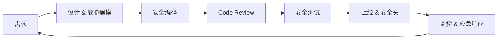

# 前端安全防护：从认知到防御的完整流程

> 参考资料：
>
> - [前端知识体系 — 解决方案 / 前端解决方案 / 前端安全防护（本文结构蓝本）](https://books.tedshen.cn/docs/%E8%A7%A3%E5%86%B3%E6%96%B9%E6%A1%88/%E5%89%8D%E7%AB%AF%E8%A7%A3%E5%86%B3%E6%96%B9%E6%A1%88/%E5%89%8D%E7%AB%AF%E5%AE%89%E5%85%A8%E9%98%B2%E6%8A%A4)
> - [前端基础知识 — 安全篇（XSS / CSRF / 点击劫持等）](https://woai3c.github.io/Front-end-basic-knowledge/safe.html#xss)
> - [OWASP — Cross Site Scripting Prevention Cheat Sheet](https://cheatsheetseries.owasp.org/cheatsheets/Cross_Site_Scripting_Prevention_Cheat_Sheet.html)
> - [OWASP — Cross-Site Request Forgery Prevention Cheat Sheet](https://cheatsheetseries.owasp.org/cheatsheets/Cross-Site_Request_Forgery_Prevention_Cheat_Sheet.html)
> - [OWASP — Content Security Policy Cheat Sheet](https://cheatsheetseries.owasp.org/cheatsheets/Content_Security_Policy_Cheat_Sheet.html)
> - [MDN — 内容安全策略（CSP）](https://developer.mozilla.org/zh-CN/docs/Web/HTTP/CSP)
> - [MDN — 同源策略（Same-origin policy）](https://developer.mozilla.org/zh-CN/docs/Web/Security/Same-origin_policy)
> - [web.dev — Prevent attacks with a Content Security Policy](https://web.dev/articles/csp)
> - [长亭科技技术博客 — 前端安全系列（XSS / CSRF / 防护实践）](https://stack.chaitin.com/techblog/detail/198)
> - [yuan 博客 — 前端安全面试题与攻防解析（Issue #133）](https://github.com/yuanyuanbyte/Blog/issues/133)
>
> 面向角色：中高级前端工程师。本文系统梳理**前端工程师必须掌握的安全威胁模型与防御手段**——同源策略、XSS、CSRF、点击劫持、传输安全、会话安全、CORS 边界、CSP、供应链安全、数据合规——并把它们串成一条**从需求到上线再到监控的端到端安全流程（SDL）**。阅读前置建议：先看 [HTTP / HTTPS 核心知识手册](/fundamentals/http/) 理解请求 / 响应 / 缓存与 TLS，再看 [浏览器核心知识手册](/fundamentals/browser/) 理解浏览器隔离模型，最后回到本文把它们落到「前端能做什么、不能做什么」的边界上。本文是该主题的**汇总篇**，重点在「完整流程」与「防御清单」，而非某一项技术的深抠。

---

## 目录

1. [概述](#一、概述)
2. [浏览器安全基石：同源策略](#二、浏览器安全基石同源策略)
3. [跨站脚本攻击（XSS）](#三、跨站脚本攻击xss)
4. [跨站请求伪造（CSRF）](#四、跨站请求伪造csrf)
5. [点击劫持与界面伪装](#五、点击劫持与界面伪装)
6. [传输安全：HTTPS、HSTS 与混合内容](#六、传输安全httpshsts-与混合内容)
7. [认证与会话安全](#七、认证与会话安全)
8. [跨域与信任边界（CORS）](#八、跨域与信任边界cors)
9. [内容安全策略（CSP）](#九、内容安全策略csp)
10. [前端依赖与供应链安全](#十、前端依赖与供应链安全)
11. [数据安全与隐私合规](#十一、数据安全与隐私合规)
12. [安全开发生命周期：端到端的流程](#十二、安全开发生命周期端到端的流程)
13. [安全测试与线上监控](#十三、安全测试与线上监控)
14. [防御清单与最佳实践](#十四、防御清单与最佳实践)
15. [常见问题与坑位速查](#十五、常见问题与坑位速查)

---

## 一、概述

前端安全不是「上线前补几个 header」的收尾动作，而是贯穿需求、设计、编码、测试、上线、监控全链路的**工程能力**。对高级前端工程师而言，至少要能回答三个问题：

- **威胁在哪？** 攻击者能借浏览器、借你写的代码、借你引用的第三方库，对用户与系统做什么？
- **边界在哪？** 哪些事前端「做不了」——必须交给服务端与协议层（HTTPS、HttpOnly Cookie、CORS 校验）兜底？
- **流程怎么闭环？** 单点防御（比如只加一个 CSP）一定会被绕过，只有把「设计 → 编码 → 测试 → 监控」串成流程，安全才可持续。

### 1.1 威胁全景

| 威胁                 | 一句话本质                                       | 主要受害者      | 前端能做的防御                                   |
| -------------------- | ------------------------------------------------ | --------------- | ------------------------------------------------ |
| XSS                  | 把恶意脚本注入到受害者浏览器执行                 | 用户 / 会话     | 转义输出、CSP、HttpOnly、避免 `innerHTML`        |
| CSRF                 | 借受害者身份发起其不知情的跨站请求               | 用户 / 账户     | SameSite Cookie、CSRF Token、校验 Origin         |
| 点击劫持             | 用透明 iframe 诱导用户点不该点的东西             | 用户操作        | `X-Frame-Options` / CSP `frame-ancestors`        |
| 中间人（MITM）       | 在传输链路里窃听 / 篡改                         | 全链路          | HTTPS、HSTS、证书固定                            |
| 不安全的第三方依赖   | 你 import 的包本身就是恶意或带漏洞的            | 全应用          | lockfile、SRI、依赖审计、最小权限                |
| 敏感信息泄漏         | 令牌 / 隐私进了前端存储、URL、日志、截图         | 用户 / 合规     | HttpOnly、不落客户端、脱敏                        |
| 跨域信任滥用         | 误把不可信源当可信，CORS 放行过宽                | 用户 / 数据     | 白名单、显式校验 Origin、不回 `*`                 |

> **核心认知**：浏览器是「在用户机器上、由用户完全控制的运行环境」。任何前端代码、前端存储、前端校验都**可以被用户或攻击者改写**。所以「前端安全」真正能守住的，是**降低攻击面 + 配合服务端与协议层把信任边界划清**——而非把安全全盘押在前端。

---

## 二、浏览器安全基石同源策略

同源策略（Same-origin policy，SOP）是浏览器一切安全机制的起点：它规定**来自不同源的文档 / 脚本，无法读取彼此的资源**（Cookie、DOM、LocalStorage、接口响应等），除非被显式授权。

### 2.1 什么是「源」

源 = `协议 + 域名（host）+ 端口`。三者任一不同即**跨源**：

| URL A                          | URL B                          | 同源？              |
| ------------------------------ | ------------------------------ | ------------------- |
| `https://a.com/page`           | `https://a.com/other`          | ✅ 同源             |
| `https://a.com`                | `http://a.com`                 | ❌ 协议不同         |
| `https://a.com`                | `https://api.a.com`            | ❌ 域名不同（子域） |
| `https://a.com`                | `https://a.com:8080`           | ❌ 端口不同         |

### 2.2 同源策略的「放行」与「拦截」

- **默认拦截**：`fetch` / `XMLHttpRequest` 跨源读响应、`iframe` 跨源读 DOM、`localStorage` 跨源读写，都被拦。
- **默认放行（历史包袱）**：`<script>`、``、`<link>`、`<form>` 提交等**「带外资源加载」不受 SOP 限制**——这正是 CSRF、XSS 能成立的根本原因之一。

> 同源策略是「最小信任」的默认态，但它**不防 XSS**（同源脚本天然能读同源 DOM / Cookie / 接口），也**不防 CSRF**（`form` / `img` 天生能跨源发请求）。这两类威胁要靠后续专门的机制去补。

---

## 三、跨站脚本攻击xss

XSS（Cross-site Scripting）是前端最高频、危害最大的漏洞：**攻击者把恶意脚本塞进页面，在受害者浏览器以「该页面的同源身份」执行**，从而窃取 Cookie / Token、伪造操作、钓鱼、挖矿。

### 3.1 三种类型

| 类型       | 注入点                                   | 触发方式                                   | 典型场景                         |
| ---------- | ---------------------------------------- | ------------------------------------------ | -------------------------------- |
| 存储型     | 服务端数据库（评论、昵称、简历）         | 受害者访问含脏数据的页面即执行             | 论坛评论、用户资料、富文本       |
| 反射型     | URL 参数                                 | 诱骗受害者点击带 payload 的链接             | 搜索框、错误页、跳转参数         |
| DOM 型     | 前端 JS 把不可信数据写进 DOM             | 前端读取 `location`、`document.referrer` 等 | 单页应用路由、客户端渲染拼接     |

> **关键区别**：存储型 / 反射型的 payload 经过服务端；DOM 型**完全在前端**拼接执行，服务端可能根本没参与——所以「后端做了转义」挡不住 DOM 型 XSS。

### 3.2 防御第一原则：永远不要信任用户输入

任何来自用户、URL、第三方接口、Cookie 的数据，在**插入到 HTML 上下文之前**都必须按上下文转义：

```js
// 不同上下文，转义规则完全不同——用错上下文的转义等于没防
const escapeHtml = (str) =>
  String(str)
    .replace(/&/g, '&amp;')
    .replace(/</g, '&lt;')
    .replace(/>/g, '&gt;')
    .replace(/"/g, '&quot;')
    .replace(/'/g, '&#39;')

// ❌ 危险：直接拼 HTML（即便来自「自己数据库」——数据可能早被污染）
el.innerHTML = `<div>${userComment}</div>`

// ✅ 安全：交给框架的模板，框架默认转义；或显式转义后再拼
el.innerHTML = `<div>${escapeHtml(userComment)}</div>`
```

### 3.3 现代框架的「默认安全」与「例外陷阱」

Vue / React 的模板默认对插值做 HTML 转义，**正常使用 `{{ }}` / `{}` 是安全的**。真正踩雷的是主动绕过转义：

```jsx
// ❌ React 危险：dangerouslySetInnerHTML 等于把转义开关关掉
<div dangerouslySetInnerHTML={{ __html: rawHtmlFromServer }} />

// ✅ 真要渲染富文本：用 DOMPurify 先净化，再插入
import DOMPurify from 'dompurify'
const clean = DOMPurify.sanitize(rawHtmlFromServer)
el.innerHTML = clean // 只允许白名单标签 / 属性，剥离 on* 事件与 javascript: 协议
```

```vue
<!-- ❌ Vue 危险：v-html 同样绕过转义 -->
<div v-html="rawHtml"></div>

<!-- ✅ 安全：插值默认转义；必须用 v-html 时先 DOMPurify -->
<div v-html="sanitizedHtml"></div>
```

> **铁律**：`v-html` / `dangerouslySetInnerHTML` / `innerHTML` 三兄弟，凡是用到就必须先经过**净化（sanitize）或强转义**，且来源必须可信。富文本场景用 DOMPurify 这类白名单净化库，而不是自己写正则。

### 3.4 输出点要明确上下文

同一份数据插到不同位置，转义方式不同：

| 插入位置                       | 风险                         | 正确做法                                       |
| ------------------------------ | ---------------------------- | ---------------------------------------------- |
| HTML 元素内文本                | 标签注入                     | HTML 实体转义                                   |
| HTML 属性值（`href` / `src`）  | 属性逃逸、`javascript:` 协议 | 转义引号 + 校验协议白名单（只放行 `http(s):`） |
| URL 参数                       | 参数截断                     | `encodeURIComponent`                            |
| `onclick` 等内联事件           | 脚本注入                     | 不要用内联事件拼接；用 `addEventListener`      |
| `<script>` 里 JSON 数据        | `</script>` 截断             | 转义 `<` 为 `\u003c`                            |

### 3.5 组合拳：XSS 不止靠转义

单点防御会被绕过，XSS 要打组合拳（详见 [第九章 CSP](#九、内容安全策略csp) 与 [第七章](#七、认证与会话安全)）：

1. **输出转义**挡住注入入口；
2. **CSP** 限制脚本来源，即便漏一处 XSS，恶意脚本也因「来源不在白名单」而无法执行；
3. **HttpOnly Cookie** 让 XSS 偷不到会话令牌（偷不到 = 拿不到登录态）；
4. **输入校验 + 服务端再校验**：前端校验只是体验，真正防线在服务端。

---

## 四、跨站请求伪造csrf

CSRF（Cross-site Request Forgery）利用的是：**浏览器会自动带上目标域的 Cookie**。攻击者诱导已登录用户访问恶意页面，该页面偷偷发起一个跨站请求（如转账、改密码），浏览器「好心」地把用户的登录 Cookie 一并带上，服务端误以为是用户本人操作。

### 4.1 为什么 SOP 拦不住它

`fetch` 读不到跨源响应，但 **`form` 提交 / `img` / 某些 `fetch` 的「简单请求」能发出去且带 Cookie**——CSRF 要的不是「读响应」，而是「让请求成功执行」。所以 CSRF 的本质是**「借用受害者身份发起写操作」**。

### 4.2 防御手段（按推荐顺序）

**① SameSite Cookie（首选，零成本）**

```http
Set-Cookie: sessionid=xxx; HttpOnly; Secure; SameSite=Lax
```

- `Strict`：完全不随跨站请求带；
- `Lax`（默认）：顶级导航的 GET 带，跨站 POST / 子资源不带——能挡住绝大多数 CSRF；
- `None`：跨站也带，但**必须配 `Secure`**（仅 HTTPS）。

> `SameSite=Lax` 不是银弹：它不防「同源内的 CSRF」（如被 XSS 后发起的请求本就是同源），也不防用户主动在恶意站点点提交按钮的「已授权跨站 GET」。所以仍需配合 Token。

**② CSRF Token（服务端校验）**

```js
// 页面渲染时下发一次性 token（藏在表单 / meta），随请求带回
const csrfToken = document.querySelector('meta[name="csrf-token"]').content

fetch('/api/transfer', {
  method: 'POST',
  headers: {
    'Content-Type': 'application/json',
    'X-CSRF-Token': csrfToken, // 自定义头——它会把请求变成「非简单请求」，触发预检
  },
  body: JSON.stringify({ to: 'attacker', amount: 1000 }),
})
```

服务端校验 `X-CSRF-Token` 与 session 中绑定的 token 一致才放行。**因为 token 存在同源 DOM / JS 变量里，恶意跨站页面读不到它**，于是伪造请求缺少正确 token 而被拒。

**③ 校验 Origin / Referer（兜底）**

```js
// 简单请求（无预检）也能拿到 Origin；用它做同源白名单兜底
const origin = req.headers.origin
if (origin && !ALLOWED_ORIGINS.includes(new URL(origin).host)) {
  return res.status(403).end()
}
```

**④ 重要操作二次验证**：改密码、转账等高危动作要求重新输入密码 / 短信验证码，即使 CSRF 成立也无法越过。

---

## 五、点击劫持与界面伪装

点击劫持（Clickjacking）：攻击者用透明 / 半透明 `iframe` 把目标站点（如「确认支付」按钮）盖在自己的诱导按钮之上，用户以为在点「领红包」，实际点的是 iframe 里的「支付」。

### 5.1 防御：不让别人把你嵌进 iframe

```http
# 经典方案：禁止被任何站 iframe
X-Frame-Options: DENY
# 或只允许同源：X-Frame-Options: SAMEORIGIN
```

```http
# 现代方案（推荐，更灵活，可指定允许的来源）：
Content-Security-Policy: frame-ancestors 'self'
# 完全禁止被嵌入：frame-ancestors 'none'
```

> `frame-ancestors` 比 `X-Frame-Options` 更强大：它支持白名单来源、且是 CSP 的一部分。**新项目直接用 `frame-ancestors`，老浏览器再补 `X-Frame-Options`**。

### 5.2 反向保护：自家页面别被「框」走

如果业务需要自己 iframe 别人（极少），注意对方也可能反嵌你；前端可加 JS 兜底 `frame-busting`（但可被绕过，真正防线还是上面的响应头）。

---

## 六、传输安全httpshsts-与混合内容

XSS / CSRF 解决的是「应用层信任」，但**链路层**若被窃听（公共 WiFi、运营商劫持），令牌与数据照样泄漏——这就是中间人攻击（MITM）。防线在协议层。

### 6.1 全站 HTTPS 是底线

- 所有请求、所有环境（含本地联调的测试域名）都走 HTTPS；
- 证书由可信 CA 签发，避免自签被用户忽略；
- 前端**不把令牌写进 URL**（URL 会进历史记录、Referer、服务器日志、截图）。

### 6.2 HSTS：禁止降级到 HTTP

即使用户手输 `http://`，攻击者也可能在跳转前拦截。HSTS 让浏览器**记住「这个域名只允许 HTTPS」**：

```http
Strict-Transport-Security: max-age=31536000; includeSubDomains; preload
```

- `max-age`：有效期内强制 HTTPS；
- `includeSubDomains`：子域一并覆盖；
- `preload`：申请进浏览器内置列表，首次访问前就生效（需到 hstspreload.org 提交）。

### 6.3 消灭混合内容（Mixed Content）

HTTPS 页面里加载 HTTP 的脚本 / 图片 / iframe 会被浏览器**拦截（主动混合内容）或告警（被动混合内容）**，且是 XSS 的敞口：

- 资源 URL 一律用 `https://` 或协议相对 `//`（推荐直接用 `https://`）；
- 部署时扫描并替换遗留的 `http://` 资源引用；
- 用 CSP 的 `block-all-mixed-content`（旧）或升级机制 `upgrade-insecure-requests` 自动把 HTTP 升 HTTPS。

```http
Content-Security-Policy: upgrade-insecure-requests
```

---

## 七、认证与会话安全

前端在认证环节最该守的边界：**令牌 / 会话凭据不要进「JS 可读」的存储**。

### 7.1 Cookie 属性组合拳

```http
Set-Cookie: sessionid=abc123; Path=/; HttpOnly; Secure; SameSite=Lax; Max-Age=3600
```

- `HttpOnly`：**JS 读不到**，`document.cookie` 不返回它——这是 XSS 偷不到会话凭据的唯一硬手段；
- `Secure`：仅 HTTPS 传输，杜绝明文泄漏；
- `SameSite=Lax/Strict`：顺带防 CSRF（见 [第四章](#四、跨站请求伪造csrf)）；
- `Max-Age` / `Expires`：控制生命周期，短期访问令牌 + 服务端刷新。

### 7.2 令牌到底放哪

| 方案                              | XSS 可读 | CSRF 风险 | 结论                                       |
| --------------------------------- | -------- | --------- | ------------------------------------------ |
| `localStorage` 存 Token           | ✅ 可读   | ❌ 无     | 不推荐：一次 XSS 全线失守                  |
| `sessionStorage` 存 Token         | ✅ 可读   | ❌ 无     | 同上有风险，且关页即失效体验差             |
| 内存变量存 Token                  | ✅ 可读   | ❌ 无     | 最安全但刷新掉登录，适合配静默续期        |
| `HttpOnly` + `Secure` + `SameSite` Cookie | ❌ 读不到 | ⚠️ 需配合 Token | **推荐**：服务端会话 + 短期访问令牌 |

> 详细取舍与「为什么本地加密不是安全边界」见 [浏览器存储指南](/fundamentals/browser-storage/) 的 4.4 节。核心：**前端加密的密钥只要还在前端就能被取出来，XSS 下同源脚本权限完全相同**——不要把前端加密当安全边界。

### 7.3 前端只做「体验层」校验

登录态、权限、金额这些**必须由服务端校验**。前端隐藏按钮、前端校验只是减少误操作，攻击者可以直接调接口绕过。前端永远假设「用户能改掉你写的任何判断」。

---

## 八、跨域与信任边界cors

CORS（Cross-Origin Resource Sharing）是「在 SOP 基础上，显式授权某些跨源访问」的机制。配置错误会**把内网 / 敏感接口暴露给任意网站**。

### 8.1 危险的「通配」

```http
# ❌ 带凭据时回 * = 任何网站都能以用户身份读你的接口响应
Access-Control-Allow-Origin: *
Access-Control-Allow-Credentials: true
```

正确做法：

- **不带凭据**的公开接口可用 `*`，但别同时开 `Allow-Credentials`；
- **带凭据**的接口必须回**具体的、经白名单校验的 Origin**，且配合 `Vary: Origin`；
- 白名单在前端「列个数组」没用——校验必须在**服务端**按 `Origin` 头执行。

### 8.2 前端视角的信任边界

- `withCredentials: true` 的跨源请求才会带 Cookie，慎用；
- 不要因为「方便联调」就把 CORS 放成 `*`，上线前一定要收紧；
- 预检（OPTIONS）失败通常不是前端 bug，而是服务端 CORS 配置没覆盖该方法和头。

---

## 九、内容安全策略csp

CSP（Content Security Policy）是 XSS 的「最后一道网」：它告诉浏览器**哪些来源的资源（脚本、样式、图片、连接）允许加载与执行**，不在白名单内的一律拒绝。即使代码里漏了一处 XSS，恶意脚本因「来源不在白名单」也执行不了。

### 9.1 一个最小可用策略

```http
Content-Security-Policy:
  default-src 'self';
  script-src 'self' https://trusted-cdn.com;
  style-src 'self' 'unsafe-inline';
  img-src 'self' data: https:;
  connect-src 'self' https://api.example.com;
  frame-ancestors 'self';
  base-uri 'self';
  object-src 'none'
```

| 指令          | 作用                                   |
| ------------- | -------------------------------------- |
| `default-src` | 兜底来源                               |
| `script-src`  | 脚本来源（最关键的防 XSS 开关）        |
| `style-src`   | 样式来源                               |
| `img-src`     | 图片来源                               |
| `connect-src` | `fetch` / WebSocket 能连的域           |
| `frame-ancestors` | 谁可以把我嵌进 iframe（防点击劫持） |
| `base-uri`    | 限制 `<base>`，防 `base` 标签劫持      |
| `object-src`  | 禁老式插件（Flash 等），一般设 `none`  |

### 9.2 关键取舍

- **尽量去掉 `unsafe-inline`**：内联 `<script>` / `onclick` 会让 CSP 形同虚设。用**随机数（nonce）或哈希**放行必需的 inline 脚本：

  ```http
  Content-Security-Policy: script-src 'self' 'nonce-abc123'
  ```

  ```html
  <script nonce="abc123">/* 只有带正确 nonce 的内联脚本才执行 */</script>
  ```

- **先 `report-only` 再强制**：上线前用 `Content-Security-Policy-Report-Only` 收集违规报告，确认无误再切到强制模式，避免误伤正常资源。
- **配合上报**：`report-uri` / `report-to` 把违规打到监控，既能发现 XSS 尝试，也能发现被篡改的注入（见 [第十三章](#十三、安全测试与线上监控)）。

> CSP 不是「加了就安全」的开关，而是一张**需要随业务资源变化持续维护的白名单**。资源域新增 / 变更时，CSP 必须同步更新，否则会误拦——这也是很多团队配了 CSP 又偷偷加 `unsafe-inline` 回退的反面教材。

---

## 十、前端依赖与供应链安全

现代前端 90% 的代码来自 `node_modules`。一条恶意或被入侵的依赖，就能在**你用户浏览器里**执行任意代码——比 XSS 更隐蔽，因为来源是「你信任的包」。

### 10.1 风险来源

- **恶意包 / 拼写抢注（typosquatting）**：名字仿冒知名库（`vuee`、`lodash-utils`）；
- **被入侵的合法包**：维护者账号被盗，发带后门的版本；
- **传递依赖**：你装的 A 依赖了 B，B 又依赖了被投毒的 C，你根本没直接 `import` C；
- **构建期脚本**：`postinstall` 能在你机器上跑任意命令。

### 10.2 防御手段

**① 锁文件 + 可重现构建**：`pnpm-lock.yaml` / `package-lock.json` 锁定**每一个**传递依赖的精确版本，禁止 `^` / `~` 在大版本漂移时悄悄引入新包。CI 用 `pnpm install --frozen-lockfile` 保证构建可重现。

**② 依赖审计常态化**：

```bash
# 检查已知漏洞
pnpm audit
# 把审计接进 CI，高危漏洞阻断合并
pnpm audit --audit-level high
```

**③ 子资源完整性（SRI）**：对 CDN 上的第三方脚本加 `integrity`，浏览器校验哈希，文件被篡改则拒绝加载：

```html
<script
  src="https://trusted-cdn.com/lib.js"
  integrity="sha384-abcdef123456..."
  crossorigin="anonymous"
></script>
```

**④ 最小权限与最小依赖**：能不用 CDN 就不用；能用原生 API 就别引库；定期 `pnpm prune` 清无用依赖。**每个 `import` 都是一次信任授予**。

**⑤ 警惕 `postinstall`**：审一遍依赖的 `package.json` 里有没有可疑的安装期脚本；私有 npm 源（如 Verdaccio / npmmirror 私有仓）可降低公共源被投毒的风险面。

---

## 十一、数据安全与隐私合规

### 11.1 前端「不该存」的东西

- **令牌 / 会话**：交给 `HttpOnly` Cookie（见 [第七章](#七、认证与会话安全)）；
- **身份证 / 银行卡 / 手机号**：脱敏展示（`138****8000`），原始值只在必要接口用，用完即弃；
- **大段隐私进 URL / 日志 / 截图**：URL 会被转发、日志会被收集、截图会被上传——这些地方默认「不安全」。

### 11.2 前端加密的边界

- **传输加密**靠 HTTPS（链路层），不是前端 `AES`；
- **本地存储加密**只能防「设备丢失后的物理读取」，防不了 XSS（密钥同在前端）；
- **真正敏感**的数据，原则是不落客户端、不进前端可读取的存储。

### 11.3 合规要点（GDPR / 个保法）

- 收集前**明示告知 + 取得同意**；
- 提供「清除本地数据」入口（也是排查问题的逃生口）；
- 默认不收集、最少够用；敏感字段服务端加密存储，前端只拿脱敏视图。

---

## 十二、安全开发生命周期端到端的流程

单点防御必然有遗漏。**SDL（Security Development Lifecycle）把安全做成一条贯穿全流程的流水线**，让「安全」成为习惯而非救火。



### 12.1 需求阶段：把安全要求写进 ticket

- 这个页面处理什么数据？敏感级别？
- 涉及哪些写操作（转账 / 改密）？是否需要二次验证？
- 是否引入新的第三方依赖 / 资源域（影响 CSP / SRI）？

### 12.2 设计阶段：威胁建模（STRIDE）

对每个功能问六个问题：

| 维度      | 问题                                   |
| --------- | -------------------------------------- |
| 仿冒      | 能否伪造用户 / 管理员身份？            |
| 篡改      | 数据在传输 / 存储中能否被改？          |
| 抵赖      | 操作能否被审计、能否追溯？             |
| 信息泄露  | 是否有不该暴露的数据外泄？             |
| 拒绝服务  | 是否存在可被放大的资源消耗？           |
| 权限提升  | 普通用户能否越权拿到更高权限？         |

输出：**信任边界图 + 每个边界的防御措施**，这直接决定后面 CSP 白名单、CORS 配置、接口鉴权怎么做。

### 12.3 编码阶段：安全编码规范

- 输出一律按上下文转义；富文本走净化；
- 禁用 `eval` / `new Function` / 不可信的 `innerHTML`；
- 凭据走 `HttpOnly` Cookie；
- 所有接口参数服务端重校验；
- 错误 / 异常不向前端泄露堆栈与内部路径。

### 12.4 评审阶段：安全 Code Review 清单

- 有没有把不可信数据直接拼进 HTML / URL / 属性？
- 新接口是否校验 Origin / Token / 权限？
- 新依赖是否过审计、是否加 SRI / 锁版本？
- 是否引入了新资源域（CSP 要不要改）？

### 12.5 测试阶段：安全测试

- **静态扫描（SAST）**：ESLint 安全规则、`semgrep` 扫危险 API；
- **依赖扫描（SCA）**：`pnpm audit` 接 CI；
- **动态测试（DAST）/ 渗透**：XSS / CSRF / 越权 的手工与自动化探测；
- **红蓝对抗**：模拟攻击者走完整利用链。

### 12.6 上线阶段：安全响应头一站式

上线前置好一组响应头（一次性把信任边界钉死）：

```http
Content-Security-Policy: default-src 'self'; script-src 'self'; frame-ancestors 'self'; object-src 'none'
X-Content-Type-Options: nosniff
X-Frame-Options: DENY
Strict-Transport-Security: max-age=31536000; includeSubDomains; preload
Referrer-Policy: strict-origin-when-cross-origin
Permissions-Policy: geolocation=(), camera=(), microphone=()
```

| 响应头                       | 作用                                   |
| ---------------------------- | -------------------------------------- |
| `X-Content-Type-Options`     | 禁止 MIME 嗅探，防「图片变脚本」       |
| `Referrer-Policy`            | 控制 Referer 外泄，避免带敏感路径出去  |
| `Permissions-Policy`         | 关掉用不到的敏感 API（定位 / 摄像头）  |

### 12.7 监控与应急：让攻击「可被看见」

- CSP 违规上报（[第九章](#九、内容安全策略csp)）捕捉 XSS 尝试；
- 接口异常高频、可疑 UA / IP 进风控；
- 准备**应急响应预案**：回滚、吊销令牌、强制改密、公告——安全事件「响应速度」往往比「事前防御完美」更决定损失大小。

---

## 十三、安全测试与线上监控

### 13.1 本地自查清单

- 在输入框 / URL 里试 `<script>alert(1)</script>`，看是否被转义而非执行；
- 看响应头是否齐了第十二章那组安全头；
- Cookie 是否 `HttpOnly` + `Secure` + `SameSite`；
- 跨域接口是否误配 `*` + `Credentials`。

### 13.2 监控指标

- **CSP violation 量**：突增 = 可能遭 XSS 探测或资源被篡改；
- **CSRF / Token 校验失败率**：异常升高可能是攻击或前端 bug；
- **依赖漏洞新增数**：`pnpm audit` 每日 / 每次合并跑；
- **敏感接口 4xx / 5xx 异常**：越权尝试或脚本化攻击。

---

## 十四、防御清单与最佳实践

### 14.1 上线前必查（前端安全 Checklist）

- [ ] 所有不可信数据输出均按上下文转义；富文本经净化
- [ ] 禁用 `innerHTML` / `v-html` / `dangerouslySetInnerHTML` 的裸用
- [ ] Cookie 全部 `HttpOnly` + `Secure` + `SameSite`
- [ ] 令牌不进 `localStorage` / `sessionStorage` / URL
- [ ] 全站 HTTPS + HSTS + 无混合内容
- [ ] CSP 已配（先 report-only 再强制），`frame-ancestors` 防点击劫持
- [ ] 安全头一组齐全（nosniff / X-Frame-Options / Referrer-Policy / Permissions-Policy）
- [ ] CORS 白名单在服务端校验，无 `*` + `Credentials`
- [ ] 依赖锁版本 + `pnpm audit` 接 CI + 关键第三方资源加 SRI
- [ ] 高危操作二次验证；所有接口服务端重校验
- [ ] CSP 违规 / 依赖漏洞 / 异常请求有监控与告警

### 14.2 一句话心法

> **前端安全的本质，是「把攻击面压到最小，并把不可信的边界交给服务端与协议层守住」。** 转义防注入、CSP 兜底、HttpOnly 守令牌、HTTPS 守链路、CORS 守跨域、SDL 守流程——六道防线缺一不可，且必须用流程把它们串起来，而不是上线前临时补一个 header。

---

## 十五、常见问题与坑位速查

| 现象                                       | 根因                                               | 处理                                                   |
| ------------------------------------------ | -------------------------------------------------- | ------------------------------------------------------ |
| 富文本渲染后被执行了脚本                   | 直接 `v-html` / `innerHTML` 未净化                  | DOMPurify 净化后再插入                                 |
| XSS 没防住但「后端转义了」                 | 是 DOM 型 XSS，纯前端拼接，后端没参与               | 前端输出点也要转义 / 净化                              |
| `SameSite=Lax` 还中招                      | 同源内 XSS 或用户主动跨站提交 GET                   | 配合 CSRF Token + 校验 Origin                          |
| 加了 CSP 页面脚本全挂                       | 用了 `unsafe-inline` 回退或白名单漏了资源域         | 用 nonce / 哈希放行，逐步移除 inline；先 report-only   |
| HTTPS 页面图片 / 脚本被拦                  | 混合内容（资源是 `http://`）                        | 改 `https://` 或 `upgrade-insecure-requests`           |
| 跨域接口在带凭据时跨域失败                 | `Allow-Origin: *` 与 `Credentials` 冲突            | 回具体白名单 Origin，不回 `*`                          |
| `localStorage` 存 Token 被盗               | 一次 XSS 即可读走，全线失守                         | 改用 `HttpOnly` Cookie                                 |
| `pnpm audit` 一堆漏洞没人管                | 没接 CI、没定期修                                   | 高危阻断合并 + 定期升级 / 替换依赖                     |
| 改了 CSP 忘记同步新资源域                 | 资源域新增但白名单没加                               | 资源变更时同步维护 CSP；先 report-only 观察            |

### 15.1 高频面试速记

1. **XSS 三种类型？** → 存储型（入库，访问即执行）/ 反射型（URL 参数，诱导点击）/ DOM 型（前端拼接，服务端不参与）（[第三章](#三、跨站脚本攻击xss)）。
2. **XSS 怎么防？** → 输出按上下文转义 + 富文本净化 + CSP 兜底 + HttpOnly 守令牌，四者缺一不可（[3.5](#三、跨站脚本攻击xss) / [第九章](#九、内容安全策略csp)）。
3. **CSRF 和 XSS 区别？** → XSS 是「借你的浏览器执行脚本」，CSRF 是「借你的身份发起请求」；CSRF 靠 SameSite + Token + Origin 校验（[第四章](#四、跨站请求伪造csrf)）。
4. **为什么 Token 不放 localStorage？** → XSS 可读走，应放 HttpOnly Cookie；前端加密不是安全边界（[第七章](#七、认证与会话安全)）。
5. **CSP 为什么重要？** → 它是 XSS 的最后一道网，限制脚本来源，漏防处也能拦（[第九章](#九、内容安全策略csp)）。
6. **前端供应链怎么防？** → 锁文件 + 审计 CI + SRI + 最小依赖（[第十章](#十、前端依赖与供应链安全)）。
7. **SDL 是什么？** → 安全贯穿需求→设计→编码→评审→测试→上线→监控的闭环流程，而非上线前补 header（[第十二章](#十二、安全开发生命周期端到端的流程)）。

---

> 本文持续更新。核心心法：**浏览器是用户完全可控的环境，前端能做的只是「缩小攻击面 + 划清信任边界」，真正的安全要靠「前端转义 + 协议层 HTTPS + 服务端校验 + 流程化 SDL」四层合力。** 把本文的清单当成每次上线的必过点，比记住任何单点技巧都重要。
