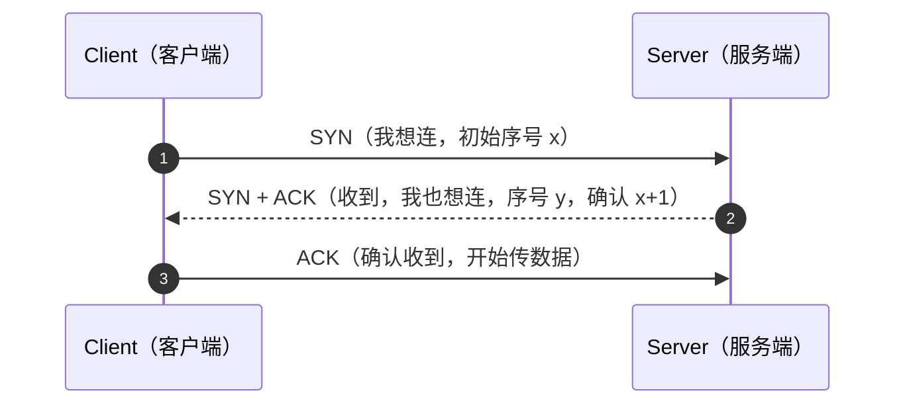
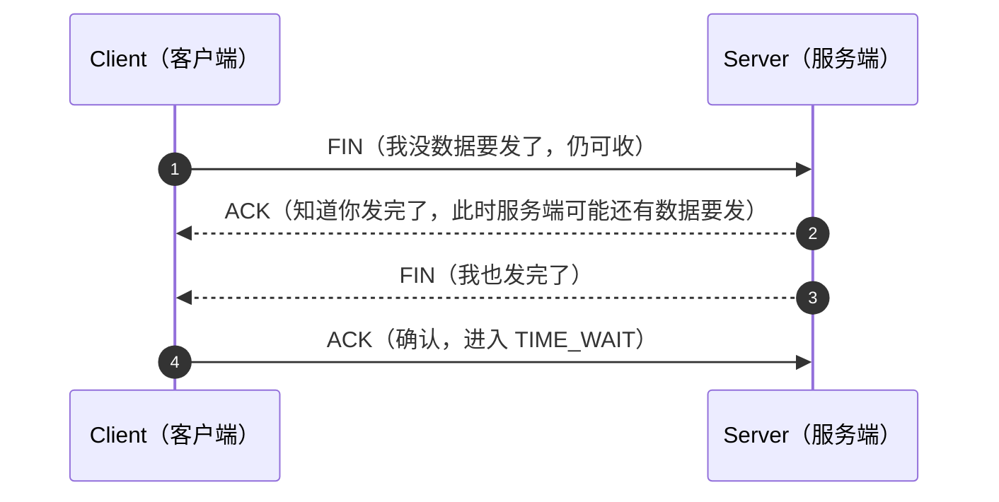

# HTTP / HTTPS 核心知识手册

> 参考资料：
>
> - [MDN Web Docs - HTTP](https://developer.mozilla.org/zh-CN/docs/Web/HTTP)
> - [ITBook HTTP 中文手册](https://itbook.team/book/http/)
> - [前端面试知识库 - Network](https://libao-jun.github.io/interview/docs/fundamentals/network/)
> - [WinDocs - 网络协议（网络分层 / 基本概念 / 性能指标）](https://dongmeng22.github.io/docs/basics/networks/)
> - [WinDocs - 深入 HTTP（网络基础 / HTTP 协议 / HTTP 报文）](https://dongmeng22.github.io/docs/basics/http/)
> - [前端知识宝典 - HTTP 常用版本（协议版本特性与对比）](https://ddz12123.github.io/docs/面试题/javaScript/http)
>
> 面向角色：中高级前端工程师。不仅罗列规范，更侧重**浏览器实际行为**、**常见坑点**与**调试手段**，并补充传输层/网络层基础、网络性能指标与协议设计 trade-off。

---

## 目录

1. [HTTP 基础与协议演进](#一、http-基础与协议演进)
2. [HTTP/1.1 核心机制](#二、http-1-1-核心机制)
3. [HTTP/2 与 HTTP/3](#三、http-2-与-http-3)
4. [缓存机制](#四、缓存机制)
5. [Cookie 与状态管理](#五、cookie-与状态管理)
6. [跨域与安全](#六、跨域与安全)
7. [HTTPS 与传输安全](#七、https-与传输安全)
8. [性能优化与调试实践](#八、性能优化与调试实践)
9. [计算机网络基础与传输层补充](#九、计算机网络基础与传输层补充)
10. [网络性能指标](#十、网络性能指标)
11. [URL 与 URI](#十一、url-与-uri)

---

## 一、HTTP 基础与协议演进

### 1.1 什么是 HTTP

HTTP（HyperText Transfer Protocol，超文本传输协议）是基于 **TCP/IP** 的应用层协议，用于在客户端（通常浏览器）与服务器之间传输超文本（HTML、图片、JSON 等）。

两个根本特征：

- **无状态（stateless）**：每个请求彼此独立，服务器默认不记得上一个请求是谁发的。状态靠 `Cookie` / `Token` / `Session` 等机制补充。
- **无连接 → 持久连接**：早期每请求新建 TCP；HTTP/1.1 起默认复用（`Keep-Alive`）。

### 1.2 HTTP 报文结构

一条 HTTP 报文由四部分组成：**起始行（请求行 / 状态行）、头部（Headers）、空行、消息体（Body）**。

**请求报文**

```
POST /api/login HTTP/1.1            ← 请求行：方法 请求目标 协议版本
Host: example.com                   ← 请求头（键值对，每行一个）
User-Agent: Mozilla/5.0
Content-Type: application/json
Authorization: Bearer <token>
                                   ← 空行（CRLF，分隔头与体，必不可少）
{"username":"a","password":"b"}     ← 消息体（Body，GET 通常无）
```

**响应报文**

```
HTTP/1.1 200 OK                    ← 状态行：协议版本 状态码 原因短语
Content-Type: application/json     ← 响应头
Cache-Control: max-age=300
Content-Length: 42
                                   ← 空行
{"token":"xyz","uid":1}            ← 消息体
```

要点：

- 头部是 **ASCII 文本、换行（CRLF）分隔、以空行结束**；Body 才是二进制或编码数据。
- 头部字段名**不区分大小写**（`Content-Type` ≡ `content-type`），但约定首字母大写（驼峰）。
- 空行是头与体的硬性边界：缺了空行，解析会失败或把头当体。

### 1.3 常见请求方法（含幂等性）

| 方法      | 语义                                          | 有 Body          | 安全 | 幂等 |
| --------- | --------------------------------------------- | ---------------- | ---- | ---- |
| `GET`     | 获取资源表示                                  | 否（规范禁止带） | ✅   | ✅   |
| `HEAD`    | 同 GET，但**无响应体**（只拿头）              | 否               | ✅   | ✅   |
| `POST`    | 提交数据，通常产生副作用/新建                 | 是               | ❌   | ❌   |
| `PUT`     | **整体替换**目标资源                          | 是               | ❌   | ✅   |
| `DELETE`  | 删除资源                                      | 可带可不带       | ❌   | ✅   |
| `PATCH`   | **部分修改**资源                              | 是               | ❌   | ❌   |
| `OPTIONS` | 查询目标资源支持的通信选项（**CORS 预检用**） | 否               | ✅   | ✅   |
| `CONNECT` | 建立隧道（HTTPS 代理用）                      | 否               | ❌   | ❌   |
| `TRACE`   | 回显请求用于诊断（有安全风险，常被禁用）      | 否               | ✅   | ✅   |

> **安全（Safe）**：不改变服务器状态（GET/HEAD/OPTIONS/TRACE）。
> **幂等（Idempotent）**：执行 1 次与 N 次效果相同（GET/HEAD/PUT/DELETE/OPTIONS/TRACE 幂等；**POST / PATCH 不幂等**）。

- **GET vs POST**：GET 取数据、参数在 URL、可缓存、幂等；POST 提交、参数在 Body、默认不缓存、不幂等。常见误解："GET 比 POST 快"（错，差异在语义/缓存）、"POST 比 GET 安全"（错，明文与否取决于 HTTPS）。
- **PUT vs PATCH**：PUT 传**完整**对象（缺字段被清空），幂等；PATCH 只传**要改的字段**，不幂等。
- **`OPTIONS *`**：请求目标可以用 `*` 代替具体资源，表示"针对服务器本身"而非某个资源，典型用途是查询服务器支持哪些方法（`OPTIONS * HTTP/1.1`）。

### 1.4 状态码语义（含常见码）

五大类（由 RFC 7231 等定义）：

| 类  | 范围    | 含义                                |
| --- | ------- | ----------------------------------- |
| 1xx | 100–199 | 信息响应：请求已收，继续/协议切换   |
| 2xx | 200–299 | 成功                                |
| 3xx | 300–399 | 重定向：需进一步操作                |
| 4xx | 400–499 | **客户端错误**（请求本身有问题）    |
| 5xx | 500–599 | **服务端错误**（服务器挂了/逻辑错） |

**常见码速查（重点）**——每个码从**前端 / 后端两侧**拆解常见原因与排查方向。

#### 2xx 成功

- **`200 OK`**
  - 含义：请求成功，最通用。
  - 前端注意：`fetch` 里 4xx/5xx **也会走进 `then`**，必须用 `res.ok` 判断，不能只看"没抛错"。
- **`204 No Content`**
  - 后端常见场景：DELETE 成功、PUT 更新成功不返回数据、`OPTIONS` 预检成功响应。
  - 前端注意：**没有响应体**，`res.json()` 会抛 `Unexpected end of JSON input`；封装请求库时先判断 `status === 204` 再决定是否解析。
- **`206 Partial Content`**
  - 触发：客户端带 `Range` 头请求部分内容（断点续传、视频拖拽、分片下载）。
  - 前端注意：合并分片时逐个校验 206；若拿到 200 说明服务器不支持 Range，需整体下载。

#### 3xx 重定向

- **`301 Moved Permanently`**
  - 后端常见场景：域名迁移、http→https、老路径下线。
  - 前端坑点：**浏览器会缓存 301 跳转**（用户清缓存前一直被劫持）；且多数浏览器会把 **POST 改成 GET**，导致提交数据丢失。临时跳转千万别用 301。
- **`302 Found`**
  - 后端常见场景：未登录跳登录页、旧接口临时指向新接口。
  - 前端坑点：默认不缓存；POST 也常被改 GET。需要保持方法时应让后端用 307/308。
- **`304 Not Modified`**
  - 触发：**协商缓存命中**——请求带 `If-None-Match`/`If-Modified-Since`，服务器说资源没变。
  - 前端注意：这是**好事不是错误**；响应体为空，别对 304 做失败处理。"改了代码不生效"往往与强缓存（200 from cache）有关，而非 304。
- **`307 / 308 Temporary / Permanent Redirect`**
  - 触发：同 302 / 301，但**严格保持原请求方法**（POST 跟随后仍是 POST）。
  - 前端注意：`fetch` 中 `redirect: 'manual'` 可拦截重定向自行处理；跨域重定向后仍受 CORS 约束。

#### 4xx 客户端错误（前端排查优先）

- **`400 Bad Request`**
  - 前端常见原因：JSON 结构不符合 schema、**参数类型错**（字符串传成对象/数组）、必填字段缺失、Content-Type 与实际体不匹配（声明 JSON 却发了 form）、日期格式不合法。
  - 后端常见原因：参数校验拦截、反序列化失败。
  - 排查：Network → Request Payload 逐字段核对类型与命名（驼峰 vs 下划线）。
- **`401 Unauthorized`**
  - 前端常见原因：未登录就发请求、Token 过期、**Authorization 头拼写错误/没带上**、请求拦截器漏加 token。
  - 后端常见原因：Token 签名校验失败、Session 过期、认证中间件拦截。
  - 排查：看请求头是否带凭证；401 时前端应引导**重新登录或用 refresh token 静默续期**，而不是弹"无权限"。
- **`403 Forbidden`**
  - 前端常见原因：用户角色没有该资源权限（产品层面问题）、CSRF Token 未带或失效、Referer/Origin 被防盗链拦。
  - 后端常见原因：权限中间件（RBAC）拒绝、IP/UA 黑名单、签名校验失败。
  - 与 401 的区别：401 是"**你是谁？**"（没认证），403 是"**知道你是谁，但不行**"（已认证无权限）。
- **`404 Not Found`**
  - 前端常见原因：**接口路径拼错**（大小写、复数、版本号 `/v1/` 漏了）、`BASE_URL` 环境变量配错、**参数拼进路径但为 undefined**（`/users/undefined`）、SPA history 路由刷新时静态资源路径不对、代理 proxy 配置漏了前缀。
  - 后端常见原因：路由未注册/未匹配、资源已删除、RESTful 资源 ID 不存在。
  - 排查：先看 Network 里**实际请求的完整 URL**，与后端路由表逐一比对；区分"路由 404"和"资源 404"（后者往往后端业务返回 200 + code，而非真 404）。
- **`405 Method Not Allowed`**
  - 前端常见原因：method 写错（该 POST 发了 GET）、axios 重复封装时 method 被覆盖、RESTful 风格对错资源用了错方法。
  - 后端常见原因：路由只注册了部分方法。
  - 排查：响应头带 `Allow: GET, POST`，对照即可。
- **`413 Payload Too Large`**
  - 前端常见原因：上传文件超过限制、批量提交数据量太大。
  - 后端/网关常见原因：Nginx `client_max_body_size`、Express `bodyParser({limit})`、框架默认 body 上限。
  - 解法：压缩/分片上传（配合 `Range`/分块），或调大服务端限制。
- **`415 Unsupported Media Type`**
  - 前端常见原因：**Content-Type 设错**（后端要 JSON 你发了 form-urlencoded；或用 FormData 时手动设了 Content-Type 丢 boundary）。
  - 排查：Network → Request Headers 看 Content-Type 是否与 Body 一致。
- **`422 Unprocessable Entity`**
  - 触发：格式正确但**语义/校验失败**（邮箱格式对但已注册、业务规则不过）。
  - 前端：读响应体里的字段级错误信息上屏，做表单标红。
- **`429 Too Many Requests`**
  - 触发：**限流/防刷**——单位时间请求过多（网关限流、登录接口防爆破）。
  - 前端应对：**指数退避重试 + 请求排队/节流**，别无脑立刻重试（会雪崩）；读 `Retry-After` 头决定等待时间。
- **`431 Request Header Fields Too Large`**
  - 触发：请求头过大——最常见是 **Cookie 累积过多**、自定义头塞了大 token。
  - 解法：清理 Cookie、缩短 Token、服务端调大 `large_client_header_buffers`。

#### 5xx 服务端错误（前端能做的：识别 + 优雅降级 + 上报）

- **`500 Internal Server Error`**
  - 后端常见原因：代码抛异常（空指针、SQL 错误）、依赖服务异常、配置错误。
  - 前端应对：统一错误提示 + **日志上报**（带请求参数、用户信息、时间戳）；不把堆栈暴露给用户。
- **`502 Bad Gateway`**
  - 后端常见原因：网关（Nginx）后面的应用**挂了/重启中/崩溃**，网关拿到无效响应。
  - 前端应对：提示"服务暂时不可用，请稍后重试"，配合有限次数重试；部署发版瞬间出现属正常。
- **`504 Gateway Timeout`**
  - 后端常见原因：**慢 SQL、下游接口卡死**、网关超时配置（如 Nginx `proxy_read_timeout` 默认 60s）太短。
  - 前端应对：检查前端自身超时配置是否比网关短（否则会先被网关掐断）；考虑超时取消 + 提示重试。
- **`503 Service Unavailable`**
  - 触发：服务器**维护中或过载**，通常带 `Retry-After`。
  - 前端应对：显示维护页/排队提示，按 `Retry-After` 退避。

> **301 vs 302 vs 307 vs 308 记忆**：是否永久？30**1**/30**8** 永久、30**2**/30**7** 临时。是否保方法？30**7**/30**8** 保方法、30**1**/30**2** 可能改 GET。
>
> **总原则**：4xx 先怀疑**请求构造**（路径/参数/头/Content-Type/凭证），5xx 先怀疑**后端与链路**（日志/网关/下游）；CORS 失败伪装成网络错误（无状态码或 failed），先查 `Access-Control-*` 响应头再怀疑业务。

### 1.5 协议演进脉络

| 版本         | 年份/规范                 | 关键特性                                                                                                                                            |
| ------------ | ------------------------- | --------------------------------------------------------------------------------------------------------------------------------------------------- |
| **HTTP/0.9** | 1991                      | 只有 `GET`，无头部、无状态码，响应直接是 HTML 文本，取完即关连接                                                                                    |
| **HTTP/1.0** | 1996 (RFC 1945)           | 引入**状态行 + 头部**、`Content-Type`、多方法（POST/HEAD）；但默认**每请求一连接**（Keep-Alive 需手动 `Connection: keep-alive` 开启）               |
| **HTTP/1.1** | 1997/1999 (RFC 2616→7230) | **持久连接默认开启**；`Host` 头强制（支持虚拟主机）；分块传输 `chunked`；管线化（pipelining）；`Cache-Control`/`ETag`；`Range` 请求；`100-continue` |
| **HTTP/2**   | 2015 (RFC 7540)           | **二进制分帧、多路复用、HPACK 头部压缩、服务端推送、流优先级**                                                                                      |
| **HTTP/3**   | 2022 (RFC 9114)           | 基于 **QUIC（跑在 UDP 上）**，解决 TCP 层队头阻塞、支持连接迁移                                                                                     |

### 1.6 无状态性与连接管理（Keep-Alive、管线化）

- **无状态**：HTTP 本身不保存上下文。解决方案：`Cookie`（客户端带状态）、`Session`（服务端存状态）、`Token`（无状态签名凭证，如 JWT）。
- **持久连接（Keep-Alive）**：HTTP/1.1 默认同一条 TCP 连接服务多个请求/响应，直到超时或显式 `Connection: close`。`Keep-Alive: timeout=5, max=1000` 可微调。
- **管线化（Pipelining）**：HTTP/1.1 允许**不等待响应就连续发多个请求**，但响应必须**按请求顺序**返回——因此仍受应用层队头阻塞，且代理/服务器兼容性差，**浏览器基本都禁用了它**。这正是 HTTP/2 多路复用要解决的痛点。

### 1.7 各版本横向对比与遗留问题

1.5 是按**时间线**梳理各版本"新增了什么"，这里换一个角度：把关键特性摆成一张矩阵做**横向对照**，再集中回答"每一代到底解决了上一代的什么问题、又留下了什么坑"。

**特性横向对照**：

| 特性             | HTTP/0.9 | HTTP/1.0                                  | HTTP/1.1                                  | HTTP/2                        | HTTP/3                |
| ---------------- | -------- | ----------------------------------------- | ----------------------------------------- | ----------------------------- | --------------------- |
| 请求头 / 响应头  | ❌       | ✅                                        | ✅                                        | ✅                            | ✅                    |
| 持久连接         | ❌       | ⚙️ 需手动 `Connection: keep-alive`        | ✅ 默认开启                               | ✅                            | ✅                    |
| 管线化 / 多路复用 | ❌       | ❌                                        | ⚙️ 管线化（大多数浏览器未实际启用）       | ✅ 多路复用                   | ✅ 多路复用（QUIC 流） |
| 二进制传输       | ❌       | ❌                                        | ❌                                        | ✅ 二进制分帧（见 3.5）       | ✅                    |
| 头部压缩         | ❌       | ❌                                        | ❌                                        | ✅ HPACK                      | ✅ QPACK              |
| 服务端推送       | ❌       | ❌                                        | ❌                                        | ✅（已废弃，主流浏览器移除）  | ❌                    |
| 传输层           | TCP      | TCP                                       | TCP                                       | TCP                           | QUIC（UDP）           |
| 队头阻塞         | —        | 连接级（每请求一连接 + 串行）             | 连接级（应用层 HOL，见 2.1）              | TCP 层 HOL（见 3.2）          | 基本消除              |

> HTTP/0.9 没有头部，队头阻塞一项本质不适用；HTTP/2 的队头阻塞只发生在 **TCP 层**，应用层已被多路复用解决；HTTP/3 把流下沉到 QUIC，单个流丢包**不阻塞**其他流。

**各版本的"遗留问题"**（选型与排障时最该记住的部分）：

- **HTTP/0.9**：只有 `GET`，无头部、无状态码，服务器只能回**纯文本**（`GET /index.html` → 直接吐 HTML），既不能传图片也不能做内容协商。
- **HTTP/1.0**：**每请求一条 TCP**——三次握手 + 四次挥手的开销被反复支付；Keep-Alive 需显式 `Connection: keep-alive` 协商才生效；缓存只有 `Expires` + `If-Modified-Since` 这套粗粒度机制。
- **HTTP/1.1**：两个结构性痛点——
  - **应用层队头阻塞**：同一连接上响应必须**按序**返回，一个慢请求拖住后面所有请求（见 2.1）；
  - **头部冗余**：每个请求都要重复携带 `User-Agent` / `Cookie` / `Accept` 等一大串头部，且**纯文本无压缩**，Cookie 越多浪费越大（这正是 HPACK / QPACK 存在的理由，见 3.1、3.3）。
- **HTTP/2**：**TCP 层队头阻塞**（一个包丢失阻塞整条连接上的所有流，见 3.2）；二进制分帧让**调试不友好**——不能再像 1.1 那样肉眼直读文本报文，需要 DevTools 的帧视图或 `nghttp2` 等工具；服务端推送因收益有限、缓存控制复杂而被主流浏览器移除。
- **HTTP/3**：**部署与调试成本高**（QUIC 全程加密，中间设备难以观测；服务端要额外支持 UDP）；部分老旧防火墙 / 代理直接丢弃 UDP 443，导致连接回退到 HTTP/2。

**为什么管线化失败、多路复用成功**：两者都试图"一次把多个请求塞进同一条连接"，但管线化的**响应仍必须严格按请求顺序返回**，慢响应依然堵住队头，且中间代理普遍实现不佳——收益小、风险大，浏览器干脆禁用；HTTP/2 把请求拆成独立**帧**并在连接上**交错传输**，响应之间不再有先后依赖，"并行"才真正成立（代价是把队头阻塞从应用层推到了 TCP 层，见 3.1、3.2）。

**落地现状与前端建议**：HTTP/1.1 仍是兜底协议（老设备、内网代理、不支持 h2 的服务端）；HTTP/2 已是主流 HTTPS 站点的默认（由 ALPN 协商，见 3.4）；HTTP/3 由主流浏览器与大型 CDN 支持并渐进铺开。前端**不需要为协议版本写代码分支**，需要做的只是：① 别再套用域名分片、雪碧图这类 HTTP/1.1 时代的补丁（见 8.1）；② 用 DevTools → Network 的 **Protocol** 列确认实际跑在哪个版本（见 3.4）。

---

## 二、HTTP/1.1 核心机制

### 2.1 持久连接与队头阻塞（HOL Blocking）

- 持久连接避免了 TCP 三次握手的重复开销，但 **HTTP/1.1 在同一连接上是"请求—响应"串行的**（即使管线化，响应也要按序）。
- **应用层 HOL（Head-of-Line Blocking）**：一个慢响应（如大文件）会阻塞后面所有请求。为缓解，浏览器对**同一域名开约 6 条 TCP 连接**并行，但文件再多仍会排队。
- 这是 1.1 时代"雪碧图、域名分片（cdn1/2/3）、文件合并"等妥协的根源；HTTP/2 多路复用后这些手段大多过时。

### 2.2 常用头字段

| 头                | 方向 | 作用 / 示例                                                                                       |
| ----------------- | ---- | ------------------------------------------------------------------------------------------------- |
| `Host`            | 请求 | **HTTP/1.1 强制**。指明主机名+端口，使一台服务器能托管多域名（虚拟主机）。`Host: www.example.com` |
| `Content-Type`    | 双向 | 实体媒体类型，如 `application/json; charset=utf-8`                                                |
| `Content-Length`  | 双向 | Body 字节长度。**与 `Transfer-Encoding: chunked` 互斥**                                           |
| `User-Agent`      | 请求 | 客户端标识（浏览器/OS 版本）。可用于统计，但**不可用于鉴权**（易伪造）                            |
| `Referer`         | 请求 | 来源页面 URL。用于防盗链、统计；隐私场景受 `Referrer-Policy` 控制                                 |
| `Accept`          | 请求 | 客户端可接受的响应类型。`Accept: text/html,application/json`                                      |
| `Accept-Language` | 请求 | 期望语言。`Accept-Language: zh-CN,zh;q=0.9`                                                       |
| `Accept-Encoding` | 请求 | 可接受的压缩。`Accept-Encoding: gzip, deflate, br`                                                |
| `Accept-Charset`  | 请求 | 可接受字符集（现已少用，由 `charset` 参数替代）                                                   |

> `q` 是相对质量因子（0–1），用于内容协商时表达偏好权重。

### 2.3 内容协商（Content Negotiation）

服务器按客户端 `Accept*` 头选择最合适的表示（同一资源可有多种格式/语言/编码）。协商分为三类：

- **服务端驱动（Server-driven）**：靠 `Accept` / `Accept-Language` / `Accept-Encoding` 头，服务器自动挑选（主流做法）。
- **客户端驱动（Agent-driven，旧译"代理驱动"）**：服务器发 `300`/`406`，由用户（或用页面脚本）从可选项列表中手动选择（少见）。
- **透明协商（Transparent）**：服务端驱动与客户端驱动的结合体，双方各自参与协商（实际落地极少）。

示例（语言协商）：

```
Accept-Language: en;q=0.8, zh-CN;q=0.9
→ 服务器优先返回 zh-CN
```

压缩协商：`Accept-Encoding: br, gzip` → 服务器选 Brotli（压缩率更高）并在响应带 `Content-Encoding: br`。

### 2.4 分块传输（Transfer-Encoding: chunked）

当响应长度**未知**（流式生成、大文件），服务器用分块编码代替 `Content-Length`：

```
HTTP/1.1 200 OK
Transfer-Encoding: chunked

1a\r\n                ← 块大小（十六进制，26 字节）
<26 字节数据>\r\n
0\r\n                 ← 0 大小表示结束
\r\n
```

- 优点：边生成边发，不必等全部拼完；配合 `Content-Length` 二选一（**两者不能同时存在**）。
- 前端 SSE（`text/event-stream`）、大文件下载常依赖此机制。

### 2.5 Range 请求与断点续传

客户端用 `Range` 头请求部分内容：

```http
GET /big.zip HTTP/1.1
Range: bytes=0-1023          ← 请求第 0~1023 字节
```

服务器支持时回 **`206 Partial Content`** + `Content-Range`：

```http
HTTP/1.1 206 Partial Content
Content-Range: bytes 0-1023/10000
```

- 不支持则返回 `200` 并给完整体（`Accept-Ranges: none`）。
- 应用：大文件**分片并发下载**、**断点续传**（记录已下字节，失败从断点续）、**音视频拖拽播放**（浏览器自动发 `Range` 定位时间点）。
- 前端合并：各分片 `Blob.arrayBuffer()` 后用 `new Blob([...])` 合成。

### 2.6 报文主体 vs 实体主体、首部分类与多部分集合

**报文（Message）与实体（Entity）**——两个概念通常等价，但编码后会分叉：

- **报文**：HTTP 通信的基本单位，由 **8 位组字节流**（octet sequence，1 octet = 8 bit）构成。
- **实体**：作为请求/响应**有效载荷**传输的数据，由**实体首部** + **实体主体**组成。
- 平时"报文主体 = 实体主体"；只有发生**内容编码**（如 gzip）时，实体主体内容被改变，二者才产生差异，且**解码由客户端负责**。

**首部的四类划分**（按作用域，与 2.2 的"常用头字段"互为补充）：

| 类别               | 作用范围     | 典型字段                                                          |
| ------------------ | ------------ | ----------------------------------------------------------------- |
| 通用首部（General）  | 请求 + 响应  | `Date`、`Connection`、`Cache-Control`                             |
| 请求首部（Request）  | 仅请求       | `Host`、`Accept`、`User-Agent`、`Authorization`                   |
| 响应首部（Response） | 仅响应       | `Server`、`Set-Cookie`、`Access-Control-Allow-Origin`             |
| 实体首部（Entity）   | 描述实体本身 | `Content-Type`、`Content-Length`、`Content-Encoding`、`ETag`      |

> 还有一类由 HTTP 之外的规范追加、RFC 未定义的首部——最典型的就是 `Cookie`（见第五章）。

**常见内容编码（`Content-Encoding`）**：`gzip`、`compress`（UNIX 标准压缩）、`deflate`（zlib）、`identity`（不编码）；压缩算法取舍见 8.3。

**多部分对象集合（Multipart）**：一个报文体内可同时携带多种类型的实体，常用于上传：

- `multipart/form-data`：表单**文件上传**。
- `multipart/byteranges`：`206 Partial Content` 一次返回多个范围内容时使用（见 2.5）。

---

## 三、HTTP/2 与 HTTP/3

### 3.1 HTTP/2 核心机制

HTTP/2 把 HTTP 语义（方法/状态码/头）保留，但**改变了传输格式**，核心：

- **二进制分帧（Binary Framing）**：不再是人类可读的文本行，而是二进制帧（frame）。最小单位叫 **流（Stream）**——每个请求/响应是一个双向流，由多个帧组成。
- **多路复用（Multiplexing）**：**一个 TCP 连接上并发多个流**，帧交错传输，彼此独立。彻底消除 1.1 的连接数与应用层 HOL，6 连接限制消失。
- **头部压缩 HPACK**：维护客户端/服务端各一张**静态+动态表**，重复头（如 `User-Agent`、`Cookie`）只传索引号，首部体积大幅下降（1.1 头部是纯文本无压缩，Cookie 一大就浪费）。
- **服务端推送（Server Push）**：服务器可主动把资源（如 CSS）推给客户端，**但已被主流放弃**（实际收益有限、缓存控制复杂，Chrome 已移除支持）。
- **流优先级（Stream Priority）**：客户端可声明资源依赖与权重，帮助服务器决定发送顺序（如先发关键 CSS/JS）。

### 3.2 HTTP/2 的队头阻塞（TCP 层）

HTTP/2 解决了**应用层** HOL，但**仍存在 TCP 层 HOL**：所有流共用一条 TCP 连接，一旦某个 TCP 包**丢失**，整条连接要等重传，其上所有流都被阻塞。在**高丢包弱网**下，HTTP/2 可能反而比多连接的 HTTP/1.1 更慢。这正是 HTTP/3 要解决的。

### 3.3 HTTP/3：基于 QUIC（UDP）

- 把传输层从 **TCP 换成 QUIC（跑在 UDP 上）**。QUIC 内置可靠传输、加密、多路复用。
- **彻底解决 TCP 层 HOL**：QUIC 的流在传输层独立，一个流丢包**不阻塞其他流**。
- **头部压缩 QPACK**：HTTP/3 用 QPACK（HPACK 在 UDP 上的适配版）压缩头部——因为 UDP 无序，需额外机制保证头部表同步，故不能用 HTTP/2 的 HPACK 直接套。
- **0-RTT 连接建立**：基于之前会话的 PSK（预共享密钥）恢复，首个请求即可带数据，握手延迟降到最低（重连极快）。
- **连接迁移（Connection Migration）**：用 **Connection ID** 标识连接，切换网络（如 WiFi→4G，IP 变了）时连接不中断，传统 TCP 基于"IP+端口"四元组做不到这点。
- 代价：UDP 可能被某些老旧网络设备/防火墙丢弃，需服务端/运营商支持。

### 3.4 浏览器实际表现与降级策略

- 浏览器通过 TLS 握手中的 **ALPN（Application-Layer Protocol Negotiation）** 协商协议版本：客户端在 `ClientHello` 声明支持 `h2`/`http/1.1`，服务器选一个回在 `ServerHello`。
- 不支持 HTTP/2 的服务器/代理会**自动降级到 HTTP/1.1**，无需前端改动。
- 查看实际版本：DevTools → Network → 勾选 **Protocol** 列，可见 `h2` / `h3` / `http/1.1` 标记。

### 3.5 HTTP/2 帧类型与流状态

"二进制分帧"落到实处就是**帧（frame）**：HTTP/2 把每个请求/响应切成若干帧在连接上交错传输，帧是协议的最小传输单位；承载这些帧的逻辑通道就是**流（Stream）**。

- **帧结构**：固定 **9 字节帧头**——`Length`（24 位，载荷长度，单帧默认上限 16384 字节，可由 `SETTINGS_MAX_FRAME_SIZE` 放大）+ `Type`（8 位，帧类型）+ `Flags`（8 位，类型相关的标志位）+ `R`（1 位保留）+ `Stream Identifier`（31 位，所属流 ID；**流 ID 0 表示该帧作用于整个连接**，如 `SETTINGS` / `PING` / `GOAWAY`）。
- **流状态流转**：`idle`（未使用）→ `open`（双向传输）→ `half-closed`（一方已发完 `END_STREAM`，反向仍可收）→ `closed`。一个连接上的并发流数受 `SETTINGS_MAX_CONCURRENT_STREAMS` 限制，这正是"多路复用"的实现基础。

**常见帧类型**：

| 帧类型          | 作用                                                              |
| --------------- | ----------------------------------------------------------------- |
| `HEADERS`       | 发送首部（HPACK 压缩后的键值对），带 `END_HEADERS` 标志         |
| `DATA`          | 发送消息体，带 `END_STREAM` 标志表示本流结束                    |
| `SETTINGS`      | 协商连接参数（初始窗口、最大并发流、最大帧长、是否允许推送）      |
| `WINDOW_UPDATE` | 流量控制：告知对端"我还能再收多少字节"                            |
| `PRIORITY`      | 声明流的依赖与权重（已在 RFC 9113 中废弃）                        |
| `RST_STREAM`    | **取消单个流**，不影响同连接上的其他流                            |
| `PUSH_PROMISE`  | 服务端推送的预声明（配合 Server Push，已弃用）                    |
| `PING`          | 探活 / 测量 RTT，对端需回 `PING` + `ACK`                          |
| `GOAWAY`        | **连接级优雅关闭**：不再接受新流，已开启的流继续跑完              |
| `CONTINUATION`  | 续传超长的 `HEADERS` 块                                           |

**排障价值**：DevTools 里的 `net::ERR_HTTP2_PROTOCOL_ERROR` 多为帧层出错；`RST_STREAM` 表示**单个请求被取消**（服务端或中间层主动拒绝），**不要误判为整条连接断开**；收到 `GOAWAY` 通常意味着服务端正在重启 / 发版，浏览器会把请求重试到新连接——这也是"发版瞬间偶发失败"的帧层解释。

---

## 四、缓存机制

缓存是前端性能与"改了不生效"排障的核心。

### 4.1 强缓存（不发请求）

命中时浏览器**直接读本地副本**，DevTools 显示 `200 (memory cache)` / `200 (disk cache)`，**状态码显示 200 但完全不发网络请求**。

- `Expires: Wed, 21 Oct 2026 07:28:00 GMT`：HTTP/1.0 遗留，**绝对时间**，受本地时钟影响，**已不推荐单独使用**。
- `Cache-Control`：HTTP/1.1 首选，指令组合：
  - `max-age=3600`：相对时间（秒），最常用。
  - `no-cache`：**使用前必须问服务器是否新鲜**（走协商缓存 304），≠ 不缓存。
  - `no-store`：**真·不缓存**，连本地都不存（敏感数据）。
  - `public`：可被任何缓存（含 CDN/代理）缓存。
  - `private`：仅浏览器（用户代理）可缓存，中间代理不可。
  - `s-maxage=3600`：专给**共享缓存（CDN/代理）** 的 `max-age`，覆盖 `max-age`。
  - `immutable`：资源永不变，期间不发起任何再验证（配合带 hash 的文件名）。

### 4.2 协商缓存（发请求，服务器判是否用缓存）

首次响应带验证器；下次请求带对应条件头，资源没变 → 服务器回 **304 Not Modified**（空 body，浏览器用缓存）。

- **最后修改时间**：响应 `Last-Modified: <GMT>` → 下次请求 `If-Modified-Since: <GMT>`。
- **实体标签（更精确）**：响应 `ETag: "<hash>"` → 下次请求 `If-None-Match: "<hash>"`。
  - ETag 比 Last-Modified **精度更高**（秒级不够、内容没变但时间变会误判）；强 ETag（`"abc"`）任意字节变化都变，弱 ETag（`W/"abc"`）语义变才变。

### 4.3 缓存决策流程与优先级

1. 先看 `Cache-Control: no-store` → 不缓存。
2. 有 `max-age`/`s-maxage` 且未过期 → **强缓存命中**（不发请求）。
3. 过期或 `no-cache` → 带 `If-None-Match` / `If-Modified-Since` 发请求。
4. 服务器比对：没变 → **304**（用缓存）；变了 → **200 + 新内容**。
5. 通常 `Cache-Control` 优先于 `Expires`；`ETag` 优先于 `Last-Modified`。

### 4.4 缓存位置（从快到慢）

| 位置                     | 说明                                                          |
| ------------------------ | ------------------------------------------------------------- |
| **Memory Cache**         | 内存缓存，最快，随标签页关闭消失（热资源、preload）           |
| **Disk Cache**           | 磁盘缓存，跨会话持久，容量大                                  |
| **Service Worker Cache** | 由 JS 控制的缓存（PWA），可编程拦截请求（`cache API`）        |
| **Push Cache**           | HTTP/2 服务端推送的缓存，**随连接存活、容量极小、已废弃趋势** |

> Service Worker 缓存优先级常高于 Disk Cache（在 `fetch` 事件里 `respondWith` 自行决定）。其更新需 `skipWaiting` + `clients.claim`，否则用户停留在旧 SW（"改了不生效"常见元凶之一）。

### 4.5 CDN / 代理缓存与失效策略

- CDN 是**共享缓存**，认 `public`/`s-maxage`，不认 `private`。
- 失效手段：① 改 URL（**带内容 hash 的文件名** `app.3a9f.js` 最可靠）；② 主动 purge/刷新 CDN 节点；③ 短 `s-maxage` + 长 `max-age` 组合。
- **最佳实践**：HTML 用 `no-cache`（每次问服务器）；带 hash 的 JS/CSS 用 `public, max-age=31536000, immutable`（一年强缓存，靠 hash 变文件名来更新）。

---

## 五、Cookie 与状态管理

### 5.1 Set-Cookie / Cookie 头

- 服务器通过响应头 **`Set-Cookie`** 种 Cookie（可一次多个）：
  ```http
  Set-Cookie: sessionid=abc123; Path=/; Max-Age=3600; Secure; HttpOnly; SameSite=Lax
  ```
- 浏览器后续请求通过 **`Cookie`** 头自动回传（满足作用域与属性的前提下）：
  ```http
  Cookie: sessionid=abc123; theme=dark
  ```

### 5.2 属性

| 属性       | 作用                                                            |
| ---------- | --------------------------------------------------------------- |
| `Domain`   | 允许哪些主机收 Cookie（默认当前 host；`.example.com` 含子域）   |
| `Path`     | 路径作用域（默认 `/`，`/admin` 仅该路径及子路径）               |
| `Expires`  | 绝对过期时间（HTTP/1.0 风格）                                   |
| `Max-Age`  | 相对秒数（**优先于 Expires**，负数即删）                        |
| `Secure`   | 仅 **HTTPS** 传输，防明文泄露                                   |
| `HttpOnly` | JS 的 `document.cookie` **读不到**，防 XSS 偷 Cookie            |
| `SameSite` | **跨站请求是否带 Cookie**（防 CSRF）：`Strict` / `Lax` / `None` |

**SameSite 三档**：

- `Strict`：完全禁止跨站携带（最严，但可能破坏"从邮件点链接带登录态"的体验）。
- `Lax`（现代浏览器**默认值**）：**顶级导航的 GET 跨站请求带 Cookie**，但跨站 POST/iframe 不带。
- `None`：跨站总是带，但**必须同时 `Secure`**（即仅 HTTPS）。用于合法的跨站嵌入场景。

### 5.3 会话 Cookie 与持久 Cookie

- **会话 Cookie**：不设 `Expires`/`Max-Age` → 浏览器关闭即删（实际常被浏览器"恢复会话"保留，非严格）。
- **持久 Cookie**：设了过期时间 → 写到磁盘，到期前一直有效（"记住我"功能）。

### 5.4 跨站请求中的 Cookie 携带规则

- **同源**请求：按 Domain/Path 正常带。
- **跨站**（不同站，含跨子域但不同 eTLD+1）：受 `SameSite` 约束（见上）。现代默认 `Lax` → 跨站 POST 默认**不带**。
- 跨域 **fetch/XHR** 带 Cookie 需显式：`fetch(url, { credentials: 'include' })` / `axios.defaults.withCredentials = true`；且服务器必须回 `Access-Control-Allow-Credentials: true` 且 `Access-Control-Allow-Origin` **不能为 `*`**。

### 5.5 与 localStorage / sessionStorage 的区别与选型

| 维度           | Cookie                         | localStorage      | sessionStorage |
| -------------- | ------------------------------ | ----------------- | -------------- |
| 容量           | ~4KB                           | ~5MB              | ~5MB           |
| 自动随请求发送 | ✅（每次 HTTP 都带，浪费流量） | ❌                | ❌             |
| 生命周期       | 可设过期 / 会话级              | 永久（手动清）    | 标签页关闭即清 |
| 服务端可写     | ✅（`Set-Cookie`）             | ❌                | ❌             |
| 易遭 XSS 窃取  | 是（但 `HttpOnly` 可防）       | 是                | 是             |
| 典型用途       | 会话标识、追踪                 | 前端持久偏好/缓存 | 单页临时状态   |

**选型原则**：需要服务端识别身份 → Cookie（配 `HttpOnly`+`Secure`+`SameSite`）；纯前端状态/大数据 → `localStorage`/`sessionStorage`。**不要把敏感 Token 放 localStorage**（XSS 一偷就走，除非有严格 CSP + 短期有效）。

---

## 六、跨域与安全

### 6.1 同源策略与跨域场景

**同源** = 协议 + 域名（eTLD+1）+ 端口 三者全同。不同源即"跨域"。限制范围：XHR/fetch 响应读取、DOM 访问（iframe）、Cookie 读取等。但 ``/`<script>`/`<link>`/`<form>` 等"资源嵌入"不受同源限制（这也是 JSONP 与 CSRF 的基础）。

### 6.2 CORS（跨源资源共享）

基于 HTTP 头的机制，让服务器声明"哪些外源可访问"。

**① 简单请求（不触发预检）**——须同时满足：

- 方法 ∈ {`GET`, `HEAD`, `POST`}；
- 人为设置的头仅限 `Accept` / `Accept-Language` / `Content-Language` / `Content-Type` / `Range`；
- `Content-Type` 仅限 `text/plain`、`multipart/form-data`、`application/x-www-form-urlencoded`。

浏览器直接发，带 `Origin` 头；服务器回 `Access-Control-Allow-Origin: *`（或具体源）即放行。

**② 预检请求（Preflight，自动发的 `OPTIONS`）**——对服务器有副作用或非简单条件时（如 `PUT`/`PATCH`/`DELETE`、`application/json`、自定义头 `Authorization`、带凭据的复杂头）。流程：

```
# 预检请求
OPTIONS /api HTTP/1.1
Origin: https://app.example
Access-Control-Request-Method: PUT
Access-Control-Request-Headers: Content-Type, Authorization

# 预检响应
HTTP/1.1 204 No Content
Access-Control-Allow-Origin: https://app.example
Access-Control-Allow-Methods: GET, POST, PUT, DELETE, OPTIONS
Access-Control-Allow-Headers: Content-Type, Authorization
Access-Control-Max-Age: 86400        ← 缓存预检 24h，减少 OPTIONS 次数
```

预检通过后，浏览器才发真实请求。

**核心响应头**：

- `Access-Control-Allow-Origin`：允许的源（`*` 或具体源；**带凭据时不能用 `*`**）。
- `Access-Control-Allow-Methods` / `Allow-Headers`：允许的方法/头。
- `Access-Control-Allow-Credentials: true`：允许带凭据。
- `Access-Control-Expose-Headers`：除基本头外，允许 JS 用 `getResponseHeader()` 读取的头（如 `X-Total-Count`）。
- 建议配合 `Vary: Origin`，避免 CDN 把某源的响应错误缓存给别的源。

### 6.3 跨域携带凭证（withCredentials）

- 默认跨域请求**不带 Cookie/HTTP 认证**。需 `fetch(url, { credentials: 'include' })` 或 `axios` 设 `withCredentials = true`。
- 服务器必须回 `Access-Control-Allow-Credentials: true`，且 `Access-Control-Allow-Origin` 为**具体源**（非 `*`），否则浏览器拒收响应。
- 注意：即便 CORS 头正确，Cookie 仍受 `SameSite` / 第三方 Cookie 策略约束。

### 6.4 CSRF 与 SameSite 防御

- **CSRF（跨站请求伪造）**：攻击者诱导用户在已登录状态下发起非预期请求（如 ``、自动提交表单）。
- 防御：
  - **`SameSite` Cookie**：`Strict`/`Lax` 能挡掉绝大多数跨站伪造（默认 `Lax` 已挡跨站 POST）。
  - **CSRF Token**：服务端下发随机 token，前端随请求（头/隐藏域）带回，服务端校验。
  - **`SameSite=None; Secure` 场景必须配 CSRF Token**，因为此时 Cookie 跨站会带。
  - 校验 `Origin` / `Referer` 头做二次确认。

### 6.5 XSS 与 Content-Security-Policy

- **XSS（跨站脚本）**：攻击者注入恶意脚本到页面执行（窃取 Cookie、Token、钓鱼）。
- **CSP（Content-Security-Policy）**：白名单控制可加载/执行的资源源，从根上限制脚本注入：

  ```
  Content-Security-Policy: default-src 'self'; script-src 'self' 'nonce-abc'; img-src 'self' data:;
  ```

  - `script-src 'self'` 禁止行内脚本与第三方脚本；`'nonce-xxx'` / `'sha256-xxx'` 精确放行可信脚本。
  - 配合 `X-XSS-Protection`（已废弃，交给 CSP）使用。

- 防 XSS 还要：输出转义、避免 `innerHTML` 拼用户输入、Token 放 `HttpOnly` Cookie。

### 6.6 点击劫持与 X-Frame-Options / frame-ancestors

- **点击劫持（Clickjacking）**：把目标站用透明 `iframe` 覆盖在诱饵页上，骗用户点击。
- 防御：
  - 旧方案 `X-Frame-Options: DENY` / `SAMEORIGIN`（拒绝/仅同源被嵌）。
  - 新方案 CSP 的 `frame-ancestors 'none'` / `'self'`（功能更强，可指定允许嵌入的父源）。
  - 现代以 `frame-ancestors` 为准（CSP 覆盖 X-Frame-Options）。

---

## 七、HTTPS 与传输安全

### 7.1 HTTPS = HTTP + TLS/SSL

HTTPS 不是新协议，而是 **HTTP 报文跑在 TLS 加密通道之上**（TLS 再跑在 TCP）。TLS 前身为 SSL（已不安全，禁用 SSLv3）。

### 7.2 对称加密、非对称加密、混合加密

- **对称加密**：同一密钥加解密（AES 等）。快，但**密钥分发难**（网上传密钥会被截获）。
- **非对称加密**：公钥加密、私钥解密（RSA/ECDHE 等）。解决分发问题，但**慢**、不适合大量数据。
- **混合加密（TLS 实际做法）**：握手阶段用**非对称**安全地协商出**对称会话密钥**，之后通信全用**对称**加密。兼顾安全与性能。

### 7.3 数字证书、CA、证书链、验证流程

- **数字证书**：CA（证书颁发机构）用**私钥**对服务器公钥+域名等信息签名，证明"这个公钥确实属于 example.com"。
- **证书链**：叶子证书（你的站点）→ 中间证书（中间 CA）→ 根证书（可信根 CA，预置在操作系统/浏览器**信任库**）。验证需一路回溯到信任的根。
- **验证流程**（浏览器）：① 证书域名匹配当前访问域名；② 签名链完整、可追溯到信任根；③ 未过期；④ 未被吊销（CRL/OCSP 检查）；任一不过 → 浏览器红字警告。

### 7.4 TLS 握手（TLS 1.2 vs TLS 1.3）

**TLS 1.2（约 2-RTT）**：

1. 客户端 `ClientHello`（随机数、支持的 cipher、SNI、ALPN）。
2. 服务器 `ServerHello`（选定 cipher）+ 发证书 + （DHE 时）`ServerKeyExchange` + `ServerHelloDone`。
3. 客户端校验证书 → `ClientKeyExchange`（用服务器公钥加密的预备主密钥或 DH 参数）+ `ChangeCipherSpec` + `Finished`。
4. 服务器 `ChangeCipherSpec` + `Finished`。→ 开始加密通信。

**TLS 1.3（1-RTT，更快）**：

- 大幅精简：客户端 `ClientHello` 直接带上**密钥共享参数（key share）**，服务器 `ServerHello` + `EncryptedExtensions` + `Finished` 一并返回，握手压缩到 **1 个往返**。
- **0-RTT（Early Data）**：基于 PSK（会话恢复）重连时，客户端首个包即可携带应用数据，**延迟最低**；但有**重放攻击风险**（0-RTT 数据不保证幂等，仅适合 GET 类安全请求）。

### 7.5 SNI、ALPN、OCSP Stapling

- **SNI（Server Name Indication）**：客户端在 `ClientHello` 里声明要访问的域名，让**一台服务器（同一 IP）能托管多个 HTTPS 站点**（服务器据此返回对应证书）。没有 SNI，虚拟主机 HTTPS 无法实现。
- **ALPN（Application-Layer Protocol Negotiation）**：在 TLS 握手内协商应用协议（`h2` vs `http/1.1`），决定走 HTTP/2 还是 1.1，无需额外往返。
- **OCSP Stapling**：服务器在握手时**附带** CA 的 OCSP 吊销证明（stapled），免去客户端另行联系 CA 查询吊销的延迟与隐私问题。

### 7.6 HSTS（Strict-Transport-Security）

```http
Strict-Transport-Security: max-age=63072000; includeSubDomains; preload
```

- 告诉浏览器：之后一段时间**强制走 HTTPS**，即使用户手输 `http://` 也被浏览器内部改写为 `https://`，杜绝 SSL 剥离攻击。
- `preload` + 提交到 [HSTS Preload List](https://hstspreload.org) 后，浏览器**首次访问前**就强制 HTTPS（连第一次的 http 跳转都省）。

### 7.7 中间人攻击（MITM）与证书固定

- **MITM**：攻击者在客户端与服务器之间截获/篡改通信（公共 WiFi 下常见）。HTTPS 靠证书校验防止——但若用户点了"继续访问风险网站"（忽略证书错误）即被攻破。
- 抓包调试（Charles/Whistle/Fiddler）本质是**受控 MITM**：需把代理的 CA 证书**安装并设为信任**，浏览器才会放过。
- **证书固定（Certificate Pinning）**：客户端只信任**预置的特定证书/公钥**，即使系统信任库里有别的有效证书也拒绝（防伪造 CA）。Web 端主要靠 HSTS preload + 浏览器信任库；移动 App 可代码内固定公钥。注意：pinning 一旦证书轮换不当会导致**全站无法访问**，需谨慎。

---

## 八、性能优化与调试实践

### 8.1 连接复用、域名分片、预连接

- **连接复用**：HTTP/2 多路复用让"域名分片"（把资源分到 cdn1/2/3 突破 6 连接限制）**基本过时**；HTTP/2 下过多分片反而因建立多连接而变慢。
- **预连接（Resource Hints）**：
  - `<link rel="dns-prefetch" href="https://cdn.example">`：提前做 DNS 解析。
  - `<link rel="preconnect" href="https://cdn.example">`：提前建 TCP + TLS 连接（含 DNS），对关键第三方源收益大。谨慎使用（每个 preconnect 占一个 socket）。
  - `<link rel="preload" ...>`（见下）。

### 8.2 资源预加载

| 提示            | 语义                                                 | 典型用途               |
| --------------- | ---------------------------------------------------- | ---------------------- |
| `preload`       | **当前页面马上要用**的关键资源，提升优先级、提前获取 | 首屏关键 CSS/JS、字体  |
| `prefetch`      | **未来页面**可能用（低优先级，空闲时取）             | 下一步路由的 JS chunk  |
| `modulepreload` | 预解析+编译 ES module（仅 `<script type=module>`）   | 路由懒加载前的依赖预取 |
| `prerender`     | 提前渲染整个页面到隐藏标签页（已少用）               | —                      |

> `preload` 用错（预加载了却没用）会在控制台报警告且浪费带宽；字体 `preload` 必须带 `crossorigin`（即使同源），否则重复下载。

### 8.3 压缩

- **文本压缩（响应体）**：`Accept-Encoding: gzip, deflate, br`；服务器回 `Content-Encoding`。
  - **Gzip**：通用，压缩率好。
  - **Brotli（br）**：压缩率更高（尤其文本），现代浏览器全支持，优先用。
  - 适用：HTML/JS/CSS/JSON。**图片/音视频本是二进制压缩格式，再 gzip 徒增 CPU，不划算**。
- **头部压缩**：HTTP/2 的 **HPACK**（见 3.1）压缩重复请求头，显著降低 Cookie 多时的开销；HTTP/1.1 无此能力。

### 8.4 首字节时间（TTFB）与瀑布图

- **TTFB（Time To First Byte）**：从请求发起到位**收到第一个响应字节**的耗时 = DNS + TCP + TLS + 服务器处理 + 网络往返。偏高通常是**后端慢/数据库慢/网络远**，不是前端问题。
- **瀑布图（Waterfall）**：DevTools 里每条请求的时序条，能看出排队（Queued）、Stalled（连接等待）、TTFB、Content Download 各占多久，定位瓶颈。

### 8.5 Chrome DevTools Network 面板

- **Timing 标签**（点开单条请求）分解各阶段：
  - `Queueing`：排队（受 6 连接限制 / 高优请求插队）。
  - `Stalled`：连接建立前的等待。
  - `DNS Lookup` / `Initial connection` / `SSL`：对应解析、TCP、TLS 耗时。
  - `Waiting (TTFB)`：服务器处理。
  - `Content Download`：下载耗时（大文件/慢带宽）。
- **Priority**：请求优先级（Highest/High/Medium/Low），受 `preload`、资源类型、HTTP/2 流优先级影响。
- **Waterfall** 列：可视化上述时序。
- 实用技巧：勾 **Disable cache** 排除缓存；**Preserve log** 保留跨跳转日志；右键请求 **Copy → Copy as cURL** 把问题复现给后端。

### 8.6 常见线上问题排查

1. **跨域失败**：Network 里请求显示 `(failed)` / `(canceled)`、无响应体、Console 报 CORS → 查响应头 `Access-Control-Allow-*` 是否齐全、是否漏 `Allow-Credentials`、是否误用 `*`；带凭据需具体源。预检 `OPTIONS` 被拦也会让真实请求发不出。
2. **缓存不生效 / 改了不生效**：① 静态资源是否带**内容 hash**（没 hash 又被长缓存就 stalе）；② HTML 是否 `no-cache`；③ Service Worker 是否未 `skipWaiting` 仍用旧缓存；④ 浏览器磁盘缓存（DevTools 勾 Disable cache 验证）；⑤ CDN 节点未 purge。
3. **证书错误**：浏览器红字（NET::ERR*CERT*...）。原因：证书过期/域名不匹配/自签名未信任/系统时间错误。调试用代理需安装并信任代理 CA；生产必须用合法 CA 证书。
4. **混合内容（Mixed Content）**：HTTPS 页面加载 **HTTP 子资源**（脚本/iframe/图片）会被浏览器**拦截**（active 必拦，passive 现代也多拦截并自动升级）。解决：全站 HTTPS，或用代理/相对协议把子资源也升级为 https；可用 CSP `upgrade-insecure-requests` 让浏览器自动把 http 子资源升级为 https。

---

## 九、计算机网络基础与传输层补充

> 前端面试与排障常要求"讲清协议设计的 trade-off"。本节补齐上一层（传输层 / 网络层）与前文未展开的基础：OSI/TCP-IP 模型、TCP vs UDP、三次握手/四次挥手、DNS、WebSocket、运营商劫持。它们与第 3、7、8 章直接关联。

### 9.1 OSI 与 TCP/IP 模型

| OSI 七层   | TCP/IP 四层 | 典型协议                            | 各层职责                                     |
| ---------- | ----------- | ----------------------------------- | -------------------------------------------- |
| 应用层     | 应用层      | **HTTP/HTTPS、DNS、WebSocket、FTP** | 为应用提供网络服务（我们的请求报文就在这层） |
| 表示层     | 应用层      | TLS（加密/编码）                    | 数据格式、加密解密、压缩                     |
| 会话层     | 应用层      | —                                   | 建立/管理/终止会话                           |
| 传输层     | 传输层      | **TCP、UDP**                        | 端到端连接、**端口寻址**、可靠/不可靠传输    |
| 网络层     | 网络层      | **IP、路由协议**                    | IP 寻址与路由转发                            |
| 数据链路层 | 网络接口层  | Ethernet、Wi-Fi                     | 相邻节点帧传输、MAC 地址                     |
| 物理层     | 网络接口层  | 光纤/双绞线                         | 比特流在物理介质上传输                       |

**前端为什么要懂**：

- HTTP 在**应用层**，TLS 在表示层（夹在 HTTP 与 TCP 之间），TCP/UDP 在**传输层**——这就是"HTTPS = HTTP over TLS over TCP"的层叠关系。
- 排障时按层定位：连不上（物理/网络层）、握手慢（传输层 TCP/TLS）、状态码/跨域（应用层 HTTP）。
- 一个 TCP 连接由 **源 IP:端口 + 目的 IP:端口** 四元组唯一标识（HTTP/3 改用 Connection ID，见 3.3）。

### 9.2 TCP vs UDP

| 维度          | TCP                                       | UDP                                        |
| ------------- | ----------------------------------------- | ------------------------------------------ |
| 连接性        | **面向连接**（先握手）                    | **无连接**                                 |
| 可靠性        | 可靠、有序、重传丢包、去重                | 不可靠、可能丢/乱序、无重传                |
| 速度/开销     | 慢、握手+确认开销大                       | 快、头部小（8 字节）                       |
| 数据边界      | 字节流（无边界，需应用自己分包）          | 数据报（保留边界）                         |
| 拥塞/流量控制 | 有（滑动窗口）                            | 无                                         |
| 典型场景      | **HTTP、文件传输、WebSocket、数据库连接** | **DNS 查询、直播、实时音视频、游戏、QUIC** |

**选择策略**：数据重要/不能丢 → TCP；实时性优先、丢一点也无妨 → UDP；强交互（聊天/协同）→ TCP（或基于 UDP 的 QUIC）。

### 9.3 三次握手与四次挥手

**建立连接（三次握手）**



- **为什么不是两次？** 若为两次，服务端在发完 `SYN+ACK` 后就会认为连接已建立；但若这个包**丢失或迟到**，服务端会一直为"已建立"的无效连接分配资源（半开连接堆积），易被 **SYN Flood 攻击**耗尽。第三次 ACK 让服务端确认"客户端确实收到了我的响应"，连接才真正建立。

**断开连接（四次挥手）** —— TCP 是**全双工**，两个方向需各自关闭：



- **为什么不是三次？** 服务端收到 `FIN` 后，可能**还有未发完的数据**，所以 `ACK`（确认收到关闭请求）和 `FIN`（我也关了）不能合并，必须分两次发——故为四次。
- **TIME_WAIT**：客户端发完最后 ACK 后进入 `TIME_WAIT`（默认 2×MSL，约 1–4 分钟），确保最后的 ACK 能到达、并让旧连接的残留报文在网络中消亡，避免新连接收到旧数据。高并发短连接服务器上 `TIME_WAIT` 过多会占满端口，需 `SO_REUSEADDR` 或调整内核参数。

### 9.4 DNS 解析流程与优化

**解析步骤（从近到远）**：

1. 浏览器 DNS 缓存 → 2. 系统缓存（`hosts` 文件）→ 3. 路由器缓存 → 4. **ISP 本地 DNS（递归查询）** → 5. 根 DNS（返回顶级域服务器）→ 6. 顶级域 DNS（如 `.com`）→ 7. **权威 DNS**（域名注册商处，返回真实 IP）。

**前端优化**：

- `<link rel="dns-prefetch" href="https://cdn.example.com">`：提前做 DNS 解析，缩短首链请求延迟。
- `<link rel="preconnect" href="https://cdn.example.com">`：更进一步，提前完成 DNS + TCP + TLS（含 SNI/ALPN），对关键第三方源收益最大（见 8.1）。
- 注意：滥用 `preconnect` 会占用 socket 与 TLS 握手资源，仅用于真正关键且确定要用的源。

### 9.5 WebSocket

- **是什么**：基于 TCP 的**全双工**、长连接通信协议，初始通过 HTTP **`101 Switching Protocols`** 握手升级（`Upgrade: websocket`），之后脱离 HTTP 语义，双方可随时主动发消息。
- **握手请求**：
  ```http
  GET /chat HTTP/1.1
  Host: example.com
  Upgrade: websocket
  Connection: Upgrade
  Sec-WebSocket-Key: dGhlIHNhbXBsZSBub25jZQ==
  Sec-WebSocket-Version: 13
  ```
  服务端回 `101` + `Sec-WebSocket-Accept`（对 key 做固定签名）即升级成功。
- **ws vs wss**：`ws://`（明文，类似 http）、`wss://`（加密，类似 https，**生产必用**）。

**与 HTTP / SSE 对比**：

| 维度     | HTTP（含 fetch/XHR） | SSE（EventSource）               | WebSocket                       |
| -------- | -------------------- | -------------------------------- | ------------------------------- |
| 通信模式 | 请求—响应（半双工）  | 服务器**单向**推送               | **全双工**双向                  |
| 协议     | HTTP                 | HTTP（流式 `text/event-stream`） | 独立 ws 协议（经 101 升级）     |
| 连接     | 短（或 keep-alive）  | 持久、自动重连                   | 持久、需自管重连                |
| 数据类型 | 任意                 | 文本（UTF-8 流）                 | 文本/二进制（Blob/ArrayBuffer） |
| 适用     | 普通 CRUD            | 通知、日志流、行情               | 聊天、协同编辑、游戏            |

**实战要点**：

- 必须自己实现**心跳（ping/pong）**维持长连接（避免被代理/NAT 超时断开）与**断线重连**（指数退避 + 重连上限）。
- 用 `wss://` 并配合 CSRF/鉴权（连接的 Query/String 里带 token，因为 WebSocket 不走常规 CORS，但同源策略与 Cookie 仍适用）。
- 弱网/兼容性要求高时，可用 **SSE（单向）** 或**长轮询**作为降级方案。
- 关于 WebSocket 的握手细节、心跳保活、断线重连、鉴权安全与可复用客户端封装（含从代码到实现的完整 TypeScript 模板），见专门的 [WebSocket 实时通信解决方案](/fundamentals/websocket/)。

### 9.6 运营商劫持与防护

**两类典型劫持**：

- **DNS 劫持**：运营商/恶意中间人伪造 DNS 响应，把你的域名解析到广告/钓鱼 IP（表现为"访问正常网站却跳到一个陌生页"）。根因是 DNS 查询默认**明文且无验证**。
- **HTTP 内容劫持（注入）**：在明文 HTTP 响应里**插入广告 JS / iframe**（页面底部莫名多出推广条幅）。根因是 HTTP 内容可被中间人任意篡改。

**防御手段**：

- **全站 HTTPS + HSTS**：加密使中间人无法读取/篡改内容；HSTS（见 7.6）强制 HTTPS，杜绝明文入口。这是最有效的手段。
- **DNSSEC**：给 DNS 响应加数字签名，让递归解析器能验证"这个 IP 确实是权威 DNS 返回的、没被伪造"，防 DNS 劫持（但部署依赖全链路支持）。
- **证书固定 / 证书透明度（CT）**：关键应用可 pin 证书公钥，异常证书立即告警（见 7.7）。
- 前端侧能做的是：**所有外链资源走 HTTPS、开启 CSP（见 6.5）、警惕第三方脚本注入的广告**。

### 9.7 为什么要分层：分层动机与各层分工

网络通信本身极其复杂，工程上的通用解法是**分层**——每层只解决一类问题，并向上提供稳定的接口。

分层带来的三点好处：

- **各层独立**：某一层不需要知道上下层是如何实现的，只要知道层间接口提供的服务即可；复杂系统被拆成若干小系统，整体复杂度随之下降。
- **灵活性好**：只要接口不变，某一层内部实现发生变化，不会影响上层或下层。
- **促进标准化**：每层职责边界清晰，便于各自独立标准化。

一个生活类比是**邮政系统**：用户只负责写信（应用层），之后由信件递送、邮包运送、交通运输、交通工具逐层接力，最终送达收件人——没有任何一环需要知道整条链路是怎么跑的。

9.1 已给出分层对照表，这里补齐**每一层具体在做什么**：

| 层         | 关键机制                                                                                                                     |
| ---------- | ---------------------------------------------------------------------------------------------------------------------------- |
| 物理层     | 用物理传输介质传递**比特流**（0/1），不关心比特含义                                                                          |
| 数据链路层 | 把比特流封装成**帧**；用网卡上的**MAC 地址**标识设备，局域网内以**广播**方式发送，各主机比对 MAC 判断数据是否发给自己         |
| 网络层     | **寻址与路由**：定义 IP 与子网掩码，二者做**与运算**即可判断两个地址是否属于同一子网，再经路由器、交换机转发                   |
| 传输层     | 提供端到端通信，用**端口号**区分是哪个进程在收发（TCP / UDP）                                                                 |
| 会话层     | 建立、维护、断开通信连接                                                                                                     |
| 表示层     | 数据格式转换、压缩与加密（HTML、MIME）                                                                                       |
| 应用层     | 直接面向用户与应用程序，承载各类应用协议（HTTP、FTP、SMTP、POP3、DNS）                                                        |

工程实践中更常用折中的**五层模型**：物理层、数据链路层、网络层、传输层、应用层（把会话层、表示层并入应用层）。

### 9.8 核心部分与边缘部分、网络协议三要素

- **边缘部分**：用户直接使用的终端设备（统称**主机**，又分客户端与服务端），用来运行各种网络应用。
- **核心部分**：为边缘部分提供**连通性**与**数据交换**能力，由网络与路由器（router）组成。
- 二者关系：边缘部分**利用**核心部分提供的服务，使众多主机之间能够互相通信、交换或共享信息——"浏览器发请求"是边缘部分，"中间的路由与链路"是核心部分。

**网络协议三要素（语法 / 语义 / 时序）**：

| 要素 | 含义                                        | 类比         |
| ---- | ------------------------------------------- | ------------ |
| 语法 | 数据的结构与格式，即"怎么做"                | 语言的语法   |
| 语义 | 这一步要"做什么"                            | 语言的语义   |
| 时序 | 事件顺序与时间要求——何时发、以什么速率发     | 对话的节奏   |

对照前面看：`Content-Length: 42` 同时用到了三者——头部格式（语法）、字段含义（语义）、以及什么时机发送、以多快速率发送（时序，实际由 TCP 拥塞控制与流量控制实现，见 9.2）。

### 9.9 IP 地址与 MAC 地址

| 维度       | MAC 地址                                       | IP 地址                                  |
| ---------- | ---------------------------------------------- | ---------------------------------------- |
| 所属层     | 数据链路层                                     | 网络层                                   |
| 长度       | 48 位（6 字节）                                | IPv4 为 32 位                            |
| 写法       | 12 个十六进制数、冒号分隔，如 `00:50:29:5A:8B:1E` | 点分十进制（dotted decimal），如 `192.168.0.1` |
| 分配依据   | 制造商（网卡出厂即固定）                       | 网络拓扑（由所接入的网络分配）           |
| 是否可变   | 基本不变                                       | 可随网络变化                             |
| 类比       | 身份证号                                       | 居住地址（因此具备定位功能）             |

要点：

- **IP 负责定位，MAC 负责"下一跳投递"**：IP 包在链路上中转时，依赖**下一跳设备的 MAC 地址**来找到下一个目标。
- **ARP（Address Resolution Protocol，地址解析协议）**：由通信方的 IP 地址反查出对应 MAC 地址——"IP + MAC 配对"才能把数据真正送出去。
- **路由选择（routing）**：中转过程中，路由器等设备只掌握很粗略的传输路线，"没有人能够全面掌握互联网中的传输状况"。
- 回到 HTTP：一次请求里 **DNS（应用层）解析域名 → IP（网络层）寻址 → MAC（链路层）投递 → TCP（传输层）保证可靠**，缺一不可。

### 9.10 TCP/IP 通信传输流：逐层封装与解封装

以"客户端想看某个 Web 页面"为例，数据在发送端自上而下走一遍：

1. **应用层（HTTP）**：发出 HTTP 请求报文，声明想看哪个页面。
2. **传输层（TCP）**：把应用层交来的数据**分割**成以**报文段（segment）**为单位的数据包，打上标记序号与端口号，转给网络层。
3. **网络层（IP）**：加上作为通信目的地的 MAC 地址（下一跳），转给链路层。
4. **链路层**：把帧真正发送到物理介质上。
5. **接收端**则反向自下而上：链路层收帧后逐层往上送，直到应用层，才算真正收到这个 HTTP 请求。

- 发送端每经过一层，就**追加一个该层所属的首部信息**；接收端每经过一层，就**消去对应的首部**。
- 这种把数据逐层包装起来的做法称为**封装（encapsulate）**。
- 前端视角：DevTools 里看到的是**应用层**的请求头/请求体；Wireshark 抓到的则是链路层帧，能看到 MAC、IP、TCP 各层首部——**排障时"要看哪一层"决定了用什么工具**（见 9.1 的按层定位）。

---

## 十、网络性能指标

> 本章补齐"网速快不快、延迟高不高"背后的量化指标。它们是 TTFB、首屏耗时等前端性能指标的物理下限，也是排查"带宽够但就是慢"的依据。

### 10.1 速率（比特率）

- 计算机中的数据都是二进制，1 个二进制位即 1 **比特（bit）**，因此网络速率的基本单位是 **bit/s**，也写作 **bps（bit per second）**。
- 量级：`kbit/s`、`Mbit/s`、`Gbit/s`、`Tbit/s`，换算按 1024 进制——1 kb = 1024 b，1 Mb = 1024 kb，1 Gb = 1024 Mb，1 Tb = 1024 Gb。

### 10.2 带宽

- **带宽**表示一条通信线路**在单位时间内所能通过的最高数据率**，是**能力上限**而非实际速度。
- 常说的"百兆宽带"即最高 100 Mbit/s。
- **单位陷阱（高频坑）**：网络速率用 **bit/s**，而下载软件显示的是**字节每秒（B/s 或 Bps）**，1 字节 = 8 比特（Byte 用大写 B 与 bit 区分）。所以百兆宽带的**理论**下载速度是 100 ÷ 8 = **12.5 MB/s**，而不是"每秒 100 兆"。

### 10.3 吞吐量

- **吞吐量**：单位时间内**实际通过**某个网络（或信道、接口）的数据量，它受带宽或额定速率的限制。
- 平时"测网速"测的其实就是吞吐量：一条 100 Mbit/s 的以太网，典型吞吐量可能只有 80 Mbit/s 左右（约 10 MB/s）。
- 结论：**标称带宽是上限，吞吐量才是用户实际拿到的值**——这也是"为什么跑不满带宽"的标准答案。

### 10.4 时延（延迟）

时延 = 数据从网络一端传送到另一端所需的时间，它由四部分叠加而成：

| 组成     | 含义                             | 决定因素                                        |
| -------- | -------------------------------- | ----------------------------------------------- |
| 发送时延 | 把数据推上链路所需的时间         | 数据量 ÷ 发送速率                               |
| 传播时延 | 信号在介质中跑完距离所需的时间   | 距离 ÷ 电磁波速率（距离不可压缩）                |
| 处理时延 | 设备解析、查表、转发所需的时间   | 设备性能与转发逻辑                              |
| 排队时延 | 在缓冲区中等待被发送的时间       | 网络拥塞程度（利用率越高，排队越久，见 10.6）    |

前端视角：DevTools 的 `DNS Lookup` / `Initial connection` / `SSL` / `Waiting (TTFB)` / `Content Download` 就是把上述几类时延**按请求阶段拆开**给你看（见 8.5）。其中 TTFB 偏高通常是服务端处理 + 排队时延，`Content Download` 偏高则多是带宽/吞吐量不足。

### 10.5 丢包率

- **丢包率** = 一定时间范围内丢失的分组数 ÷ 总分组数，用来反映**网络拥塞程度**；可分为接口丢包率、结点丢包率、链路丢包率、路径丢包率、网络丢包率等。
- 注意"感觉不到丢包"的假象：分组丢失后 TCP 会**自动重传**，用户往往只觉得"网速变慢、延迟变大"，而不是收到报错。
- 与前面呼应：高丢包弱网下，HTTP/2 可能反而比多连接的 HTTP/1.1 更慢（TCP 层队头阻塞，见 3.2），这正是 HTTP/3 换用 QUIC 的动因（见 3.3）。

### 10.6 利用率

- **信道利用率**：某条信道有百分之几的时间是"被利用"的（有数据通过）。
- **网络利用率**：全网络信道利用率的加权平均值。
- 利用率并非越高越好：逼近饱和时排队时延会急剧上升，表现就是"带宽明明没跑满，但就是卡"。

---

## 十一、URL 与 URI

### 11.1 URL 与 URI 的关系

- **URI（Uniform Resource Identifier，统一资源标识符）**：由某个协议方案表示的资源的**定位标识符**。拆开看三个词——`Uniform` 强调格式统一（新增协议方案也容易扩展）、`Resource` 指"**可标识的任何东西**"（不止文档文件，图像、服务如"当天天气预报"都是资源，且可以是单个或集合体）、`Identifier` 即"可标识的对象"。
- **URL（Uniform Resource Locator，统一资源定位符）**：表示资源**在互联网上所处的位置**。因此 **URL 是 URI 的子集**。
- 协议方案（scheme）指访问资源所用的协议类型名，由 IANA 统一管理与颁布，标准方案有 30 种左右。
- 前端意义：浏览器地址栏输入的就是 URL，理清 URI 各段的结构，才能准确回答"这个请求到底发给了谁、带没带上参数"。

### 11.2 绝对 URI 的通用格式

```text
scheme://userinfo@host:port/path?query#fragment

http://example.com:8080/docs/http/index.html?key=val#section-2
```

| 部分            | 是否必填 | 说明                                                                                                       |
| --------------- | -------- | ---------------------------------------------------------------------------------------------------------- |
| 协议方案 scheme | 必填     | 声明访问资源所用的协议，**不区分大小写**，末尾跟一个冒号。除 `http`/`https` 外还有 `ftp`、`mailto`、`telnet`、`file`，以及 `data:`、`javascript:` 这类数据/脚本方案 |
| 登录信息 userinfo | 可选   | 从服务器获取资源所需的用户名与密码（身份认证），现代站点已基本不再用 URL 传凭证                              |
| 服务器地址 host | 必填     | 可以是 DNS 可解析的域名（`www.example.com`）、IPv4（`192.168.0.1`），IPv6 需用方括号包裹（`[::1]`）           |
| 端口 port       | 可选     | 省略时使用该协议的默认端口（如 http 80 / https 443）                                                        |
| 路径 path       | 必填     | 定位服务器上的具体资源，层级结构与 UNIX 目录类似                                                            |
| 查询字符串 query | 可选    | 以 `?` 开头、`&` 分隔的键值对，向已定位的资源传参                                                            |
| 片段标识符 fragment | 可选 | 以 `#` 开头，标记已获取资源内的**子资源**（文档内某个位置）；RFC 未严格规定其用法                            |

### 11.3 相对 URL 与基准 URI

- **绝对 URI** 涵盖全部必要信息；**相对 URL** 则是相对**基本 URI（base URI）**指定的地址，浏览器按当前文档 URL（或 `<base href>` 指定的值）解析它。
- 常见相对写法：`/a/b`（根相对）、`../x`（上层目录）、`?q=1`（只换查询串）、`#top`（页内锚点）。
- 排查 404 时先确认"基准 URI + 拼接结果"——相对路径解析错位是"本地好好的、线上 404"的常见原因之一（见 1.4 的 404 拆解）。

### 11.4 各段最终去了哪里

| URI 部分        | 在请求链路中的去向                                                                     |
| --------------- | -------------------------------------------------------------------------------------- |
| `host`          | 经 DNS 解析为 IP，用于建立 TCP 连接（见 9.4、9.3）                                      |
| `port`          | 作为 TCP 连接的目的端口                                                                |
| `host` + `port` | HTTP/1.1 起由 **`Host` 请求头**携带，用于虚拟主机（见 2.2）                              |
| `path` + `query` | 组成请求行里的"请求目标"（request target）                                            |
| `fragment`      | **不进入请求报文**，只由浏览器在本地定位                                               |

### 11.5 前端实践：编码与拼接

- URL 中不允许出现中文、空格、`&`、`#` 等字符，出现时须按百分号编码：整体 URL 用 `encodeURI()`，**单个参数值**用 `encodeURIComponent()`（后者会把 `&`、`=`、`/` 等分隔符也编码掉，避免参数被截断）。
- 拼接 URL 优先用 `new URL()` 与 `URLSearchParams`，比字符串相加更安全（自动处理编码、相对路径解析与 base 合并）。
- 记住 `#` 之后的内容不会发送给服务器——SPA 的 hash 路由正是靠这一点实现"零请求"切换页面。

---

> **核心心法**：HTTP 是"文本/二进制协议 + 头驱动的声明式协商"。绝大多数前后端联调与性能问题，都能在 **Request Headers / Response Headers / Status / Timing** 四处找到答案——善用 DevTools 与 `curl -i` 这两把钥匙。
