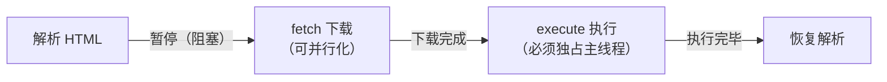

# 脚本 Script 加载与执行指南

> 一份面向前端开发工程师的 `<script>` 专题速查与深度指南：覆盖 `script` 元素的基础认知、同步 / `defer` / `async` / `type="module"` / 动态注入等**全部加载方式的行为差异与选型**、完整属性速查、第三方脚本优化与常见坑。
> 适用人群：入门者按「一 ~ 三」顺序建立加载模型认知；熟练者可直接查阅「四 ~ 七」属性速查、优化与避坑章节。
>
> 参考资料：
>
> - [MDN `<script>` 元素参考](https://developer.mozilla.org/zh-CN/docs/Web/HTML/Reference/Elements/script)
> - [HTML 规范：脚本处理模型与 `async` 属性（htmlspecs 中文镜像）](https://htmlspecs.com/#attr-script-async)
> - [script 标签 defer / async 加载机制详解（掘金）](https://juejin.cn/post/7154366358132785160)
> - [script 加载方式对比（PingCode 百科）](https://docs.pingcode.com/baike/2304977)
> - [JS 脚本加载与执行机制笔记（博客园）](https://www.cnblogs.com/redFeather/p/17702506.html)
> - [高效加载第三方 JavaScript（web.dev）](https://web.dev/articles/efficiently-load-third-party-javascript?hl=zh-cn)

---

## 目录

1. [script 元素基础](#一、script-元素基础)
2. [脚本为什么阻塞页面：解析与执行模型](#二、脚本为什么阻塞页面-解析与执行模型)
3. [六种加载方式详解与横向对比](#三、六种加载方式详解与横向对比)
4. [script 属性速查](#四、script-属性速查)
5. [第三方脚本加载优化](#五、第三方脚本加载优化)
6. [注意事项与常见坑](#六、注意事项与常见坑)
7. [速查表](#七、速查表)

---

## 一、script 元素基础

### 1.1 script 是什么

`<script>` 是 HTML 中用于嵌入或引用**可执行脚本**的元素。它既可以写在 `<head>` 里，也可以写在 `<body>` 里（甚至 `body` 结束标签之后，浏览器仍会按文档位置处理），属于**脚本支撑（script-supporting）**内容。

| 形式     | 写法                                       | 说明                                                                                     |
| -------- | ------------------------------------------ | ---------------------------------------------------------------------------------------- |
| 内嵌脚本 | `<script>console.log('hi')</script>`       | 脚本代码直接写在标签内部；**设置 `src` 后标签内代码会被忽略**                             |
| 外链脚本 | `<script src="/static/app.js"></script>`   | 从 `src` 地址获取脚本执行；受同源策略与 CORS 规则约束                                     |
| 数据块   | `<script type="application/json">…</script>` | `type` 为不可执行的 MIME 类型时不执行，作为数据块由 JS 读取（JSON-LD、模板数据等常用） |

### 1.2 默认行为：同步加载、立即执行

不带任何加载属性的外链脚本，是浏览器最古老的默认模式：

1. HTML 解析器逐行解析，遇到 `<script src>` 时**暂停解析**；
2. 发起请求下载脚本（下载期间解析器一直挂起）；
3. 下载完成后**立即执行**，执行完才恢复 HTML 解析。

这保证了脚本执行时「它之前」的 DOM 一定已就绪，也是早期把脚本都堆在 `</body>` 之前的原因——让前面的内容先渲染出来。

### 1.3 放置位置：head、body 与 body 末尾

| 位置                   | 特点                                                                                               | 典型用途                                   |
| ---------------------- | -------------------------------------------------------------------------------------------------- | ------------------------------------------ |
| `<head>` 内同步脚本    | 最先下载执行，**阻塞首屏渲染时间最长**                                                             | 必须在渲染前就绪的极小脚本（如环境判断）   |
| `<body>` 末尾同步脚本  | DOM 基本就绪，阻塞影响小，但仍有下载阻塞                                                           | 传统项目的兜底写法                         |
| `<head>` 内 `defer`    | 与 HTML 并行下载，解析完再按序执行，**兼得「早发现、早下载」与「不阻塞」**                         | 现代项目的推荐写法                         |
| 任意位置 `async`       | 与 HTML 并行下载，下载完立即执行                                                                   | 统计、埋点等与文档顺序无关的独立脚本       |

> 结论：**「脚本放 body 末尾」是没 `defer`/`async` 时代的经验法则；现代写法是脚本放 `head` 并加 `defer`**——这样浏览器能在解析最开始就发现脚本并尽早已行下载，同时不阻塞解析。

### 1.4 内嵌脚本与外链脚本的差异

- 内嵌脚本没有下载环节，`async` / `defer` / `crossorigin` / `integrity` 等与获取相关的属性**对内嵌脚本无效**。
- 内嵌脚本修改 `type` 为不可执行类型（如 `text/plain`、`application/json`）后不再执行，常用作**数据块**或模板。
- 外链脚本天然可被 HTTP 缓存、可被 Service Worker 拦截、便于 CDN 分发与独立更新，生产环境优先外链。

---

## 二、脚本为什么阻塞页面：解析与执行模型

### 2.1 阻塞的根源：JS 可能改写文档

HTML 规范要求同步脚本**执行完成前，解析器不能继续**。原因是脚本可能调用 `document.write()` 向文档流中写入内容，也可能修改 DOM——如果解析器继续往下走，脚本看到的 DOM 与最终 DOM 会不一致。

```html
<p>第一段</p>
<script>
  // 执行到这里时，解析器已停在 script 之后
  // 「第二段」尚未被解析，下面的查询结果是 null
  console.log(document.querySelector('#second')) // null
</script>
<p id="second">第二段</p>
```

### 2.2 一次同步脚本的三段时间线

把一个外链脚本的完整生命周期拆成三段，后面所有加载方式的差异都是对这三段的重排：



- **fetch**：纯网络 / 缓存操作，完全可以与 HTML 解析、其它资源下载并行；
- **execute**：脚本在主线程上运行，会占用事件循环，天然阻塞交互与渲染；
- **defer 与 async 的本质**：都是把「fetch 与解析并行」化；区别只在「execute 的时机与顺序」。

### 2.3 渲染阻塞与脚本的关系

- 同步脚本**既阻塞解析也阻塞渲染**：脚本执行前，浏览器通常不会把它之后的内容画出来（避免脚本又要改 DOM 造成闪烁）。
- CSS 也会间接阻塞脚本：脚本执行前要求**之前的样式表已加载完成**（脚本可能读取几何属性），所以「慢 CSS + 脚本」会叠加拖慢首屏。
- `defer` / `async` / `module` 脚本执行前同样受「先前样式表已加载」约束，这是把关键 CSS 内联、非关键 CSS 异步化的原因之一。

---

## 三、六种加载方式详解与横向对比

### 3.1 方式一：默认同步脚本

```html
<script src="app.js"></script>
```

- 解析器在 `src` 处暂停，下载完成后立即执行，然后继续解析；
- 多个同步脚本**严格按文档顺序**执行；
- 阻塞最严重，仅在「必须最先执行」时使用。

### 3.2 方式二：defer

```html
<script src="a.js" defer></script>
<script src="b.js" defer></script>
```

- 下载与 HTML 解析**并行**，不阻塞解析；
- 执行推迟到**文档解析完成之后、`DOMContentLoaded` 事件之前**；
- 多个 `defer` 脚本**按文档顺序**执行（规范保证）；
- 仅对外链脚本有效，**内嵌脚本写 `defer` 会被忽略**；
- 适合有依赖关系、需要完整 DOM 的业务脚本 bundle。

### 3.3 方式三：async

```html
<script src="analytics.js" async></script>
```

- 下载与解析并行，**下载完成后立即执行**（可能在解析完成前）；
- 多个 `async` 脚本执行顺序 = **下载完成顺序**，不保证文档顺序；
- 执行那一刻仍会阻塞解析与渲染（执行占用主线程）；
- 适合彼此独立、不依赖 DOM 顺序的脚本：统计、埋点、广告、独立小组件。

### 3.4 方式四：type="module"（默认 defer 语义）

```html
<script type="module" src="app.js"></script>
```

- ES Module 脚本默认按 `defer` 语义处理：并行获取、文档解析完后按序执行；
- 依赖的其它模块（import 链）也会被解析并获取，全部就绪后才执行入口模块；
- 自动启用严格模式；支持 `import` / `export`；
- 模块脚本天然只执行一次（同一 URL 重复引入不会重复执行）；
- 内嵌模块脚本同样是 defer 语义，常配合 `import()` 动态加载。

### 3.5 方式五：type="module" + async

```html
<script type="module" src="app.js" async></script>
```

- 对模块脚本追加 `async` 后，模块及其依赖树**与解析并行获取**，获取完（不必等整个依赖树之外的文档解析完成）立即执行；
- 执行时机提前、顺序不确定，等同「module 版的 async」；
- 适合不依赖文档顺序的独立模块入口。

### 3.6 方式六：动态脚本注入

```js
const s = document.createElement('script')
s.src = '/static/chart.js'
s.async = true // 动态脚本默认就是 async = true
document.head.appendChild(s)
```

- `createElement('script')` 创建的脚本**默认 `async` 为 true**（行为等同 async），希望按序执行需显式 `s.async = false`；
- 显式置 `async = false` 后，动态脚本会加入「按序执行队列」，顺序按**插入文档的顺序**排队；
- 动态注入无法被浏览器预加载扫描器（preload scanner）提前发现，若资源关键，应配合 `<link rel="preload">` 提示；
- 常见变体：按需加载、AB 实验、JSONP（历史方案）、错误兜底加载 CDN 备用地址。

### 3.7 横向对比总表

| 方式                       | 阻塞解析       | 执行时机                       | 执行顺序         | DOM 就绪保证 | 适用场景                     |
| -------------------------- | -------------- | ------------------------------ | ---------------- | ------------ | ---------------------------- |
| `<script src>`（默认）     | **是**         | 下载完立即执行                 | 按文档顺序       | 部分 DOM     | 必须最先执行的引导脚本       |
| `<script defer src>`       | 否             | 解析完成后、DOMContentLoaded 前 | **按文档顺序**   | 完整 DOM     | 业务主脚本（推荐默认）       |
| `<script async src>`       | 否（下载期）   | 下载完立即执行                 | **不确定**       | 不保证       | 统计 / 埋点 / 独立三方脚本   |
| `<script type="module">`   | 否             | 默认 defer 语义                | 按文档顺序       | 完整 DOM     | 现代模块化应用入口           |
| `<script type="module" async>` | 否         | 依赖树获取完立即执行           | 不确定           | 不保证       | 独立模块入口                 |
| 动态注入（默认 async）     | 否             | 下载完立即执行                 | 不确定（可改）   | 不保证       | 按需加载 / 实验脚本          |

对应的解析器 / 下载 / 执行时间线示意图（六行依次对应上表六种方式）：

1️⃣ 自动生成的脚本加载方式示意图


2️⃣ htmlspecs 脚本加载方式示意图


> 图例（对应 [HTML 规范脚本处理模型](https://htmlspecs.com/#attr-script-async) 示意图的 parser / fetch / execution 三色）：
> **绿色 = 解析 HTML（parser）**、**蓝色 = 下载 fetch**、**红色 = 执行脚本（execution）**、**白色空隙 = 该时间段解析被阻塞或被打断**。
> 关键差异一眼看：**同步**的红条夹在解析中间且解析有整段空隙；**defer / module** 的红条整体推到最后；**async / module async / 动态注入** 的红条紧跟自己的下载条，出现位置随机。

> 记忆口诀：**defer = 「下载不挡路，结尾按序跑」；async = 「下载不挡路，谁先到谁先跑」；module = 默认就是 defer，再加 async 才乱序**。

### 3.8 defer 与 async 的选型决策

```text
脚本是否依赖 DOM 完整 / 依赖其它脚本按序执行？
├─ 是 → defer（业务主逻辑、框架入口、需要完整 DOM 的脚本）
└─ 否（独立、无顺序要求）
   ├─ 越早跑越好（统计上报、性能采集）→ async
   └─ 用户交互后才需要 → 动态注入（按需加载）
```

补充规则：

- `async` 与 `defer` 同时存在时，现代浏览器以 `async` 为准；
- 规范保留两者同写的历史兼容语义：让只支持 `defer` 的旧浏览器回退到 defer 行为，而不是回退到阻塞式默认行为（现代浏览器可只写 `async`）；
- 内联脚本两个属性都无效；模块脚本 `defer` 属性无效（本身就是 defer 语义）。

---

## 四、script 属性速查

### 4.1 加载控制类

| 属性          | 类型     | 作用                                                                                                |
| ------------- | -------- | --------------------------------------------------------------------------------------------------- |
| `src`         | URL      | 外链脚本地址；设置后标签内代码被忽略                                                               |
| `type`        | MIME     | 默认 `text/javascript`（现代浏览器）；`module` 表示 ES 模块；不可执行类型则作为数据块               |
| `async`       | 布尔     | 并行获取，获取完尽快执行，不保证顺序；模块脚本同样生效                                             |
| `defer`       | 布尔     | 并行获取，解析完成后按序执行；仅外链经典脚本有效                                                   |
| `nomodule`    | 布尔     | **支持模块脚本的浏览器不执行**该脚本，用于给旧浏览器下发传统回退脚本（双版本发布策略）             |
| `blocking`    | 枚举     | 显式声明阻塞行为，如 `blocking="render"`；配合 `renderblocking` 相关特性做渲染阻塞控制             |
| `fetchpriority` | 枚举   | 提示下载优先级：`high` / `low` / `auto`，可用于让关键脚本插队、让非关键脚本让路                     |

### 4.2 安全与跨域类

| 属性             | 类型   | 作用                                                                                                  |
| ---------------- | ------ | ----------------------------------------------------------------------------------------------------- |
| `integrity`      | hash   | 子资源完整性（SRI）：浏览器校验脚本内容哈希，被 CDN 篡改 / 劫持时拒绝执行                             |
| `crossorigin`    | 枚举   | 非 `anonymous` / `use-credentials` 值决定跨域脚本是否带凭据；**跨域脚本配合它才能拿到详细报错信息**   |
| `referrerpolicy` | 枚举   | 请求脚本时的 Referer 策略（`no-referrer`、`strict-origin-when-cross-origin` 等）                      |

### 4.3 双版本发布（module + nomodule）范式

```html
<!-- 现代浏览器：体积更小的模块产物 -->
<script type="module" src="/app.modern.js"></script>
<!-- 旧浏览器：不支持 module 才会执行的回退产物 -->
<script nomodule src="/app.legacy.js"></script>
```

- 构建工具（Vite / webpack 的 legacy 插件）会同时产出两份 bundle，用这对属性实现「按能力下发」；
- 支持模块的浏览器只下载 modern 产物，旧浏览器只下载 legacy 产物，互不重复执行。

---

## 五、第三方脚本加载优化

第三方脚本（统计、客服、广告、A/B、地图 SDK）通常是页面性能的最大变量。依据 web.dev 的优化指南，按四步控制：

### 5.1 第一步：审计与降载

- 清点页面所有三方脚本：DevTools Network 面板按域名分组，统计每个域的传输体积与主线程耗时；
- Lighthouse 的「第三方使用」报告会标出**阻塞主线程**的三方脚本；
- 能删则删、能自助实现则自助实现：埋点改用 `navigator.sendBeacon` 自建上报，远比整套 SDK 便宜。

### 5.2 第二步：选对加载方式

| 三方脚本类型           | 推荐加载方式                     | 原因                               |
| ---------------------- | -------------------------------- | ---------------------------------- |
| 统计 / 埋点            | `async` + `fetchpriority="low"`  | 无依赖、不要求顺序、不应抢带宽     |
| 非首屏小组件（客服等） | 交互后动态注入 / `IntersectionObserver` 触发 | 首屏不需要        |
| 广告                   | `async`，容器提前占位            | 广告脚本是重灾区，严禁同步加载     |
| A/B 实验               | `head` 内同步极小段代码 + 其余 async | 避免首屏闪烁（FOOC）          |
| 地图 / 播放器          | 懒加载：滚动到附近再注入         | 大体积 SDK 不该参与首屏竞争        |

### 5.3 第三步：用资源提示抢时间

```html
<!-- 提前建立与三方域的连接（DNS + TCP + TLS） -->
<link rel="preconnect" href="https://third-party.example" crossorigin />

<!-- 对确定要加载的关键脚本提前下载（动态注入场景尤其实用） -->
<link rel="preload" as="script" href="https://third-party.example/sdk.js" />

<!-- 降低非关键脚本优先级 -->
<script src="/static/analytics.js" async fetchpriority="low"></script>
```

- 动态注入的脚本不被预加载扫描器发现，**必须**配 `preload` 才能提前下载；
- `preconnect` 对「脚本本体 + 其后续 API 请求」都有收益，注意 `crossorigin` 取值要与实际请求一致。

### 5.4 第四步：限制运行时影响

- 用 `requestIdleCallback` / 交互事件把三方初始化推迟到空闲时段；
- 用 `setTimeout` 包裹非关键初始化，避免与首屏渲染抢主线程；
- 对 iframe 类三方（广告、视频）启用 `loading="lazy"`；
- 高级方案：把三方脚本放入 Web Worker / iframe 沙箱（如 Partytown 思路），彻底移出主线程。

---

## 六、注意事项与常见坑

### 6.1 执行时机相关

- **`defer` 脚本执行早于 `DOMContentLoaded`**，所以 defer 脚本内不需要再监听 DOMContentLoaded；`async` 脚本执行时机不定，**在其内部监听 DOMContentLoaded 可能永不触发**（事件可能已错过），应改读 `document.readyState`：
  ```js
  if (document.readyState !== 'loading') {
    init()
  } else {
    document.addEventListener('DOMContentLoaded', init)
  }
  ```
- `type="module"` 的内嵌脚本也是 defer 语义，等 DOM 就绪才执行，无需 `defer` 属性（写了也无效）。
- 动态脚本默认 `async = true`，**按序加载必须显式 `async = false`**，顺序按插入文档的顺序排队。

### 6.2 插入方式决定是否执行

| 插入方式                          | 脚本是否执行                          |
| --------------------------------- | ------------------------------------- |
| `document.write()` 写入           | **通常会执行**（会阻塞后续解析）      |
| `innerHTML` / `outerHTML` 赋值    | **完全不执行**                        |
| `insertAdjacentHTML()`            | **完全不执行**                        |
| `document.createElement('script')` + `appendChild` | 执行（标准动态脚本） |

- `innerHTML` 不执行脚本是规范行为（XSS 第一道防线），需要执行时应改用 `createElement` + `appendChild`；Trusted Types 启用后，还可通过 `createParserOptions` 回调定制策略。

### 6.3 安全相关

- **跨域脚本 + `crossorigin`**：不设置时跨域脚本报错只有 `Script error.`；设置 `crossorigin` 且服务端返回正确 CORS 头后，`window.onerror` 才能拿到真实堆栈——这是错误监控平台的标准配置。
- **SRI（`integrity`）**：对来自 CDN 的脚本校验内容哈希；脚本一旦更新哈希就变，所以「永远指向最新版」的 CDN 地址无法用 SRI，需锁定版本号。
- **CSP**：`script-src` 指令限制可执行脚本的来源；内联脚本需 nonce / hash 白名单，是防御 XSS 的纵深手段。

### 6.4 易错点清单

| 易错点                                       | 正确认知                                                                 |
| -------------------------------------------- | ------------------------------------------------------------------------ |
| 给内联脚本加 `defer` / `async`               | 无效，两个属性只对外链经典脚本有意义                                     |
| 认为 `async` 脚本「完全不阻塞页面」          | 下载不阻塞，**执行那一刻仍占用主线程**                                   |
| 认为 `defer` 脚本一定在 `DOMContentLoaded` 之后 | 恰好相反：defer 执行完才会触发 DOMContentLoaded                        |
| 给 `type="module"` 再写 `defer`              | 冗余，模块默认就是 defer 语义                                            |
| 内嵌模块里 `import` 一个尚不存在的导出       | 构建期 / 运行期报错，模块解析失败整体不执行（经典脚本则可能半执行）      |
| 依赖 `document.write` 加载脚本               | 阻塞解析、在 async 场景不可靠，Chrome 会对慢网下的此类脚本介入干预       |
| 多个 `async` 脚本假设按引入顺序执行          | 顺序 = 下载完成顺序，有依赖必须改 `defer` 或动态注入 + `async = false`   |
| 跨域脚本想拿报错详情却没加 `crossorigin`     | 只会收到 `Script error.`，需两端同时配合                                 |
| 用 `innerHTML` 插入含 `<script>` 的字符串    | 不会执行，属于规范行为而非 bug                                           |

---

## 七、速查表

### 7.1 加载方式一句话选型

```html
<!-- 1. 业务主脚本：现代项目默认 -->
<script type="module" src="/app.js"></script>
<!-- 2. 经典脚本但要 DOM 与顺序：defer -->
<script src="/app.js" defer></script>
<!-- 3. 独立脚本：async -->
<script src="/analytics.js" async fetchpriority="low"></script>
<!-- 4. 旧浏览器回退：nomodule -->
<script nomodule src="/app.legacy.js"></script>
<!-- 5. 按需加载 -->
<script>
  const load = () => import('/static/chart.js')
</script>
```

### 7.2 事件时序


> 橙色菱形 = `DOMContentLoaded` 事件触发点：defer / module 的执行在它**之前**，async / 动态注入则落在它前后任意位置。

### 7.3 属性记忆卡

| 记忆点           | 内容                                                        |
| ---------------- | ----------------------------------------------------------- |
| `defer`          | 「下载并行、结尾按序、DOM 就绪」，业务脚本首选              |
| `async`          | 「下载并行、到货即跑、顺序随机」，独立脚本专用              |
| `type="module"`  | 自带 defer + 严格模式 + 单次执行 + 依赖树整体就绪           |
| `nomodule`       | 反向开关：现代浏览器跳过，给旧浏览器留后门                  |
| `crossorigin`    | 跨域报错可见性的钥匙，错误监控必配                          |
| `integrity`      | CDN 脚本防篡改，必须锁定版本                                |
| `fetchpriority`  | 关键脚本 `high`、统计脚本 `low`，带宽分配器                 |
| `blocking=render`| 显式声明渲染阻塞，配合渲染阻塞特性使用                      |

> 与本站其它文档的衔接：`<script>` 元素在 HTML 全集中的位置见 [HTML5 知识指南](/fundamentals/html5/)；模块语法本身（import / export / 动态 import）见 [ECMAScript 6 知识指南](/fundamentals/ecmascript-6/)；脚本对首屏性能的影响与资源提示体系可在浏览器与性能类文档中继续深入。
