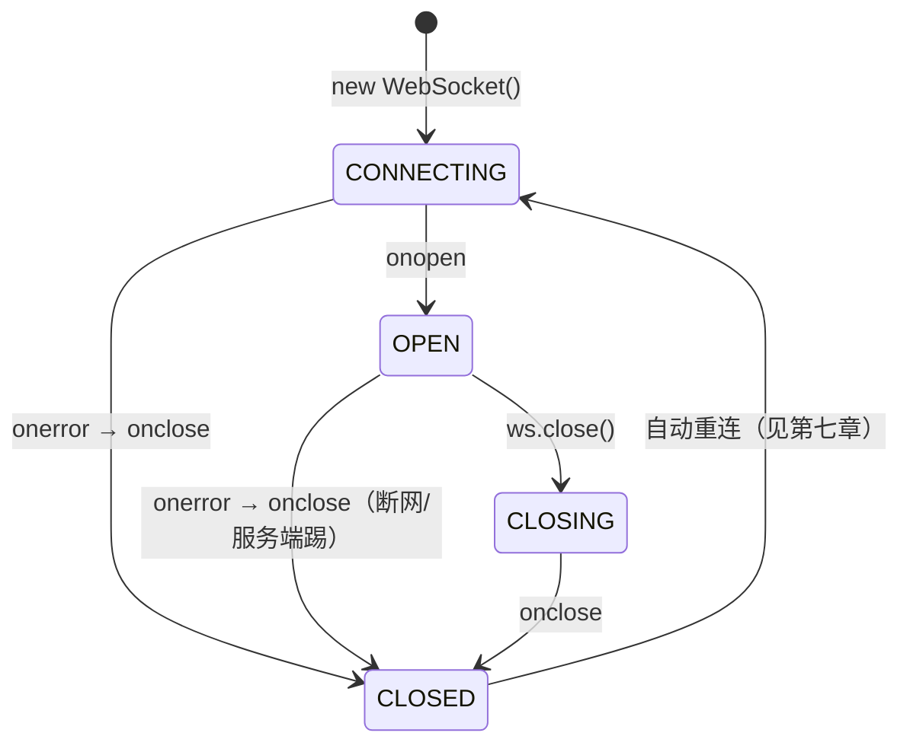

# WebSocket 实时通信解决方案

> 参考资料：
>
> - [WebSocket 实时通信解决方案（前端解决方案）](https://books.tedshen.cn/docs/解决方案/前端解决方案/WebSocket实时通信解决方案)
> - [MDN Web Docs - WebSocket](https://developer.mozilla.org/zh-CN/docs/Web/API/WebSocket)
> - [CSDN - WebSocket 实时通信实践](https://blog.csdn.net/2503_94519591/article/details/156544113)
> - [阮一峰 - WebSocket 教程](https://ruanyifeng.com/blog/2017/05/websocket.html)
>
> 面向角色：中高级前端工程师。不仅讲清协议与浏览器 API，更聚焦**连接生命周期管理**、**心跳保活**、**断线重连**、**鉴权安全**与**可复用工程封装**——目标是让开发人员读完即可从代码落地一套生产可用的 WebSocket 能力，而不只是会用 `new WebSocket()`。

---

## 目录

1. [什么是 WebSocket 与为什么需要它](#一、什么是-websocket-与为什么需要它)
2. [协议原理 握手与数据帧](#二、协议原理-握手与数据帧)
3. [浏览器原生 WebSocket API](#三、浏览器原生-websocket-api)
4. [连接生命周期与状态管理](#四、连接生命周期与状态管理)
5. [消息收发 文本与二进制](#五、消息收发-文本与二进制)
6. [心跳机制 保活与超时](#六、心跳机制-保活与超时)
7. [断线重连 指数退避与上限](#七、断线重连-指数退避与上限)
8. [鉴权与安全 wss token 与跨域](#八、鉴权与安全-wss-token-与跨域)
9. [错误处理与异常恢复](#九、错误处理与异常恢复)
10. [可复用客户端封装 TypeScript 实战](#十、可复用客户端封装-typescript-实战)
11. [与 SSE 长轮询的选型对比](#十一、与-sse-长轮询的选型对比)
12. [服务端实现 Node ws 示例](#十二、服务端实现-node-ws-示例)
13. [调试与排障](#十三、调试与排障)
14. [常见误区与 FAQ](#十四、常见误区与-faq)

---

## 一、什么是 WebSocket 与为什么需要它

**WebSocket** 是一种基于 TCP 的**全双工（full-duplex）**、长连接通信协议，诞生于 HTML5 时代（RFC 6455）。它先通过一次 HTTP 请求完成协议升级，之后便脱离 HTTP 语义，在单条 TCP 连接上让**客户端与服务端随时、双向**地主动发送数据。

### 1.1 传统方案的三大瓶颈

在 WebSocket 之前，想要"服务端主动推消息给浏览器"只能靠前端轮询或变通手段：

| 方案             | 做法                                                         | 痛点                                                       |
| ---------------- | ------------------------------------------------------------ | ---------------------------------------------------------- |
| 短轮询（Polling）| 客户端定时 `fetch` 问"有新消息吗"                            | 大部分请求是空跑，浪费带宽与连接；延迟取决于轮询间隔       |
| 长轮询（Long Polling）| 请求挂起，服务端有消息才返回，客户端立刻再发一个        | 仍需反复建连/挂起，服务端要维护大量挂起请求，复杂度高      |
| SSE（EventSource）| 服务端单向推文本流                                         | 只能服务端→客户端单向；断线重连虽内建但能力有限            |

轮询的本质问题是：**HTTP 是"请求—响应"的半双工模型**，服务端无法在没有请求的前提下主动触达客户端。而聊天、协同编辑、实时行情、监控大屏、在线游戏等场景，**要求低延迟的双向通信**——这正是 WebSocket 的主场。

### 1.2 WebSocket 的核心特征

- **全双工**：连接建立后，任意一方随时可发数据，不必等待对方请求。
- **长连接**：一条 TCP 连接长时间保持，避免反复握手开销。
- **轻量协议**：数据帧头部最小仅 2 字节，远轻于 HTTP 每次都带一堆头部。
- **同源策略仍适用**：WebSocket 受浏览器同源策略约束，`ws://` 跨源需要服务端在握手阶段显式允许（注意它**不走常规 CORS 预检**那一套，详见第八章）。
- **协议标识**：`ws://`（明文，类似 `http://`）、`wss://`（加密，类似 `https://`，**生产必用**）。

### 1.3 适用场景与不适用场景

- **适合**：即时聊天、多人协同编辑、实时数据看板、行情/赛事推送、音视频信令、IoT 设备状态。
- **不适合**：一次性 CRUD 请求（用 `fetch`/`axios` 更合适）、纯静态资源分发（用 HTTP/CDN）。能用普通 HTTP 解决的事，别硬上 WebSocket。

---

## 二、协议原理 握手与数据帧

### 2.1 握手：一次 HTTP 升级

WebSocket 连接始于一个**特殊的 HTTP 请求**，通过 `Upgrade` 头把协议从 HTTP 切到 WebSocket。这个过程叫**握手（Handshake）**，服务端返回 `101 Switching Protocols` 即升级成功。

**客户端请求**（浏览器 `new WebSocket()` 自动发出）：

```http
GET /chat HTTP/1.1
Host: example.com
Connection: Upgrade
Upgrade: websocket
Sec-WebSocket-Key: dGhlIHNhbXBsZSBub25jZQ==
Sec-WebSocket-Version: 13
Origin: https://app.example.com
```

**服务端响应**：

```http
HTTP/1.1 101 Switching Protocols
Connection: Upgrade
Upgrade: websocket
Sec-WebSocket-Accept: s3pPLMBiTxaQ9kYGzzhZRbK+xOo=
```

关键点：

- `Connection: Upgrade` + `Upgrade: websocket`：声明要升级协议。
- `Sec-WebSocket-Key`：客户端随机生成的 16 字节 Base64 串，**防缓存代理误当成普通请求**。
- `Sec-WebSocket-Accept`：**服务端把客户端发来的 Key 拼接固定 GUID `258EAFA5-E914-47DA-95CA-C5AB0DC85B11`，做一次 SHA-1 + Base64** 得到。这是握手合法性的校验，防止服务端误响应。
- 握手一旦完成，后续数据就不再用 HTTP 报文格式，而是走 WebSocket **数据帧（Frame）**。

> 握手是普通 HTTP，因此**鉴权（Cookie / `Authorization` 头 / Query 参数）都能在握手阶段带上**——这是 WebSocket 鉴权的主要入口（见第八章）。

### 2.2 数据帧结构（了解即可）

WebSocket 把要发送的消息切成一个个**帧（frame）**传输。帧的最小头部只有 2 字节，包含：

- `FIN`：是否为消息的最后一帧（长消息会被分片，多帧拼成一条消息）。
- `Opcode`：帧类型——`0x1` 文本、`0x2` 二进制、`0x8` 关闭、`0x9` Ping、`0xA` Pong、`0x0` 续帧。
- `Mask`：客户端发给服务端的帧**必须掩码**（防缓存污染攻击），服务端发客户端的帧不掩码。
- 载荷长度（7 位 / 7+16 位 / 7+64 位 变长编码）。

> 前端几乎不需要手动组帧——浏览器 `WebSocket` 对象会自动分片、加掩码、组包。理解帧结构主要是为了读懂**为什么二进制消息要区分 `Blob` 与 `ArrayBuffer`**、以及**心跳 Ping/Pong 帧**的机制。

### 2.3 Ping / Pong 与关闭帧

- **Ping（0x9）/ Pong（0xA）**：用于保活探测。浏览器原生 `WebSocket` **不会自动发应用层 Ping**（部分浏览器在底层有实现），但服务端可以发 Ping，浏览器自动回 Pong。要稳定保活，通常要自己在应用层发心跳（见第六章）。
- **Close（0x8）**：一端发送关闭帧，携带关闭码（code）与原因，另一端确认后连接关闭。

---

## 三、浏览器原生 WebSocket API

浏览器内置 `WebSocket` 全局构造器，无需任何依赖即可使用。

### 3.1 创建连接

```js
// 明文 ws 仅用于本地开发；生产一律 wss
const ws = new WebSocket('wss://example.com/ws?token=xxx')

// 可同时协商多个子协议（服务端需选中其中一个）
const ws2 = new WebSocket('wss://example.com/ws', ['chat', 'superchat'])
```

注意：构造器**立即开始连接**，没有回调参数。所有状态变化通过**事件**感知。

### 3.2 四个关键事件

| 事件        | 触发时机                                   | 事件对象关键字段                         |
| ----------- | ------------------------------------------ | ---------------------------------------- |
| `open`      | 连接建立成功（握手完成）                   | —                                        |
| `message`   | 收到服务端消息                             | `event.data`（文本 / `Blob` / `ArrayBuffer`） |
| `error`     | 发生错误（常伴随随后 `close`）             | `event`（细节有限，靠 `close` 拿原因）   |
| `close`     | 连接关闭（无论正常还是异常）               | `event.code` / `event.reason` / `event.wasClean` |

```js
ws.addEventListener('open', () => {
  console.log('连接已建立，可以发消息了')
  ws.send(JSON.stringify({ type: 'hello', userId: 1 }))
})

ws.addEventListener('message', (event) => {
  // event.data 的类型取决于你用 binaryType 怎么设置（见第五章）
  const payload = JSON.parse(event.data)
  console.log('收到消息：', payload)
})

ws.addEventListener('error', (event) => {
  // 浏览器出于安全限制，error 事件本身不含详细信息
  // 真正的原因要等随后的 close 事件里的 code / reason
  console.warn('WebSocket 发生错误')
})

ws.addEventListener('close', (event) => {
  console.log('连接关闭：', event.code, event.reason, 'wasClean =', event.wasClean)
})
```

### 3.3 方法与属性

```js
ws.send(data)                  // 发送：文本字符串 / Blob / ArrayBuffer / ArrayBufferView
ws.close(code, reason)         // 主动关闭，code 默认 1000，reason 不超过 123 字节

ws.readyState                  // 当前状态（见第四章）
ws.bufferedAmount             // 尚未发出的字节数，可用于背压控制
ws.protocol                   // 最终协商到的子协议
ws.url                        // 连接地址
ws.binaryType = 'arraybuffer' // 收到二进制时以 ArrayBuffer 还是 Blob 形式交付（默认 'blob'）
```

> `bufferedAmount` 是个实用但常被忽略的属性：当你高频发送大消息时，可以据此做**背压（backpressure）**——比如 `bufferedAmount > 1 << 20`（>1MB）时暂停发送，等 `bufferedamountlow` 事件再继续，避免内存堆积。

---

## 四、连接生命周期与状态管理

### 4.1 readyState 四态

`WebSocket.readyState` 是一个只读数字常量，等价于四个命名常量：

| 值  | 常量                  | 含义                                   |
| --- | --------------------- | -------------------------------------- |
| `0` | `WebSocket.CONNECTING`| 正在建立连接                           |
| `1` | `WebSocket.OPEN`      | 连接已建立，可通信                     |
| `2` | `WebSocket.CLOSING`   | 正在关闭                               |
| `3` | `WebSocket.CLOSED`    | 连接已关闭或建立失败                   |

### 4.2 连接状态机

一个健壮的客户端必须把这个状态机管理清楚，否则极易出现"重复连接""消息发到已死连接"等 bug：



### 4.3 为什么必须自己管理状态

- 浏览器**不会自动重连**：连接一旦断了，`WebSocket` 对象就废了，必须**新建一个**并重走握手。
- `send()` 在非 `OPEN` 状态调用会**抛异常**（`InvalidStateError`），所以发送前务必判断 `readyState === WebSocket.OPEN`。
- `error` 之后**必定**跟着 `close`：不要试图在 `error` 里恢复连接，统一在 `close` 里做重连决策。
- 区分**主动关闭**（用户登出、页面卸载）与**意外断开**（网络抖动、服务端重启）：主动关闭时应**停止重连**，否则会无限重连。

---

## 五、消息收发 文本与二进制

### 5.1 文本消息

最常用。`send` 字符串，`message` 事件 `event.data` 也是字符串。通常前后端约定用 JSON 文本：

```js
// 发送
ws.send(JSON.stringify({ type: 'chat', to: 1001, text: '你好' }))

// 接收
ws.addEventListener('message', (event) => {
  let msg
  try {
    msg = JSON.parse(event.data)
  } catch {
    console.warn('非 JSON 消息：', event.data)
    return
  }
  switch (msg.type) {
    case 'chat': renderChat(msg); break
    case 'notice': showNotice(msg); break
    default: console.warn('未知消息类型', msg.type)
  }
})
```

### 5.2 二进制消息

`send` 支持 `Blob` / `ArrayBuffer` / `ArrayBufferView`（如 `Uint8Array`）。接收时由 `binaryType` 决定交付形态：

```js
// 接收为 ArrayBuffer（适合自己解析协议，如 Protobuf）
ws.binaryType = 'arraybuffer'
ws.addEventListener('message', (event) => {
  if (event.data instanceof ArrayBuffer) {
    const view = new DataView(event.data)
    // 按自定义二进制协议解析……
  }
})

// 接收为 Blob（适合直接当文件用，如转成图片/下载）
ws.binaryType = 'blob'
ws.addEventListener('message', (event) => {
  if (event.data instanceof Blob) {
    const url = URL.createObjectURL(event.data)
    const img = new Image()
    img.src = url
    // 用完后 URL.revokeObjectURL(url)
  }
})
```

`binaryType` **默认是 `'blob'`**。如果你要解析结构化二进制（数组、Protobuf、自研协议），一定要先设成 `'arraybuffer'`，否则拿到的是 `Blob`，多一次异步 `arrayBuffer()` 转换且不便随机访问。

### 5.3 发送前的状态守卫

```js
function safeSend(ws, data) {
  if (ws.readyState !== WebSocket.OPEN) {
    console.warn('连接未就绪，消息丢弃/入队：', data)
    return false
  }
  ws.send(data)
  return true
}
```

生产环境更稳妥的做法是做一个**发送队列**：连接未就绪时把消息缓存，等 `open` 后再 flush（注意区分可丢失消息如心跳，与必须送达的消息如聊天）。

---

## 六、心跳机制 保活与超时

### 6.1 为什么需要心跳

建立好的 WebSocket 长连接，中间可能经过**代理、NAT、负载均衡器**，它们常常有**空闲超时**（如 Nginx 默认 60s 无活动就断开）。TCP 层面连接"看起来还在"，但中间设备已经把它掐了——表现为：服务端以为连着，客户端 `readyState` 还是 `OPEN`，但 `send` 石沉大海，消息既不报错也不送达。

**心跳（Heartbeat）** 就是定期互发一个小包，证明"我还活着"，顺带让中间设备认为连接有活动而不去掐它。

### 6.2 应用层心跳实现

浏览器原生 `WebSocket` 的底层 Ping/Pong 不暴露给 JS（服务端发的 Ping 浏览器自动回 Pong，应用层收不到），所以**最可靠的是在应用层自己设计心跳报文**：

```js
function setupHeartbeat(ws, { interval = 30000, timeout = 10000 } = {}) {
  let pingTimer = null
  let pongTimer = null

  const start = () => {
    // 定时发心跳
    pingTimer = setInterval(() => {
      if (ws.readyState !== WebSocket.OPEN) return
      ws.send(JSON.stringify({ type: 'ping', t: Date.now() }))
      // 发完等待对方 pong，超时则判定死亡，主动断开触发重连
      pongTimer = setTimeout(() => {
        console.warn('心跳超时，主动断开')
        ws.close(4000, 'heartbeat timeout')
      }, timeout)
    }, interval)
  }

  const stop = () => {
    clearInterval(pingTimer)
    clearTimeout(pongTimer)
  }

  ws.addEventListener('open', start)
  ws.addEventListener('close', stop)
  // 收到服务端的 pong 就取消超时定时器
  ws.addEventListener('message', (event) => {
    try {
      const msg = JSON.parse(event.data)
      if (msg.type === 'pong') clearTimeout(pongTimer)
    } catch { /* 非心跳消息忽略 */ }
  })

  return { stop }
}
```

要点：

- 心跳间隔（30s）应**小于**中间设备空闲超时（如 60s），留足余量。
- 不仅"发得出"，还要"收得回"：发出 Ping 后一定时间内没收到 Pong，就**主动 `close`**，让重连逻辑接管（见第七章）。
- 心跳包要轻（一条 JSON 或单字节），高频心跳会徒增流量。

---

## 七、断线重连 指数退避与上限

### 7.1 为什么不能无脑重连

网络抖动、服务端发布、Wi‑Fi 切换都会让连接断开。简单 `setTimeout(reconnect, 1000)` 在**服务端长时间不可用**时会变成"每秒打一次"的**连接风暴**，反而把快恢复的服务端压垮。正确做法是**指数退避（exponential backoff）** + **重连上限/抖动**。

### 7.2 指数退避 + 随机抖动

```js
function nextDelay(attempt, { base = 1000, max = 30000 } = {}) {
  // 指数增长：1s, 2s, 4s, 8s, 16s ... 封顶 30s
  const exp = Math.min(base * 2 ** attempt, max)
  // 加入 ±50% 随机抖动，避免大量客户端同时重连（惊群效应）
  const jitter = exp * 0.5 * Math.random()
  return Math.floor(exp / 2 + jitter)
}
```

### 7.3 完整的重连控制

```js
class Reconnector {
  constructor(connect, { maxAttempts = 10 } = {}) {
    this.connect = connect
    this.maxAttempts = maxAttempts
    this.attempt = 0
    this.timer = null
    this.stopped = false // 主动停止后不再重连
  }

  schedule() {
    if (this.stopped) return
    if (this.attempt >= this.maxAttempts) {
      console.error('重连次数超限，放弃')
      return
    }
    const delay = nextDelay(this.attempt)
    console.log(`第 ${this.attempt + 1} 次重连，等待 ${delay}ms`)
    this.timer = setTimeout(() => {
      this.attempt += 1
      this.connect(() => this.onReconnect)
    }, delay)
  }

  onReconnect() { this.attempt = 0 }  // 连上后重置计数
  stop() { this.stopped = true; clearTimeout(this.timer) }
}
```

关键原则：

- **区分主动关闭与异常断开**：用户登出 / 页面卸载时应调用 `stop()`，**不要再重连**。
- **连上即重置退避计数**，避免后续正常抖动被之前计数拖累。
- **超上限后停止并重试提示**：给出"重连失败，请检查网络"的 UI，而不是静默死循环。
- 配合**页面可见性（visibilitychange）**：标签页隐藏时不急着重连，回到前台再连，省资源。

---

## 八、鉴权与安全 wss token 与跨域

### 8.1 鉴权入口在握手阶段

WebSocket 握手是一次普通 HTTP 请求，因此鉴权方式与普通 HTTP 类似，但**有一个重要区别**：`new WebSocket(url)` **不能自定义请求头**（如 `Authorization`）。所以鉴权 token 通常走以下三种方式之一：

| 方式            | 做法                                              | 注意                                   |
| --------------- | ------------------------------------------------- | -------------------------------------- |
| Query 参数       | `wss://host/ws?token=xxx`                          | token 会进 URL/日志，**必须 wss** 加密 |
| Cookie           | 自动携带（同域或配置 `withCredentials` 的等效机制）| 受 `SameSite` / 第三方 Cookie 策略约束 |
| 首条消息        | 连上后第一条 `send({ type: 'auth', token })`      | 服务端需先收 auth 才放开业务消息       |

推荐：同域优先用 Cookie（自动带、不泄露），跨域用 `wss://...?token=` 并在握手后立即校验。无论如何，**生产必须用 `wss://`**，否则 token 与数据全程明文裸奔。

### 8.2 跨域（Origin）校验

WebSocket **不走常规 CORS 预检**（没有 `OPTIONS` 预检那一套），但浏览器仍会带上 `Origin` 头。服务端应在握手时**校验 `Origin` 白名单**，拒绝非法来源建连，否则任何网站都能偷偷连你的 WebSocket 通道。

```
// 服务端握手伪逻辑
if (!ALLOWED_ORIGINS.includes(request.headers.origin)) {
  return response(403, 'Origin not allowed')
}
```

### 8.3 其他安全要点

- **必须 `wss://`**：等价 HTTPS，防中间人窃听/篡改。
- **防范消息注入**：服务端对收到的每条消息做**校验与限流**，别把客户端发来的内容当可信（防垃圾消息、防协议绕过）。
- **关闭码规范**：正常关闭用 `1000`；异常用 `1001`（离开）、`1006`（异常断开，浏览器自动用，不能手动发）、`4000–4999` 留给应用自定义。
- **不要在前端存长期敏感 token 于 `localStorage` 再拼 URL**：易被 XSS 窃取；尽量走 HttpOnly Cookie 或短期有效期 token。

---

## 九、错误处理与异常恢复

### 9.1 关闭码速查（前端排障必会）

| code | 含义                                                         | 前端应对                                   |
| ---- | ------------------------------------------------------------ | ------------------------------------------ |
| 1000 | 正常关闭                                                     | 正常，按主动关闭流程处理                   |
| 1001 | 端点离开（如服务端重启、页面导航）                           | 触发重连                                   |
| 1006 | **异常断开**（网络断、进程被杀，浏览器自动使用）             | 最常见的"无征兆掉线"，触发重连             |
| 1011 | 服务端内部错误                                               | 提示"服务异常"，重连                       |
| 1012 | 服务端重启中                                                 | 重连（服务端通常很快恢复）                 |
| 1013 | 服务端过载，稍后重试                                         | 退避重连                                   |
| 4000+| 应用自定义                                                 | 按业务约定处理                             |

> `event.wasClean` 为 `true` 表示**收到过关闭帧、正常关闭**；`false` 多半是 1006 异常断开。重连逻辑里应重点处理 `wasClean === false` 或 `code === 1006`。

### 9.2 错误恢复清单

1. **`error` 事件**：不在此恢复，仅打日志；真正的动作等 `close`。
2. **`close` 事件**：根据 `code` / `wasClean` 决定——主动关闭（`stop()`）则不重连；异常则走指数退避重连。
3. **消息丢失补偿**：重连成功后，客户端应**重新订阅/拉取**断线期间可能漏掉的状态（如重新 `send` 订阅房间、向服务端要增量），不能假设"连上就有全量"。
4. **幂等处理**：服务端推来的消息可能重复（尤其重连后），消费端做**去重**（消息 id 判重）。
5. **全局兜底**：用 `window.addEventListener('online'/'offline')` 监听网络恢复，主动触发重连；页面卸载时 `ws.close()` 优雅退出。

---

## 十、可复用客户端封装 TypeScript 实战

把上面所有要点（状态管理、发送守卫、心跳、退避重连、鉴权、事件订阅）封装成一个**可复用、类型安全**的客户端。这是本章重点，也是"从代码到实现"的落地模板。

### 10.1 事件类型定义

```ts
type WsStatus = 'connecting' | 'open' | 'closed' | 'reconnecting'

interface WsOptions {
  url: string
  protocols?: string | string[]
  token?: string
  heartbeatInterval?: number   // 默认 30000
  heartbeatTimeout?: number    // 默认 10000
  maxReconnectAttempts?: number // 默认 10
  onOpen?: (ws: WebSocket) => void
  onClose?: (e: CloseEvent) => void
  onError?: (e: Event) => void
}

type Listener = (data: unknown) => void
```

### 10.2 完整客户端实现

```ts
export class WebSocketClient {
  private url: string
  private protocols?: string | string[]
  private token?: string
  private opts: Required<Omit<WsOptions, 'url' | 'protocols' | 'token' | 'onOpen' | 'onClose' | 'onError'>>
  private ws: WebSocket | null = null
  private status: WsStatus = 'closed'

  private reconnectAttempt = 0
  private stopped = false
  private pingTimer: ReturnType<typeof setInterval> | null = null
  private pongTimer: ReturnType<typeof setTimeout> | null = null
  private reconnectTimer: ReturnType<typeof setTimeout> | null = null

  private listeners = new Map<string, Set<Listener>>()
  private sendQueue: string[] = []

  constructor(options: WsOptions) {
    this.url = options.url
    this.protocols = options.protocols
    this.token = options.token
    this.opts = {
      heartbeatInterval: options.heartbeatInterval ?? 30000,
      heartbeatTimeout: options.heartbeatTimeout ?? 10000,
      maxReconnectAttempts: options.maxReconnectAttempts ?? 10,
      onOpen: options.onOpen ?? (() => {}),
      onClose: options.onClose ?? (() => {}),
      onError: options.onError ?? (() => {}),
    }
  }

  // ---- 连接 ----
  connect(): void {
    if (this.stopped) return
    this.status = this.reconnectAttempt > 0 ? 'reconnecting' : 'connecting'

    const query = this.token ? `?token=${encodeURIComponent(this.token)}` : ''
    this.ws = new WebSocket(this.url + query, this.protocols)

    this.ws.addEventListener('open', () => this.handleOpen())
    this.ws.addEventListener('message', (e) => this.handleMessage(e))
    this.ws.addEventListener('error', (e) => this.opts.onError(e))
    this.ws.addEventListener('close', (e) => this.handleClose(e))
  }

  private handleOpen(): void {
    this.status = 'open'
    this.reconnectAttempt = 0
    this.opts.onOpen(this.ws!)
    this.startHeartbeat()
    this.flushQueue() // 把断线期间堆积的消息发出去
  }

  private handleMessage(event: MessageEvent): void {
    // 心跳 pong
    try {
      const msg = JSON.parse(event.data as string)
      if (msg.type === 'pong') {
        if (this.pongTimer) clearTimeout(this.pongTimer)
        return
      }
    } catch { /* 非 JSON，往下走 */ }

    // 广播给业务订阅者
    this.emit('message', event.data)
  }

  private handleClose(event: CloseEvent): void {
    this.stopHeartbeat()
    this.status = 'closed'
    this.opts.onClose(event)

    // 主动停止 / 正常关闭 → 不重连
    if (this.stopped || event.code === 1000) return
    this.scheduleReconnect()
  }

  // ---- 心跳 ----
  private startHeartbeat(): void {
    this.pingTimer = setInterval(() => {
      if (this.ws?.readyState !== WebSocket.OPEN) return
      this.ws.send(JSON.stringify({ type: 'ping', t: Date.now() }))
      this.pongTimer = setTimeout(() => {
        console.warn('心跳超时，主动断开')
        this.ws?.close(4000, 'heartbeat timeout')
      }, this.opts.heartbeatTimeout)
    }, this.opts.heartbeatInterval)
  }

  private stopHeartbeat(): void {
    if (this.pingTimer) clearInterval(this.pingTimer)
    if (this.pongTimer) clearTimeout(this.pongTimer)
    this.pingTimer = null
    this.pongTimer = null
  }

  // ---- 重连 ----
  private scheduleReconnect(): void {
    if (this.reconnectAttempt >= this.opts.maxReconnectAttempts) {
      console.error('重连次数超限，停止重连')
      this.emit('reconnect-failed', null)
      return
    }
    const exp = Math.min(1000 * 2 ** this.reconnectAttempt, 30000)
    const delay = Math.floor(exp / 2 + (exp / 2) * Math.random()) // 指数退避 + 抖动
    this.reconnectAttempt += 1
    this.reconnectTimer = setTimeout(() => this.connect(), delay)
  }

  // ---- 发送 ----
  send(data: string | object): boolean {
    const payload = typeof data === 'string' ? data : JSON.stringify(data)
    if (this.ws?.readyState === WebSocket.OPEN) {
      this.ws.send(payload)
      return true
    }
    // 非 OPEN 状态：缓存，连上后补发（心跳等可丢弃消息请勿入队）
    this.sendQueue.push(payload)
    return false
  }

  private flushQueue(): void {
    while (this.sendQueue.length && this.ws?.readyState === WebSocket.OPEN) {
      this.ws.send(this.sendQueue.shift()!)
    }
  }

  // ---- 订阅 ----
  on(type: 'message' | 'reconnect-failed', listener: Listener): () => void {
    if (!this.listeners.has(type)) this.listeners.set(type, new Set())
    this.listeners.get(type)!.add(listener)
    return () => this.listeners.get(type)?.delete(listener) // 返回取消订阅函数
  }

  private emit(type: string, data: unknown): void {
    this.listeners.get(type)?.forEach((fn) => fn(data))
  }

  // ---- 停止 ----
  close(code = 1000, reason = 'client close'): void {
    this.stopped = true
    this.stopHeartbeat()
    if (this.reconnectTimer) clearTimeout(this.reconnectTimer)
    this.ws?.close(code, reason)
  }

  getStatus(): WsStatus {
    return this.status
  }
}
```

### 10.3 业务中使用

```ts
const client = new WebSocketClient({
  url: 'wss://example.com/ws',
  token: getToken(),
  onOpen: () => client.send({ type: 'subscribe', room: 'room-1' }),
})

const off = client.on('message', (data) => {
  const msg = JSON.parse(data as string)
  if (msg.type === 'chat') renderChat(msg)
})

// 用户登出
function logout() {
  off()                 // 取消订阅
  client.close(1000)    // 主动关闭，不再重连
}
```

这个封装已经覆盖了生产落地所需的：状态机、发送守卫、断线消息队列、心跳保活、指数退避重连、鉴权、类型化订阅。**复制即可用，按业务补充订阅类型与消息路由即可。**

---

## 十一、与 SSE 长轮询的选型对比

| 维度       | HTTP 轮询 / 长轮询          | SSE（EventSource）                  | WebSocket                              |
| ---------- | --------------------------- | ----------------------------------- | -------------------------------------- |
| 通信模式   | 请求—响应（半双工）         | 服务端**单向**推送（文本）          | **全双工**双向                         |
| 协议       | HTTP                        | HTTP（`text/event-stream`）         | 独立 ws 协议（101 升级）               |
| 原生重连   | 自己实现                    | **内建自动重连** + 断点续传         | 自己实现                               |
| 数据类型   | 任意                        | 文本（UTF-8 流）                    | 文本 + 二进制                          |
| 连接数     | 多（频繁建连）              | 单条持久连接                        | 单条持久连接                           |
| 鉴权       | 标准 HTTP（头/Cookie）      | 标准 HTTP                           | 握手阶段（Query/Cookie/首消息）        |
| 适用       | 低频、简单查询              | 通知、日志流、行情、监控            | 聊天、协同、游戏、双向实时             |

**选型建议**：

- 只需**服务端→客户端单向推送**（通知、流水日志、行情）：优先 **SSE**，自带重连、实现简单。
- 需要**双向实时交互**（聊天、协同编辑、信令）：用 **WebSocket**。
- 数据量小、实时性要求低：普通 **HTTP 轮询** 足矣，别过度设计。

---

## 十二、服务端实现 Node ws 示例

前端要能联调，必须有对应的服务端。下面用 Node 生态最主流的 [`ws`](https://github.com/websockets/ws) 库给出一个最小可运行的服务端，**包含握手鉴权、心跳、广播**，与第十章客户端配套。

```bash
npm install ws
```

```js
// server.js
import { WebSocketServer } from 'ws'

const wss = new WebSocketServer({ port: 8080 })

// 握手阶段鉴权：校验 token 与 Origin
wss.on('headers', (headers, req) => {
  const url = new URL(req.url, 'http://localhost')
  const token = url.searchParams.get('token')
  if (token !== 'valid-token') {
    // 直接拦截：不升级协议
    headers.push('HTTP/1.1 401 Unauthorized')
  }
})

wss.on('connection', (ws, req) => {
  console.log('客户端已连接，Origin =', req.headers.origin)

  // 服务端发 Ping，浏览器自动回 Pong；用 isAlive 标记，超时未响应则踢掉
  ws.isAlive = true
  ws.on('pong', () => { ws.isAlive = true })

  ws.on('message', (data) => {
    let msg
    try { msg = JSON.parse(data.toString()) } catch { return }
    if (msg.type === 'ping') {
      ws.send(JSON.stringify({ type: 'pong', t: msg.t }))
      return
    }
    // 业务消息：广播给所有客户端
    wss.clients.forEach((client) => {
      if (client.readyState === 1) {
        client.send(JSON.stringify({ type: 'chat', text: msg.text, ts: Date.now() }))
      }
    })
  })

  ws.on('close', () => console.log('客户端断开'))
})

// 心跳巡检：每 30s 检查一次，未响应的连接直接终止
const interval = setInterval(() => {
  wss.clients.forEach((ws) => {
    if (ws.isAlive === false) return ws.terminate()
    ws.isAlive = false
    ws.ping()
  })
}, 30000)
```

> 这只是演示骨架。生产服务端还需：集群下的连接管理（如用 Redis 广播跨进程消息）、鉴权完整校验、消息限流与体积上限、TLS（`wss`，通常由反向代理 Nginx 终止 TLS 再转发 `ws`）、以及优雅关闭。但**前端联调有它足矣**。

---

## 十三、调试与排障

### 13.1 Chrome DevTools

- **Network → WS**：点开 WebSocket 连接，看**Headers**（握手请求/响应、101）、**Messages**（收发的帧，可过滤方向、可看二进制）、**Timing**。
- 关注：握手是否 101、Messages 里是否有持续的心跳包（验证保活）、断线后是否正常重连。
- **Application → 无对应面板**：WebSocket 不在 Storage 里，状态靠代码日志。

### 13.2 命令行工具 wscat

```bash
npm install -g wscat
wscat -c wss://example.com/ws?token=xxx
> {"type":"ping"}
< {"type":"pong"}
```

`wscat` 适合**脱离前端快速验证服务端**是否正常收发、鉴权是否生效。

### 13.3 常见问题定位

| 现象                                   | 可能原因                                           | 排查                                       |
| -------------------------------------- | -------------------------------------------------- | ------------------------------------------ |
| 握手 200 而非 101                       | 服务端没实现升级，或走了普通 HTTP 路由             | 看响应头有没有 `Upgrade: websocket`        |
| 连接建立后静默无消息                   | 中间设备空闲超时掐断（伪装成连着）                 | 加心跳；`close` 多半是 1006                |
| 发消息报错 `InvalidStateError`          | 在非 `OPEN` 状态 `send`                            | 发送前判 `readyState`；用发送队列          |
| 重连风暴（每秒一连）                   | 没有退避，或 `close` 里无条件重连                  | 指数退避 + 上限 + 区分主动关闭             |
| 收到数据乱码/类型不对                  | `binaryType` 没设 `arraybuffer` 却按二进制解析     | 设 `ws.binaryType = 'arraybuffer'`         |
| 跨域建连被拒                           | 服务端没校验/没放行 `Origin` 或协议不匹配          | 服务端白名单；确认 `wss` 一致              |

---

## 十四、常见误区与 FAQ

**Q1：浏览器会自动重连吗？**
不会。`WebSocket` 断开即废弃，必须新建实例并重走握手（见第七章）。

**Q2：WebSocket 走 CORS 吗？**
不走常规 CORS 预检（没有 `OPTIONS`），但浏览器仍带 `Origin`，需服务端在握手时自行校验白名单（见 8.2）。

**Q3：`new WebSocket()` 能加自定义请求头吗？**
不能（规范不允许）。鉴权走 Query 参数、`Cookie` 或连上后的首条消息（见 8.1）。

**Q4：心跳一定要做吗？**
生产环境**必须做**。否则中间代理/NAT 空闲超时后会静默掐断连接，表现为"连着但发不出去"（见第六章）。

**Q5：Ping/Pong 帧和我的业务心跳是一回事吗？**
不完全是。浏览器底层可能收发 Ping/Pong，但**不暴露给 JS**；要可靠保活，应在应用层自己设计 `ping`/`pong` 报文（见 6.2）。

**Q6：连接断了，断线期间的消息会补发吗？**
不会自动补。重连成功后需要客户端**主动重新订阅/拉取增量**，并做**消息去重**（见 9.2）。

**Q7：能用 WebSocket 传文件吗？**
可以，用二进制帧（`Blob`/`ArrayBuffer`），但大文件更常见做法是走 HTTP 上传、用 WebSocket 通知进度。务必在服务端限制单帧/单消息体积防滥用。

**Q8：`wss` 和 `https` 什么关系？**
`wss` 就是"WebSocket over TLS"，等价于 `https`。生产**必须**用 `wss`，否则数据明文裸奔。TLS 终止通常由 Nginx 等反向代理完成，再以内网 `ws` 转发给应用。

> **核心心法**：WebSocket 的难点**不在建立连接，而在连接建立之后的工程化**——状态机、心跳、重连、鉴权、消息可靠性，每一项都决定了它是"玩具 Demo"还是"生产可用"。把第十章的封装吃透，你就能从代码落地一套可复用的实时通信能力。
